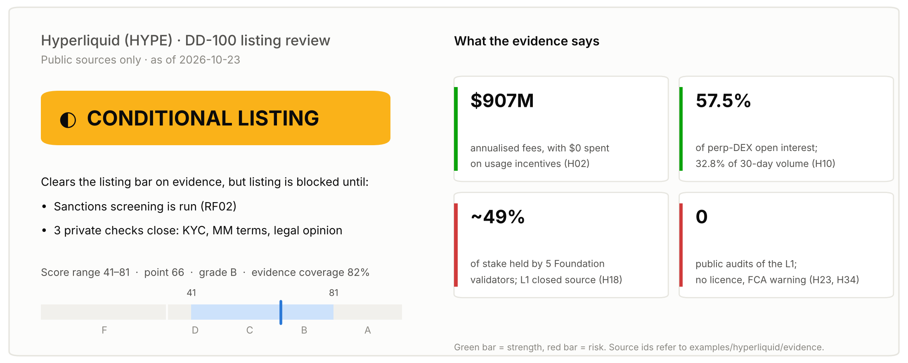
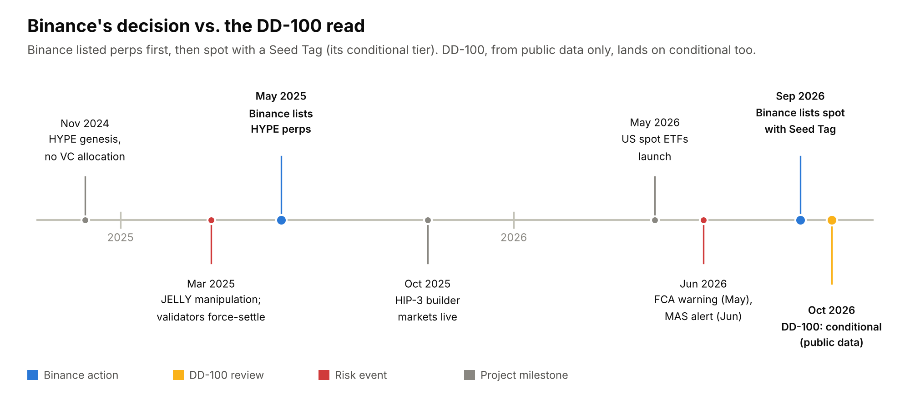
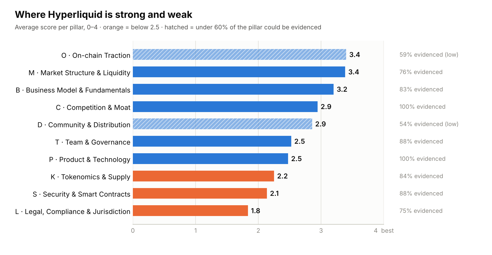
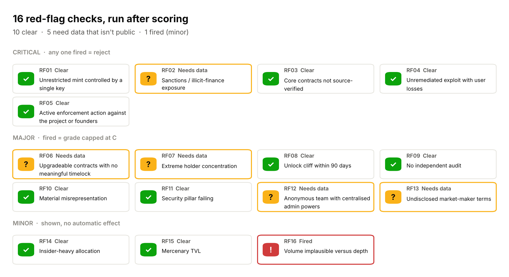
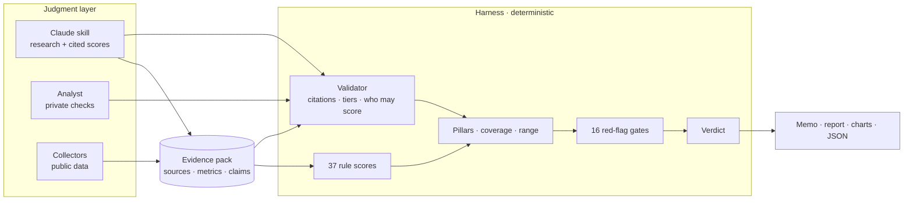

# DD-100 · Crypto Project Due-Diligence Harness

**100 dimensions. Evidence-gated scoring. Red flags that don't average out.**

DD-100 turns crypto project due diligence — for exchange listing reviews,
investment screens or research reports — into a repeatable, auditable
pipeline. A Claude **skill** does the research and makes cited judgments; a
deterministic **harness** verifies every judgment against its evidence,
computes the score, applies red-flag gates and writes the committee memo.



## Real case: Hyperliquid (HYPE)

Binance listed HYPE spot on 24 Sep 2026 with a **Seed Tag**, its conditional
tier. DD-100 used only 61 public sources and reached the same answer: list,
but only once specific checks are closed.



**The business is strong and the control is weak.** The project earns $907M in
annualised fees, spends nothing on usage incentives, and sends all revenue to
holders. But Foundation validators hold about 49% of stake, the L1 is closed
source with no public audit, and it holds no licence anywhere.



**No red flag fired that blocks a listing.** Five checks remain open because
the data isn't public. An exchange can close them internally, for example by
running sanctions screening and labelling top holders.



**The verification layer changed the answer.** On the first run, a major red
flag fired because a source had been misread. An independent fact-check went
back to the contract code and overturned it, and the verdict moved from
watchlist to conditional. The write-up, one-page memo and full 100-dimension
report are in **[examples/hyperliquid](examples/hyperliquid)**.

> Two **fictional** projects, Halcyon and Moonvault, ship alongside the real
> case. They exist to exercise every path through the harness: one clean
> conditional, and one hard reject.

---

## Why this exists

Most bad listings aren't caused by missing information. They come from five
recurring failures, and each one has a mechanism here:

| Failure | What DD-100 does |
|---|---|
| A fatal flaw gets averaged away by strong scores elsewhere | **16 red-flag gates** run after scoring. Critical → REJECT whatever the score. Major → grade capped at C. |
| The project's own numbers end up in the memo as facts | Project **claims are stored separately** and cross-checked against independent sources. Contradictions are counted and can fire a gate. |
| "73.4/100" hides how much was guessed | Every result carries **evidence coverage and a score range**; unscored and low-confidence dimensions widen it. |
| Two analysts, two standards | One framework, fixed anchors, sector profiles — the same 100 questions every time. |
| Fluent AI output nobody can trace | **No citation, no score.** Judgments citing missing evidence are rejected, high confidence on thin evidence is downgraded, and agents can't fill human-only checks. |

### The gate demo

Take Halcyon (grade B, 77.7) and change one on-chain fact — the token's mint
authority — from `renounced` to `eoa`:

```
Halcyon Finance (HLCN)  ·  🔴 REJECT  ·  grade B  ·  77.7/100 (range 61–90)  ·  coverage 97%
  🚩 RF01 [critical] Unrestricted mint controlled by a single key — fired
```

The average barely notices. The verdict does. That asymmetry is the point.

### The rejection example

[`examples/moonvault`](examples/moonvault) is a consumer token with an owner
mint, instant upgrades, 62% top-10 concentration, a 41% unlock cliff in 90
days and a deck claiming 8× its observed daily users. It also shows the
validator at work: an agent tried to score the human-only KYC dimension, and
another score cited a source that doesn't exist — both rejected and listed in
the report.

---

## The framework

10 pillars × 10 dimensions, each scored 0–4. Full list with anchors and
thresholds: **[docs/FRAMEWORK.md](docs/FRAMEWORK.md)**.

| Pillar | What it asks | Examples |
|---|---|---|
| **T** Team & Governance | Who is accountable, and are they aligned? | founder track record, KYC level, vesting, treasury transparency, disclosure honesty |
| **P** Product & Technology | Does it work, and is it real? | product maturity, originality vs fork, dependency risk, reproducible builds |
| **S** Security & Smart Contracts | Can users lose money to code or keys? | audit coverage & remediation, upgrade timelock, admin custody, mint/freeze powers |
| **K** Tokenomics & Supply | Who sells, when, and why hold? | value accrual, holder concentration, 12m unlocks, investor cost basis, FDV/mcap |
| **O** On-chain Traction | Is usage organic? | DAA trend, retention, sybil share, mercenary TVL, net capital flows |
| **M** Market Structure & Liquidity | Can the market absorb it honestly? | ±2% depth, venue concentration, wash-trading signals, MM terms |
| **B** Business Model | Does it make money without emissions? | protocol revenue, FDV/fees, incentives vs revenue, runway |
| **C** Competition & Moat | Why this, not a fork or an incumbent? | share trajectory, moat, forkability, relative valuation, venue fit |
| **D** Community & Distribution | Is attention real? | engagement authenticity, paid-promotion dependence, holder base |
| **L** Legal & Compliance | Can a regulated venue touch it? | securities risk, sanctions exposure, licensing, RWA custody & attestation |

**How dimensions get scored**

- **37 rule** dimensions are computed from metrics, with thresholds in YAML.
- **60 agent** dimensions are judged against 0/2/4 anchors and must cite evidence.
- **3 human** dimensions — founder KYC, market-maker terms, legal opinion — need a private channel and cannot be filled by an agent.

**Sector profiles** (`defi`, `l1_l2`, `rwa`, `infra`, `consumer`) re-weight the
pillars and mark dimensions that don't apply. An RWA issuer puts 18% on Legal;
an L1 puts 14% on Product & Technology.

---

## Skill + harness



The skill ([`skills/crypto-dd/SKILL.md`](skills/crypto-dd/SKILL.md)) tells
Claude how to research each pillar, how to tier sources, what manipulation
looks like in the data, and — just as important — what it must not do: score
without citing, fill human-only checks, or soften inputs to clear a gate.

The harness never asks a model for the score, the gates or the verdict. The
only model call is an optional node (`--llm`) that drafts judgment scores into
a reviewable YAML file, which then goes through the same validator as any
analyst's work.

---

## Quick start

```bash
git clone <this repo> && cd crypto-dd-100
pip install -e ".[dev]"

dd100 validate                                  # framework integrity
dd100 run examples/halcyon/manifest.yaml        # CONDITIONAL, grade B
dd100 run examples/moonvault/manifest.yaml      # REJECT, RF01 critical
dd100 run examples/hyperliquid/manifest.yaml    # real project: CONDITIONAL, grade B
pytest -q                                       # 31 tests
```

**Review a real project**

```bash
mkdir -p projects/myproject && cp examples/halcyon/manifest.yaml projects/myproject/
dd100 template projects/myproject               # blank sheet: every judgment dim + anchors
dd100 collect  projects/myproject/manifest.yaml # CoinGecko, DefiLlama, GitHub
# research → projects/myproject/evidence/research.json   (see skills/crypto-dd)
# judge    → projects/myproject/assessments/agent.yaml
dd100 run      projects/myproject/manifest.yaml [--llm]
```

`projects/` is git-ignored so NDA material never reaches the repo.

**With Claude Code**, open the repo and ask: *"Run a DD-100 review of
\<project\> for a listing decision."* The `crypto-dd` skill is wired in through
`.claude/skills/` and `CLAUDE.md`.

---

## Outputs

| File | For |
|---|---|
| `memo.md` | One page for decision-makers: verdict, key numbers, case for / against, gates, conditions |
| `report.md` | The full record: gates, pillar table, claims vs observation, strengths, risks, **open questions for the team**, verification audit, all 100 dimensions with evidence, source list |
| `radar.svg` | Pillar profile |
| `scorecard.json` | Everything, machine-readable, for pipelines and dashboards |

The *open questions* section is the bridge between diligence and BD: every
unscored or pending dimension becomes a specific question or data request for
the project team.

---

## Repository map

```
framework/dimensions.yaml   the 100 dimensions — the methodology lives here
framework/red_flags.yaml    16 gates
config/scoring.yaml         weights, profiles, confidence radii, grade bands
dd100/                      harness (no thresholds in code)
skills/crypto-dd/           Claude skill + research playbook + red-flag patterns
examples/                   Hyperliquid (real, public data) + two fictional projects, with reports
docs/                       METHODOLOGY · ARCHITECTURE · FRAMEWORK
tests/                      31 tests incl. end-to-end verdicts
```

## Limitations and next steps

- **Thresholds are judgment-calibrated, not back-tested.** The next step is
  fitting the bands against historical listings and their 6/12-month outcomes
  (liquidity retention, drawdown vs sector, delisting).
- **Free collectors only.** Depth, wallet screening and entity labels need paid
  data; the collector interface is ready for them (see ARCHITECTURE.md).
- **Snapshot, not monitor.** Post-listing surveillance = scheduled re-runs with
  alerts on new gates or grade changes.

DD-100 is decision support for a committee, not investment advice.

## Author

Built by **Tom Huang** ([@tomvitalbridge-commits](https://github.com/tomvitalbridge-commits)): investment director at Fenbushi Capital (2017–2020), founding
partner of BKFUND (since 2018), COO on the founding team of CNHC, an
offshore-RMB stablecoin (2020–2024), and head of a crypto fund at Vitalbridge
(2023–2024). The framework encodes the questions I've learned to ask the hard way.

MIT licensed.
