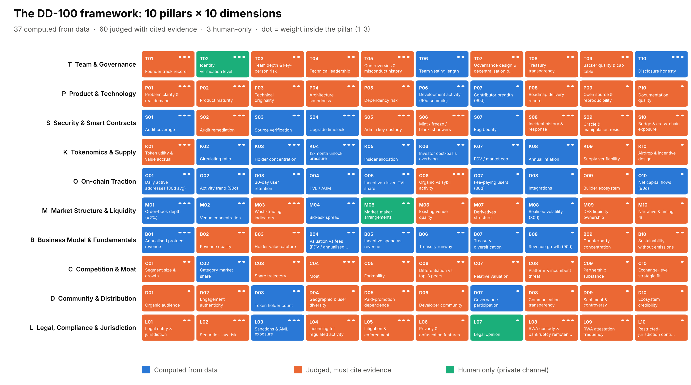

# DD-100 · 加密项目尽职调查引擎

**100 个维度，证据门控打分，红旗不会被平均掉。**

DD-100 把加密项目的尽调（交易所上币评审、投资筛选、研究报告）做成一条可复现、可审计的流水线：Claude Skill 负责研究和带引用的判断，确定性的 harness 负责核验每一条判断的证据、计算分数、执行红旗闸门，最后输出给决策委员会的备忘录。

## 框架

10 大支柱 × 10 个维度，每项打 0–4 分。10 大支柱分别是：团队治理、产品技术、安全合约、代币经济、链上数据、市场结构、商业模式、竞争壁垒、社区分发、法律合规。

打分方式分三类：37 项由规则直接从数据算出来；60 项由 agent 或分析师按锚点判断，必须引用证据；3 项只能人工完成，分别是 KYC、做市协议和法律意见书。完整清单见 [docs/FRAMEWORK.md](docs/FRAMEWORK.md)。



## 红旗不会被平均掉

大部分糟糕的上币决策不是因为信息不够，而是犯了下面五种老毛病，每一种都有对应的机制：

1. **致命缺陷被平均掉**：团队强、叙事热，盖过了一个能无限增发的私钥。→ 16 个红旗闸门在打分之后执行：critical 级直接拒绝，major 级封顶 C 级。
2. **项目方自报的数据直接写进了备忘录**。→ 项目方的说法单独存为 claims，再和独立来源交叉核对，对不上的会被计数，可以触发闸门。
3. **"73.4 分"这种数字，看不出有多少是猜的**。→ 每个结果都带证据覆盖率和分数区间。
4. **两个分析师，两套标准**。→ 同一套框架、固定锚点、按赛道配置权重。
5. **AI 写得很流畅，但查不到出处**。→ 没有引用就不计分；引用了不存在的证据直接拒绝；只有单一自报来源却标"高置信"的，自动降级；必须人工完成的三项，agent 不能填。

## 实战案例：Hyperliquid（HYPE）

为了在真实决策上检验这套框架，我们复盘了币安刚上线的一个代币。币安 2026 年 9 月 24 日上了 HYPE 现货，带种子标签，这相当于"有条件上币"。我们只用了 61 个公开来源，得出的结论也是"有条件通过"。


这个项目的业务很强：年化手续费约 9 亿美元，没有任何激励补贴，收入全部归持币人，主要通过链上回购。短板在三处：控制权，基金会验证人掌握约 49% 的质押；安全审计，主链不开源，也没有公开审计；牌照，英国 FCA 发过警示。


过程中还纠正过一次错误。第一次跑的时候，一条重大红旗被触发了，依据是一条被误读的来源。独立核查回到合约代码本身，证明那条说法不成立，结论也跟着改了。这正好说明核验层在起作用。完整复盘见 [examples/hyperliquid](examples/hyperliquid)。

另外两个示例 Halcyon 和 Moonvault 是虚构项目，数据是编的，专门用来把每条流程都跑一遍。

## 快速开始

```bash
pip install -e ".[dev]"
dd100 validate
dd100 run examples/hyperliquid/manifest.yaml # 真实项目：有条件通过
dd100 run examples/halcyon/manifest.yaml     # 虚构：有条件通过
dd100 run examples/moonvault/manifest.yaml   # 虚构：拒绝，触发 RF01
pytest -q
```

方法论见 [docs/METHODOLOGY.md](docs/METHODOLOGY.md)，架构见 [docs/ARCHITECTURE.md](docs/ARCHITECTURE.md)。
