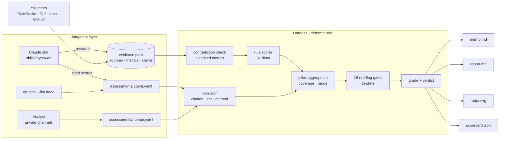

# Architecture



## Modules

| Path | Responsibility |
|---|---|
| `framework/dimensions.yaml` | The 100 dimensions: question, method, weight, anchors or rule bands |
| `framework/red_flags.yaml` | Gates: severity, condition, reason |
| `config/scoring.yaml` | Confidence radii, verification thresholds, grades, sector profiles, LLM model |
| `dd100/framework.py` | Loads and validates the above — fails loudly on any inconsistency |
| `dd100/evidence.py` | Loads/merges evidence packs, refuses silent metric conflicts, finds contradictions, derives metrics |
| `dd100/evaluators/rules.py` | Maps metrics to scores using the YAML bands |
| `dd100/evaluators/assessments.py` | The verification gate for judgment scores |
| `dd100/evaluators/llm.py` | Optional model node; output goes through the same validator |
| `dd100/gates.py` | Tri-state gate evaluation |
| `dd100/scorer.py` | Pillars, coverage, range, grade, verdict |
| `dd100/report.py` | Markdown report, one-page memo, radar SVG, JSON scorecard |
| `dd100/collectors/` | Public-data fetchers; never score anything |

## Extending

**A new data source.** Add a function decorated with `@collector("<manifest key>")`
in `dd100/collectors/__init__.py` returning `{"sources": [...], "metrics": {...}}`.
Natural next ones for an exchange setting, all keyed:

- block explorer APIs → `contracts_verified`, `upgrade_timelock_hours`, `mint_authority`
- order-book data vendor → `depth_2pct_usd`, `spread_bps`, `top_venue_volume_share_pct`
- wallet-screening provider → `sanctions_exposure`
- entity-labelling provider → `top10_holder_pct_ex_contracts`
- the exchange's own internal data (deposit/withdrawal flows, user geography) → D04, M03

**A new dimension.** Replace one of the existing ten in its pillar (the
framework enforces 10 × 10), add rule bands or anchors, run `pytest` and
regenerate the metrics catalog.

**A new gate.** Add it to `red_flags.yaml`. Conditions can reference metrics,
dimension scores or pillar scores.

**A new sector profile.** Add pillar weights summing to 100 and the N/A list.

## Fitting into a listing workflow

```
sourcing ──► screening ──► full DD ──► committee ──► post-listing monitoring
              dd100 run      skill +      memo.md      scheduled re-run,
              on auto data   analyst      + report     alert on new gates
              only (fast     (days)                    or grade changes
              triage)
```

Screening with only collector data typically yields INSUFFICIENT_DATA plus a
list of fired or unchecked gates — that is the point: a fast "no" or "worth a
closer look" before anyone spends days on it.
