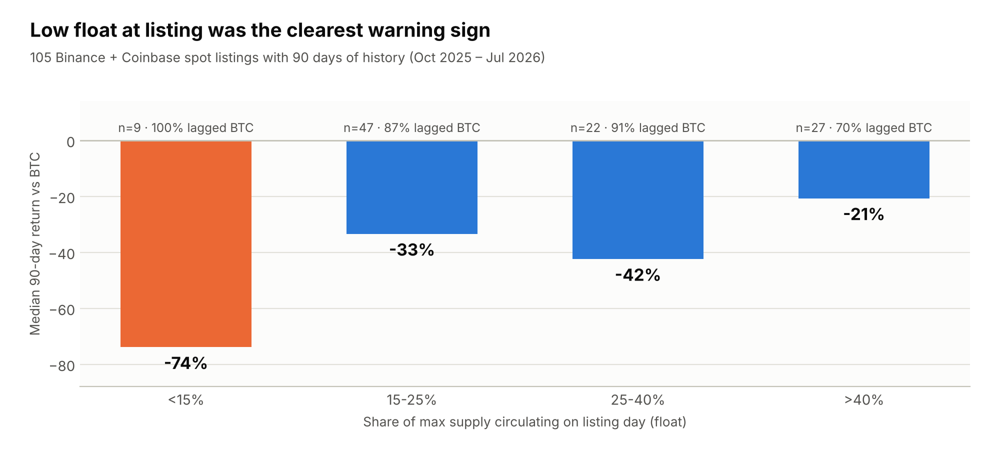
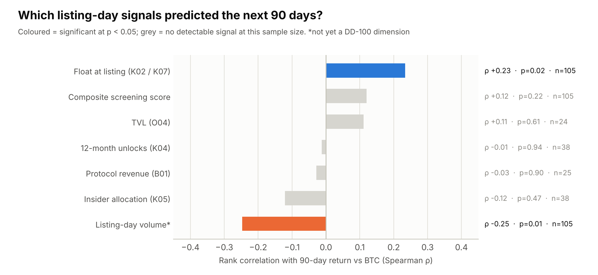
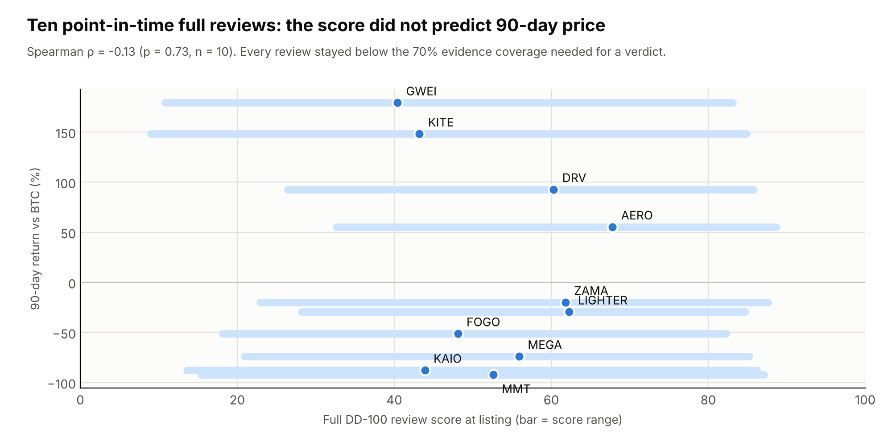

# Backtest: one year of Binance and Coinbase listings

**Question.** If DD-100 had screened every token Binance and Coinbase listed
for spot trading in the last 12 months, using only data available on the day
of listing, would its score have told you anything about what happened next?

**Short answer.** The base rate is brutal: **85% of new listings lagged BTC
over the following 90 days**, with a median 34 points of underperformance. The
composite screening score, built from free public data, carried only a weak
signal that was not statistically significant. One input inside it did
predict returns: **float at listing**, meaning the share of total supply
actually circulating. A second signal that is not yet in the framework also
did: **listing-day trading volume**. Unlock schedules, insider share, revenue
and TVL showed no detectable signal at this sample size.



## Sample

| | |
|---|---|
| Window | Listings from 23 Oct 2025 to 21 Oct 2026; prices through 23 Oct 2026 |
| Events | **120**: 29 Binance spot listings, 91 Coinbase USD listings |
| With 90 days of history | 105 events, 89 unique tokens (16 tokens listed on both exchanges) |
| Outcome | Token return ÷ BTC return − 1, from the listing-day close, measured on the same exchange's daily candles |
| Excluded | Stablecoins, tokenised stocks, gold tokens |

How the listings were identified:

- **Binance**: from its *New Cryptocurrency Listing* announcements (spot
  listings, HODLer Airdrops, Launchpool). Each listing date was confirmed by
  the token's first daily candle.
- **Coinbase**: every USD product whose first daily candle falls inside the
  window.

Each token was matched to CoinGecko, and the match was accepted only if
CoinGecko's price was within 25% of the exchange's own last close. All 120
passed.

## What the screening could see

On listing day, free public data could fill only a handful of the 37
rule-based dimensions:

| Dimension | Metric | Events covered |
|---|---|---:|
| K02 Circulating ratio | supply at listing ÷ max supply | 119 |
| K07 FDV / market cap | the reciprocal of K02 | 119 |
| K04 12-month unlock pressure | DefiLlama documented unlock schedule | 42 |
| K05 Insider allocation | DefiLlama schedule categories | 42 |
| O04 TVL | DefiLlama, last point before listing | 23 |
| B01 Protocol revenue | DefiLlama, 30 days before listing, annualised | 27 |
| B04 FDV / fees | derived | 30 |
| B08 Revenue growth | DefiLlama, quarter on quarter | 20 |

The median event had **2 scored dimensions out of 100**. Every event
therefore came out `INSUFFICIENT_DATA` as a verdict, which is the harness
working as designed. The backtest uses the point score: the same framework,
weights and thresholds as everywhere else in this repo, with **no tuning to
this sample**.

## Results



| Signal (rank correlation with 90-day return vs BTC) | Events (n=105) | Unique tokens (n=89) |
|---|---|---|
| Composite screening score | ρ +0.12, p=0.22 | ρ +0.15, p=0.15 |
| Float at listing (K02; K07 is the same signal inverted) | **ρ +0.23, p=0.02** | **ρ +0.26, p=0.01** |
| Listing-day volume (not a DD-100 dimension) | **ρ −0.25, p=0.01** | **ρ −0.30, p<0.01** |
| 12-month unlocks, insider share, revenue, TVL | \|ρ\| ≤ 0.12, n=24–38, not significant | |

**Float.** Every one of the 9 tokens that listed with under 15% of supply
circulating lagged BTC, by a median of 74%. Tokens with more than 40% float
lagged by a median of 21%, and 30% of them beat BTC. The effect is stronger
(ρ +0.42, p<0.01, n=38) in the cleanest subset, where supply at listing comes
from the documented unlock schedule rather than today's circulating figure.
It holds in the same direction on both exchanges.

**Listing-day volume.** The tokens that traded most on day one did worst
afterwards. The median 90-day return vs BTC was −20% for the lowest-volume
third and −49% / −40% for the middle and top thirds. Within Coinbase alone,
ρ = −0.35 (p<0.01). One plausible reading is that heavy day-one volume is
airdrop and points-farming supply leaving. That makes it a candidate new
dimension, but this sample only shows correlation.

**Composite score.** Splitting the score into thirds gave medians of −33%,
−46% and −26%, which is not monotonic. With two dimensions doing almost all
the work, the composite mostly re-expresses float, diluted by noise from
sparsely covered metrics.

## What this means for DD-100

1. **The screening layer is not enough on its own.** Two metrics on listing
   day cannot separate good listings from bad ones well. This argues for the
   full review: the judgment and human-only dimensions are where the
   information is, and they are what a listing team adds.
2. **Float deserves more weight at screening time.** A fair change would be a
   red-flag gate for float under 15% at listing (9 of 9 lagged BTC). It is
   **not applied here**, because changing thresholds on the same sample that
   motivated them would overfit. The proper test is the next 12 months of
   listings.
3. **Add a hype dimension.** Listing-day volume relative to float or market
   cap is cheap to measure and carried signal here.
4. **Unlocks need better data, not a different weight.** DefiLlama documents
   schedules for only about a third of new tokens. The null result for K04/K05
   says more about coverage (n=38) than about whether unlocks matter.

## Caveats

- **Small sample, one regime.** 105 events in a year when BTC fell from about
  $110k to below $60k and ended near $82k. Nothing here has been tested out of sample.
- **Look-ahead in supply.** For 77 of 120 events, no documented schedule
  existed, so "supply at listing" uses CoinGecko's *current* circulating
  supply. Supply only grows, so this overstates float at listing for those
  tokens. The schedule-only subset, which has no look-ahead, shows a stronger
  float effect, not a weaker one.
- **Listing date ≠ token launch.** Some Coinbase listings were mature tokens
  (TON, RAY, HYPE, VIRTUAL). Others were day-one launches. The two are pooled.
- **Exchange volume is not comparable across venues.** Binance day-one volume
  is roughly 40× Coinbase's (median), so the volume signal should be read within each
  exchange.
- **Survivorship.** Coinbase products delisted before 23 Oct 2026 that were
  also listed inside the window would be missing. None were found.
- **Correlation, not a trading strategy.** Returns are close-to-close on
  daily candles, before fees and slippage.

## Full reviews (n=10)

The screening layer fills about 2 dimensions on listing day. The obvious
objection is "of course it doesn't predict, it barely looked". So ten tokens
from the sample got a **full DD-100 review as of their listing day**: the
same Skill and harness used for Hyperliquid, with research limited to what
was published before that date. The reviewer was not told how the token
performed. Each review is in
[`reviews/listings-2025-26/`](../reviews/listings-2025-26/).

The ten were picked to cover both exchanges and the full outcome range, from
the worst performers to the best, with a mix of DeFi, L1/L2 and
infrastructure tokens.



| Token | Listed | Score (range) | Grade | Coverage | Gates fired | 90d vs BTC | To 23 Oct 2026 |
|---|---|---|---|---:|---|---:|---:|
| MMT | Binance 2025-11-04 | 52.6 (15–87) | C | 51% | – | -92% | -93% |
| KAIO | Coinbase 2026-05-06 | 43.9 (14–86) | D | 47% | – | -88% | -85% |
| MEGA | Binance 2026-04-30 | 55.9 (21–85) | C | 56% | – | -74% | -75% |
| FOGO | Binance 2026-01-15 | 48.1 (18–82) | D | 54% | RF09,RF14 | -51% | -90% |
| LIGHTER | Coinbase 2026-01-15 | 62.3 (28–85) | C | 61% | RF06 | -29% | +115% |
| ZAMA | Binance 2026-02-02 | 61.8 (23–88) | C | 50% | – | -20% | +104% |
| AERO | Binance 2026-07-17 | 67.8 (33–89) | B | 65% | – | +55% | +31% |
| DRV | Coinbase 2026-05-28 | 60.3 (26–86) | C | 62% | – | +93% | +332% |
| KITE | Binance 2025-11-03 | 43.2 (9–85) | D | 39% | – | +148% | +102% |
| GWEI | Coinbase 2026-02-24 | 40.4 (11–83) | D | 46% | RF09,RF11,RF14 | +179% | -50% |

**Result: the full score did not predict 90-day price.** Rank correlation
with 90-day return vs BTC was **ρ −0.13 (p=0.73)**. Against the return to
23 Oct 2026 it was ρ +0.45 (p=0.19). Neither is significant at n=10.

What the reviews did get right:

- **The four worst performers were all marked down on supply and
  incentive risks.** MMT: a mint path with no disclosed cap, 20% float, and
  more than half of peak TVL gone within six days of a points campaign
  ending. KAIO: 6.8% float, with 12-month unlocks equal to 85% of
  circulating supply. MEGA: float not published (only "under 10%"), and a
  launch KPI that was easy to farm. FOGO: no audit of its own client (RF09)
  and 62% of supply with insiders (RF14). None scored above C.
- **Coverage was the binding constraint, not the score.** Every review ended
  `INSUFFICIENT_DATA` (coverage 39–65%). Sanctions screening (RF02) could not
  be checked for any of them from public sources, and mint authority (RF01)
  stayed unchecked for half. A listing desk would close these through the
  project; a public-data reviewer cannot.

What they got wrong:

- **KITE and GWEI scored D and were the two best performers** (+148% and
  +179% vs BTC at 90 days). They carried the same kind of risk as
  MMT and KAIO: KITE listed at 18% float with no mainnet and an undisclosed
  pause key; GWEI at 17.5% float, 59% insiders, 12-month unlocks of 73% and
  no full audit (RF09, RF11, RF14 fired). The reviews saw the risk but not
  which way it would break.

**How to read this.** A listing framework measures whether a token is safe
and well built enough for a venue to put in front of users. It is not a
price model, and these results say so plainly: quality and 90-day price
were unrelated in this sample, and the first 90 days of a new listing are
dominated by float, unlocks and market regime. That is consistent with the
screening result, where float carried the only reliable signal. The useful
output of a full review is the list of open gates and the questions for the
team, not the number.

### Leakage and limits

Point-in-time research from today is never fully blind. What was checked:

- Every source in every evidence pack carries a publication date, and the
  harness reports the `as_of` date. After the reviews, an independent agent
  re-checked 24 load-bearing claims across the ten packs for accuracy and
  for sources dated after `as_of`.
- Where the reviewer saw later information while searching, it is disclosed
  in that review's notes: MEGA (post-listing price fall seen in search
  results, not used), DRV (an October all-time high seen, not used), MMT
  (post-listing TVL data seen, excluded), FOGO (a later headline seen, not
  used), KITE (a later contract migration seen, not used), AERO (Q3 figures
  seen, excluded).
- Search snippets that mention later events can still shape judgment in ways
  a reviewer cannot fully separate. This is a real limitation of retroactive
  reviews; the clean test is to review new listings before the outcome
  exists.
- Block explorers were not reachable from the research environment, so
  several on-chain checks (holder concentration, admin keys) are unscored
  rather than verified.
- n=10 has very little statistical power. A correlation of ±0.6 would be
  needed for significance.

## Reproduce

```bash
python scripts/backtest.py data/backtest/features.csv   # scores, summary.json, charts
python scripts/full_reviews.py                           # full-review table and chart
```

- `data/backtest/features.csv`: one row per listing event, every input metric.
- `data/backtest/results.csv`: adds the screening score, the dimension scores,
  fired gates and outcomes.
- `data/backtest/summary.json`: every number quoted on this page.
- `scripts/collect_listings.js`: how the features were collected (public,
  keyless APIs: Binance, Coinbase, CoinGecko, DefiLlama).
