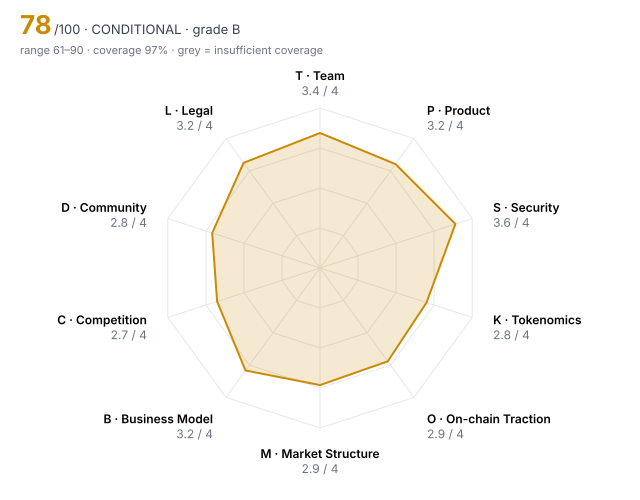

# Halcyon Finance (HLCN) — DD-100 Due-Diligence Report

> **🟡 CONDITIONAL** · Grade **B** · Score **77.7/100** (range 61–90) · Evidence coverage **97%**  
> Profile `defi` · Evidence as of 2026-10-20 · 100 dimensions · 23 sources

The range is the honest number: it shows where the score could land once unscored dimensions are filled and low-confidence judgments are firmed up.

## Why this verdict

- grade B meets the listing bar on score; listing is blocked until:
- human-only checks outstanding: M05 Market-maker arrangements

## Red-flag gates

| Gate | Severity | Status | What it means |
|---|---|---|---|
| RF13 Undisclosed market-maker terms | major | ❔ unchecked | Token loans and call options are where post-listing dumps are engineered. |

15 of 16 gates verified clear.

## Pillar scores

| Pillar | Weight | Score /4 | | Coverage | Scored |
|---|---:|---:|---|---:|---:|
| T · Team & Governance | 12 | 3.38 | `████████░░` | 100% | 10/10 |
| P · Product & Technology | 10 | 3.21 | `████████░░` | 100% | 10/10 |
| S · Security & Smart Contracts | 14 | 3.56 | `█████████░` | 100% | 10/10 |
| K · Tokenomics & Supply | 14 | 2.80 | `███████░░░` | 95% | 9/10 |
| O · On-chain Traction | 10 | 2.88 | `███████░░░` | 100% | 10/10 |
| M · Market Structure & Liquidity | 8 | 2.93 | `███████░░░` | 82% | 8/10 |
| B · Business Model & Fundamentals | 10 | 3.17 | `████████░░` | 100% | 10/10 |
| C · Competition & Moat | 8 | 2.71 | `███████░░░` | 94% | 9/10 |
| D · Community & Distribution | 5 | 2.83 | `███████░░░` | 92% | 9/10 |
| L · Legal, Compliance & Jurisdiction | 9 | 3.25 | `████████░░` | 100% | 8/8 |

⚠️ = coverage below the pillar minimum; treat that pillar's score as indicative.

## Claims vs. observation

| Claim | Claimed | Observed | Gap | Sources |
|---|---:|---:|---:|---|
| Website: "40,000+ daily active users" | 40,000 | 21,400 | 87% | E23 vs E03 |

## Strengths

- **T01 Founder track record** (4/4) — CEO ran risk at a top-10 lending protocol; CTO an ex-core L2 client contributor; both verifiable from prior public work.
- **T02 Identity verification level** (4/4) — All four founders KYC'd to the reviewer; two have public professional histories, two are public under real names.
- **P02 Product maturity** (4/4) — Mainnet since March 2024 (31 months) on two chains with v2 in production.
- **S01 Audit coverage** (4/4) — audits_reputable_count = 3  (bands 4:≥3, 3:≥2, 2:≥1, 1:≥0.5)
- **S02 Audit remediation** (4/4) — All highs fixed and re-verified; one acknowledged medium (curator-configurable TWAP window); deployed code matches audited tag.
- **S06 Mint / freeze / blacklist powers** (4/4) — Fixed 1B supply; MINTER_ROLE renounced on-chain; no freeze or blacklist functions.

## Risks

- **T10 Disclosure honesty** (2/4) — contradiction_count = 1  (bands 4:≤0, 3:≤0.5, 2:≤1, 1:≤2)
- **K04 12-month unlock pressure** (2/4) — unlock_12m_pct_of_circ = 38  (bands 4:≤10, 3:≤25, 2:≤50, 1:≤100)
- **C04 Moat** (2/4) — Moat is curator network and integrations; real but early, not yet tested by a well-funded incentive war.
- **L02 Securities-law risk** (2/4) — Favourable in SG/EU; moderate US risk because the fee share depends on the team's ongoing efforts.
- **K05 Insider allocation** (2/4) — insider_allocation_pct = 38  (bands 4:≤25, 3:≤35, 2:≤45, 1:≤55)
- **C02 Category market share** (2/4) — category_share_pct = 7.5  (bands 4:≥30, 3:≥15, 2:≥5, 1:≥1)

## Open questions for the project team

Everything below is unscored. Each one is a question to put to the team or a data request, not a negative finding.

**Needs a private channel (call, data room, counsel)** (1)

- M05 Market-maker arrangements: Are MM agreements (loans, call options, KPIs) disclosed to the reviewer and reasonable? — _Team agreed to share MM agreements under NDA (call 2026-10-15); not yet received._

**Needs evidence** (4)

- K10 Airdrop & incentive design: Do incentive programmes reward real users and resist sybil farming? — _need claim-level data from the 2025 airdrop to test post-claim retention_
- M07 Derivatives structure: Do perp open interest and funding indicate healthy two-way markets or crowded positioning? — _perp OI/funding not yet pulled_
- C08 Platform & incumbent threat: Could an L1, wallet, CEX or major protocol absorb this as a native feature? — _check whether major CEX/L1 lending products overlap with long-tail markets_
- D04 Geographic & user diversity: Is the user base spread across regions, or concentrated where the venue cannot serve it? — _need geographic split of users; ask team for front-end analytics_

## Verification audit

Confidence the harness lowered because the cited evidence did not meet the bar:

- C03: confidence downgraded high→medium: single non-primary source

## Appendix A — all 100 dimensions

### T · Team & Governance

| ID | Dimension | Method | W | Score | Conf. | Evidence | Basis |
|---|---|---|---:|---:|---|---|---|
| T01 | Founder track record | agent | 3 | **4** | high | E13, E21 | CEO ran risk at a top-10 lending protocol; CTO an ex-core L2 client contributor; both verifiable from prior public work. |
| T02 | Identity verification level | human | 3 | **4** | high | E14, E13 | All four founders KYC'd to the reviewer; two have public professional histories, two are public under real names. |
| T03 | Team depth & key-person risk | agent | 2 | **3** | medium | E13, E11 | 23 FTE with 2 dedicated security engineers; liquidation-engine design still concentrated in the CTO with a shadow in place. |
| T04 | Technical leadership | agent | 2 | **4** | high | E11, E07 | In-house team wrote the formally verified solvency invariants and maintains reproducible builds. |
| T05 | Controversies & misconduct history | agent | 3 | **3** | medium | E17 | No enforcement or litigation; one 2025 front-running allegation reviewed by an independent delegate with no on-chain support. |
| T06 | Team vesting length | rule | 2 | **4** | low | E02 | team_vesting_months = 48  (bands 4:≥48, 3:≥36, 2:≥24, 1:≥12) |
| T07 | Governance design & decentralisation path | agent | 2 | **3** | high | E12, E04 | Binding Governor with quorum and 2-day timelock; vote power concentrated (top 3 voters 41%, two team-adjacent). |
| T08 | Treasury transparency | agent | 2 | **4** | medium | E15 | Quarterly treasury reports with published addresses that reconcile to on-chain balances. |
| T09 | Backer quality & cap table | agent | 2 | **3** | medium | E21 | Established funds led both rounds and supported the team through the 2025 drawdown; no strategic exchange or ecosystem backer. |
| T10 | Disclosure honesty | rule | 3 | **2** | high | HARNESS | contradiction_count = 1  (bands 4:≤0, 3:≤0.5, 2:≤1, 1:≤2) |

### P · Product & Technology

| ID | Dimension | Method | W | Score | Conf. | Evidence | Basis |
|---|---|---|---:|---:|---|---|---|
| P01 | Problem clarity & real demand | agent | 3 | **3** | high | E03, E08 | Isolated markets serve long-tail collateral that pooled lenders reject; 27% 30-day retention and growing fees without proportional incentives. |
| P02 | Product maturity | agent | 3 | **4** | high | E01, E04 | Mainnet since March 2024 (31 months) on two chains with v2 in production. |
| P03 | Technical originality | agent | 2 | **3** | medium | E01, E11 | Original curator-based isolated-market design with Dutch-auction liquidations; builds on known patterns rather than new research. |
| P04 | Architecture soundness | agent | 2 | **3** | high | E05, E07 | Formally verified solvency invariants; per-market isolation limits contagion. Curator-set parameters remain a design-level risk. |
| P05 | Dependency risk | agent | 2 | **3** | high | E01, E06 | Chainlink primary with TWAP fallback and deviation breaker; dependent on Arbitrum sequencer for the L2 deployment. |
| P06 | Development activity (90d commits) | rule | 2 | **3** | high | E11 | github_commits_90d = 210  (bands 4:≥300, 3:≥150, 2:≥60, 1:≥15) |
| P07 | Contributor breadth (90d) | rule | 1 | **3** | high | E11 | github_active_contributors_90d = 14  (bands 4:≥25, 3:≥12, 2:≥6, 1:≥3) |
| P08 | Roadmap delivery record | agent | 2 | **3** | medium | E01, E11 | v2 and fee switch shipped, both about one quarter late; cross-chain markets still on the roadmap. |
| P09 | Open source & reproducibility | agent | 1 | **4** | high | E11, E04 | Contracts, bots and subgraph open source; tagged release reproduces deployed bytecode. |
| P10 | Documentation quality | agent | 1 | **3** | medium | E01 | Solid integration and risk docs; no published threat model. |

### S · Security & Smart Contracts

| ID | Dimension | Method | W | Score | Conf. | Evidence | Basis |
|---|---|---|---:|---:|---|---|---|
| S01 | Audit coverage | rule | 3 | **4** | high | E05 | audits_reputable_count = 3  (bands 4:≥3, 3:≥2, 2:≥1, 1:≥0.5) |
| S02 | Audit remediation | agent | 3 | **4** | high | E05, E06, E11 | All highs fixed and re-verified; one acknowledged medium (curator-configurable TWAP window); deployed code matches audited tag. |
| S03 | Source verification | rule | 2 | **4** | high | E04 | contracts_verified = true |
| S04 | Upgrade timelock | rule | 3 | **3** | high | E04 | upgrade_timelock_hours = 48  (bands 4:≥72, 3:≥48, 2:≥24, 1:≥6) |
| S05 | Admin key custody | agent | 3 | **3** | high | E04, E13 | Upgrades go through a 5-of-8 Safe and 48h timelock; 3 of 8 signers are independent of the team. |
| S06 | Mint / freeze / blacklist powers | agent | 3 | **4** | high | E04, E02 | Fixed 1B supply; MINTER_ROLE renounced on-chain; no freeze or blacklist functions. |
| S07 | Bug bounty | rule | 1 | **3** | low | E18 | bug_bounty_max_usd = 500,000  (bands 4:≥1e+06, 3:≥250,000, 2:≥50,000, 1:≥10,000) |
| S08 | Incident history & response | agent | 3 | **4** | medium | E17, E18 | No exploits found; bounty programme has paid three medium reports. |
| S09 | Oracle & manipulation resistance | agent | 2 | **3** | high | E01, E06 | Primary oracle plus TWAP fallback and 5% breaker; curators can shorten TWAP windows on thin markets. |
| S10 | Bridge & cross-chain exposure | agent | 2 | **3** | medium | E01, E04 | Native deployments on both chains; some Arbitrum markets accept bridged collateral. |

### K · Tokenomics & Supply

| ID | Dimension | Method | W | Score | Conf. | Evidence | Basis |
|---|---|---|---:|---:|---|---|---|
| K01 | Token utility & value accrual | agent | 3 | **3** | high | E01, E15 | Fee switch live since 2025-09 sends 35% of interest spread to stakers; value accrual is direct but requires staking. |
| K02 | Circulating ratio | rule | 2 | **3** | high | HARNESS | circulating_supply_pct = 43  (bands 4:≥60, 3:≥40, 2:≥25, 1:≥15) |
| K03 | Holder concentration | rule | 3 | **3** | high | E03 | top10_holder_pct_ex_contracts = 22.4  (bands 4:≤15, 3:≤25, 2:≤40, 1:≤60) |
| K04 | 12-month unlock pressure | rule | 3 | **2** | low | E02 | unlock_12m_pct_of_circ = 38  (bands 4:≤10, 3:≤25, 2:≤50, 1:≤100) |
| K05 | Insider allocation | rule | 2 | **2** | low | E02 | insider_allocation_pct = 38  (bands 4:≤25, 3:≤35, 2:≤45, 1:≤55) |
| K06 | Investor cost-basis overhang | rule | 2 | **3** | low | E21 | price_to_last_round_multiple = 4.2  (bands 4:≤3, 3:≤10, 2:≤30, 1:≤100) |
| K07 | FDV / market cap | rule | 2 | **3** | high | HARNESS | fdv_to_mcap = 2.33  (bands 4:≤1.5, 3:≤2.5, 2:≤4, 1:≤7) |
| K08 | Annual inflation | rule | 2 | **3** | low | E02 | annual_inflation_pct = 4  (bands 4:≤2, 3:≤5, 2:≤10, 1:≤20) |
| K09 | Supply verifiability | agent | 1 | **4** | high | E02, E03 | All allocations in public vesting contracts; reviewer query reconciles circulating supply. |
| K10 | Airdrop & incentive design | agent | 1 | – |  |  | need claim-level data from the 2025 airdrop to test post-claim retention |

### O · On-chain Traction

| ID | Dimension | Method | W | Score | Conf. | Evidence | Basis |
|---|---|---|---:|---:|---|---|---|
| O01 | Daily active addresses (30d avg) | rule | 2 | **3** | high | E03 | daa_30d_avg = 21,400  (bands 4:≥50,000, 3:≥10,000, 2:≥2,000, 1:≥300) |
| O02 | Activity trend (90d) | rule | 2 | **3** | high | E03 | daa_90d_change_pct = 18  (bands 4:≥50, 3:≥10, 2:≥-10, 1:≥-40) |
| O03 | 30-day user retention | rule | 2 | **3** | high | E03 | retention_30d_pct = 27  (bands 4:≥40, 3:≥25, 2:≥15, 1:≥8) |
| O04 | TVL / AUM | rule | 2 | **3** | medium | E08 | tvl_usd = 640,000,000  (bands 4:≥1e+09, 3:≥2e+08, 2:≥5e+07, 1:≥1e+07) |
| O05 | Incentive-driven TVL share | rule | 2 | **3** | medium | E08 | incentivised_tvl_share_pct = 22  (bands 4:≤10, 3:≤25, 2:≤50, 1:≤75) |
| O06 | Organic vs sybil activity | agent | 3 | **3** | medium | E03 | Activity persisted after the Q2 points campaign ended; ~12% of addresses cluster to common funders. |
| O07 | Fee-paying users (30d) | rule | 1 | **2** | high | E03 | fee_paying_users_30d = 17,800  (bands 4:≥100,000, 3:≥20,000, 2:≥5,000, 1:≥1,000) |
| O08 | Integrations | rule | 1 | **3** | low | E01 | live_integrations_count = 34  (bands 4:≥50, 3:≥20, 2:≥8, 1:≥3) |
| O09 | Builder ecosystem | agent | 1 | **2** | medium | E11, E01 | Around ten third-party curators and two vault builders, mostly grant-funded. |
| O10 | Net capital flows (90d) | rule | 1 | **3** | high | E03 | net_inflow_90d_usd = 45,000,000  (bands 4:≥1e+08, 3:≥2e+07, 2:≥0, 1:≥-2e+07) |

### M · Market Structure & Liquidity

| ID | Dimension | Method | W | Score | Conf. | Evidence | Basis |
|---|---|---|---:|---:|---|---|---|
| M01 | Order-book depth (±2%) | rule | 3 | **3** | medium | E10 | depth_2pct_usd = 820,000  (bands 4:≥2e+06, 3:≥500,000, 2:≥150,000, 1:≥50,000) |
| M02 | Venue concentration | rule | 2 | **3** | medium | E10 | top_venue_volume_share_pct = 38  (bands 4:≤30, 3:≤45, 2:≤60, 1:≤80) |
| M03 | Wash-trading indicators | agent | 3 | **3** | medium | E10 | Volume/depth 17x, inside the 12–25x range of lending-token peers; no round-lot anomalies. |
| M04 | Bid-ask spread | rule | 2 | **3** | medium | E10 | spread_bps = 9  (bands 4:≤5, 3:≤15, 2:≤40, 1:≤100) |
| M05 | Market-maker arrangements | human | 2 | ⏳ |  |  | Team agreed to share MM agreements under NDA (call 2026-10-15); not yet received. |
| M06 | Existing venue quality | agent | 1 | **3** | high | E10, E09 | Trades on several tier-1 and tier-2 venues plus major DEXs. |
| M07 | Derivatives structure | agent | 1 | – |  |  | perp OI/funding not yet pulled |
| M08 | Realised volatility (30d) | rule | 1 | **3** | medium | E09 | realized_vol_30d_pct = 74  (bands 4:≤50, 3:≤80, 2:≤120, 1:≤180) |
| M09 | DEX liquidity ownership | agent | 1 | **2** | medium | E03 | About 35% of DEX liquidity is protocol-owned; the rest is incentivised LPs. |
| M10 | Narrative & timing fit | agent | 1 | **3** | medium | E22, E08 | On-chain credit is a growing sector; Halcyon is a top-5 player, not the leader. |

### B · Business Model & Fundamentals

| ID | Dimension | Method | W | Score | Conf. | Evidence | Basis |
|---|---|---|---:|---:|---|---|---|
| B01 | Annualised protocol revenue | rule | 3 | **3** | medium | E08 | annualized_revenue_usd = 14,500,000  (bands 4:≥5e+07, 3:≥1e+07, 2:≥2e+06, 1:≥250,000) |
| B02 | Revenue quality | agent | 2 | **3** | medium | E08, E03 | Interest-spread revenue from independent borrowers; cyclical with leverage demand. |
| B03 | Holder value capture | agent | 2 | **4** | high | E01, E15 | Fee share to stakers live and verifiable on-chain since 2025-09. |
| B04 | Valuation vs fees (FDV / annualised fees) | rule | 2 | **4** | high | HARNESS | fdv_to_annual_fees = 10.2  (bands 4:≤20, 3:≤50, 2:≤150, 1:≤500) |
| B05 | Incentive spend vs revenue | rule | 2 | **3** | low | E15 | incentives_to_revenue = 0.8  (bands 4:≤0.5, 3:≤1, 2:≤2, 1:≤4) |
| B06 | Treasury runway | rule | 2 | **3** | low | E15 | runway_months = 40  (bands 4:≥48, 3:≥36, 2:≥24, 1:≥12) |
| B07 | Treasury diversification | rule | 1 | **3** | low | E15 | treasury_non_native_pct = 46  (bands 4:≥60, 3:≥40, 2:≥20, 1:≥5) |
| B08 | Revenue growth (90d) | rule | 1 | **3** | medium | E08 | revenue_qoq_growth_pct = 22  (bands 4:≥50, 3:≥15, 2:≥0, 1:≥-25) |
| B09 | Counterparty concentration | agent | 1 | **2** | medium | E13 | Largest borrower (a market maker) is about 11% of borrows; top 5 roughly a third. |
| B10 | Sustainability without emissions | agent | 2 | **3** | medium | E15, E08 | Revenue exceeds incentive spend (0.8x); without emissions TVL would fall roughly 22% but the core remains profitable. |

### C · Competition & Moat

| ID | Dimension | Method | W | Score | Conf. | Evidence | Basis |
|---|---|---|---:|---:|---|---|---|
| C01 | Segment size & growth | agent | 2 | **4** | medium | E22 | Lending is one of the largest DeFi categories and on-chain credit is growing faster than DeFi overall. |
| C02 | Category market share | rule | 2 | **2** | medium | E22 | category_share_pct = 7.5  (bands 4:≥30, 3:≥15, 2:≥5, 1:≥1) |
| C03 | Share trajectory | agent | 2 | **3** | medium | E22 | Share rose 6.1% to 7.5% over two quarters while incentive spend fell 30%. |
| C04 | Moat | agent | 3 | **2** | medium | E01, E22 | Moat is curator network and integrations; real but early, not yet tested by a well-funded incentive war. |
| C05 | Forkability | agent | 2 | **2** | medium | E11, E22 | Code is forkable; curator relationships and liquidity are the sticky parts. |
| C06 | Differentiation vs top-3 peers | agent | 2 | **3** | medium | E01, E22 | Versus the top 3 pooled lenders: accepts long-tail collateral with isolated risk, which pooled designs cannot do safely. |
| C07 | Relative valuation | agent | 2 | **3** | medium | E08, E09, E22 | FDV/fees ~10x versus a peer median near 18x. |
| C08 | Platform & incumbent threat | agent | 1 | – |  |  | check whether major CEX/L1 lending products overlap with long-tail markets |
| C09 | Partnership substance | agent | 1 | **3** | medium | E01, E03 | Most listed integrations show on-chain flows; a few aggregator logos have negligible volume. |
| C10 | Exchange-level strategic fit | agent | 1 | **3** | medium | E22, E09 | Adds a top-5 on-chain credit asset with real revenue; partial overlap with lending tokens already listed. |

### D · Community & Distribution

| ID | Dimension | Method | W | Score | Conf. | Evidence | Basis |
|---|---|---|---:|---:|---|---|---|
| D01 | Organic audience | agent | 1 | **3** | medium | E19 | 96k X followers with above-peer engagement; ~600 weekly Discord posters. |
| D02 | Engagement authenticity | agent | 2 | **3** | medium | E19 | Bot-likelihood of top repliers ~7%, low for the category. |
| D03 | Token holder count | rule | 2 | **3** | high | E03 | holders_count = 61,000  (bands 4:≥200,000, 3:≥50,000, 2:≥10,000, 1:≥2,000) |
| D04 | Geographic & user diversity | agent | 1 | – |  |  | need geographic split of users; ask team for front-end analytics |
| D05 | Paid-promotion dependence | agent | 2 | **3** | medium | E19 | Two disclosed paid campaigns in 90 days; mostly organic attention. |
| D06 | Developer community | agent | 1 | **2** | medium | E11, E01 | Grant programme with modest uptake; few external contributors. |
| D07 | Governance participation | rule | 1 | **2** | high | E12 | governance_participation_pct = 6.2  (bands 4:≥15, 3:≥8, 2:≥3, 1:≥1) |
| D08 | Communication transparency | agent | 1 | **3** | medium | E15, E01 | Regular reports; v2 delay communicated late. |
| D09 | Sentiment & controversy | agent | 1 | **3** | low | E19 | Broadly positive among DeFi risk researchers; criticism focuses on curator centralisation. |
| D10 | Ecosystem credibility | agent | 1 | **3** | medium | E03, E05 | Integrated by several established protocols; audited by recognised firms. |

### L · Legal, Compliance & Jurisdiction

| ID | Dimension | Method | W | Score | Conf. | Evidence | Basis |
|---|---|---|---:|---:|---|---|---|
| L01 | Legal entity & jurisdiction | agent | 2 | **3** | high | E20, E14 | Cayman foundation plus Swiss development company with real staff. |
| L02 | Securities-law risk | agent | 3 | **2** | medium | E20 | Favourable in SG/EU; moderate US risk because the fee share depends on the team's ongoing efforts. |
| L03 | Sanctions & AML exposure | rule | 3 | **4** | medium | E16 | sanctions_exposure = false |
| L04 | Licensing for regulated activity | agent | 2 | **3** | medium | E20 | Non-custodial lending without an operator licence; opinion reviews this and finds no licence requirement in SG/EU. |
| L05 | Litigation & enforcement | agent | 3 | **4** | medium | E17 | No litigation or enforcement found in court and regulator databases. |
| L06 | Privacy & obfuscation features | agent | 1 | **4** | high | E01, E04 | No privacy or obfuscation features. |
| L07 | Legal opinion | human | 1 | **4** | high | E20 | Multi-jurisdiction opinion from a recognised firm, shared under NDA. |
| L08 | RWA custody & bankruptcy remoteness | agent | 3 | n/a |  |  | not applicable to profile 'defi' |
| L09 | RWA attestation frequency | agent | 2 | n/a |  |  | not applicable to profile 'defi' |
| L10 | Restricted-jurisdiction controls | agent | 1 | **2** | medium | E20 | Front-end geoblocking only; incentives are not restricted at contract level. |

## Appendix B — sources

| ID | Tier | Type | Title |
|---|---|---|---|
| E03 | 1 · primary | onchain | [Reviewer Dune query: HLCN holders, ex-CEX/burn/protocol contracts](https://dune.example/queries/hlcn-holders) |
| E04 | 1 · primary | onchain | [Block explorer: Halcyon core contracts, proxy admin, timelock, token roles](https://explorer.example/address/0xhalcyon) |
| E08 | 2 · independent | api | [DefiLlama: Halcyon TVL, fees, revenue, lending category](https://defillama.example/protocol/halcyon) |
| E09 | 2 · independent | api | [CoinGecko: HLCN market data](https://coingecko.example/coins/halcyon) |
| E10 | 2 · independent | api | [Order-book snapshot, 7 venues, 7-day average](https://marketdata.example/hlcn-depth) |
| E11 | 1 · primary | github | [GitHub: halcyon-finance org, 90-day activity](https://github.example/halcyon-finance) |
| E12 | 1 · primary | governance | [Snapshot + on-chain Governor: last 12 proposals](https://governance.example/halcyon) |
| E16 | 2 · independent | screening | Wallet screening report (sanctions, mixers, illicit clusters) |
| E22 | 2 · independent | api | [Lending category dashboard: share by TVL and fees, 2 quarters](https://defillama.example/category/lending) |
| E01 | 3 · self-reported | doc | [Halcyon docs & whitepaper v2.3](https://halcyon.example/docs) |
| E02 | 3 · self-reported | tokenomics | [HLCN tokenomics & vesting schedule](https://halcyon.example/token) |
| E05 | 1 · primary | audit | [Audit report — Firm A, v2 core (2025-11)](https://halcyon.example/audits/a-2025-11.pdf) |
| E06 | 1 · primary | audit | [Audit report — Firm B, periphery & oracle adapter (2026-02)](https://halcyon.example/audits/b-2026-02.pdf) |
| E07 | 1 · primary | audit | [Audit report — Firm C, v2.3 diff + formal verification of solvency invariants (2026-06)](https://halcyon.example/audits/c-2026-06.pdf) |
| E13 | 3 · self-reported | interview | Reviewer call with CEO and CTO, 2026-10-15 (notes) |
| E14 | 1 · primary | kyc | KYC verification record: 4 founders + legal entity |
| E15 | 3 · self-reported | doc | [Halcyon treasury report Q3 2026](https://halcyon.example/treasury-q3) |
| E17 | 2 · independent | news | News, court-record and regulator database search: Halcyon, founders, entity |
| E18 | 3 · self-reported | doc | [Bug bounty programme listing](https://bounty.example/halcyon) |
| E19 | 2 · independent | social | Social analytics: X, Discord, Telegram, 90 days |
| E20 | 1 · primary | legal | Token legal opinion (US + EU + SG), dated 2026-04 |
| E21 | 3 · self-reported | doc | Cap table & fundraising history |
| E23 | 3 · self-reported | doc | [Halcyon investor update & website claims, 2026-10](https://halcyon.example/) |
| HARNESS | computed | harness | Metrics derived by the harness from other evidence |

---
_Generated by DD-100. Scores are decision support for a listing committee, not investment advice. Every judgment above cites its evidence; anything uncited was not scored._