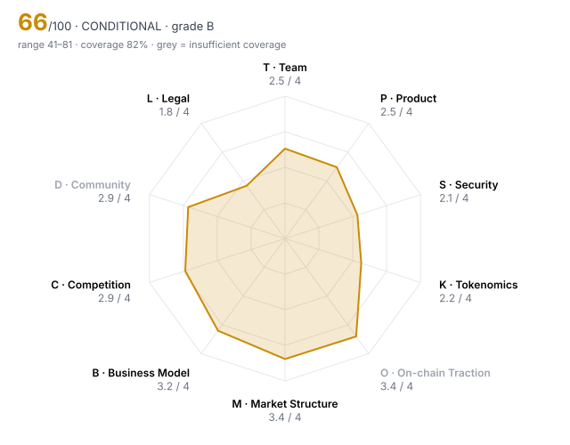

# Hyperliquid (HYPE) — DD-100 Due-Diligence Report

> **🟡 CONDITIONAL** · Grade **B** · Score **66.0/100** (range 41–81) · Evidence coverage **82%**  
> Profile `defi` · Evidence as of 2026-10-23 · 100 dimensions · 61 sources

The range is the honest number: it shows where the score could land once unscored dimensions are filled and low-confidence judgments are firmed up.

## Why this verdict

- grade B meets the listing bar on score; listing is blocked until:
- critical gates not yet checkable: RF02
- human-only checks outstanding: T02 Identity verification level, M05 Market-maker arrangements, L07 Legal opinion

## Red-flag gates

| Gate | Severity | Status | What it means |
|---|---|---|---|
| RF16 Volume implausible versus depth | minor | 🚩 fired | Daily volume more than 100x the ±2% depth is a common wash-trading signature. |
| RF02 Sanctions / illicit-finance exposure | critical | ❔ unchecked | Listing would create direct regulatory liability for the venue. |
| RF06 Upgradeable contracts with no meaningful timelock | major | ❔ unchecked | Logic can change under users with no time to exit. |
| RF07 Extreme holder concentration | major | ❔ unchecked | A handful of wallets can set the price; order books will not absorb their exit. |
| RF12 Anonymous team with centralised admin powers | major | ❔ unchecked | Unaccountable people holding privileged keys. |
| RF13 Undisclosed market-maker terms | major | ❔ unchecked | Token loans and call options are where post-listing dumps are engineered. |

10 of 16 gates verified clear.

## Pillar scores

| Pillar | Weight | Score /4 | | Coverage | Scored |
|---|---:|---:|---|---:|---:|
| T · Team & Governance | 12 | 2.52 | `██████░░░░` | 88% | 9/10 |
| P · Product & Technology | 10 | 2.47 | `██████░░░░` | 100% | 10/10 |
| S · Security & Smart Contracts | 14 | 2.14 | `█████░░░░░` | 88% | 9/10 |
| K · Tokenomics & Supply | 14 | 2.25 | `██████░░░░` | 84% | 8/9 |
| O · On-chain Traction | 10 | 3.40 | `████████░░` | 59% ⚠️ | 5/10 |
| M · Market Structure & Liquidity | 8 | 3.38 | `████████░░` | 76% | 7/10 |
| B · Business Model & Fundamentals | 10 | 3.20 | `████████░░` | 83% | 8/10 |
| C · Competition & Moat | 8 | 2.94 | `███████░░░` | 100% | 10/10 |
| D · Community & Distribution | 5 | 2.86 | `███████░░░` | 54% ⚠️ | 6/10 |
| L · Legal, Compliance & Jurisdiction | 9 | 1.83 | `█████░░░░░` | 75% | 6/8 |

⚠️ = coverage below the pillar minimum; treat that pillar's score as indicative.

## Claims vs. observation

No contradictions found across 1 checked project claim(s).

## Strengths

- **T10 Disclosure honesty** (4/4) — contradiction_count = 0  (bands 4:≤0, 3:≤0.5, 2:≤1, 1:≤2)
- **P01 Problem clarity & real demand** (4/4) — $212B 30d perp volume and $907M annualised fees with zero usage incentives — demand is paid for, not subsidised.
- **P02 Product maturity** (4/4) — Exchange in production well over 12 months (token genesis Nov 2024 on a live venue); HyperEVM since Feb 2025, HIP-3 since Oct 2025.
- **K01 Token utility & value accrual** (4/4) — 99% of fees (net of builder fees) buy HYPE on-chain — $1.36B spent so far; HYPE also needed for staking, gas and HIP-3 deployment bonds.
- **M01 Order-book depth (±2%)** (4/4) — depth_2pct_usd = 2,885,381  (bands 4:≥2e+06, 3:≥500,000, 2:≥150,000, 1:≥50,000)
- **B01 Annualised protocol revenue** (4/4) — annualized_revenue_usd = 690,280,000  (bands 4:≥5e+07, 3:≥1e+07, 2:≥2e+06, 1:≥250,000)

## Risks

- **P06 Development activity (90d commits)** (0/4) — github_commits_90d = 2  (bands 4:≥300, 3:≥150, 2:≥60, 1:≥15)
- **L04 Licensing for regulated activity** (0/4) — Offers retail leveraged perps (up to 40×) with no licence anywhere; FCA warning list, MAS alert; ESMA caps EU retail at 2:1.
- **P07 Contributor breadth (90d)** (0/4) — github_active_contributors_90d = 1  (bands 4:≥25, 3:≥12, 2:≥6, 1:≥3)
- **S02 Audit remediation** (1/4) — The only public audits (two Zellic reports, 2023) cover the legacy bridge; no public audit of HyperCore/HyperEVM, which hold most of the ~$8.4B.
- **S05 Admin key custody** (1/4) — No admin key, but bridge withdrawals need only 3 of 4 EOA validator signatures, and L1 upgrades ship as binaries adopted by a validator set where the Foundation holds ~49% of stake.
- **K04 12-month unlock pressure** (1/4) — unlock_12m_pct_of_circ = 53.5  (bands 4:≤10, 3:≤25, 2:≤50, 1:≤100)

## Open questions for the project team

Everything below is unscored. Each one is a question to put to the team or a data request, not a negative finding.

**Needs a private channel (call, data room, counsel)** (3)

- T02 Identity verification level: Are the key people identified to the reviewer (KYC) and, ideally, publicly? — _requires private channel_
- M05 Market-maker arrangements: Are MM agreements (loans, call options, KPIs) disclosed to the reviewer and reasonable? — _requires private channel_
- L07 Legal opinion: Has the project provided a token legal opinion from reputable counsel? — _requires private channel_

**Needs evidence** (16)

- S04 Upgrade timelock: How long must users wait between an upgrade being queued and executed? (non-upgradeable = 9999) — _metric 'upgrade_timelock_hours' not in evidence pack; Bridge2 is not upgradeable (H62). The L1 upgrades by validators adopting new signed binaries (H63); no notice period is documented. Ask: how much notice do users get before a protocol upgrade takes effect?_
- K03 Holder concentration: Share of supply held by the top 10 wallets, excluding exchanges, burn and protocol contracts — _metric 'top10_holder_pct_ex_contracts' not in evidence pack; Top holders are dominated by protocol and team addresses (Assistance Fund, staking, ~240M team stake, H58). Needs entity labelling to exclude them; public explorers did not render for this review._
- O02 Activity trend (90d): Percentage change in daily active addresses over 90 days — _metric 'daa_90d_change_pct' not in evidence pack_
- O03 30-day user retention: Share of a new-user cohort still active after 30 days — _metric 'retention_30d_pct' not in evidence pack_
- O07 Fee-paying users (30d): Unique addresses that paid fees in the last 30 days — _metric 'fee_paying_users_30d' not in evidence pack_
- O08 Integrations: Number of live third-party integrations (wallets, protocols, aggregators) — _metric 'live_integrations_count' not in evidence pack_
- O10 Net capital flows (90d): Net inflow of external capital (stablecoins/majors) into the protocol over 90 days, USD — _metric 'net_inflow_90d_usd' not in evidence pack_
- M07 Derivatives structure: Do perp open interest and funding indicate healthy two-way markets or crowded positioning? — _missing: HYPE funding-rate history and CEX OI split_
- M08 Realised volatility (30d): Annualised 30-day realised volatility — _metric 'realized_vol_30d_pct' not in evidence pack_
- B06 Treasury runway: Months of runway at current burn, counting non-native assets at full value and native token at 50% — _metric 'runway_months' not in evidence pack; Hyper Foundation treasury balance is not published; Labs is self-funded (H19)._
- B07 Treasury diversification: Share of treasury held in assets other than the native token — _metric 'treasury_non_native_pct' not in evidence pack_
- D02 Engagement authenticity: What share of engagement appears bot-driven or paid? — _missing: bot-likelihood / engagement-quality analysis of X and Discord_
- D03 Token holder count: Number of addresses holding a non-dust balance — _metric 'holders_count' not in evidence pack_
- D04 Geographic & user diversity: Is the user base spread across regions, or concentrated where the venue cannot serve it? — _missing: user geography; ask team or use Binance's own deposit/withdrawal data_
- D07 Governance participation: Average share of circulating supply voting on recent proposals — _metric 'governance_participation_pct' not in evidence pack; There is no token-holder vote: governance is stake-weighted validator voting (H18), scored under T07._
- L03 Sanctions & AML exposure: Has screening found exposure to sanctioned addresses, mixers or illicit flows above tolerance? — _metric 'sanctions_exposure' not in evidence pack; No public wallet screening exists. Lazarus-linked flows of ~$30M were reported (H37). Needs the venue's own Chainalysis/TRM screening of HYPE treasury, team, Assistance Fund and top-holder addresses._

## Appendix A — all 100 dimensions

### T · Team & Governance

| ID | Dimension | Method | W | Score | Conf. | Evidence | Basis |
|---|---|---|---:|---:|---|---|---|
| T01 | Founder track record | agent | 3 | **3** | medium | H19, H10 | Founders came from HFT and built the largest perp DEX (32.8% of 30d perp-DEX volume) — the outcome is verifiable; earlier ventures are only thinly documented. |
| T02 | Identity verification level | human | 3 | ⏳ |  |  | requires private channel |
| T03 | Team depth & key-person risk | agent | 2 | **1** | medium | H19, H20 | Hyperliquid Labs had 11 employees (Jan 2026) running a closed-source L1 with ~$8.4B TVL; core knowledge sits with a very small group. |
| T04 | Technical leadership | agent | 2 | **3** | medium | H19, H31 | In-house team built and keeps shipping its own L1, HyperEVM and HIP-3/HIP-4; no public specs or research to evaluate independently. |
| T05 | Controversies & misconduct history | agent | 3 | **2** | medium | H34, H35, H36 | No enforcement actions found, but FCA warning (May 2026), MAS investor alert (Jun 2026) and a US House Oversight records request on insider trading (Sep 2026) are open. |
| T06 | Team vesting length | rule | 2 | **3** | medium | H03 | team_vesting_months = 36  (bands 4:≥48, 3:≥36, 2:≥24, 1:≥12) |
| T07 | Governance design & decentralisation path | agent | 2 | **1** | high | H18, H06, H49 | Decisions are stake-weighted validator votes; 5 Foundation validators hold ~49% of stake; no token-holder vote; key outcomes (Assistance Fund 'burn') rest on social consensus, not code. |
| T08 | Treasury transparency | agent | 2 | **2** | medium | H07, H49 | Assistance Fund buybacks are visible on-chain (48.0M HYPE for $1.36B); Foundation treasury balance and spending are not reported. |
| T09 | Backer quality & cap table | agent | 2 | **3** | medium | H04, H19, H38 | No private investors by design, so no VC unlock overhang; institutional exposure comes through spot ETFs and token purchases rather than a cap table. |
| T10 | Disclosure honesty | rule | 3 | **4** | high | HARNESS | contradiction_count = 0  (bands 4:≤0, 3:≤0.5, 2:≤1, 1:≤2) |

### P · Product & Technology

| ID | Dimension | Method | W | Score | Conf. | Evidence | Basis |
|---|---|---|---:|---:|---|---|---|
| P01 | Problem clarity & real demand | agent | 3 | **4** | high | H02, H10 | $212B 30d perp volume and $907M annualised fees with zero usage incentives — demand is paid for, not subsidised. |
| P02 | Product maturity | agent | 3 | **4** | high | H31, H04 | Exchange in production well over 12 months (token genesis Nov 2024 on a live venue); HyperEVM since Feb 2025, HIP-3 since Oct 2025. |
| P03 | Technical originality | agent | 2 | **3** | medium | H20, H31 | Original L1 with a fully on-chain order book, not a fork — but closed source, so originality can't be inspected. |
| P04 | Architecture soundness | agent | 2 | **2** | medium | H27, H28, H30, H29 | Core engine held up in the Oct 2025 crash, but thin markets were repeatedly manipulated (JELLY, XPL, POPCAT) and a 37-minute API outage needed $2M in reimbursements. |
| P05 | Dependency risk | agent | 2 | **2** | medium | H25, H22, H32 | Oracle prices come from CEX feeds (Binance carries the top weight); USDC rails depend on Circle/Coinbase and a legacy Arbitrum bridge. |
| P06 | Development activity (90d commits) | rule | 2 | **0** | high | H20 | github_commits_90d = 2  (bands 4:≥300, 3:≥150, 2:≥60, 1:≥15) |
| P07 | Contributor breadth (90d) | rule | 1 | **0** | high | H20 | github_active_contributors_90d = 1  (bands 4:≥25, 3:≥12, 2:≥6, 1:≥3) |
| P08 | Roadmap delivery record | agent | 2 | **3** | medium | H31, H20 | HyperEVM, HIP-3, priority fees, native USDC shipped; open-sourcing the node, promised since Jan 2025, still has no date. |
| P09 | Open source & reproducibility | agent | 1 | **1** | high | H20 | Node ships as binaries only; only the bridge contract and SDKs are public. Nobody outside the team can build or verify the L1. |
| P10 | Documentation quality | agent | 1 | **2** | medium | H06, H25 | Good integrator docs (staking, oracle, builder codes); no consensus spec or threat model. |

### S · Security & Smart Contracts

| ID | Dimension | Method | W | Score | Conf. | Evidence | Basis |
|---|---|---|---:|---:|---|---|---|
| S01 | Audit coverage | rule | 3 | **2** | high | H23 | audits_reputable_count = 1  (bands 4:≥3, 3:≥2, 2:≥1, 1:≥0.5) |
| S02 | Audit remediation | agent | 3 | **1** | high | H23, H20 | The only public audits (two Zellic reports, 2023) cover the legacy bridge; no public audit of HyperCore/HyperEVM, which hold most of the ~$8.4B. |
| S03 | Source verification | rule | 2 | **4** | high | H20 | contracts_verified = true |
| S04 | Upgrade timelock | rule | 3 | – |  |  | metric 'upgrade_timelock_hours' not in evidence pack; Bridge2 is not upgradeable (H62). The L1 upgrades by validators adopting new signed binaries (H63); no notice period is documented. Ask: how much notice do users get before a protocol upgrade takes effect? |
| S05 | Admin key custody | agent | 3 | **1** | high | H21, H62, H18, H63 | No admin key, but bridge withdrawals need only 3 of 4 EOA validator signatures, and L1 upgrades ship as binaries adopted by a validator set where the Foundation holds ~49% of stake. |
| S06 | Mint / freeze / blacklist powers | agent | 3 | **3** | medium | H26, H27 | No mint key and no freeze/blacklist function; but validators have shown they will force-settle a market (JELLY at $0.0095). |
| S07 | Bug bounty | rule | 1 | **4** | low | H24 | bug_bounty_max_usd = 1,000,000  (bands 4:≥1e+06, 3:≥250,000, 2:≥50,000, 1:≥10,000) |
| S08 | Incident history & response | agent | 3 | **2** | high | H27, H28, H29, H30 | No theft of user funds from the core, but recurring manipulation losses to the HLP vault (~$4M, ~$4.9M, ~$1.2–1.5M) and discretionary interventions. |
| S09 | Oracle & manipulation resistance | agent | 2 | **2** | high | H25, H28, H30 | Stake-weighted median of CEX prices is robust for majors; thin and HIP-3 markets (own oracles) have been manipulated repeatedly. |
| S10 | Bridge & cross-chain exposure | agent | 2 | **2** | high | H21, H22, H62 | Legacy bridge (non-upgradeable contract) still holds ~$431M secured by 3-of-4 EOA validator keys; most USDC now arrives natively via CCTP. |

### K · Tokenomics & Supply

| ID | Dimension | Method | W | Score | Conf. | Evidence | Basis |
|---|---|---|---:|---:|---|---|---|
| K01 | Token utility & value accrual | agent | 3 | **4** | high | H02, H07 | 99% of fees (net of builder fees) buy HYPE on-chain — $1.36B spent so far; HYPE also needed for staking, gas and HIP-3 deployment bonds. |
| K02 | Circulating ratio | rule | 2 | **1** | high | HARNESS | circulating_supply_pct = 23.3  (bands 4:≥60, 3:≥40, 2:≥25, 1:≥15) |
| K03 | Holder concentration | rule | 3 | – |  |  | metric 'top10_holder_pct_ex_contracts' not in evidence pack; Top holders are dominated by protocol and team addresses (Assistance Fund, staking, ~240M team stake, H58). Needs entity labelling to exclude them; public explorers did not render for this review. |
| K04 | 12-month unlock pressure | rule | 3 | **1** | medium | H03 | unlock_12m_pct_of_circ = 53.5  (bands 4:≤10, 3:≤25, 2:≤50, 1:≤100) |
| K05 | Insider allocation | rule | 2 | **3** | medium | H03 | insider_allocation_pct = 29.8  (bands 4:≤25, 3:≤35, 2:≤45, 1:≤55) |
| K06 | Investor cost-basis overhang | rule | 2 | n/a |  | H04 | n/a for this project: no private round was ever sold, so there is no investor cost basis to overhang the market |
| K07 | FDV / market cap | rule | 2 | **1** | high | HARNESS | fdv_to_mcap = 4.29  (bands 4:≤1.5, 3:≤2.5, 2:≤4, 1:≤7) |
| K08 | Annual inflation | rule | 2 | **4** | medium | H05 | annual_inflation_pct = 0.5  (bands 4:≤2, 3:≤5, 2:≤10, 1:≤20) |
| K09 | Supply verifiability | agent | 1 | **2** | medium | H01, H03, H13 | Buybacks are on-chain, but circulating supply differs by provider (222M vs 254M) and team releases are discretionary claims reported inconsistently. |
| K10 | Airdrop & incentive design | agent | 1 | **1** | medium | H17 | Only 6.8% of the airdrop is still in recipient wallets and 86% of wallets sold everything — distribution created users, not holders. |

### O · On-chain Traction

| ID | Dimension | Method | W | Score | Conf. | Evidence | Basis |
|---|---|---|---:|---:|---|---|---|
| O01 | Daily active addresses (30d avg) | rule | 2 | **3** | medium | H12 | daa_30d_avg = 20,600  (bands 4:≥50,000, 3:≥10,000, 2:≥2,000, 1:≥300) |
| O02 | Activity trend (90d) | rule | 2 | – |  |  | metric 'daa_90d_change_pct' not in evidence pack |
| O03 | 30-day user retention | rule | 2 | – |  |  | metric 'retention_30d_pct' not in evidence pack |
| O04 | TVL / AUM | rule | 2 | **4** | medium | H02 | tvl_usd = 8,433,000,000  (bands 4:≥1e+09, 3:≥2e+08, 2:≥5e+07, 1:≥1e+07) |
| O05 | Incentive-driven TVL share | rule | 2 | **4** | medium | H02 | incentivised_tvl_share_pct = 0  (bands 4:≤10, 3:≤25, 2:≤50, 1:≤75) |
| O06 | Organic vs sybil activity | agent | 3 | **3** | medium | H02, H12, H44 | Activity persists with zero incentives since Nov 2024; HIP-3 volume is concentrated in one deployer (trade.xyz ~96%). |
| O07 | Fee-paying users (30d) | rule | 1 | – |  |  | metric 'fee_paying_users_30d' not in evidence pack |
| O08 | Integrations | rule | 1 | – |  |  | metric 'live_integrations_count' not in evidence pack |
| O09 | Builder ecosystem | agent | 1 | **3** | medium | H43, H44, H54 | Third parties launch most new markets (98 of 104 in 2026) and Coinbase routes Base App users in; builder activity is concentrated in a few teams. |
| O10 | Net capital flows (90d) | rule | 1 | – |  |  | metric 'net_inflow_90d_usd' not in evidence pack |

### M · Market Structure & Liquidity

| ID | Dimension | Method | W | Score | Conf. | Evidence | Basis |
|---|---|---|---:|---:|---|---|---|
| M01 | Order-book depth (±2%) | rule | 3 | **4** | medium | H01 | depth_2pct_usd = 2,885,381  (bands 4:≥2e+06, 3:≥500,000, 2:≥150,000, 1:≥50,000) |
| M02 | Venue concentration | rule | 2 | **4** | medium | H01 | top_venue_volume_share_pct = 23.8  (bands 4:≤30, 3:≤45, 2:≤60, 1:≤80) |
| M03 | Wash-trading indicators | agent | 3 | **2** | low | H01 | Top venues look healthy (0.01% spreads), but reported 24h volume ($829M) is ~4× the top-8 pairs' total; the long tail of 83 markets is unverified. |
| M04 | Bid-ask spread | rule | 2 | **4** | medium | H01 | spread_bps = 1  (bands 4:≤5, 3:≤15, 2:≤40, 1:≤100) |
| M05 | Market-maker arrangements | human | 2 | ⏳ |  |  | requires private channel |
| M06 | Existing venue quality | agent | 1 | **4** | high | H01, H15, H16 | Already on Coinbase, OKX, Bybit, Robinhood and Binance.US, with Binance perps since May 2025. |
| M07 | Derivatives structure | agent | 1 | – |  |  | missing: HYPE funding-rate history and CEX OI split |
| M08 | Realised volatility (30d) | rule | 1 | – |  |  | metric 'realized_vol_30d_pct' not in evidence pack |
| M09 | DEX liquidity ownership | agent | 1 | **2** | medium | H01 | On-chain liquidity is an order book (no LP to pull), but Hyperliquid's own spot book is thin: ~$150k/$55k within ±2%. |
| M10 | Narrative & timing fit | agent | 1 | **4** | high | H10, H38, H11 | Category leader in on-chain perps with RWA perps driving new users and three US spot ETFs live. |

### B · Business Model & Fundamentals

| ID | Dimension | Method | W | Score | Conf. | Evidence | Basis |
|---|---|---|---:|---:|---|---|---|
| B01 | Annualised protocol revenue | rule | 3 | **4** | medium | H02 | annualized_revenue_usd = 690,280,000  (bands 4:≥5e+07, 3:≥1e+07, 2:≥2e+06, 1:≥250,000) |
| B02 | Revenue quality | agent | 2 | **3** | medium | H08, H45 | Revenue is organic trading fees, but cyclical: gross revenue fell from $457M (Q3-25) to $202M (Q2-26). |
| B03 | Holder value capture | agent | 2 | **4** | high | H02, H07 | All protocol revenue accrues to holders: Q3-26 $151M of $174M bought back HYPE on-chain; the rest was USDC reserve yield and burns. |
| B04 | Valuation vs fees (FDV / annualised fees) | rule | 2 | **2** | high | HARNESS | fdv_to_annual_fees = 81.5  (bands 4:≤20, 3:≤50, 2:≤150, 1:≤500) |
| B05 | Incentive spend vs revenue | rule | 2 | **4** | medium | H02 | incentives_to_revenue = 0  (bands 4:≤0.5, 3:≤1, 2:≤2, 1:≤4) |
| B06 | Treasury runway | rule | 2 | – |  |  | metric 'runway_months' not in evidence pack; Hyper Foundation treasury balance is not published; Labs is self-funded (H19). |
| B07 | Treasury diversification | rule | 1 | – |  |  | metric 'treasury_non_native_pct' not in evidence pack |
| B08 | Revenue growth (90d) | rule | 1 | **2** | medium | H08 | revenue_qoq_growth_pct = 1.6  (bands 4:≥50, 3:≥15, 2:≥0, 1:≥-25) |
| B09 | Counterparty concentration | agent | 1 | **2** | medium | H43, H44 | HIP-3 is ~37.5% of volume and one deployer does ~96% of HIP-3 — roughly a third of volume runs through a single partner. |
| B10 | Sustainability without emissions | agent | 2 | **3** | medium | H02, H05 | No usage incentives, so fees are real; but staking emissions (~9.9M HYPE/yr) about equal buybacks, so holders see little net supply reduction. |

### C · Competition & Moat

| ID | Dimension | Method | W | Score | Conf. | Evidence | Basis |
|---|---|---|---:|---:|---|---|---|
| C01 | Segment size & growth | agent | 2 | **4** | medium | H54, H09 | Perps are crypto's largest market; Hyperliquid alone reached 6.63% of global perp volume including CEXs. |
| C02 | Category market share | rule | 2 | **4** | medium | H10 | category_share_pct = 32.8  (bands 4:≥30, 3:≥15, 2:≥5, 1:≥1) |
| C03 | Share trajectory | agent | 2 | **2** | medium | H10, H12, H46 | Volume share fell from ~44% (Mar 2026) to 32.8% (Oct 2026); OI share stable at ~55–57%. |
| C04 | Moat | agent | 3 | **3** | medium | H46, H10, H51 | Volume share fell from 33% to ~10% in late 2025 as Lighter (zero fees) and Aster surged, then recovered to ~33% without incentives; Aster's volume data was delisted by DefiLlama over wash-trading concerns. |
| C05 | Forkability | agent | 2 | **3** | medium | H20, H10 | Closed-source core can't be forked directly, and OI/liquidity concentration is hard to replicate. |
| C06 | Differentiation vs top-3 peers | agent | 2 | **3** | medium | H43, H11 | CEX-like order book with self-custody plus permissionless markets (RWA/equity perps) competitors don't match yet. |
| C07 | Relative valuation | agent | 2 | **2** | medium | H01, H02 | FDV/fees ~82× vs Aster ~28× and Lighter ~40× on trailing fees; on market cap (~19×) it is cheaper. |
| C08 | Platform & incumbent threat | agent | 1 | **2** | medium | H54, H47 | Competes head-on with CEX perps (incl. Binance); Coinbase chose to partner instead. |
| C09 | Partnership substance | agent | 1 | **3** | medium | H32, H54, H38 | Coinbase USDC deployer and Base App routing are live, ETFs trade; the USDH partnership was reversed eight months after it was voted in. |
| C10 | Exchange-level strategic fit | agent | 1 | **3** | medium | H15, H16, H47 | Top-demand asset users already trade as a Binance perp since May 2025; spot adds a TRY fiat route but lists a direct competitor's token. |

### D · Community & Distribution

| ID | Dimension | Method | W | Score | Conf. | Evidence | Basis |
|---|---|---|---:|---:|---|---|---|
| D01 | Organic audience | agent | 1 | **3** | medium | H41, H42 | 431k X followers and ~93k Discord members (~9.8k online); growth is steady rather than campaign-driven. |
| D02 | Engagement authenticity | agent | 2 | – |  |  | missing: bot-likelihood / engagement-quality analysis of X and Discord |
| D03 | Token holder count | rule | 2 | – |  |  | metric 'holders_count' not in evidence pack |
| D04 | Geographic & user diversity | agent | 1 | – |  |  | missing: user geography; ask team or use Binance's own deposit/withdrawal data |
| D05 | Paid-promotion dependence | agent | 2 | **3** | low | H61, H02 | Stated policy of no investors and no paid market makers; no paid campaigns found and no incentives running. |
| D06 | Developer community | agent | 1 | **3** | medium | H43, H44 | External teams ship HIP-3 markets and HyperEVM apps; grants programme details not public. |
| D07 | Governance participation | rule | 1 | – |  |  | metric 'governance_participation_pct' not in evidence pack; There is no token-holder vote: governance is stake-weighted validator voting (H18), scored under T07. |
| D08 | Communication transparency | agent | 1 | **2** | medium | H29, H37 | Fast on outage reimbursement; no public response found on Lazarus-linked flows (2026) or later manipulation events. |
| D09 | Sentiment & controversy | agent | 1 | **2** | medium | H59, H60, H32 | Strong trader sentiment, but persistent informed criticism of centralisation and of the reversed USDH vote. |
| D10 | Ecosystem credibility | agent | 1 | **4** | high | H32, H38, H54 | Coinbase, Circle and three US ETF issuers have integrated or built products on it. |

### L · Legal, Compliance & Jurisdiction

| ID | Dimension | Method | W | Score | Conf. | Evidence | Basis |
|---|---|---|---:|---:|---|---|---|
| L01 | Legal entity & jurisdiction | agent | 2 | **2** | medium | H33 | Labs registered in Singapore; Foundation described as Cayman-based with no published registration details; self-described as unregulated. |
| L02 | Securities-law risk | agent | 3 | **2** | medium | H38, H02, H18 | Fee-funded buybacks and Foundation-weighted control cut against the token; SEC-effective spot ETFs show US regulators allowed exposure, but that is not a legal determination. |
| L03 | Sanctions & AML exposure | rule | 3 | – |  |  | metric 'sanctions_exposure' not in evidence pack; No public wallet screening exists. Lazarus-linked flows of ~$30M were reported (H37). Needs the venue's own Chainalysis/TRM screening of HYPE treasury, team, Assistance Fund and top-holder addresses. |
| L04 | Licensing for regulated activity | agent | 2 | **0** | high | H34, H33, H52 | Offers retail leveraged perps (up to 40×) with no licence anywhere; FCA warning list, MAS alert; ESMA caps EU retail at 2:1. |
| L05 | Litigation & enforcement | agent | 3 | **2** | medium | H34, H35, H36 | No litigation or enforcement found; two regulator warnings and a congressional records request are open. |
| L06 | Privacy & obfuscation features | agent | 1 | **4** | medium | H26, H50 | No privacy or obfuscation features; all activity is public on-chain. |
| L07 | Legal opinion | human | 1 | ⏳ |  |  | requires private channel |
| L08 | RWA custody & bankruptcy remoteness | agent | 3 | n/a |  |  | not applicable to profile 'defi' |
| L09 | RWA attestation frequency | agent | 2 | n/a |  |  | not applicable to profile 'defi' |
| L10 | Restricted-jurisdiction controls | agent | 1 | **2** | medium | H50, H37 | Front-end geofencing only; the L1 accepts anyone, and Lazarus-linked wallets moved ~$30M through it in Aug 2026. |

## Appendix B — sources

| ID | Tier | Type | Title |
|---|---|---|---|
| H01 | 2 · independent | api | [CoinGecko — Hyperliquid (HYPE): price, supply, venues, order-book depth](https://www.coingecko.com/en/coins/hyperliquid) |
| H02 | 2 · independent | api | [DefiLlama — Hyperliquid protocol: fees, revenue, TVL, OI, methodology](https://defillama.com/protocol/hyperliquid) |
| H03 | 2 · independent | tokenomics | [Tokenomist — Hyperliquid allocation, vesting and unlock tracking](https://tokenomist.ai/hyperliquid) |
| H04 | 2 · independent | news | [The Block — Hyperliquid genesis event and allocation (28 Nov 2024)](https://www.theblock.co/post/328631/hyperliquid-plans-to-launch-hype-token-in-nov-29-genesis-event) |
| H05 | 2 · independent | api | [Staking Rewards — Hyperliquid staking](https://www.stakingrewards.com/asset/hyperliquid) |
| H06 | 3 · self-reported | doc | [Hyperliquid docs — Staking](https://hyperliquid.gitbook.io/hyperliquid-docs/hypercore/staking) |
| H07 | 2 · independent | news | [crypto.news — HYPE price falls despite $1.36B in buybacks](https://crypto.news/hype-price-falls-despite-1-36b-in-buybacks/) |
| H08 | 2 · independent | news | [Coinpaprika — Hyperliquid revenue keeps falling](https://coinpaprika.com/news/hype-revenue-keeps-falling-hyperliquid/) |
| H09 | 2 · independent | news | [21Shares — Hyperliquid fees and revenue, H1 2026 (ETF issuer: has a commercial interest)](https://21shares.com/en-eu/insights/hyperliquid-fees-revenue-h1-2026) |
| H10 | 2 · independent | api | [DefiLlama — Perps dashboard (volume and open interest by protocol)](https://defillama.com/perps) |
| H11 | 2 · independent | news | [DefiLlama Research — Hyperliquid's RWA boom by the numbers](https://defillama-research.beehiiv.com/p/hyperliquid-s-rwa-boom-by-the-numbers) |
| H12 | 2 · independent | news | [Datawallet — Hyperliquid statistics](https://www.datawallet.com/es/cripto/hyperliquid-statistics) |
| H13 | 2 · independent | news | [The Crypto Times — HYPE token unlock, 6 Oct 2026](https://www.cryptotimes.io/2026/10/06/hyperliquid-price-today-340m-token-unlock-hits-as-hype-trades-near-93/) |
| H14 | 2 · independent | api | [Trading Strategy — Hyperliquidity Provider (HLP) vault](https://tradingstrategy.ai/vaults/hyperliquidity-provider-hlp) |
| H15 | 2 · independent | news | [BeInCrypto — Binance lists Hyperliquid (HYPE) with 3 spot pairs, Seed Tag](https://beincrypto.com/binance-lists-hyperliquid-hype-seed-tag/) |
| H16 | 2 · independent | news | [Bloomingbit — Binance Futures lists HYPE perpetual (May 2025)](https://en.bloomingbit.io/feed/news/89258) |
| H17 | 2 · independent | onchain | [Otomato — HYPE airdrop retention analysis](https://otomato.xyz/blog/hype-airdrop-retention) |
| H56 | 2 · independent | news | [crypto.news — a16z-linked wallets may rank No. 6 among HYPE holders](https://crypto.news/hype-whale-alert-a16z-linked-wallets-may-rank-no-6/) |
| H57 | 2 · independent | news | [KuCoin News — Hyperliquid Strategies (PURR) grows HYPE treasury to 29.3M](https://www.kucoin.com/news/flash/hyperliquid-strategies-raises-647m-grows-hype-treasury-to-29-3m-tokens) |
| H18 | 2 · independent | governance | [crypto.news — Who actually runs Hyperliquid? The governance audit](https://crypto.news/who-actually-runs-hyperliquid-the-governance-audit/) |
| H19 | 2 · independent | news | [Fortune — Jeff Yan and Hyperliquid (12 Jan 2026)](https://fortune.com/2026/01/12/hyperliquid-jeff-yan-defi-perpetuals-perps-exchange-defi/) |
| H20 | 1 · primary | github | [GitHub — hyperliquid-dex/node and org repositories](https://github.com/hyperliquid-dex/node) |
| H21 | 2 · independent | onchain | [L2BEAT — Hyperliquid bridge risk assessment](https://www.l2beat.com/bridges/projects/hyperliquid) |
| H22 | 2 · independent | onchain | [Bitquery — Hyperliquid bridge ledger investigation](https://bitquery.io/investigations/hyperliquid-bridge-ledger) |
| H23 | 1 · primary | audit | [Zellic — Hyperliquid bridge audit reports (Nov 2023)](https://reports.zellic.io/publications/hyperliquid) |
| H24 | 3 · self-reported | doc | [Hyperliquid docs — Bug bounty program](https://hyperliquid.gitbook.io/hyperliquid-docs/bug-bounty-program) |
| H25 | 3 · self-reported | doc | [Hyperliquid docs — Oracle](https://hyperliquid.gitbook.io/hyperliquid-docs/hypercore/oracle) |
| H26 | 3 · self-reported | doc | [Hyperliquid docs — HIP-1 native token standard](https://hyperliquid.gitbook.io/hyperliquid-docs/hyperliquid-improvement-proposals-hips/hip-1-native-token-standard) |
| H27 | 2 · independent | news | [Decrypt — Hyperliquid delists JELLY after validator vote (Mar 2025)](https://decrypt.co/311713) |
| H28 | 2 · independent | news | [BTC-Echo — POPCAT attack on Hyperliquid (Nov 2025)](https://www.btc-echo.de/schlagzeilen/angriff-auf-hyperliquid-mit-millionenschaden-219458/) |
| H29 | 2 · independent | news | [Cointelegraph — Hyperliquid reimburses $2M after API outage (Jul 2025)](https://cointelegraph.com/news/hyperliquid-reimburses-2m-crypto-traders-outage) |
| H30 | 2 · independent | news | [The Block — XPL pre-market squeeze on Hyperliquid (Aug 2025)](https://www.theblock.co/post/368486) |
| H31 | 2 · independent | news | [FalconX — Drivers behind Hyperliquid's next phase (ETFs, HIP-4, priority fees, USDC)](https://www.falconx.io/newsroom/the-drivers-behind-hyperliquids-next-phase-hype-etfs-hip-4-outcome-markets-priority-fees-and-its-usdc-agreement) |
| H48 | 2 · independent | news | [Bitcoin.com — AQAv2 passes, USDC reserve yield to buybacks](https://news.bitcoin.com/crypto-news/hyperliquid-aqav2-hype-buyback-usdc/) |
| H49 | 2 · independent | news | [The Block — Validators vote to treat Assistance Fund HYPE as burned (Dec 2025)](https://www.theblock.co/post/383091) |
| H58 | 2 · independent | news | [BTC-Echo — Team restakes HYPE despite unlock fears (Dec 2025)](https://www.btc-echo.de/schlagzeilen/hype-kurs-trotzt-unlock-angst-team-restaked-millionenbetraege-220589/) |
| H62 | 1 · primary | github | [GitHub — hyperliquid-dex/contracts Bridge2.sol](https://github.com/hyperliquid-dex/contracts/blob/master/Bridge2.sol) |
| H63 | 1 · primary | github | [GitHub — hyperliquid-dex/node README (hl-visor binary installation)](https://github.com/hyperliquid-dex/node) |
| H32 | 2 · independent | news | [The Defiant — Coinbase lands Hyperliquid stablecoin role eight months after USDH vote](https://thedefiant.io/news/defi/coinbase-lands-hyperliquid-stablecoin-role-eight-months-after-governance-vote-picked-native) |
| H33 | 2 · independent | news | [Blockhead — Hyperliquid confirms Singapore registration; MAS says it falls outside its jurisdiction](https://www.blockhead.co/2026/10/07/hyperliquid-confirms-singapore-registration-as-mas-says-exchange-falls-outside-its-jurisdiction/) |
| H34 | 1 · primary | legal | [UK FCA Warning List — Hyperliquid](https://www.fca.org.uk/news/warnings/hyperliquid) |
| H35 | 2 · independent | news | [ForkLog — Singapore regulator adds Hyperliquid to Investor Alert List](https://forklog.com/en/news/singapore-regulator-adds-hyperliquid-to-list-of-risky-platforms) |
| H36 | 2 · independent | news | [Unchained — House Oversight targets Hyperliquid, Crypto.com and PredictIt in insider-trading probe](https://unchainedcrypto.com/house-oversight-targets-hyperliquid-crypto-com-and-predictit-in-insider-trading-probe/) |
| H37 | 2 · independent | news | [Cointelegraph — Lazarus-linked wallets move $30M through Hyperliquid](https://cointelegraph.com/news/lazarus-group-move-30m-hyperliquid) |
| H38 | 1 · primary | legal | [SEC EDGAR — 21Shares Hyperliquid ETF prospectus (424)](https://www.sec.gov/Archives/edgar/data/0002090011/000121390026103576/ea0306711-424i_21shares.htm) |
| H39 | 2 · independent | news | [Cointelegraph — ICE and CME press US regulators to rein in Hyperliquid](https://cointelegraph.com/news/ice-cme-press-us-regulators-rein-hyperliquid-dex) |
| H40 | 2 · independent | news | [The Block — Trump says CFTC working to bring Hyperliquid to the US 'in a fully compliant fashion'](https://theblock.co/news/regulation/2026-08-19-hype-token-surges-trump-says-cftc-bring-hyperliquid-us-fully-compliant-fashion-412262) |
| H41 | 1 · primary | social | [Discord API — Hyperliquid server member counts](https://discord.com/api/v9/invites/hyperliquid?with_counts=true) |
| H42 | 2 · independent | social | [AltIndex — HYPE X/Twitter followers](https://altindex.com/ticker/hype/twitter-followers) |
| H43 | 2 · independent | news | [Blockworks 0xResearch — HIP-3 market share](https://blockworks.com/newsletter/0xresearch/issue/post_cd59dc4c-07ec-4969-8c32-4054113b310a) |
| H44 | 2 · independent | news | [Arrakis — Who is trading on HIP-3?](https://arrakis.finance/blog/who-is-trading-on-hip3) |
| H45 | 2 · independent | news | [The Block — Hyperliquid OI climbs to $14.3B as HYPE hits ATH](https://www.theblock.co/news/ecosystems/2026-09-08-hyperliquid-open-interest-climbs-14-3-billion-hype-hits-an-all-time-high-413855) |
| H46 | 2 · independent | news | [The Block — Hyperliquid perp-DEX share falls as Lighter and Aster surge (Nov 2025)](https://www.theblock.co/post/377319/) |
| H47 | 2 · independent | news | [Cryptoast — Binance lists Hyperliquid after an 'unusually long' wait](https://cryptoast.fr/binance-listing-hyperliquid-hype/) |
| H50 | 2 · independent | legal | [Memeburn — Is Hyperliquid available in the US? (Terms of Use s.1.5)](https://memeburn.com/is-hyperliquid-available-in-the-us-what-trump-just-said/) |
| H51 | 2 · independent | news | [The Block — DefiLlama delists Aster perp volume over wash-trading concerns](https://theblock.co/news/ecosystems/2025-10-05-asters-token-drops-10-after-defillama-head-raises-wash-trading-concerns-delists-perpetuals-data-373458) |
| H52 | 2 · independent | news | [FinTelegram — ESMA statement on crypto 'perpetual' derivatives](https://fintelegram.com/?p=80678) |
| H54 | 2 · independent | news | [The Block — Hyperliquid hits record share of global perps volume](https://www.theblock.co/post/403384/) |
| H59 | 2 · independent | news | [ForkLog — Native Markets secures USDH ticker; Dragonfly calls process 'a farce'](https://forklog.com/en/native-markets-secures-usdh-ticker-for-hyperliquid/) |
| H60 | 2 · independent | news | [Blockworks Research — Hyperliquid is centralized](https://blockworks-research.beehiiv.com/p/hyperliquid-is-centralized) |
| H61 | 2 · independent | news | [KuCoin News — Hyperliquid founder rejects outside funding offer](https://www.kucoin.com/news/flash/hyperliquid-founder-rejects-10b-valuation-funding-offer-commits-to-zero-external-investment-path) |
| HARNESS | computed | harness | Metrics derived by the harness from other evidence |

---
_Generated by DD-100. Scores are decision support for a listing committee, not investment advice. Every judgment above cites its evidence; anything uncited was not scored._