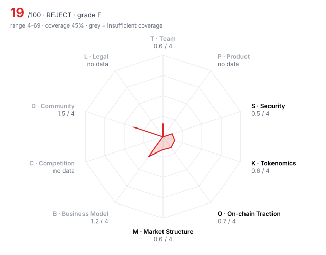

# Moonvault (MVLT) — DD-100 Due-Diligence Report

> **🔴 REJECT** · Grade **F** · Score **19.0/100** (range 4–69) · Evidence coverage **45%**  
> Profile `consumer` · Evidence as of 2026-10-20 · 100 dimensions · 6 sources

The range is the honest number: it shows where the score could land once unscored dimensions are filled and low-confidence judgments are firmed up.

## Why this verdict

- critical gate RF01: Unrestricted mint controlled by a single key

## Red-flag gates

| Gate | Severity | Status | What it means |
|---|---|---|---|
| RF01 Unrestricted mint controlled by a single key | critical | 🚩 fired | Supply can be inflated at will; every other number in the report is conditional on one person's restraint. |
| RF06 Upgradeable contracts with no meaningful timelock | major | 🚩 fired | Logic can change under users with no time to exit. |
| RF07 Extreme holder concentration | major | 🚩 fired | A handful of wallets can set the price; order books will not absorb their exit. |
| RF08 Unlock cliff within 90 days | major | 🚩 fired | More than a quarter of circulating supply unlocks shortly after a listing window. |
| RF09 No independent audit | major | 🚩 fired | Code holding user funds has never been reviewed by a third party. |
| RF10 Material misrepresentation | major | 🚩 fired | Two or more project claims contradicted by observed data — the reviewer cannot rely on anything self-reported. |
| RF11 Security pillar failing | major | 🚩 fired | Average security score below 1.5/4 — structural rather than one-off weakness. |
| RF14 Insider-heavy allocation | minor | 🚩 fired | Team and investors hold more than half of supply. |
| RF16 Volume implausible versus depth | minor | 🚩 fired | Daily volume more than 100x the ±2% depth is a common wash-trading signature. |
| RF02 Sanctions / illicit-finance exposure | critical | ❔ unchecked | Listing would create direct regulatory liability for the venue. |
| RF04 Unremediated exploit with user losses | critical | ❔ unchecked | Users are owed money; listing would expose new users to the same counterparty. |
| RF05 Active enforcement action against the project or founders | critical | ❔ unchecked | Outcome could force delisting or freeze assets after listing. |
| RF12 Anonymous team with centralised admin powers | major | ❔ unchecked | Unaccountable people holding privileged keys. |
| RF13 Undisclosed market-maker terms | major | ❔ unchecked | Token loans and call options are where post-listing dumps are engineered. |

1 of 16 gates verified clear (1 not applicable to this profile).

## Pillar scores

| Pillar | Weight | Score /4 | | Coverage | Scored |
|---|---:|---:|---|---:|---:|
| T · Team & Governance | 12 | 0.62 | `██░░░░░░░░` | 33% ⚠️ | 3/10 |
| P · Product & Technology | 8 | n/a | `··········` | 0% ⚠️ | 0/10 |
| S · Security & Smart Contracts | 12 | 0.47 | `█░░░░░░░░░` | 68% | 6/10 |
| K · Tokenomics & Supply | 16 | 0.60 | `██░░░░░░░░` | 71% | 6/10 |
| O · On-chain Traction | 14 | 0.67 | `██░░░░░░░░` | 69% | 4/8 |
| M · Market Structure & Liquidity | 10 | 0.64 | `██░░░░░░░░` | 65% | 5/10 |
| B · Business Model & Fundamentals | 6 | 1.20 | `███░░░░░░░` | 31% ⚠️ | 2/9 |
| C · Competition & Moat | 6 | n/a | `··········` | 0% ⚠️ | 0/10 |
| D · Community & Distribution | 10 | 1.50 | `████░░░░░░` | 31% ⚠️ | 2/10 |
| L · Legal, Compliance & Jurisdiction | 6 | n/a | `··········` | 0% ⚠️ | 0/8 |

⚠️ = coverage below the pillar minimum; treat that pillar's score as indicative.

## Claims vs. observation

| Claim | Claimed | Observed | Gap | Sources |
|---|---:|---:|---:|---|
| Deck: "250,000 daily players" | 250,000 | 31,000 | 706% | MV01 vs MV03 |
| Deck: "2M+ holders" | 2,000,000 | 48,000 | 4067% | MV01 vs MV03 |
| Deck: "$5M monthly revenue" | 60,000,000 | 2,100,000 | 2757% | MV01 vs MV03 |

## Strengths

- **S03 Source verification** (4/4) — contracts_verified = true
- **O01 Daily active addresses (30d avg)** (3/4) — daa_30d_avg = 31,000  (bands 4:≥50,000, 3:≥10,000, 2:≥2,000, 1:≥300)

## Risks

- **T10 Disclosure honesty** (0/4) — contradiction_count = 3  (bands 4:≤0, 3:≤0.5, 2:≤1, 1:≤2)
- **S01 Audit coverage** (0/4) — audits_reputable_count = 0  (bands 4:≥3, 3:≥2, 2:≥1, 1:≥0.5)
- **S02 Audit remediation** (0/4) — Only high finding left unfixed; game contracts never audited.
- **S04 Upgrade timelock** (0/4) — upgrade_timelock_hours = 0  (bands 4:≥72, 3:≥48, 2:≥24, 1:≥6)
- **S05 Admin key custody** (0/4) — A single EOA holds owner rights over the token and all game proxies.
- **S06 Mint / freeze / blacklist powers** (0/4) — Owner can mint unlimited MVLT; auditor flagged it, team kept it 'by design'.

## Open questions for the project team

Everything below is unscored. Each one is a question to put to the team or a data request, not a negative finding.

**Needs a private channel (call, data room, counsel)** (2)

- M05 Market-maker arrangements: Are MM agreements (loans, call options, KPIs) disclosed to the reviewer and reasonable? — _requires private channel_
- L07 Legal opinion: Has the project provided a token legal opinion from reputable counsel? — _requires private channel_

**Needs evidence** (63)

- T03 Team depth & key-person risk: Would the project survive the departure of any single person? — _no assessment provided_
- T04 Technical leadership: Is there credible technical leadership able to own protocol design and security decisions? — _no assessment provided_
- T05 Controversies & misconduct history: Are there credible allegations, enforcement actions or past rugs connected to the team? — _no assessment provided_
- T07 Governance design & decentralisation path: Who can change the protocol, and is there a credible path to reducing that power? — _no assessment provided_
- T08 Treasury transparency: Are treasury addresses, holdings and spending disclosed and reconcilable on-chain? — _no assessment provided_
- T09 Backer quality & cap table: Who has invested, on what terms, and do they add more than capital? — _no assessment provided_
- P01 Problem clarity & real demand: Is there a specific user with a specific problem that this solves better than today's alternatives? — _no assessment provided_
- P02 Product maturity: What is live today versus promised? — _no assessment provided_
- P03 Technical originality: Is the technology novel, a meaningful improvement, or a fork? — _no assessment provided_
- P04 Architecture soundness: Is the architecture appropriate for the use case at the target scale? — _no assessment provided_
- P05 Dependency risk: How exposed is the protocol to oracles, bridges, sequencers or other protocols it does not control? — _no assessment provided_
- P06 Development activity (90d commits): How much code is being shipped in public repositories? — _metric 'github_commits_90d' not in evidence pack_
- P07 Contributor breadth (90d): How many distinct developers are actively contributing? — _metric 'github_active_contributors_90d' not in evidence pack_
- P08 Roadmap delivery record: Has the team historically shipped what it promised, roughly when it promised? — _no assessment provided_
- P09 Open source & reproducibility: Can a third party build and verify what is deployed? — _no assessment provided_
- P10 Documentation quality: Could an integrator or auditor understand the system from the docs alone? — _no assessment provided_
- S07 Bug bounty: What is the maximum bug bounty payout on an established platform? — _metric 'bug_bounty_max_usd' not in evidence pack_
- S08 Incident history & response: Has the protocol been exploited, and how was it handled? — _no assessment provided_
- S09 Oracle & manipulation resistance: Can prices or state be manipulated to drain funds (flash loans, thin oracles)? — _no assessment provided_
- S10 Bridge & cross-chain exposure: How much value depends on bridges or wrapped representations? — _no assessment provided_
- K06 Investor cost-basis overhang: Current price as a multiple of the last private round price (higher = more profit to take) — _metric 'price_to_last_round_multiple' not in evidence pack_
- K08 Annual inflation: Net annual emission rate after burns — _metric 'annual_inflation_pct' not in evidence pack_
- K09 Supply verifiability: Can circulating supply and vesting be verified on-chain rather than taken from a spreadsheet? — _no assessment provided_
- K10 Airdrop & incentive design: Do incentive programmes reward real users and resist sybil farming? — _no assessment provided_
- O07 Fee-paying users (30d): Unique addresses that paid fees in the last 30 days — _metric 'fee_paying_users_30d' not in evidence pack_
- O08 Integrations: Number of live third-party integrations (wallets, protocols, aggregators) — _metric 'live_integrations_count' not in evidence pack_
- O09 Builder ecosystem: Are independent teams building on or around the protocol? — _no assessment provided_
- O10 Net capital flows (90d): Net inflow of external capital (stablecoins/majors) into the protocol over 90 days, USD — _metric 'net_inflow_90d_usd' not in evidence pack_
- M06 Existing venue quality: Where does the token already trade, and what does that say about prior diligence? — _no assessment provided_
- M07 Derivatives structure: Do perp open interest and funding indicate healthy two-way markets or crowded positioning? — _no assessment provided_
- M09 DEX liquidity ownership: Is on-chain liquidity protocol-owned/locked or mercenary and removable overnight? — _no assessment provided_
- M10 Narrative & timing fit: Is the sector in favour with buyers, and is this project a leader of that narrative? — _no assessment provided_
- B02 Revenue quality: Is revenue organic and recurring, or one-off, wash or self-generated? — _no assessment provided_
- B03 Holder value capture: What share of revenue reaches token holders, and is that mechanism live? — _no assessment provided_
- B05 Incentive spend vs revenue: USD value of token incentives divided by protocol revenue (90d) — _metric 'incentives_to_revenue' not in evidence pack_
- B06 Treasury runway: Months of runway at current burn, counting non-native assets at full value and native token at 50% — _metric 'runway_months' not in evidence pack_
- B07 Treasury diversification: Share of treasury held in assets other than the native token — _metric 'treasury_non_native_pct' not in evidence pack_
- B08 Revenue growth (90d): Quarter-on-quarter change in protocol revenue — _metric 'revenue_qoq_growth_pct' not in evidence pack_
- B09 Counterparty concentration: Does a single client, partner or whale drive most of the usage or revenue? — _no assessment provided_
- C01 Segment size & growth: How large and fast-growing is the addressable on-chain segment? — _no assessment provided_
- C02 Category market share: Share of the relevant category metric (TVL, volume, fees) held by this project — _metric 'category_share_pct' not in evidence pack_
- C03 Share trajectory: Is market share rising or falling over the last two quarters? — _no assessment provided_
- C05 Forkability: Could a fork with an airdrop replicate the product and pull users away? — _no assessment provided_
- C06 Differentiation vs top-3 peers: Can the reviewer state, in one sentence, why a user chooses this over each top competitor? — _no assessment provided_
- C07 Relative valuation: Is the valuation reasonable against peers on comparable metrics? — _no assessment provided_
- C08 Platform & incumbent threat: Could an L1, wallet, CEX or major protocol absorb this as a native feature? — _no assessment provided_
- C09 Partnership substance: Are announced partnerships live integrations with measurable usage, or press releases? — _no assessment provided_
- C10 Exchange-level strategic fit: Does listing/supporting this add something the venue's users lack (new sector, new users, ecosystem synergy)? — _no assessment provided_
- D01 Organic audience: Size and quality of the audience across X, Telegram, Discord and regional channels — _no assessment provided_
- D04 Geographic & user diversity: Is the user base spread across regions, or concentrated where the venue cannot serve it? — _no assessment provided_
- D05 Paid-promotion dependence: How much attention comes from paid KOLs, undisclosed promotions or points campaigns? — _no assessment provided_
- D06 Developer community: Grants, hackathons and external contributors beyond the core team — _no assessment provided_
- D07 Governance participation: Average share of circulating supply voting on recent proposals — _metric 'governance_participation_pct' not in evidence pack_
- D08 Communication transparency: Does the team communicate bad news promptly and plainly? — _no assessment provided_
- D09 Sentiment & controversy: What is the prevailing tone among informed market participants? — _no assessment provided_
- D10 Ecosystem credibility: Do respected builders, auditors and protocols vouch for or integrate with the project? — _no assessment provided_
- L01 Legal entity & jurisdiction: Is there an accountable legal entity in a jurisdiction with functioning courts? — _no assessment provided_
- L02 Securities-law risk: How strong is the argument that the token is a security in major jurisdictions? — _no assessment provided_
- L03 Sanctions & AML exposure: Has screening found exposure to sanctioned addresses, mixers or illicit flows above tolerance? — _metric 'sanctions_exposure' not in evidence pack_
- L04 Licensing for regulated activity: If the project performs regulated activity (custody, exchange, payments, issuance), is it licensed? — _no assessment provided_
- L05 Litigation & enforcement: Any pending lawsuits, regulator actions or subpoenas? — _no assessment provided_
- L06 Privacy & obfuscation features: Do privacy features create AML or delisting risk in major jurisdictions? — _no assessment provided_
- L10 Restricted-jurisdiction controls: Does the project geofence and enforce restrictions consistent with its legal analysis? — _no assessment provided_

**Submitted but rejected by the harness** (2)

- T02 Identity verification level: Are the key people identified to the reviewer (KYC) and, ideally, publicly? — _human-only dimension cannot be scored by an agent_
- C04 Moat: What stops a well-funded competitor from taking the users? (liquidity, network effects, integrations, licences, brand) — _cites evidence not in the pack: MV99_

## Appendix A — all 100 dimensions

### T · Team & Governance

| ID | Dimension | Method | W | Score | Conf. | Evidence | Basis |
|---|---|---|---:|---:|---|---|---|
| T01 | Founder track record | agent | 3 | **1** | low | MV01 | Pseudonymous team; deck lists prior 'Web3 gaming experience' that cannot be verified. |
| T02 | Identity verification level | human | 3 | ✖ |  |  | human-only dimension cannot be scored by an agent |
| T03 | Team depth & key-person risk | agent | 2 | – |  |  | no assessment provided |
| T04 | Technical leadership | agent | 2 | – |  |  | no assessment provided |
| T05 | Controversies & misconduct history | agent | 3 | – |  |  | no assessment provided |
| T06 | Team vesting length | rule | 2 | **1** | low | MV06 | team_vesting_months = 18  (bands 4:≥48, 3:≥36, 2:≥24, 1:≥12) |
| T07 | Governance design & decentralisation path | agent | 2 | – |  |  | no assessment provided |
| T08 | Treasury transparency | agent | 2 | – |  |  | no assessment provided |
| T09 | Backer quality & cap table | agent | 2 | – |  |  | no assessment provided |
| T10 | Disclosure honesty | rule | 3 | **0** | high | HARNESS | contradiction_count = 3  (bands 4:≤0, 3:≤0.5, 2:≤1, 1:≤2) |

### P · Product & Technology

| ID | Dimension | Method | W | Score | Conf. | Evidence | Basis |
|---|---|---|---:|---:|---|---|---|
| P01 | Problem clarity & real demand | agent | 3 | – |  |  | no assessment provided |
| P02 | Product maturity | agent | 3 | – |  |  | no assessment provided |
| P03 | Technical originality | agent | 2 | – |  |  | no assessment provided |
| P04 | Architecture soundness | agent | 2 | – |  |  | no assessment provided |
| P05 | Dependency risk | agent | 2 | – |  |  | no assessment provided |
| P06 | Development activity (90d commits) | rule | 2 | – |  |  | metric 'github_commits_90d' not in evidence pack |
| P07 | Contributor breadth (90d) | rule | 1 | – |  |  | metric 'github_active_contributors_90d' not in evidence pack |
| P08 | Roadmap delivery record | agent | 2 | – |  |  | no assessment provided |
| P09 | Open source & reproducibility | agent | 1 | – |  |  | no assessment provided |
| P10 | Documentation quality | agent | 1 | – |  |  | no assessment provided |

### S · Security & Smart Contracts

| ID | Dimension | Method | W | Score | Conf. | Evidence | Basis |
|---|---|---|---:|---:|---|---|---|
| S01 | Audit coverage | rule | 3 | **0** | high | MV05 | audits_reputable_count = 0  (bands 4:≥3, 3:≥2, 2:≥1, 1:≥0.5) |
| S02 | Audit remediation | agent | 3 | **0** | high | MV05 | Only high finding left unfixed; game contracts never audited. |
| S03 | Source verification | rule | 2 | **4** | high | MV02 | contracts_verified = true |
| S04 | Upgrade timelock | rule | 3 | **0** | high | MV02 | upgrade_timelock_hours = 0  (bands 4:≥72, 3:≥48, 2:≥24, 1:≥6) |
| S05 | Admin key custody | agent | 3 | **0** | high | MV02 | A single EOA holds owner rights over the token and all game proxies. |
| S06 | Mint / freeze / blacklist powers | agent | 3 | **0** | high | MV02, MV05 | Owner can mint unlimited MVLT; auditor flagged it, team kept it 'by design'. |
| S07 | Bug bounty | rule | 1 | – |  |  | metric 'bug_bounty_max_usd' not in evidence pack |
| S08 | Incident history & response | agent | 3 | – |  |  | no assessment provided |
| S09 | Oracle & manipulation resistance | agent | 2 | – |  |  | no assessment provided |
| S10 | Bridge & cross-chain exposure | agent | 2 | – |  |  | no assessment provided |

### K · Tokenomics & Supply

| ID | Dimension | Method | W | Score | Conf. | Evidence | Basis |
|---|---|---|---:|---:|---|---|---|
| K01 | Token utility & value accrual | agent | 3 | **1** | medium | MV01 | Token used as in-game reward currency; no sink beyond cosmetic purchases. |
| K02 | Circulating ratio | rule | 2 | **1** | high | HARNESS | circulating_supply_pct = 15.6  (bands 4:≥60, 3:≥40, 2:≥25, 1:≥15) |
| K03 | Holder concentration | rule | 3 | **0** | high | MV03 | top10_holder_pct_ex_contracts = 62  (bands 4:≤15, 3:≤25, 2:≤40, 1:≤60) |
| K04 | 12-month unlock pressure | rule | 3 | **0** | low | MV06 | unlock_12m_pct_of_circ = 290  (bands 4:≤10, 3:≤25, 2:≤50, 1:≤100) |
| K05 | Insider allocation | rule | 2 | **1** | low | MV06 | insider_allocation_pct = 53  (bands 4:≤25, 3:≤35, 2:≤45, 1:≤55) |
| K06 | Investor cost-basis overhang | rule | 2 | – |  |  | metric 'price_to_last_round_multiple' not in evidence pack |
| K07 | FDV / market cap | rule | 2 | **1** | high | HARNESS | fdv_to_mcap = 6.42  (bands 4:≤1.5, 3:≤2.5, 2:≤4, 1:≤7) |
| K08 | Annual inflation | rule | 2 | – |  |  | metric 'annual_inflation_pct' not in evidence pack |
| K09 | Supply verifiability | agent | 1 | – |  |  | no assessment provided |
| K10 | Airdrop & incentive design | agent | 1 | – |  |  | no assessment provided |

### O · On-chain Traction

| ID | Dimension | Method | W | Score | Conf. | Evidence | Basis |
|---|---|---|---:|---:|---|---|---|
| O01 | Daily active addresses (30d avg) | rule | 2 | **3** | high | MV03 | daa_30d_avg = 31,000  (bands 4:≥50,000, 3:≥10,000, 2:≥2,000, 1:≥300) |
| O02 | Activity trend (90d) | rule | 2 | **0** | high | MV03 | daa_90d_change_pct = -46  (bands 4:≥50, 3:≥10, 2:≥-10, 1:≥-40) |
| O03 | 30-day user retention | rule | 2 | **0** | high | MV03 | retention_30d_pct = 6  (bands 4:≥40, 3:≥25, 2:≥15, 1:≥8) |
| O04 | TVL / AUM | rule | 2 | n/a |  |  | not applicable to profile 'consumer' |
| O05 | Incentive-driven TVL share | rule | 2 | n/a |  |  | not applicable to profile 'consumer' |
| O06 | Organic vs sybil activity | agent | 3 | **0** | high | MV03 | 58% of active addresses cluster to 14 funding sources; top holders funded from one address at launch. |
| O07 | Fee-paying users (30d) | rule | 1 | – |  |  | metric 'fee_paying_users_30d' not in evidence pack |
| O08 | Integrations | rule | 1 | – |  |  | metric 'live_integrations_count' not in evidence pack |
| O09 | Builder ecosystem | agent | 1 | – |  |  | no assessment provided |
| O10 | Net capital flows (90d) | rule | 1 | – |  |  | metric 'net_inflow_90d_usd' not in evidence pack |

### M · Market Structure & Liquidity

| ID | Dimension | Method | W | Score | Conf. | Evidence | Basis |
|---|---|---|---:|---:|---|---|---|
| M01 | Order-book depth (±2%) | rule | 3 | **1** | medium | MV04 | depth_2pct_usd = 90,000  (bands 4:≥2e+06, 3:≥500,000, 2:≥150,000, 1:≥50,000) |
| M02 | Venue concentration | rule | 2 | **1** | medium | MV04 | top_venue_volume_share_pct = 71  (bands 4:≤30, 3:≤45, 2:≤60, 1:≤80) |
| M03 | Wash-trading indicators | agent | 3 | **0** | high | MV04, MV03 | Volume is 533x the ±2% depth, 71% on a single venue. |
| M04 | Bid-ask spread | rule | 2 | **1** | medium | MV04 | spread_bps = 62  (bands 4:≤5, 3:≤15, 2:≤40, 1:≤100) |
| M05 | Market-maker arrangements | human | 2 | ⏳ |  |  | requires private channel |
| M06 | Existing venue quality | agent | 1 | – |  |  | no assessment provided |
| M07 | Derivatives structure | agent | 1 | – |  |  | no assessment provided |
| M08 | Realised volatility (30d) | rule | 1 | **0** | medium | MV04 | realized_vol_30d_pct = 210  (bands 4:≤50, 3:≤80, 2:≤120, 1:≤180) |
| M09 | DEX liquidity ownership | agent | 1 | – |  |  | no assessment provided |
| M10 | Narrative & timing fit | agent | 1 | – |  |  | no assessment provided |

### B · Business Model & Fundamentals

| ID | Dimension | Method | W | Score | Conf. | Evidence | Basis |
|---|---|---|---:|---:|---|---|---|
| B01 | Annualised protocol revenue | rule | 3 | **2** | high | MV03 | annualized_revenue_usd = 2,100,000  (bands 4:≥5e+07, 3:≥1e+07, 2:≥2e+06, 1:≥250,000) |
| B02 | Revenue quality | agent | 2 | – |  |  | no assessment provided |
| B03 | Holder value capture | agent | 2 | – |  |  | no assessment provided |
| B04 | Valuation vs fees (FDV / annualised fees) | rule | 2 | n/a |  |  | not applicable to profile 'consumer' |
| B05 | Incentive spend vs revenue | rule | 2 | – |  |  | metric 'incentives_to_revenue' not in evidence pack |
| B06 | Treasury runway | rule | 2 | – |  |  | metric 'runway_months' not in evidence pack |
| B07 | Treasury diversification | rule | 1 | – |  |  | metric 'treasury_non_native_pct' not in evidence pack |
| B08 | Revenue growth (90d) | rule | 1 | – |  |  | metric 'revenue_qoq_growth_pct' not in evidence pack |
| B09 | Counterparty concentration | agent | 1 | – |  |  | no assessment provided |
| B10 | Sustainability without emissions | agent | 2 | **0** | medium | MV03, MV01 | Activity is reward farming; without emissions there is no visible demand. |

### C · Competition & Moat

| ID | Dimension | Method | W | Score | Conf. | Evidence | Basis |
|---|---|---|---:|---:|---|---|---|
| C01 | Segment size & growth | agent | 2 | – |  |  | no assessment provided |
| C02 | Category market share | rule | 2 | – |  |  | metric 'category_share_pct' not in evidence pack |
| C03 | Share trajectory | agent | 2 | – |  |  | no assessment provided |
| C04 | Moat | agent | 3 | ✖ |  |  | cites evidence not in the pack: MV99 |
| C05 | Forkability | agent | 2 | – |  |  | no assessment provided |
| C06 | Differentiation vs top-3 peers | agent | 2 | – |  |  | no assessment provided |
| C07 | Relative valuation | agent | 2 | – |  |  | no assessment provided |
| C08 | Platform & incumbent threat | agent | 1 | – |  |  | no assessment provided |
| C09 | Partnership substance | agent | 1 | – |  |  | no assessment provided |
| C10 | Exchange-level strategic fit | agent | 1 | – |  |  | no assessment provided |

### D · Community & Distribution

| ID | Dimension | Method | W | Score | Conf. | Evidence | Basis |
|---|---|---|---:|---:|---|---|---|
| D01 | Organic audience | agent | 1 | – |  |  | no assessment provided |
| D02 | Engagement authenticity | agent | 2 | **1** | low | MV01 | Follower spikes coincide with reward campaigns. |
| D03 | Token holder count | rule | 2 | **2** | high | MV03 | holders_count = 48,000  (bands 4:≥200,000, 3:≥50,000, 2:≥10,000, 1:≥2,000) |
| D04 | Geographic & user diversity | agent | 1 | – |  |  | no assessment provided |
| D05 | Paid-promotion dependence | agent | 2 | – |  |  | no assessment provided |
| D06 | Developer community | agent | 1 | – |  |  | no assessment provided |
| D07 | Governance participation | rule | 1 | – |  |  | metric 'governance_participation_pct' not in evidence pack |
| D08 | Communication transparency | agent | 1 | – |  |  | no assessment provided |
| D09 | Sentiment & controversy | agent | 1 | – |  |  | no assessment provided |
| D10 | Ecosystem credibility | agent | 1 | – |  |  | no assessment provided |

### L · Legal, Compliance & Jurisdiction

| ID | Dimension | Method | W | Score | Conf. | Evidence | Basis |
|---|---|---|---:|---:|---|---|---|
| L01 | Legal entity & jurisdiction | agent | 2 | – |  |  | no assessment provided |
| L02 | Securities-law risk | agent | 3 | – |  |  | no assessment provided |
| L03 | Sanctions & AML exposure | rule | 3 | – |  |  | metric 'sanctions_exposure' not in evidence pack |
| L04 | Licensing for regulated activity | agent | 2 | – |  |  | no assessment provided |
| L05 | Litigation & enforcement | agent | 3 | – |  |  | no assessment provided |
| L06 | Privacy & obfuscation features | agent | 1 | – |  |  | no assessment provided |
| L07 | Legal opinion | human | 1 | ⏳ |  |  | requires private channel |
| L08 | RWA custody & bankruptcy remoteness | agent | 3 | n/a |  |  | not applicable to profile 'consumer' |
| L09 | RWA attestation frequency | agent | 2 | n/a |  |  | not applicable to profile 'consumer' |
| L10 | Restricted-jurisdiction controls | agent | 1 | – |  |  | no assessment provided |

## Appendix B — sources

| ID | Tier | Type | Title |
|---|---|---|---|
| MV01 | 3 · self-reported | doc | [Moonvault litepaper & pitch deck](https://moonvault.example/deck) |
| MV02 | 1 · primary | onchain | [Block explorer: MVLT token and game contracts](https://explorer.example/address/0xmvlt) |
| MV03 | 1 · primary | onchain | [Reviewer holder & activity queries](https://dune.example/queries/mvlt) |
| MV04 | 2 · independent | api | [Market data + order-book snapshot](https://marketdata.example/mvlt) |
| MV05 | 1 · primary | audit | [Audit — small firm, token contract only (2026-01)](https://moonvault.example/audit.pdf) |
| MV06 | 3 · self-reported | tokenomics | [MVLT vesting schedule](https://moonvault.example/token) |
| HARNESS | computed | harness | Metrics derived by the harness from other evidence |

---
_Generated by DD-100. Scores are decision support for a listing committee, not investment advice. Every judgment above cites its evidence; anything uncited was not scored._