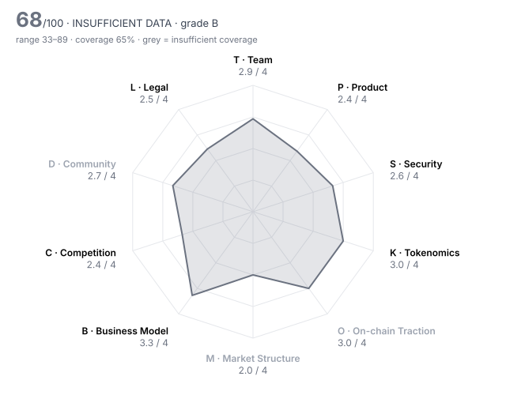

# Aerodrome (AERO) — DD-100 Due-Diligence Report

> **⚪ INSUFFICIENT DATA** · Grade **B** · Score **67.8/100** (range 33–89) · Evidence coverage **65%**  
> Profile `defi` · Evidence as of 2026-07-17 · 100 dimensions · 21 sources

The range is the honest number: it shows where the score could land once unscored dimensions are filled and low-confidence judgments are firmed up.

## Why this verdict

- evidence coverage 65% below the 70% needed for a verdict

## Red-flag gates

| Gate | Severity | Status | What it means |
|---|---|---|---|
| RF02 Sanctions / illicit-finance exposure | critical | ❔ unchecked | Listing would create direct regulatory liability for the venue. |
| RF03 Core contracts not source-verified | critical | ❔ unchecked | Nobody outside the team can see what users are interacting with. |
| RF07 Extreme holder concentration | major | ❔ unchecked | A handful of wallets can set the price; order books will not absorb their exit. |
| RF13 Undisclosed market-maker terms | major | ❔ unchecked | Token loans and call options are where post-listing dumps are engineered. |
| RF15 Mercenary TVL | minor | ❔ unchecked | Most deposits are paid to be there and will leave when incentives stop. |
| RF16 Volume implausible versus depth | minor | ❔ unchecked | Daily volume more than 100x the ±2% depth is a common wash-trading signature. |

10 of 16 gates verified clear.

## Pillar scores

| Pillar | Weight | Score /4 | | Coverage | Scored |
|---|---:|---:|---|---:|---:|
| T · Team & Governance | 12 | 2.94 | `███████░░░` | 71% | 7/10 |
| P · Product & Technology | 10 | 2.37 | `██████░░░░` | 100% | 10/10 |
| S · Security & Smart Contracts | 14 | 2.65 | `███████░░░` | 80% | 8/10 |
| K · Tokenomics & Supply | 14 | 3.00 | `████████░░` | 76% | 8/10 |
| O · On-chain Traction | 10 | 3.00 | `████████░░` | 29% ⚠️ | 3/10 |
| M · Market Structure & Liquidity | 8 | 2.00 | `█████░░░░░` | 12% ⚠️ | 2/10 |
| B · Business Model & Fundamentals | 10 | 3.27 | `████████░░` | 61% | 5/10 |
| C · Competition & Moat | 8 | 2.35 | `██████░░░░` | 94% | 9/10 |
| D · Community & Distribution | 5 | 2.67 | `███████░░░` | 23% ⚠️ | 3/10 |
| L · Legal, Compliance & Jurisdiction | 9 | 2.45 | `██████░░░░` | 69% | 5/8 |

⚠️ = coverage below the pillar minimum; treat that pillar's score as indicative.

## Claims vs. observation

No contradictions found across 2 checked project claim(s).

## Strengths

- **T10 Disclosure honesty** (4/4) — contradiction_count = 0  (bands 4:≤0, 3:≤0.5, 2:≤1, 1:≤2)
- **P02 Product maturity** (4/4) — Mainnet since August 2023 (~35 months) with Slipstream concentrated liquidity live since April 2024.
- **S04 Upgrade timelock** (4/4) — upgrade_timelock_hours = 9,999  (bands 4:≥72, 3:≥48, 2:≥24, 1:≥6)
- **K01 Token utility & value accrual** (4/4) — Locked AERO (veAERO) receives 100% of trading fees plus bribes from the pools it votes for, live since 2023.
- **B01 Annualised protocol revenue** (4/4) — annualized_revenue_usd = 57,000,000  (bands 4:≥5e+07, 3:≥1e+07, 2:≥2e+06, 1:≥250,000)
- **K05 Insider allocation** (4/4) — insider_allocation_pct = 8.61  (bands 4:≤25, 3:≤35, 2:≤45, 1:≤55)

## Risks

- **P06 Development activity (90d commits)** (0/4) — github_commits_90d = 4  (bands 4:≥300, 3:≥150, 2:≥60, 1:≥15)
- **S08 Incident history & response** (1/4) — Contracts never exploited, but users lost ~$700K (Nov 2025) and >$40K (Nov 2023) to two DNS hijacks of the official front end; compensation grants were announced but no payout found.
- **K08 Annual inflation** (1/4) — annual_inflation_pct = 11  (bands 4:≤2, 3:≤5, 2:≤10, 1:≤20)
- **L01 Legal entity & jurisdiction** (1/4) — Aerodrome Foundation and Dromos Labs are named with executives, but an exchange disclosure lists the foundation's jurisdiction and legal form as unknown.
- **P07 Contributor breadth (90d)** (1/4) — github_active_contributors_90d = 3  (bands 4:≥25, 3:≥12, 2:≥6, 1:≥3)
- **S05 Admin key custody** (2/4) — Admin powers sit with a team multisig and an Emergency Council multisig, not an EOA; threshold and signer independence unknown; powers include pausing v1 swaps and swapping fee modules with no timelock.

## Open questions for the project team

Everything below is unscored. Each one is a question to put to the team or a data request, not a negative finding.

**Needs a private channel (call, data room, counsel)** (3)

- T02 Identity verification level: Are the key people identified to the reviewer (KYC) and, ideally, publicly? — _requires private channel_
- M05 Market-maker arrangements: Are MM agreements (loans, call options, KPIs) disclosed to the reviewer and reasonable? — _requires private channel_
- L07 Legal opinion: Has the project provided a token legal opinion from reputable counsel? — _requires private channel_

**Needs evidence** (35)

- T06 Team vesting length: How long are team tokens locked and vested? — _metric 'team_vesting_months' not in evidence pack; team_vesting_months NOT set. One source says the team cliff is Feb 2028 (AERO-08), another that the 8.61% foundation+team allocation vests 'over time' (AERO-07); the lock was not verified on-chain, and the team also receives up to 5% of weekly emissions._
- T08 Treasury transparency: Are treasury addresses, holdings and spending disclosed and reconcilable on-chain? — _missing: foundation/team treasury addresses and any periodic treasury or buyback report to reconcile against on-chain balances_
- S02 Audit remediation: Were critical and high findings fixed and re-verified, and does deployed code match audited code? — _missing: finding-by-finding remediation status in the Spearbit (2023) and ChainSecurity (2025) reports, and confirmation that Base deployments match the audited commits_
- S03 Source verification: Is the source code of every core contract verified on the block explorer? — _metric 'contracts_verified' not in evidence pack; contracts_verified NOT set. The project README links every core address to Basescan '#code' (AERO-02), but that is the project's own claim; Basescan, Blockscout and Sourcify were blocked here, so verification was not independently confirmed. Two-minute analyst check: open the Basescan links for AERO 0x9401…8631, Minter, Voter, VotingEscrow, PoolFactory and the Slipstream CLFactory._
- K03 Holder concentration: Share of supply held by the top 10 wallets, excluding exchanges, burn and protocol contracts — _metric 'top10_holder_pct_ex_contracts' not in evidence pack; top10_holder_pct_ex_contracts NOT set: most supply sits in the VotingEscrow contract as veNFTs, so concentration needs veNFT-owner-level data; explorers were not reachable._
- K06 Investor cost-basis overhang: Current price as a multiple of the last private round price (higher = more profit to take) — _metric 'price_to_last_round_multiple' not in evidence pack; price_to_last_round_multiple NOT set: no priced private round disclosed (Coinbase Ventures/Base Ecosystem Fund terms unknown)._
- O02 Activity trend (90d): Percentage change in daily active addresses over 90 days — _metric 'daa_90d_change_pct' not in evidence pack; daa_90d_change_pct NOT set: the only figure is Q1-2026 vs Q4-2025 (-34%), which is stale; May fees +40% vs March suggest activity recovered._
- O03 30-day user retention: Share of a new-user cohort still active after 30 days — _metric 'retention_30d_pct' not in evidence pack; retention_30d_pct NOT set: needs own cohort query._
- O05 Incentive-driven TVL share: Share of TVL attributable to active token incentives (mercenary capital) — _metric 'incentivised_tvl_share_pct' not in evidence pack; incentivised_tvl_share_pct NOT set. Structurally, staked LPs give up fees for AERO emissions, so most TVL is likely in emission-receiving gauges; RF15 (mercenary TVL) may well apply. Needs a gauge-staked TVL / total TVL query._
- O06 Organic vs sybil activity: How much of the activity is bots, farmers or self-dealing? — _missing: address clustering / funding-source analysis of Aerodrome traders and LPs_
- O07 Fee-paying users (30d): Unique addresses that paid fees in the last 30 days — _metric 'fee_paying_users_30d' not in evidence pack; fee_paying_users_30d NOT set._
- O08 Integrations: Number of live third-party integrations (wallets, protocols, aggregators) — _metric 'live_integrations_count' not in evidence pack; live_integrations_count NOT set: no dated list of live integrations found._
- O10 Net capital flows (90d): Net inflow of external capital (stablecoins/majors) into the protocol over 90 days, USD — _metric 'net_inflow_90d_usd' not in evidence pack; net_inflow_90d_usd NOT set._
- M01 Order-book depth (±2%): Aggregate USD depth within 2% of mid across major venues — _metric 'depth_2pct_usd' not in evidence pack; depth_2pct_usd, spread_bps, volume_24h_usd and top_venue_volume_share_pct NOT set: only current venue data is available, which would leak post-listing information._
- M02 Venue concentration: Share of volume on the single largest venue — _metric 'top_venue_volume_share_pct' not in evidence pack; top_venue_volume_share_pct NOT set (see M01)._
- M03 Wash-trading indicators: Do volume, depth and trade-size patterns suggest fabricated volume? — _missing: point-in-time CEX order-book depth and volume by venue for mid-July 2026_
- M04 Bid-ask spread: Volume-weighted average spread in basis points — _metric 'spread_bps' not in evidence pack; spread_bps NOT set (see M01)._
- M07 Derivatives structure: Do perp open interest and funding indicate healthy two-way markets or crowded positioning? — _missing: AERO perp open interest and funding history before 17 July 2026_
- M08 Realised volatility (30d): Annualised 30-day realised volatility — _metric 'realized_vol_30d_pct' not in evidence pack; realized_vol_30d_pct NOT set: no pre-listing daily price series retrievable (CoinGecko API blocked)._
- M09 DEX liquidity ownership: Is on-chain liquidity protocol-owned/locked or mercenary and removable overnight? — _missing: ownership of AERO/USDC and AERO/WETH LP positions on Aerodrome (POL vs gauge-staked third parties)_
- B05 Incentive spend vs revenue: USD value of token incentives divided by protocol revenue (90d) — _metric 'incentives_to_revenue' not in evidence pack; incentives_to_revenue NOT set. Rough range only: ~11-18% annual inflation on ~1.87B supply at ~$0.45 is ~$90-150M/yr of emissions against ~$57-89M annualised revenue, i.e. ~1-2.5x. Too derived to enter as a metric._
- B06 Treasury runway: Months of runway at current burn, counting non-native assets at full value and native token at 50% — _metric 'runway_months' not in evidence pack; runway_months NOT set: foundation/Dromos treasury not published._
- B07 Treasury diversification: Share of treasury held in assets other than the native token — _metric 'treasury_non_native_pct' not in evidence pack; treasury_non_native_pct NOT set (see B06)._
- B08 Revenue growth (90d): Quarter-on-quarter change in protocol revenue — _metric 'revenue_qoq_growth_pct' not in evidence pack; revenue_qoq_growth_pct NOT set: Q1-2026 was -37% q/q; Q2-2026 total not retrievable._
- B09 Counterparty concentration: Does a single client, partner or whale drive most of the usage or revenue? — _missing: fee share by pool and by top LP/trader addresses_
- C09 Partnership substance: Are announced partnerships live integrations with measurable usage, or press releases? — _missing: list of announced partnerships to test against on-chain flows_
- D01 Organic audience: Size and quality of the audience across X, Telegram, Discord and regional channels — _missing: social engagement analytics (X, Discord, Telegram) for H1 2026_
- D02 Engagement authenticity: What share of engagement appears bot-driven or paid? — _missing: bot-likelihood / engagement-quality analysis_
- D03 Token holder count: Number of addresses holding a non-dust balance — _metric 'holders_count' not in evidence pack; holders_count NOT set: no pre-listing indexer snapshot retrievable._
- D04 Geographic & user diversity: Is the user base spread across regions, or concentrated where the venue cannot serve it? — _missing: user geography_
- D05 Paid-promotion dependence: How much attention comes from paid KOLs, undisclosed promotions or points campaigns? — _missing: disclosed or detected paid-promotion campaigns_
- D06 Developer community: Grants, hackathons and external contributors beyond the core team — _missing: grant programme and external contributor data_
- D07 Governance participation: Average share of circulating supply voting on recent proposals — _metric 'governance_participation_pct' not in evidence pack; governance_participation_pct NOT set: weekly gauge voting is near-universal among veAERO holders, but ProtocolGovernor/EpochGovernor participation data was not retrievable._
- L03 Sanctions & AML exposure: Has screening found exposure to sanctioned addresses, mixers or illicit flows above tolerance? — _metric 'sanctions_exposure' not in evidence pack; sanctions_exposure NOT set: needs the venue's own Chainalysis/TRM screening of the team multisig (0xE6A4…2075), Emergency Council (0x9924…013D), foundation and top-holder addresses._
- L10 Restricted-jurisdiction controls: Does the project geofence and enforce restrictions consistent with its legal analysis? — _missing: front-end geofencing and terms-of-use restrictions_

## Appendix A — all 100 dimensions

### T · Team & Governance

| ID | Dimension | Method | W | Score | Conf. | Evidence | Basis |
|---|---|---|---:|---:|---|---|---|
| T01 | Founder track record | agent | 3 | **3** | medium | AERO-20, AERO-13, AERO-06 | The same team built Velodrome, the largest DEX on Optimism, and Aerodrome, the largest DEX on Base, both still running. Outcomes are verifiable; individual founders' earlier careers are not documented in sources found. |
| T02 | Identity verification level | human | 3 | ⏳ |  |  | requires private channel |
| T03 | Team depth & key-person risk | agent | 2 | **2** | medium | AERO-11, AERO-13, AERO-01 | Named CEO (Cutler), CFO (Wick) and foundation executive director, plus several engineers visible in git history; no documented succession, and public code activity rests on 3 contributors over 90 days. |
| T04 | Technical leadership | agent | 2 | **3** | medium | AERO-02, AERO-03, AERO-11 | In-house team wrote and maintains the ve(3,3) v2 design (managed veNFTs, Aero Fed emissions), Slipstream and dynamic-fee modules, with public specs; most core math is adapted from Solidly and Uniswap V3. |
| T05 | Controversies & misconduct history | agent | 3 | **3** | medium | AERO-13, AERO-06, AERO-08 | No enforcement, lawsuit or misconduct allegation found in press coverage; court records and team wallet histories were not checked, so not a 4. |
| T06 | Team vesting length | rule | 2 | – |  |  | metric 'team_vesting_months' not in evidence pack; team_vesting_months NOT set. One source says the team cliff is Feb 2028 (AERO-08), another that the 8.61% foundation+team allocation vests 'over time' (AERO-07); the lock was not verified on-chain, and the team also receives up to 5% of weekly emissions. |
| T07 | Governance design & decentralisation path | agent | 2 | **2** | medium | AERO-02, AERO-08 | veAERO holders vote weekly and bindingly on emissions allocation and the tail rate, but the team multisig still holds pauser, fee-manager, factory-registry and vetoer roles; the vetoer renunciation is promised without a date. |
| T08 | Treasury transparency | agent | 2 | – |  |  | missing: foundation/team treasury addresses and any periodic treasury or buyback report to reconcile against on-chain balances |
| T09 | Backer quality & cap table | agent | 2 | **3** | low | AERO-08 | No private sale or VC allocation at genesis; one source names Coinbase Ventures (via the Base Ecosystem Fund) as an investor, with terms undisclosed. |
| T10 | Disclosure honesty | rule | 3 | **4** | high | HARNESS | contradiction_count = 0  (bands 4:≤0, 3:≤0.5, 2:≤1, 1:≤2) |

### P · Product & Technology

| ID | Dimension | Method | W | Score | Conf. | Evidence | Basis |
|---|---|---|---:|---:|---|---|---|
| P01 | Problem clarity & real demand | agent | 3 | **3** | medium | AERO-08, AERO-09 | Traders pay real fees (~$57M annualised in July 2026, >$17B 30d volume), but the liquidity side is paid for with AERO emissions. |
| P02 | Product maturity | agent | 3 | **4** | high | AERO-20, AERO-06, AERO-07 | Mainnet since August 2023 (~35 months) with Slipstream concentrated liquidity live since April 2024. |
| P03 | Technical originality | agent | 2 | **2** | high | AERO-02, AERO-03, AERO-20 | Fork of Velodrome V2 (Solidly lineage) and adapted Uniswap V3 pools, with meaningful additions: managed veNFTs, gauge-integrated CL pools, dynamic fee modules. |
| P04 | Architecture soundness | agent | 2 | **3** | medium | AERO-02, AERO-15, AERO-06 | Uses battle-tested constant-product and concentrated-liquidity designs; no contract exploit in ~3 years of production. |
| P05 | Dependency risk | agent | 2 | **2** | medium | AERO-18, AERO-15, AERO-20 | Single-chain dependence on Base and its sequencer for the core business, and a centralised web domain that was hijacked twice (2023, 2025). |
| P06 | Development activity (90d commits) | rule | 2 | **0** | high | AERO-01 | github_commits_90d = 4  (bands 4:≥300, 3:≥150, 2:≥60, 1:≥15) |
| P07 | Contributor breadth (90d) | rule | 1 | **1** | high | AERO-01 | github_active_contributors_90d = 3  (bands 4:≥25, 3:≥12, 2:≥6, 1:≥3) |
| P08 | Roadmap delivery record | agent | 2 | **2** | medium | AERO-08, AERO-10, AERO-09, AERO-01 | Slipstream and dynamic fees shipped, but the flagship Aero merger targeted for Q2 2026 was not live by 1 July 2026, and Predictive Allocation was still 'scheduled'. |
| P09 | Open source & reproducibility | agent | 1 | **2** | medium | AERO-02, AERO-03 | Contracts are public (GPL/Apache, gauges BUSL); the reviewer could not confirm deployed bytecode matches a tagged commit. |
| P10 | Documentation quality | agent | 1 | **3** | medium | AERO-02, AERO-03 | Repos ship a specification, an exhaustive admin-permissions list and a voting-escrow spec; no threat model found. |

### S · Security & Smart Contracts

| ID | Dimension | Method | W | Score | Conf. | Evidence | Basis |
|---|---|---|---:|---:|---|---|---|
| S01 | Audit coverage | rule | 3 | **3** | medium | AERO-04 | audits_reputable_count = 2  (bands 4:≥3, 3:≥2, 2:≥1, 1:≥0.5) |
| S02 | Audit remediation | agent | 3 | – |  |  | missing: finding-by-finding remediation status in the Spearbit (2023) and ChainSecurity (2025) reports, and confirmation that Base deployments match the audited commits |
| S03 | Source verification | rule | 2 | – |  |  | metric 'contracts_verified' not in evidence pack; contracts_verified NOT set. The project README links every core address to Basescan '#code' (AERO-02), but that is the project's own claim; Basescan, Blockscout and Sourcify were blocked here, so verification was not independently confirmed. Two-minute analyst check: open the Basescan links for AERO 0x9401…8631, Minter, Voter, VotingEscrow, PoolFactory and the Slipstream CLFactory. |
| S04 | Upgrade timelock | rule | 3 | **4** | low | AERO-02 | upgrade_timelock_hours = 9,999  (bands 4:≥72, 3:≥48, 2:≥24, 1:≥6) |
| S05 | Admin key custody | agent | 3 | **2** | medium | AERO-02, AERO-03, AERO-08 | Admin powers sit with a team multisig and an Emergency Council multisig, not an EOA; threshold and signer independence unknown; powers include pausing v1 swaps and swapping fee modules with no timelock. |
| S06 | Mint / freeze / blacklist powers | agent | 3 | **3** | medium | AERO-02, AERO-06, AERO-07 | Only the Minter contract can mint, on a coded schedule that veAERO voters can nudge by 1 bp of supply per week; no freeze or blacklist function. Supply is uncapped. |
| S07 | Bug bounty | rule | 1 | **2** | medium | AERO-04 | bug_bounty_max_usd = 100,000  (bands 4:≥1e+06, 3:≥250,000, 2:≥50,000, 1:≥10,000) |
| S08 | Incident history & response | agent | 3 | **1** | medium | AERO-15, AERO-16, AERO-17, AERO-18, AERO-19 | Contracts never exploited, but users lost ~$700K (Nov 2025) and >$40K (Nov 2023) to two DNS hijacks of the official front end; compensation grants were announced but no payout found. |
| S09 | Oracle & manipulation resistance | agent | 2 | **3** | medium | AERO-02, AERO-03 | Swaps do not depend on an external price oracle; risk sits with third parties that read Aerodrome pool prices, not with the DEX's own solvency. |
| S10 | Bridge & cross-chain exposure | agent | 2 | **3** | medium | AERO-02, AERO-10 | AERO is minted natively on Base; the planned Aero expansion to Ethereum and Arc would add cross-chain exposure that is not yet live. |

### K · Tokenomics & Supply

| ID | Dimension | Method | W | Score | Conf. | Evidence | Basis |
|---|---|---|---:|---:|---|---|---|
| K01 | Token utility & value accrual | agent | 3 | **4** | high | AERO-07, AERO-08 | Locked AERO (veAERO) receives 100% of trading fees plus bribes from the pools it votes for, live since 2023. |
| K02 | Circulating ratio | rule | 2 | **3** | high | HARNESS | circulating_supply_pct = 51.2  (bands 4:≥60, 3:≥40, 2:≥25, 1:≥15) |
| K03 | Holder concentration | rule | 3 | – |  |  | metric 'top10_holder_pct_ex_contracts' not in evidence pack; top10_holder_pct_ex_contracts NOT set: most supply sits in the VotingEscrow contract as veNFTs, so concentration needs veNFT-owner-level data; explorers were not reachable. |
| K04 | 12-month unlock pressure | rule | 3 | **3** | medium | AERO-11 | unlock_12m_pct_of_circ = 11.4  (bands 4:≤10, 3:≤25, 2:≤50, 1:≤100) |
| K05 | Insider allocation | rule | 2 | **4** | medium | AERO-07 | insider_allocation_pct = 8.61  (bands 4:≤25, 3:≤35, 2:≤45, 1:≤55) |
| K06 | Investor cost-basis overhang | rule | 2 | – |  |  | metric 'price_to_last_round_multiple' not in evidence pack; price_to_last_round_multiple NOT set: no priced private round disclosed (Coinbase Ventures/Base Ecosystem Fund terms unknown). |
| K07 | FDV / market cap | rule | 2 | **3** | high | HARNESS | fdv_to_mcap = 1.96  (bands 4:≤1.5, 3:≤2.5, 2:≤4, 1:≤7) |
| K08 | Annual inflation | rule | 2 | **1** | medium | AERO-08 | annual_inflation_pct = 11  (bands 4:≤2, 3:≤5, 2:≤10, 1:≤20) |
| K09 | Supply verifiability | agent | 1 | **2** | medium | AERO-08, AERO-02 | Minting is on-chain and formulaic, but providers disagree on circulating supply (~958M vs ~1.25B) and the team lock was not verified on-chain. |
| K10 | Airdrop & incentive design | agent | 1 | **3** | medium | AERO-02, AERO-07 | The 10% airdrop went out as locked veAERO (AirdropDistributor creates locked NFTs), so recipients could not dump on day one; post-unlock retention not measured. |

### O · On-chain Traction

| ID | Dimension | Method | W | Score | Conf. | Evidence | Basis |
|---|---|---|---:|---:|---|---|---|
| O01 | Daily active addresses (30d avg) | rule | 2 | **3** | medium | AERO-08 | daa_30d_avg = 24,000  (bands 4:≥50,000, 3:≥10,000, 2:≥2,000, 1:≥300) |
| O02 | Activity trend (90d) | rule | 2 | – |  |  | metric 'daa_90d_change_pct' not in evidence pack; daa_90d_change_pct NOT set: the only figure is Q1-2026 vs Q4-2025 (-34%), which is stale; May fees +40% vs March suggest activity recovered. |
| O03 | 30-day user retention | rule | 2 | – |  |  | metric 'retention_30d_pct' not in evidence pack; retention_30d_pct NOT set: needs own cohort query. |
| O04 | TVL / AUM | rule | 2 | **3** | medium | AERO-09 | tvl_usd = 310,000,000  (bands 4:≥1e+09, 3:≥2e+08, 2:≥5e+07, 1:≥1e+07) |
| O05 | Incentive-driven TVL share | rule | 2 | – |  |  | metric 'incentivised_tvl_share_pct' not in evidence pack; incentivised_tvl_share_pct NOT set. Structurally, staked LPs give up fees for AERO emissions, so most TVL is likely in emission-receiving gauges; RF15 (mercenary TVL) may well apply. Needs a gauge-staked TVL / total TVL query. |
| O06 | Organic vs sybil activity | agent | 3 | – |  |  | missing: address clustering / funding-source analysis of Aerodrome traders and LPs |
| O07 | Fee-paying users (30d) | rule | 1 | – |  |  | metric 'fee_paying_users_30d' not in evidence pack; fee_paying_users_30d NOT set. |
| O08 | Integrations | rule | 1 | – |  |  | metric 'live_integrations_count' not in evidence pack; live_integrations_count NOT set: no dated list of live integrations found. |
| O09 | Builder ecosystem | agent | 1 | **3** | medium | AERO-07, AERO-08 | Third-party protocols pay bribes to veAERO voters to direct liquidity (~22% of Q1-2026 value flow) and 180+ tokens are listed; activity depends on that incentive market. |
| O10 | Net capital flows (90d) | rule | 1 | – |  |  | metric 'net_inflow_90d_usd' not in evidence pack; net_inflow_90d_usd NOT set. |

### M · Market Structure & Liquidity

| ID | Dimension | Method | W | Score | Conf. | Evidence | Basis |
|---|---|---|---:|---:|---|---|---|
| M01 | Order-book depth (±2%) | rule | 3 | – |  |  | metric 'depth_2pct_usd' not in evidence pack; depth_2pct_usd, spread_bps, volume_24h_usd and top_venue_volume_share_pct NOT set: only current venue data is available, which would leak post-listing information. |
| M02 | Venue concentration | rule | 2 | – |  |  | metric 'top_venue_volume_share_pct' not in evidence pack; top_venue_volume_share_pct NOT set (see M01). |
| M03 | Wash-trading indicators | agent | 3 | – |  |  | missing: point-in-time CEX order-book depth and volume by venue for mid-July 2026 |
| M04 | Bid-ask spread | rule | 2 | – |  |  | metric 'spread_bps' not in evidence pack; spread_bps NOT set (see M01). |
| M05 | Market-maker arrangements | human | 2 | ⏳ |  |  | requires private channel |
| M06 | Existing venue quality | agent | 1 | **2** | medium | AERO-06, AERO-09 | Pre-listing venues evidenced: Coinone (since 2024), KuCoin and Aerodrome itself; other tier-1 venues not confirmed from pre-listing sources. |
| M07 | Derivatives structure | agent | 1 | – |  |  | missing: AERO perp open interest and funding history before 17 July 2026 |
| M08 | Realised volatility (30d) | rule | 1 | – |  |  | metric 'realized_vol_30d_pct' not in evidence pack; realized_vol_30d_pct NOT set: no pre-listing daily price series retrievable (CoinGecko API blocked). |
| M09 | DEX liquidity ownership | agent | 1 | – |  |  | missing: ownership of AERO/USDC and AERO/WETH LP positions on Aerodrome (POL vs gauge-staked third parties) |
| M10 | Narrative & timing fit | agent | 1 | **2** | medium | AERO-08, AERO-09, AERO-12 | Leader of Base DEX trading, but Base DEX volume was ~50% below its Oct 2025 peak and AERO ~87% below its high; the merger is a pending catalyst. |

### B · Business Model & Fundamentals

| ID | Dimension | Method | W | Score | Conf. | Evidence | Basis |
|---|---|---|---:|---:|---|---|---|
| B01 | Annualised protocol revenue | rule | 3 | **4** | medium | AERO-08 | annualized_revenue_usd = 57,000,000  (bands 4:≥5e+07, 3:≥1e+07, 2:≥2e+06, 1:≥250,000) |
| B02 | Revenue quality | agent | 2 | **2** | medium | AERO-08, AERO-07 | Revenue comes from swaps across many pools but is cyclical (Q1-2026 fees -37% q/q, May +40% vs March), and ~22% is bribes paid by protocols. |
| B03 | Holder value capture | agent | 2 | **4** | high | AERO-07, AERO-08 | All fees and bribes are distributed weekly on-chain to veAERO voters; cumulative >$295M by Jan 2026. |
| B04 | Valuation vs fees (FDV / annualised fees) | rule | 2 | **4** | high | HARNESS | fdv_to_annual_fees = 16.1  (bands 4:≤20, 3:≤50, 2:≤150, 1:≤500) |
| B05 | Incentive spend vs revenue | rule | 2 | – |  |  | metric 'incentives_to_revenue' not in evidence pack; incentives_to_revenue NOT set. Rough range only: ~11-18% annual inflation on ~1.87B supply at ~$0.45 is ~$90-150M/yr of emissions against ~$57-89M annualised revenue, i.e. ~1-2.5x. Too derived to enter as a metric. |
| B06 | Treasury runway | rule | 2 | – |  |  | metric 'runway_months' not in evidence pack; runway_months NOT set: foundation/Dromos treasury not published. |
| B07 | Treasury diversification | rule | 1 | – |  |  | metric 'treasury_non_native_pct' not in evidence pack; treasury_non_native_pct NOT set (see B06). |
| B08 | Revenue growth (90d) | rule | 1 | – |  |  | metric 'revenue_qoq_growth_pct' not in evidence pack; revenue_qoq_growth_pct NOT set: Q1-2026 was -37% q/q; Q2-2026 total not retrievable. |
| B09 | Counterparty concentration | agent | 1 | – |  |  | missing: fee share by pool and by top LP/trader addresses |
| B10 | Sustainability without emissions | agent | 2 | **2** | medium | AERO-07, AERO-08 | Staked LPs give their fees to voters and are paid in emissions, so liquidity would thin if emissions stopped; a fee-paying swap business would remain. |

### C · Competition & Moat

| ID | Dimension | Method | W | Score | Conf. | Evidence | Basis |
|---|---|---|---:|---:|---|---|---|
| C01 | Segment size & growth | agent | 2 | **3** | medium | AERO-11, AERO-08 | Spot DEX trading is a large segment ($613B in Oct 2025), but Base DEX volume had fallen ~50% from its Oct 2025 peak. |
| C02 | Category market share | rule | 2 | **4** | medium | AERO-08 | category_share_pct = 43  (bands 4:≥30, 3:≥15, 2:≥5, 1:≥1) |
| C03 | Share trajectory | agent | 2 | **2** | low | AERO-08, AERO-09 | Base DEX share fell from 72% (Q4-2024) to a ~39% trough before recovering to 43-53% in May 2026; the sources disagree on the latest level. |
| C04 | Moat | agent | 3 | **2** | medium | AERO-08, AERO-07 | Bribe/emission marketplace and Base-native liquidity give a moat, but Uniswap took share to ~32% while Aerodrome fell from 72% to ~43%. |
| C05 | Forkability | agent | 2 | **2** | medium | AERO-03, AERO-20 | Code is forkable (Aerodrome is itself a fork; gauges are BUSL-licensed), but liquidity depth and the bribe market are sticky; no fork that took share was found. |
| C06 | Differentiation vs top-3 peers | agent | 2 | **2** | medium | AERO-07, AERO-13 | Versus Uniswap, projects can buy liquidity through bribes rather than seed it themselves; one axis, and other ve(3,3) DEXs can copy it. |
| C07 | Relative valuation | agent | 2 | **2** | medium | AERO-08 | Q1-2026 price/sales ~2.2x circulating vs Uniswap 2.3x; on FDV 4.6x vs 3.3x — roughly in line. |
| C08 | Platform & incumbent threat | agent | 1 | **2** | medium | AERO-08, AERO-14 | Base was 'exploring' a native token (Sep 2025) and Uniswap competes on the same chain; no competing native DEX from Coinbase/Base found. |
| C09 | Partnership substance | agent | 1 | – |  |  | missing: list of announced partnerships to test against on-chain flows |
| C10 | Exchange-level strategic fit | agent | 1 | **2** | medium | AERO-13, AERO-20 | Adds the leading Base DEX token, but the venue already covers DEX tokens; Base is a rival exchange's chain. |

### D · Community & Distribution

| ID | Dimension | Method | W | Score | Conf. | Evidence | Basis |
|---|---|---|---:|---:|---|---|---|
| D01 | Organic audience | agent | 1 | – |  |  | missing: social engagement analytics (X, Discord, Telegram) for H1 2026 |
| D02 | Engagement authenticity | agent | 2 | – |  |  | missing: bot-likelihood / engagement-quality analysis |
| D03 | Token holder count | rule | 2 | – |  |  | metric 'holders_count' not in evidence pack; holders_count NOT set: no pre-listing indexer snapshot retrievable. |
| D04 | Geographic & user diversity | agent | 1 | – |  |  | missing: user geography |
| D05 | Paid-promotion dependence | agent | 2 | – |  |  | missing: disclosed or detected paid-promotion campaigns |
| D06 | Developer community | agent | 1 | – |  |  | missing: grant programme and external contributor data |
| D07 | Governance participation | rule | 1 | – |  |  | metric 'governance_participation_pct' not in evidence pack; governance_participation_pct NOT set: weekly gauge voting is near-universal among veAERO holders, but ProtocolGovernor/EpochGovernor participation data was not retrievable. |
| D08 | Communication transparency | agent | 1 | **3** | medium | AERO-16, AERO-17, AERO-18, AERO-21 | Both DNS incidents were flagged publicly within hours with a preliminary root cause in days; a Velodrome post was deleted and the compensation programme had no public follow-up in sources found. |
| D09 | Sentiment & controversy | agent | 1 | **2** | low | AERO-12, AERO-08 | AERO fell 19% on the merger announcement and sat ~87% below its high; informed opinion appears mixed. |
| D10 | Ecosystem credibility | agent | 1 | **3** | medium | AERO-20, AERO-21, AERO-08 | Largest DEX on Base, integrated with major wallets' security tooling and reportedly backed via Coinbase's Base Ecosystem Fund. |

### L · Legal, Compliance & Jurisdiction

| ID | Dimension | Method | W | Score | Conf. | Evidence | Basis |
|---|---|---|---:|---:|---|---|---|
| L01 | Legal entity & jurisdiction | agent | 2 | **1** | medium | AERO-06, AERO-13 | Aerodrome Foundation and Dromos Labs are named with executives, but an exchange disclosure lists the foundation's jurisdiction and legal form as unknown. |
| L02 | Securities-law risk | agent | 3 | **2** | low | AERO-07, AERO-08, AERO-02 | Lockers receive 100% of fees, a profit-like feature, and the team keeps admin roles; but there was no token sale, and emissions governance is on-chain. |
| L03 | Sanctions & AML exposure | rule | 3 | – |  |  | metric 'sanctions_exposure' not in evidence pack; sanctions_exposure NOT set: needs the venue's own Chainalysis/TRM screening of the team multisig (0xE6A4…2075), Emergency Council (0x9924…013D), foundation and top-holder addresses. |
| L04 | Licensing for regulated activity | agent | 2 | **3** | medium | AERO-02, AERO-13 | Non-custodial AMM with no custody or issuance; Aero plans permissioned tiers for regulated institutions, which may raise licensing questions. |
| L05 | Litigation & enforcement | agent | 3 | **3** | medium | AERO-13, AERO-06, AERO-08 | No litigation or regulator action found in press or exchange disclosures; court and regulator databases were not searched directly. |
| L06 | Privacy & obfuscation features | agent | 1 | **4** | medium | AERO-02, AERO-06 | Plain ERC-20 and AMM contracts with no privacy or obfuscation features. |
| L07 | Legal opinion | human | 1 | ⏳ |  |  | requires private channel |
| L08 | RWA custody & bankruptcy remoteness | agent | 3 | n/a |  |  | not applicable to profile 'defi' |
| L09 | RWA attestation frequency | agent | 2 | n/a |  |  | not applicable to profile 'defi' |
| L10 | Restricted-jurisdiction controls | agent | 1 | – |  |  | missing: front-end geofencing and terms-of-use restrictions |

## Appendix B — sources

| ID | Tier | Type | Title |
|---|---|---|---|
| AERO-07 | 2 · independent | tokenomics | [Tokenomics.com — Aerodrome tokenomics: how AERO accrues 100% of protocol fees (published 2 Feb 2026)](https://tokenomics.com/articles/aerodrome-tokenomics-how-aero-captures-100-of-protocol-fees) |
| AERO-08 | 2 · independent | news | [TokenIntel — Aerodrome (AERO) research and analysis (header 'April 2026', figures 'last verified 2026-07-01')](https://tokenintel.org/research/aerodrome) |
| AERO-09 | 2 · independent | news | [KuCoin Blog — Aerodrome launches Predictive Allocation (published 20 Jun 2026; exchange with a commercial interest in AERO trading)](https://www.kucoin.com/blog/aerodrome-predictive-allocation-defi-liquidity) |
| AERO-06 | 2 · independent | doc | [Coinone — AERO digital asset manual (Korean exchange disclosure, dated 11 Sep 2024)](https://research.coinone.co.kr/manual/AERO_digital_asset_manual_EE814724EDA1637E.pdf) |
| AERO-11 | 2 · independent | news | [ForkLog — Aerodrome and Velodrome to merge into Aero (13 Nov 2025)](https://forklog.com/en/news/aerodrome-and-velodrome-to-merge-into-aero) |
| AERO-12 | 2 · independent | news | [Bitcoin.com News — Dromos Labs reveals Aero after merging 2 major L2 DEXs (13 Nov 2025)](https://news.bitcoin.com/dromos-labs-reveals-aero-after-merging-2-major-l2-dexs/) |
| AERO-01 | 1 · primary | github | [Own git-history query of public Aerodrome/Velodrome repositories (commits 2026-04-18 to 2026-07-17)](https://github.com/aerodrome-finance/contracts) |
| AERO-02 | 3 · self-reported | doc | [aerodrome-finance/contracts — source, README, PERMISSIONS.md, SPECIFICATION.md (main branch, last commit 2025-12-18)](https://github.com/aerodrome-finance/contracts) |
| AERO-03 | 3 · self-reported | doc | [aerodrome-finance/slipstream — README, fee modules, audits folder](https://github.com/aerodrome-finance/slipstream) |
| AERO-04 | 2 · independent | doc | [Immunefi — Velodrome Finance bug bounty (last updated 5 Jul 2026)](https://immunefi.com/bug-bounty/velodromefinance/information) |
| AERO-05 | 2 · independent | audit | [ChainSecurity — Velodrome Slipstream Dynamic Fee audit (completed 13 Jan 2025)](https://www.chainsecurity.com/security-audit/velodrome-slipstream-dynamic-fee) |
| AERO-15 | 2 · independent | news | [Blockaid — How Blockaid's network contained the Aerodrome DNS attack (24 Nov 2025)](https://www.blockaid.io/blog/how-blockaids-customer-data-network-contained-the-aerodrome-dns-attack) |
| AERO-16 | 2 · independent | news | [MEXC News (PANews) — Aerodrome/Velodrome preliminary post-mortem (24 Nov 2025)](https://www.mexc.com/news/186121) |
| AERO-17 | 2 · independent | news | [MEXC News (PANews) — Aerodrome domain migration complete (6 Dec 2025)](https://www.mexc.com/en-NG/news/233422) |
| AERO-18 | 2 · independent | news | [The Block — Aerodrome, Velodrome hit with front-end compromise (22 Nov 2025)](https://www.theblock.co/post/380037/top-dexs-aerodrome-velodrome-hit-with-front-end-compromise-urge-users-to-avoid-main-domains) |
| AERO-19 | 2 · independent | news | [The Block — Velodrome, Aerodrome hit by attack on front-end websites (29 Nov 2023)](https://www.theblock.co/post/265104/velodrome-aerodrome-hit-by-attack-on-front-end-websites) |
| AERO-10 | 2 · independent | news | [The Defiant — Dromos Labs merges Aerodrome and Velodrome into new DEX Aero (12 Nov 2025)](https://thedefiant.io/news/defi/dromos-labs-merges-aerodrome-and-velodrome-into-new-dex-aero) |
| AERO-13 | 2 · independent | news | [DL News — Aerodrome devs target Uniswap with new Ethereum protocol (13 Nov 2025)](https://dlnews.com/articles/defi/aerodrome-devs-target-uniswap-with-new-ethereum-protocol/) |
| AERO-14 | 2 · independent | news | [CoinDesk (via Yahoo Finance) — Aero DEX aims to fix liquidity fragmentation (29 Jan 2026)](https://finance.yahoo.com/news/aero-dex-aims-fix-liquidity-181407013.html) |
| AERO-20 | 2 · independent | news | [The Block — Aerodrome tops $1 billion in deposits, dominating DeFi on Base (3 Oct 2024)](https://www.theblock.co/post/319258/aerodrome-tops-1-billion-in-dominating-defi-on-base) |
| AERO-21 | 2 · independent | news | [ChainCatcher — Aerodrome domain hijacking contained, ~$700K lost (24 Nov 2025)](https://www.chaincatcher.com/en/article/2223307) |
| HARNESS | computed | harness | Metrics derived by the harness from other evidence |

---
_Generated by DD-100. Scores are decision support for a listing committee, not investment advice. Every judgment above cites its evidence; anything uncited was not scored._