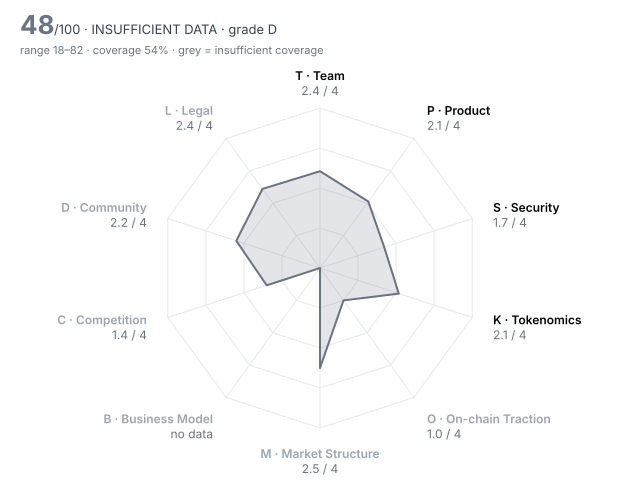

# Fogo (FOGO) — DD-100 Due-Diligence Report

> **⚪ INSUFFICIENT DATA** · Grade **D** · Score **48.1/100** (range 18–82) · Evidence coverage **54%**  
> Profile `l1_l2` · Evidence as of 2026-01-15 · 100 dimensions · 21 sources

The range is the honest number: it shows where the score could land once unscored dimensions are filled and low-confidence judgments are firmed up.

## Why this verdict

- evidence coverage 54% below the 70% needed for a verdict

## Red-flag gates

| Gate | Severity | Status | What it means |
|---|---|---|---|
| RF09 No independent audit | major | 🚩 fired | Code holding user funds has never been reviewed by a third party. |
| RF14 Insider-heavy allocation | minor | 🚩 fired | Team and investors hold more than half of supply. |
| RF02 Sanctions / illicit-finance exposure | critical | ❔ unchecked | Listing would create direct regulatory liability for the venue. |
| RF06 Upgradeable contracts with no meaningful timelock | major | ❔ unchecked | Logic can change under users with no time to exit. |
| RF07 Extreme holder concentration | major | ❔ unchecked | A handful of wallets can set the price; order books will not absorb their exit. |
| RF12 Anonymous team with centralised admin powers | major | ❔ unchecked | Unaccountable people holding privileged keys. |
| RF13 Undisclosed market-maker terms | major | ❔ unchecked | Token loans and call options are where post-listing dumps are engineered. |
| RF16 Volume implausible versus depth | minor | ❔ unchecked | Daily volume more than 100x the ±2% depth is a common wash-trading signature. |

7 of 16 gates verified clear (1 not applicable to this profile).

## Pillar scores

| Pillar | Weight | Score /4 | | Coverage | Scored |
|---|---:|---:|---|---:|---:|
| T · Team & Governance | 12 | 2.42 | `██████░░░░` | 79% | 8/10 |
| P · Product & Technology | 14 | 2.06 | `█████░░░░░` | 95% | 9/10 |
| S · Security & Smart Contracts | 12 | 1.69 | `████░░░░░░` | 64% | 6/10 |
| K · Tokenomics & Supply | 14 | 2.07 | `█████░░░░░` | 67% | 7/10 |
| O · On-chain Traction | 12 | 1.00 | `██░░░░░░░░` | 13% ⚠️ | 2/9 |
| M · Market Structure & Liquidity | 8 | 2.50 | `██████░░░░` | 12% ⚠️ | 2/10 |
| B · Business Model & Fundamentals | 6 | n/a | `··········` | 0% ⚠️ | 0/9 |
| C · Competition & Moat | 10 | 1.40 | `████░░░░░░` | 56% ⚠️ | 6/10 |
| D · Community & Distribution | 6 | 2.20 | `██████░░░░` | 38% ⚠️ | 4/10 |
| L · Legal, Compliance & Jurisdiction | 6 | 2.44 | `██████░░░░` | 56% ⚠️ | 4/8 |

⚠️ = coverage below the pillar minimum; treat that pillar's score as indicative.

## Claims vs. observation

| Claim | Claimed | Observed | Gap | Sources |
|---|---:|---:|---:|---|
| December tokenomics: institutional investors (Distributed Global, CMS Holdings) hold 8.77% of supply | 8.77 | 12.06 | 27% | FOGO-01 vs FOGO-07 |

## Strengths

- **S03 Source verification** (4/4) — contracts_verified = true
- **K08 Annual inflation** (4/4) — annual_inflation_pct = 2  (bands 4:≤2, 3:≤5, 2:≤10, 1:≤20)
- **L06 Privacy & obfuscation features** (4/4) — Transparent SVM ledger forked from Firedancer; no privacy or obfuscation feature appears in the client or the product description.
- **T01 Founder track record** (3/4) — Colkitt built Ambient Finance (ex-Citadel quant); Sagurton ran digital-asset sales at Jump Crypto; engineering comes from Douro Labs, the team behind Pyth and Pythnet. Outcomes of Ambient were not established from these sources.
- **T05 Controversies & misconduct history** (3/4) — No enforcement or misconduct found; public criticism concerns pricing (the $1B-FDV presale called 'extractive', cancelled within two days) and raising on forked code, not conduct.
- **S06 Mint / freeze / blacklist powers** (3/4) — Native token with no mint key; issuance is a fixed 2% a year set in the client. Supply is not fixed, and the BSC token used for the Prime Sale was not checked.

## Risks

- **S01 Audit coverage** (0/4) — audits_reputable_count = 0  (bands 4:≥3, 3:≥2, 2:≥1, 1:≥0.5)
- **K05 Insider allocation** (0/4) — insider_allocation_pct = 61.74  (bands 4:≤25, 3:≤35, 2:≤45, 1:≤55)
- **O08 Integrations** (0/4) — live_integrations_count = 1  (bands 4:≥50, 3:≥20, 2:≥8, 1:≥3)
- **S02 Audit remediation** (1/4) — The only audit found covers upstream Firedancer v0.1 for Jump (2 highs, Agave runtime out of scope); Fogo's own modifications and the Sessions programs have no public audit.
- **S05 Admin key custody** (1/4) — A genesis authority curates the validator set, and protocol changes ship as client releases from the Foundation-funded team; no on-chain timelock or independent signer set is documented.
- **C04 Moat** (1/4) — The only edge is latency from validator co-location and Firedancer; Solana is adopting the same client (~21% of stake), and no retention has been shown.

## Open questions for the project team

Everything below is unscored. Each one is a question to put to the team or a data request, not a negative finding.

**Needs a private channel (call, data room, counsel)** (3)

- T02 Identity verification level: Are the key people identified to the reviewer (KYC) and, ideally, publicly? — _requires private channel_
- M05 Market-maker arrangements: Are MM agreements (loans, call options, KPIs) disclosed to the reviewer and reasonable? — _requires private channel_
- L07 Legal opinion: Has the project provided a token legal opinion from reputable counsel? — _requires private channel_

**Needs evidence** (45)

- T08 Treasury transparency: Are treasury addresses, holdings and spending disclosed and reconcilable on-chain? — _missing: Foundation and launch-liquidity wallet addresses (21.76% + 6.5% unlocked at TGE) and any treasury reporting; fogo.io docs could not be accessed in this review_
- P10 Documentation quality: Could an integrator or auditor understand the system from the docs alone? — _missing: docs.fogo.io and the litepaper could not be accessed in this review; need technical specs for zone rotation, fallback and validator admission; fogo.io and docs.fogo.io could not be fetched in this review (access not granted), so official docs, the litepaper, treasury addresses and the published vesting addresses were not read directly._
- S04 Upgrade timelock: How long must users wait between an upgrade being queued and executed? (non-upgradeable = 9999) — _metric 'upgrade_timelock_hours' not in evidence pack; No upgrade timelock is documented. Protocol changes ship as client releases adopted by a curated validator set (FOGO-17, FOGO-20). Ask: notice period before upgrades, and who controls the Sessions programs' upgrade authority._
- S07 Bug bounty: What is the maximum bug bounty payout on an established platform? — _metric 'bug_bounty_max_usd' not in evidence pack; No public bug bounty was found for Fogo or Fogo Sessions._
- S08 Incident history & response: Has the protocol been exploited, and how was it handled? — _missing: production history; mainnet was 0–2 days old at as_of, so no incident record exists to judge_
- S09 Oracle & manipulation resistance: Can prices or state be manipulated to drain funds (flash loans, thin oracles)? — _missing: which oracle setups the launch DeFi apps use; native Pyth integration is claimed (FOGO-06) but not verified_
- K03 Holder concentration: Share of supply held by the top 10 wallets, excluding exchanges, burn and protocol contracts — _metric 'top10_holder_pct_ex_contracts' not in evidence pack; Top-holder concentration not established. At TGE the Foundation controls 21.76% plus 6.5% launch liquidity, about 78% of the 36.26% unlocked supply (FOGO-09). Needs labelled holder data from the Fogo explorer; locked allocations' custody (vesting contracts or custodian) is not documented._
- K06 Investor cost-basis overhang: Current price as a multiple of the last private round price (higher = more profit to take) — _metric 'price_to_last_round_multiple' not in evidence pack_
- K07 FDV / market cap: How much future dilution is priced in? — _metric 'fdv_to_mcap' not in evidence pack; Price, market cap, FDV, 24h volume, depth and spread at listing are not set. Trading opened on 15 Jan 2026; no pre-listing exchange snapshot or listing-day price published on or before that date was found. The only priced reference is the Binance Wallet Prime Sale on 13 Jan: $0.035/FOGO, about $350M FDV on 10B supply (FOGO-07, FOGO-08). The Echo round was $8M at a $100M valuation (FOGO-01). M01, M02, M04, M08, K06, K07, B04 are therefore unscored._
- O01 Daily active addresses (30d avg): How many unique addresses interact with the protocol daily? — _metric 'daa_30d_avg' not in evidence pack; O01, O02, O03, O07, O10 and TVL are not set: public mainnet was 0–2 days old on 15 Jan 2026 (FOGO-14 says 13 Jan, FOGO-15/16 say 15 Jan)._
- O02 Activity trend (90d): Percentage change in daily active addresses over 90 days — _metric 'daa_90d_change_pct' not in evidence pack_
- O03 30-day user retention: Share of a new-user cohort still active after 30 days — _metric 'retention_30d_pct' not in evidence pack_
- O04 TVL / AUM: Value deposited in the protocol (DeFi / RWA) — _metric 'tvl_usd' not in evidence pack_
- O06 Organic vs sybil activity: How much of the activity is bots, farmers or self-dealing? — _missing: mainnet activity data; the chain was 0–2 days old at as_of_
- O07 Fee-paying users (30d): Unique addresses that paid fees in the last 30 days — _metric 'fee_paying_users_30d' not in evidence pack_
- O10 Net capital flows (90d): Net inflow of external capital (stablecoins/majors) into the protocol over 90 days, USD — _metric 'net_inflow_90d_usd' not in evidence pack_
- M01 Order-book depth (±2%): Aggregate USD depth within 2% of mid across major venues — _metric 'depth_2pct_usd' not in evidence pack_
- M02 Venue concentration: Share of volume on the single largest venue — _metric 'top_venue_volume_share_pct' not in evidence pack_
- M03 Wash-trading indicators: Do volume, depth and trade-size patterns suggest fabricated volume? — _missing: trading history; spot trading started on listing day_
- M04 Bid-ask spread: Volume-weighted average spread in basis points — _metric 'spread_bps' not in evidence pack_
- M07 Derivatives structure: Do perp open interest and funding indicate healthy two-way markets or crowded positioning? — _missing: whether perpetual or pre-market futures existed at listing, with OI and funding_
- M08 Realised volatility (30d): Annualised 30-day realised volatility — _metric 'realized_vol_30d_pct' not in evidence pack_
- M09 DEX liquidity ownership: Is on-chain liquidity protocol-owned/locked or mercenary and removable overnight? — _missing: on-chain ownership of DEX pools; 6.5% launch-liquidity allocation is Foundation-held (FOGO-09) but its deployment was not verified_
- B01 Annualised protocol revenue: Revenue retained by the protocol/treasury (not total fees), annualised from the last 90 days, USD — _metric 'annualized_revenue_usd' not in evidence pack; B01, B05, B06, B07, B08 not set: no fee revenue yet; Foundation treasury size and burn rate are not published. Funding raised: $5.5M seed + $8M Echo + $7M Prime Sale (FOGO-07)._
- B02 Revenue quality: Is revenue organic and recurring, or one-off, wash or self-generated? — _missing: no fee revenue history; mainnet days old_
- B03 Holder value capture: What share of revenue reaches token holders, and is that mechanism live? — _missing: fee split/burn parameters on Fogo; docs not accessible, no source found_
- B04 Valuation vs fees (FDV / annualised fees): Price paid per dollar of fees generated — _metric 'fdv_to_annual_fees' not in evidence pack_
- B05 Incentive spend vs revenue: USD value of token incentives divided by protocol revenue (90d) — _metric 'incentives_to_revenue' not in evidence pack_
- B06 Treasury runway: Months of runway at current burn, counting non-native assets at full value and native token at 50% — _metric 'runway_months' not in evidence pack_
- B07 Treasury diversification: Share of treasury held in assets other than the native token — _metric 'treasury_non_native_pct' not in evidence pack_
- B08 Revenue growth (90d): Quarter-on-quarter change in protocol revenue — _metric 'revenue_qoq_growth_pct' not in evidence pack_
- B10 Sustainability without emissions: If incentives stopped tomorrow, would the business stand? — _missing: no activity or revenue data yet_
- C01 Segment size & growth: How large and fast-growing is the addressable on-chain segment? — _missing: dated pre-listing sizing of the on-chain trading / high-performance L1 segment_
- C02 Category market share: Share of the relevant category metric (TVL, volume, fees) held by this project — _metric 'category_share_pct' not in evidence pack; No category share at day 0._
- C03 Share trajectory: Is market share rising or falling over the last two quarters? — _missing: no share history; mainnet days old_
- C07 Relative valuation: Is the valuation reasonable against peers on comparable metrics? — _missing: market FDV at listing (only the $0.035 Prime Sale price, ~$350M FDV, FOGO-07) and dated peer valuations_
- D01 Organic audience: Size and quality of the audience across X, Telegram, Discord and regional channels — _missing: social analytics (engagement, bot share) for dates before 15 Jan 2026_
- D02 Engagement authenticity: What share of engagement appears bot-driven or paid? — _missing: social analytics for dates before 15 Jan 2026_
- D03 Token holder count: Number of addresses holding a non-dust balance — _metric 'holders_count' not in evidence pack; Holder count not available; the token was not distributed until 15 Jan._
- D04 Geographic & user diversity: Is the user base spread across regions, or concentrated where the venue cannot serve it? — _missing: user geography of testnet/airdrop recipients_
- D06 Developer community: Grants, hackathons and external contributors beyond the core team — _missing: count of external developers or shipped third-party projects beyond announced launch apps_
- D07 Governance participation: Average share of circulating supply voting on recent proposals — _metric 'governance_participation_pct' not in evidence pack; No token-holder governance exists (FOGO-20); not applicable in practice._
- L01 Legal entity & jurisdiction: Is there an accountable legal entity in a jurisdiction with functioning courts? — _missing: Fogo Foundation jurisdiction and registry record_
- L03 Sanctions & AML exposure: Has screening found exposure to sanctioned addresses, mixers or illicit flows above tolerance? — _metric 'sanctions_exposure' not in evidence pack; sanctions_exposure not established: no public wallet screening. Needs the venue's own Chainalysis/TRM screening of the Foundation, launch-liquidity, Prime Sale and team addresses._
- L10 Restricted-jurisdiction controls: Does the project geofence and enforce restrictions consistent with its legal analysis? — _missing: front-end geofencing and airdrop-eligibility restrictions_

## Appendix A — all 100 dimensions

### T · Team & Governance

| ID | Dimension | Method | W | Score | Conf. | Evidence | Basis |
|---|---|---|---:|---:|---|---|---|
| T01 | Founder track record | agent | 3 | **3** | medium | FOGO-06, FOGO-05, FOGO-04 | Colkitt built Ambient Finance (ex-Citadel quant); Sagurton ran digital-asset sales at Jump Crypto; engineering comes from Douro Labs, the team behind Pyth and Pythnet. Outcomes of Ambient were not established from these sources. |
| T02 | Identity verification level | human | 3 | ⏳ |  |  | requires private channel |
| T03 | Team depth & key-person risk | agent | 2 | **2** | medium | FOGO-17, FOGO-18, FOGO-05 | 9 human committers across the two public repos in the 90 days to listing, several from Douro Labs; core development depends on one outside firm, and no security, BD or ops leads are named. |
| T04 | Technical leadership | agent | 2 | **3** | medium | FOGO-17, FOGO-18, FOGO-04 | In-house (Douro Labs) engineers ship public changes to a Firedancer fork (zones, validator manager, fixed inflation) and an original Sessions standard; the underlying client is Jump's work, not theirs. |
| T05 | Controversies & misconduct history | agent | 3 | **3** | medium | FOGO-03, FOGO-04, FOGO-21 | No enforcement or misconduct found; public criticism concerns pricing (the $1B-FDV presale called 'extractive', cancelled within two days) and raising on forked code, not conduct. |
| T06 | Team vesting length | rule | 2 | **3** | medium | FOGO-11 | team_vesting_months = 44  (bands 4:≥48, 3:≥36, 2:≥24, 1:≥12) |
| T07 | Governance design & decentralisation path | agent | 2 | **1** | medium | FOGO-04, FOGO-20, FOGO-06 | Validators are hand-picked by a genesis authority and clustered in one zone; there is no token-holder governance and the DAO roadmap has no dates. |
| T08 | Treasury transparency | agent | 2 | – |  |  | missing: Foundation and launch-liquidity wallet addresses (21.76% + 6.5% unlocked at TGE) and any treasury reporting; fogo.io docs could not be accessed in this review |
| T09 | Backer quality & cap table | agent | 2 | **2** | medium | FOGO-07, FOGO-01, FOGO-06 | Seed led by Distributed Global with CMS Holdings, then an Echo community round (Cobie, Kain Warwick, Larry Cermak, ~3,200 investors) and a Binance Wallet sale; crypto-native funds and angels, no record of support through a down cycle established. |
| T10 | Disclosure honesty | rule | 3 | **2** | high | HARNESS | contradiction_count = 1  (bands 4:≤0, 3:≤0.5, 2:≤1, 1:≤2) |

### P · Product & Technology

| ID | Dimension | Method | W | Score | Conf. | Evidence | Basis |
|---|---|---|---:|---:|---|---|---|
| P01 | Problem clarity & real demand | agent | 3 | **2** | medium | FOGO-01, FOGO-05, FOGO-10 | Low-latency on-chain trading is a real need, but Fogo's only usage so far is testnet activity rewarded with Flames points that convert into the airdrop. |
| P02 | Product maturity | agent | 3 | **2** | medium | FOGO-14, FOGO-15, FOGO-16, FOGO-18 | Public mainnet went live 13–15 Jan 2026, days before listing; Sessions is still a 'developer preview' and zone rotation and open validator entry are not live. |
| P03 | Technical originality | agent | 2 | **2** | high | FOGO-17, FOGO-04 | Client is a declared fork of Firedancer with meaningful changes (multi-local zones, validator manager, fixed 2% inflation, Sessions instruction). |
| P04 | Architecture soundness | agent | 2 | **2** | medium | FOGO-05, FOGO-06, FOGO-20 | Speed comes from co-locating validators in one data centre in Asia with a single client; a global fallback is described but its trigger is undocumented and untested on mainnet. |
| P05 | Dependency risk | agent | 2 | **1** | medium | FOGO-17, FOGO-15, FOGO-05 | Depends on upstream Firedancer (Jump) as its only client, Wormhole as the sole official bridge for USDC/ETH/SOL, Douro Labs for engineering and one data centre for block production. |
| P06 | Development activity (90d commits) | rule | 2 | **3** | high | FOGO-17 | github_commits_90d = 247  (bands 4:≥300, 3:≥150, 2:≥60, 1:≥15) |
| P07 | Contributor breadth (90d) | rule | 1 | **2** | high | FOGO-17 | github_active_contributors_90d = 9  (bands 4:≥25, 3:≥12, 2:≥6, 1:≥3) |
| P08 | Roadmap delivery record | agent | 2 | **2** | high | FOGO-04, FOGO-01, FOGO-15 | Testnet and mainnet were planned for H1 2025; testnet shipped July 2025 and mainnet January 2026, about six months late. |
| P09 | Open source & reproducibility | agent | 1 | **3** | medium | FOGO-17, FOGO-18 | Validator client and Sessions programs are public under Apache 2.0; reproducible builds against mainnet binaries are not documented. |
| P10 | Documentation quality | agent | 1 | – |  |  | missing: docs.fogo.io and the litepaper could not be accessed in this review; need technical specs for zone rotation, fallback and validator admission; fogo.io and docs.fogo.io could not be fetched in this review (access not granted), so official docs, the litepaper, treasury addresses and the published vesting addresses were not read directly. |

### S · Security & Smart Contracts

| ID | Dimension | Method | W | Score | Conf. | Evidence | Basis |
|---|---|---|---:|---:|---|---|---|
| S01 | Audit coverage | rule | 3 | **0** | high | FOGO-17 | audits_reputable_count = 0  (bands 4:≥3, 3:≥2, 2:≥1, 1:≥0.5) |
| S02 | Audit remediation | agent | 3 | **1** | medium | FOGO-19, FOGO-17, FOGO-18 | The only audit found covers upstream Firedancer v0.1 for Jump (2 highs, Agave runtime out of scope); Fogo's own modifications and the Sessions programs have no public audit. |
| S03 | Source verification | rule | 2 | **4** | high | FOGO-17 | contracts_verified = true |
| S04 | Upgrade timelock | rule | 3 | – |  |  | metric 'upgrade_timelock_hours' not in evidence pack; No upgrade timelock is documented. Protocol changes ship as client releases adopted by a curated validator set (FOGO-17, FOGO-20). Ask: notice period before upgrades, and who controls the Sessions programs' upgrade authority. |
| S05 | Admin key custody | agent | 3 | **1** | medium | FOGO-20, FOGO-04, FOGO-17 | A genesis authority curates the validator set, and protocol changes ship as client releases from the Foundation-funded team; no on-chain timelock or independent signer set is documented. |
| S06 | Mint / freeze / blacklist powers | agent | 3 | **3** | medium | FOGO-17, FOGO-05 | Native token with no mint key; issuance is a fixed 2% a year set in the client. Supply is not fixed, and the BSC token used for the Prime Sale was not checked. |
| S07 | Bug bounty | rule | 1 | – |  |  | metric 'bug_bounty_max_usd' not in evidence pack; No public bug bounty was found for Fogo or Fogo Sessions. |
| S08 | Incident history & response | agent | 3 | – |  |  | missing: production history; mainnet was 0–2 days old at as_of, so no incident record exists to judge |
| S09 | Oracle & manipulation resistance | agent | 2 | – |  |  | missing: which oracle setups the launch DeFi apps use; native Pyth integration is claimed (FOGO-06) but not verified |
| S10 | Bridge & cross-chain exposure | agent | 2 | **2** | medium | FOGO-15, FOGO-05 | USDC, ETH and SOL reach Fogo only through Wormhole, its official native bridge; an established bridge, but all external liquidity sits behind it. |

### K · Tokenomics & Supply

| ID | Dimension | Method | W | Score | Conf. | Evidence | Basis |
|---|---|---|---:|---:|---|---|---|
| K01 | Token utility & value accrual | agent | 3 | **2** | medium | FOGO-05, FOGO-17 | FOGO pays gas and secures the chain through staking, rewarded by 2% fixed inflation; no fee share, buyback or burn is documented. |
| K02 | Circulating ratio | rule | 2 | **2** | high | HARNESS | circulating_supply_pct = 37  (bands 4:≥60, 3:≥40, 2:≥25, 1:≥15) |
| K03 | Holder concentration | rule | 3 | – |  |  | metric 'top10_holder_pct_ex_contracts' not in evidence pack; Top-holder concentration not established. At TGE the Foundation controls 21.76% plus 6.5% launch liquidity, about 78% of the 36.26% unlocked supply (FOGO-09). Needs labelled holder data from the Fogo explorer; locked allocations' custody (vesting contracts or custodian) is not documented. |
| K04 | 12-month unlock pressure | rule | 3 | **3** | medium | FOGO-11 | unlock_12m_pct_of_circ = 23.6  (bands 4:≤10, 3:≤25, 2:≤50, 1:≤100) |
| K05 | Insider allocation | rule | 2 | **0** | medium | FOGO-11 | insider_allocation_pct = 61.74  (bands 4:≤25, 3:≤35, 2:≤45, 1:≤55) |
| K06 | Investor cost-basis overhang | rule | 2 | – |  |  | metric 'price_to_last_round_multiple' not in evidence pack |
| K07 | FDV / market cap | rule | 2 | – |  |  | metric 'fdv_to_mcap' not in evidence pack; Price, market cap, FDV, 24h volume, depth and spread at listing are not set. Trading opened on 15 Jan 2026; no pre-listing exchange snapshot or listing-day price published on or before that date was found. The only priced reference is the Binance Wallet Prime Sale on 13 Jan: $0.035/FOGO, about $350M FDV on 10B supply (FOGO-07, FOGO-08). The Echo round was $8M at a $100M valuation (FOGO-01). M01, M02, M04, M08, K06, K07, B04 are therefore unscored. |
| K08 | Annual inflation | rule | 2 | **4** | high | FOGO-17 | annual_inflation_pct = 2  (bands 4:≤2, 3:≤5, 2:≤10, 1:≤20) |
| K09 | Supply verifiability | agent | 1 | **1** | medium | FOGO-01, FOGO-06, FOGO-09, FOGO-11 | Allocations changed between the 11 Dec tokenomics and launch (institutional 8.77% to 12.06%, Foundation 30.38% to 21.76% + 6.5% launch liquidity) and no vesting contract addresses were found. |
| K10 | Airdrop & incentive design | agent | 1 | **1** | low | FOGO-01, FOGO-03, FOGO-10 | Airdrop goes to testnet game players, bridge-points holders and anyone who sent USDC after 11 Dec, all of which can be farmed; no sybil filtering was disclosed and the checker launched with a display bug. |

### O · On-chain Traction

| ID | Dimension | Method | W | Score | Conf. | Evidence | Basis |
|---|---|---|---:|---:|---|---|---|
| O01 | Daily active addresses (30d avg) | rule | 2 | – |  |  | metric 'daa_30d_avg' not in evidence pack; O01, O02, O03, O07, O10 and TVL are not set: public mainnet was 0–2 days old on 15 Jan 2026 (FOGO-14 says 13 Jan, FOGO-15/16 say 15 Jan). |
| O02 | Activity trend (90d) | rule | 2 | – |  |  | metric 'daa_90d_change_pct' not in evidence pack |
| O03 | 30-day user retention | rule | 2 | – |  |  | metric 'retention_30d_pct' not in evidence pack |
| O04 | TVL / AUM | rule | 2 | – |  |  | metric 'tvl_usd' not in evidence pack |
| O05 | Incentive-driven TVL share | rule | 2 | n/a |  |  | not applicable to profile 'l1_l2' |
| O06 | Organic vs sybil activity | agent | 3 | – |  |  | missing: mainnet activity data; the chain was 0–2 days old at as_of |
| O07 | Fee-paying users (30d) | rule | 1 | – |  |  | metric 'fee_paying_users_30d' not in evidence pack |
| O08 | Integrations | rule | 1 | **0** | medium | FOGO-15 | live_integrations_count = 1  (bands 4:≥50, 3:≥20, 2:≥8, 1:≥3) |
| O09 | Builder ecosystem | agent | 1 | **2** | low | FOGO-05, FOGO-06 | About seven launch apps are announced (perps, DEX, lending, LST, launchpad), one of them (Ambient) built by a co-founder; none verified live with users at as_of. |
| O10 | Net capital flows (90d) | rule | 1 | – |  |  | metric 'net_inflow_90d_usd' not in evidence pack |

### M · Market Structure & Liquidity

| ID | Dimension | Method | W | Score | Conf. | Evidence | Basis |
|---|---|---|---:|---:|---|---|---|
| M01 | Order-book depth (±2%) | rule | 3 | – |  |  | metric 'depth_2pct_usd' not in evidence pack |
| M02 | Venue concentration | rule | 2 | – |  |  | metric 'top_venue_volume_share_pct' not in evidence pack |
| M03 | Wash-trading indicators | agent | 3 | – |  |  | missing: trading history; spot trading started on listing day |
| M04 | Bid-ask spread | rule | 2 | – |  |  | metric 'spread_bps' not in evidence pack |
| M05 | Market-maker arrangements | human | 2 | ⏳ |  |  | requires private channel |
| M06 | Existing venue quality | agent | 1 | **3** | low | FOGO-10, FOGO-12 | No prior spot venue except Binance Alpha; Binance, OKX, Gate and KuCoin all list it on 15 Jan, reported by one secondary source. |
| M07 | Derivatives structure | agent | 1 | – |  |  | missing: whether perpetual or pre-market futures existed at listing, with OI and funding |
| M08 | Realised volatility (30d) | rule | 1 | – |  |  | metric 'realized_vol_30d_pct' not in evidence pack |
| M09 | DEX liquidity ownership | agent | 1 | – |  |  | missing: on-chain ownership of DEX pools; 6.5% launch-liquidity allocation is Foundation-held (FOGO-09) but its deployment was not verified |
| M10 | Narrative & timing fit | agent | 1 | **2** | medium | FOGO-03, FOGO-06 | Launches into a market Fogo itself said did not favour high-FDV launches, as a follower among high-performance SVM chains whose speed edge narrows as Solana adopts Firedancer. |

### B · Business Model & Fundamentals

| ID | Dimension | Method | W | Score | Conf. | Evidence | Basis |
|---|---|---|---:|---:|---|---|---|
| B01 | Annualised protocol revenue | rule | 3 | – |  |  | metric 'annualized_revenue_usd' not in evidence pack; B01, B05, B06, B07, B08 not set: no fee revenue yet; Foundation treasury size and burn rate are not published. Funding raised: $5.5M seed + $8M Echo + $7M Prime Sale (FOGO-07). |
| B02 | Revenue quality | agent | 2 | – |  |  | missing: no fee revenue history; mainnet days old |
| B03 | Holder value capture | agent | 2 | – |  |  | missing: fee split/burn parameters on Fogo; docs not accessible, no source found |
| B04 | Valuation vs fees (FDV / annualised fees) | rule | 2 | – |  |  | metric 'fdv_to_annual_fees' not in evidence pack |
| B05 | Incentive spend vs revenue | rule | 2 | – |  |  | metric 'incentives_to_revenue' not in evidence pack |
| B06 | Treasury runway | rule | 2 | – |  |  | metric 'runway_months' not in evidence pack |
| B07 | Treasury diversification | rule | 1 | – |  |  | metric 'treasury_non_native_pct' not in evidence pack |
| B08 | Revenue growth (90d) | rule | 1 | – |  |  | metric 'revenue_qoq_growth_pct' not in evidence pack |
| B09 | Counterparty concentration | agent | 1 | n/a |  |  | not applicable to profile 'l1_l2' |
| B10 | Sustainability without emissions | agent | 2 | – |  |  | missing: no activity or revenue data yet |

### C · Competition & Moat

| ID | Dimension | Method | W | Score | Conf. | Evidence | Basis |
|---|---|---|---:|---:|---|---|---|
| C01 | Segment size & growth | agent | 2 | – |  |  | missing: dated pre-listing sizing of the on-chain trading / high-performance L1 segment |
| C02 | Category market share | rule | 2 | – |  |  | metric 'category_share_pct' not in evidence pack; No category share at day 0. |
| C03 | Share trajectory | agent | 2 | – |  |  | missing: no share history; mainnet days old |
| C04 | Moat | agent | 3 | **1** | medium | FOGO-06, FOGO-04 | The only edge is latency from validator co-location and Firedancer; Solana is adopting the same client (~21% of stake), and no retention has been shown. |
| C05 | Forkability | agent | 2 | **1** | medium | FOGO-17, FOGO-04 | Fogo is itself an Apache-licensed fork of open-source Firedancer; no liquidity or integrations are sticky yet. |
| C06 | Differentiation vs top-3 peers | agent | 2 | **2** | medium | FOGO-05, FOGO-06 | 40ms blocks and gasless Sessions set it apart from Solana today, but both are copyable and Solana's Firedancer rollout narrows the gap. |
| C07 | Relative valuation | agent | 2 | – |  |  | missing: market FDV at listing (only the $0.035 Prime Sale price, ~$350M FDV, FOGO-07) and dated peer valuations |
| C08 | Platform & incumbent threat | agent | 1 | **1** | medium | FOGO-06, FOGO-04 | The incumbent, Solana, is rolling out the same Firedancer client (~21% of stake), which goes straight at Fogo's speed pitch. |
| C09 | Partnership substance | agent | 1 | **2** | low | FOGO-15, FOGO-06, FOGO-05 | Wormhole is confirmed live by Wormhole; Pyth and the DEX/lending partners are announced but not observed live. |
| C10 | Exchange-level strategic fit | agent | 1 | **2** | medium | FOGO-08, FOGO-12 | Adds another SVM L1 to sectors Binance already covers; the Binance Wallet Prime Sale and Alpha launch tie it to Binance's own funnel. |

### D · Community & Distribution

| ID | Dimension | Method | W | Score | Conf. | Evidence | Basis |
|---|---|---|---:|---:|---|---|---|
| D01 | Organic audience | agent | 1 | – |  |  | missing: social analytics (engagement, bot share) for dates before 15 Jan 2026 |
| D02 | Engagement authenticity | agent | 2 | – |  |  | missing: social analytics for dates before 15 Jan 2026 |
| D03 | Token holder count | rule | 2 | – |  |  | metric 'holders_count' not in evidence pack; Holder count not available; the token was not distributed until 15 Jan. |
| D04 | Geographic & user diversity | agent | 1 | – |  |  | missing: user geography of testnet/airdrop recipients |
| D05 | Paid-promotion dependence | agent | 2 | **2** | low | FOGO-05, FOGO-12, FOGO-01 | Disclosed paid content (sponsored CoinGecko explainer), a 50M FOGO Binance marketing allocation and points campaigns run alongside organic interest. |
| D06 | Developer community | agent | 1 | – |  |  | missing: count of external developers or shipped third-party projects beyond announced launch apps |
| D07 | Governance participation | rule | 1 | – |  |  | metric 'governance_participation_pct' not in evidence pack; No token-holder governance exists (FOGO-20); not applicable in practice. |
| D08 | Communication transparency | agent | 1 | **2** | medium | FOGO-01, FOGO-03, FOGO-08, FOGO-09, FOGO-10 | Published tokenomics and explained the presale cancellation, but a month later sold the same 2% via the Binance Prime Sale and revised investor and Foundation shares; no explanation of the revisions was found. |
| D09 | Sentiment & controversy | agent | 1 | **2** | medium | FOGO-03, FOGO-04 | Informed participants criticised the $1B-FDV presale and the forked-code raise; the switch to an airdrop answered part of it. |
| D10 | Ecosystem credibility | agent | 1 | **3** | medium | FOGO-15, FOGO-07, FOGO-10 | Integrated by Wormhole, backed by CMS and Distributed Global, sold through Binance Wallet and listed the same day by Binance, OKX, Gate and KuCoin. |

### L · Legal, Compliance & Jurisdiction

| ID | Dimension | Method | W | Score | Conf. | Evidence | Basis |
|---|---|---|---:|---:|---|---|---|
| L01 | Legal entity & jurisdiction | agent | 2 | – |  |  | missing: Fogo Foundation jurisdiction and registry record |
| L02 | Securities-law risk | agent | 3 | **1** | medium | FOGO-01, FOGO-08, FOGO-20 | Tokens were sold to ~3,200 Echo investors and to the public via Binance Wallet while a genesis authority controls the validator set; utility is gas and staking. |
| L03 | Sanctions & AML exposure | rule | 3 | – |  |  | metric 'sanctions_exposure' not in evidence pack; sanctions_exposure not established: no public wallet screening. Needs the venue's own Chainalysis/TRM screening of the Foundation, launch-liquidity, Prime Sale and team addresses. |
| L04 | Licensing for regulated activity | agent | 2 | **3** | low | FOGO-05, FOGO-08 | A base layer with no custody or exchange function of its own; the public token sales are the only activity that may need a licence. |
| L05 | Litigation & enforcement | agent | 3 | **3** | medium | FOGO-21, FOGO-01 | No litigation or enforcement found in news coverage; court and regulator registries were not searched directly. |
| L06 | Privacy & obfuscation features | agent | 1 | **4** | medium | FOGO-17, FOGO-05 | Transparent SVM ledger forked from Firedancer; no privacy or obfuscation feature appears in the client or the product description. |
| L07 | Legal opinion | human | 1 | ⏳ |  |  | requires private channel |
| L08 | RWA custody & bankruptcy remoteness | agent | 3 | n/a |  |  | not applicable to profile 'l1_l2' |
| L09 | RWA attestation frequency | agent | 2 | n/a |  |  | not applicable to profile 'l1_l2' |
| L10 | Restricted-jurisdiction controls | agent | 1 | – |  |  | missing: front-end geofencing and airdrop-eligibility restrictions |

## Appendix B — sources

| ID | Tier | Type | Title |
|---|---|---|---|
| FOGO-01 | 2 · independent | news | [The Block — Fogo cancels $20 million pre-sale, will airdrop tokens instead (published 12 Dec 2025, updated 15 Dec 2025)](https://www.theblock.co/post/382435/fogo-solana-svm-airdrop-token-sale-mainnet-launch) |
| FOGO-02 | 2 · independent | news | [Gate News — Fogo's strategic pivot: $20M presale cancelled, switched to airdrop (15 Dec 2025)](https://www.gate.com/news/detail/16831725) |
| FOGO-03 | 2 · independent | news | [OurCryptoTalk — Fogo cancels ICO amid backlash (16 Dec 2025)](https://ourcryptotalk.com/news/fogo-cancels-ico-amid-backlash) |
| FOGO-06 | 2 · independent | research | [BlockEden — Fogo L1: Firedancer, institutional trading on SVM (13 Jan 2026, updated 14 Jan 2026)](https://blockeden.xyz/blog/2026/01/13/fogo-l1-firedancer-institutional-solana-rwa/) |
| FOGO-07 | 2 · independent | tokenomics | [ICO Drops — Fogo (FOGO) funding rounds, Binance Wallet sale and allocation amounts](https://icodrops.com/fogo/) |
| FOGO-08 | 2 · independent | exchange | [CoinCarp — Fogo Prime Sale on Binance Wallet (event page)](https://www.coincarp.com/events/fogo-new-listing-on-binance-wallet/) |
| FOGO-09 | 2 · independent | news | [CoinGabbar — Fogo airdrop listing on Binance: $FOGO pre-TGE sale and price details (13 Jan 2026)](https://www.coingabbar.com/en/crypto-currency-news/fogo-airdrop-listing-date-binance-pre-tge-sale-price-today) |
| FOGO-11 | 2 · independent | tokenomics | [Tokenomics.com — Fogo unlock schedule (contractual terms)](https://app.tokenomics.com/tokenomics/fogo/unlocks) |
| FOGO-12 | 2 · independent | exchange | [Bloomingbit — Binance to list Fogo (FOGO) with Seed Tag (12 Jan 2026)](https://en.bloomingbit.io/feed/news/103882) |
| FOGO-13 | 2 · independent | news | [CoinTurk — Binance announces altcoin listing: Fogo joins the market (12 Jan 2026)](https://en.coin-turk.com/binance-announces-surprise-altcoin-listing-fogo-coin-joins-the-market/) |
| FOGO-14 | 2 · independent | news | [MEXC News — Binance to list FOGO with Seed Tag (13 Jan 2026)](https://www.mexc.com/news/465004) |
| FOGO-04 | 2 · independent | news | [Blockworks — Fogo plots a Solana chain running 'pure Firedancer' (24 Feb 2025)](https://blockworks.com/news/solana-chain-running-pure-firedancer) |
| FOGO-05 | 3 · self-reported | doc | [CoinGecko Learn — What is Fogo? (sponsored by Fogo; last updated 9 Dec 2025)](https://www.coingecko.com/learn/what-is-fogo) |
| FOGO-15 | 2 · independent | partner | [Wormhole blog — Fogo mainnet launches with interoperability powered by Wormhole (15 Jan 2026)](https://wormhole.com/blog/fogo-mainnet-launches-with-interoperability-powered-by-wormhole) |
| FOGO-16 | 2 · independent | news | [The Defiant — Fogo launches public mainnet after Binance token sale (15 Jan 2026)](https://thedefiant.io/fogo-launches-public-mainnet-after-binance-token-sale) |
| FOGO-17 | 1 · primary | github | [GitHub — fogo-foundation/fogo (validator client), history to 15 Jan 2026](https://github.com/fogo-foundation/fogo) |
| FOGO-18 | 1 · primary | github | [GitHub — fogo-foundation/fogo-sessions, history to 15 Jan 2026](https://github.com/fogo-foundation/fogo-sessions) |
| FOGO-19 | 1 · primary | audit | [Neodyme — Firedancer v0.1 security audit for Jump Crypto (30 Jun 2024)](https://neodyme.io/reports/Firedancer.pdf) |
| FOGO-20 | 2 · independent | research | [Encapsulate (validator operator) — FogoChain overview (undated, pre-mainnet)](https://encapsulate.xyz/blog/fogochain) |
| FOGO-10 | 2 · independent | news | [CoinGabbar — FOGO airdrop claim live as Binance, Gate and KuCoin list tomorrow (14 Jan 2026)](https://www.coingabbar.com/en/crypto-currency-news/fogo-airdrop-claim-live-binance-gate-kucoin-listing-tomorrow) |
| FOGO-21 | 2 · independent | search | Reviewer search — enforcement actions, lawsuits or regulator warnings naming Fogo, Fogo Foundation, Robert Sagurton or Douglas Colkitt |
| HARNESS | computed | harness | Metrics derived by the harness from other evidence |

---
_Generated by DD-100. Scores are decision support for a listing committee, not investment advice. Every judgment above cites its evidence; anything uncited was not scored._