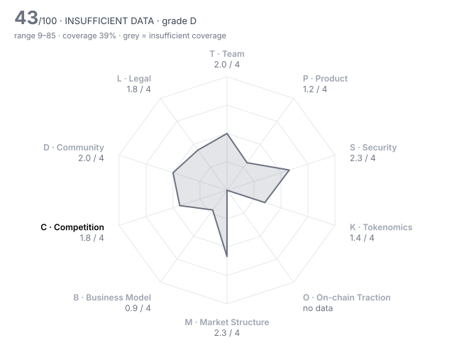

# Kite (KITE) — DD-100 Due-Diligence Report

> **⚪ INSUFFICIENT DATA** · Grade **D** · Score **43.2/100** (range 9–85) · Evidence coverage **39%**  
> Profile `l1_l2` · Evidence as of 2025-11-03 · 100 dimensions · 27 sources

The range is the honest number: it shows where the score could land once unscored dimensions are filled and low-confidence judgments are firmed up.

## Why this verdict

- evidence coverage 39% below the 70% needed for a verdict

## Red-flag gates

| Gate | Severity | Status | What it means |
|---|---|---|---|
| RF01 Unrestricted mint controlled by a single key | critical | ❔ unchecked | Supply can be inflated at will; every other number in the report is conditional on one person's restraint. |
| RF02 Sanctions / illicit-finance exposure | critical | ❔ unchecked | Listing would create direct regulatory liability for the venue. |
| RF04 Unremediated exploit with user losses | critical | ❔ unchecked | Users are owed money; listing would expose new users to the same counterparty. |
| RF05 Active enforcement action against the project or founders | critical | ❔ unchecked | Outcome could force delisting or freeze assets after listing. |
| RF06 Upgradeable contracts with no meaningful timelock | major | ❔ unchecked | Logic can change under users with no time to exit. |
| RF07 Extreme holder concentration | major | ❔ unchecked | A handful of wallets can set the price; order books will not absorb their exit. |
| RF08 Unlock cliff within 90 days | major | ❔ unchecked | More than a quarter of circulating supply unlocks shortly after a listing window. |
| RF10 Material misrepresentation | major | ❔ unchecked | Two or more project claims contradicted by observed data — the reviewer cannot rely on anything self-reported. |
| RF12 Anonymous team with centralised admin powers | major | ❔ unchecked | Unaccountable people holding privileged keys. |
| RF13 Undisclosed market-maker terms | major | ❔ unchecked | Token loans and call options are where post-listing dumps are engineered. |
| RF16 Volume implausible versus depth | minor | ❔ unchecked | Daily volume more than 100x the ±2% depth is a common wash-trading signature. |

4 of 16 gates verified clear (1 not applicable to this profile).

## Pillar scores

| Pillar | Weight | Score /4 | | Coverage | Scored |
|---|---:|---:|---|---:|---:|
| T · Team & Governance | 12 | 2.00 | `█████░░░░░` | 38% ⚠️ | 4/10 |
| P · Product & Technology | 14 | 1.20 | `███░░░░░░░` | 53% ⚠️ | 4/10 |
| S · Security & Smart Contracts | 12 | 2.31 | `██████░░░░` | 52% ⚠️ | 5/10 |
| K · Tokenomics & Supply | 14 | 1.40 | `████░░░░░░` | 48% ⚠️ | 5/10 |
| O · On-chain Traction | 12 | n/a | `··········` | 0% ⚠️ | 0/9 |
| M · Market Structure & Liquidity | 8 | 2.33 | `██████░░░░` | 18% ⚠️ | 3/10 |
| B · Business Model & Fundamentals | 6 | 0.86 | `██░░░░░░░░` | 41% ⚠️ | 3/9 |
| C · Competition & Moat | 10 | 1.75 | `████░░░░░░` | 67% | 7/10 |
| D · Community & Distribution | 6 | 2.00 | `█████░░░░░` | 31% ⚠️ | 3/10 |
| L · Legal, Compliance & Jurisdiction | 6 | 1.75 | `████░░░░░░` | 25% ⚠️ | 2/8 |

⚠️ = coverage below the pillar minimum; treat that pillar's score as indicative.

## Claims vs. observation

No contradictions found across 2 checked project claim(s).

## Strengths

- **S03 Source verification** (4/4) — contracts_verified = true
- **L06 Privacy & obfuscation features** (4/4) — No privacy features; the design is identity-first (three-tier identity, compliance-ready SPACE framework).
- **S02 Audit remediation** (3/4) — The one High (missing pause controls) was fixed and the other report has no critical/high/medium findings, with three informational items acknowledged; deployed bytecode was not matched to the audited commits.
- **T09 Backer quality & cap table** (3/4) — Led by PayPal Ventures and General Catalyst with Coinbase Ventures, Samsung Next, 8VC, Hashed and HashKey; terms are opaque — valuation and token warrants undisclosed — and a market maker (GSR Markets) is on the cap table.
- **K05 Insider allocation** (3/4) — insider_allocation_pct = 32  (bands 4:≤25, 3:≤35, 2:≤45, 1:≤55)
- **M06 Existing venue quality** (3/4) — Coinbase, Upbit, OKX, Bitget and HTX all list spot on the same day, each after its own review; there is no prior spot trading history to observe.

## Risks

- **B01 Annualised protocol revenue** (0/4) — annualized_revenue_usd = 0  (bands 4:≥5e+07, 3:≥1e+07, 2:≥2e+06, 1:≥250,000)
- **P01 Problem clarity & real demand** (1/4) — Agent payments is a real problem, but the lead investor calls current agent activity 'very small and experimental' and the PayPal and Shopify integrations are pilots; no paying users are evidenced.
- **P02 Product maturity** (1/4) — Mainnet is not live at listing; a public testnet has run since February 2025 and staking, commissions and governance are deferred to mainnet; Binance's own disclaimer says features are still in development.
- **S06 Mint / freeze / blacklist powers** (1/4) — No direct mint function, but the owner can pause all transfers and sets the LayerZero peers whose messages mint supply on other chains; who holds that key is undisclosed.
- **K01 Token utility & value accrual** (1/4) — At TGE the token only gates module activation, liquidity locks and ecosystem access; commission buybacks, staking and governance start at a mainnet that is not live.
- **C04 Moat** (1/4) — x402 is Coinbase's open standard that Kite implements among other L1s; the distinguishing assets are investor relationships and pilot integrations, with no live network effect.

## Open questions for the project team

Everything below is unscored. Each one is a question to put to the team or a data request, not a negative finding.

**Needs a private channel (call, data room, counsel)** (3)

- T02 Identity verification level: Are the key people identified to the reviewer (KYC) and, ideally, publicly? — _requires private channel_
- M05 Market-maker arrangements: Are MM agreements (loans, call options, KPIs) disclosed to the reviewer and reasonable? — _requires private channel_
- L07 Legal opinion: Has the project provided a token legal opinion from reputable counsel? — _requires private channel_

**Needs evidence** (57)

- T03 Team depth & key-person risk: Would the project survive the departure of any single person? — _missing: team size and named owners for security, BD and operations beyond the two founders; only a project claim of staff from Uber, Databricks, Salesforce and NEAR (KITE-09)_
- T05 Controversies & misconduct history: Are there credible allegations, enforcement actions or past rugs connected to the team? — _missing: court, regulator and wallet-history checks on founders and deployer; no allegations appear in the funding or listing coverage reviewed, which is not a clean-record search_
- T06 Team vesting length: How long are team tokens locked and vested? — _metric 'team_vesting_months' not in evidence pack; team_vesting_months not set: only 'multi-year vesting' is stated (KITE-05)._
- T08 Treasury transparency: Are treasury addresses, holdings and spending disclosed and reconcilable on-chain? — _missing: foundation, ecosystem (48%) and modules (20%) wallet addresses and any treasury report; foundation site not readable in this review_
- T10 Disclosure honesty: Do the project's claims match what the reviewer can observe? (contradictions found by the harness) — _metric 'contradiction_count' not in evidence pack; No project claim could be checked against an independent observation as of listing (no testnet or on-chain metrics were published by the project in the sources found); T10 left unscored rather than awarded._
- P04 Architecture soundness: Is the architecture appropriate for the use case at the target scale? — _missing: technical review of the whitepaper architecture; no production chain exists to evidence behaviour at scale_
- P06 Development activity (90d commits): How much code is being shipped in public repositories? — _metric 'github_commits_90d' not in evidence pack; GitHub activity not measured: the audited repo (GoKite-AI/contracts-external) was not reachable from this review, and no public chain/node repository was found._
- P07 Contributor breadth (90d): How many distinct developers are actively contributing? — _metric 'github_active_contributors_90d' not in evidence pack_
- P08 Roadmap delivery record: Has the team historically shipped what it promised, roughly when it promised? — _missing: a dated public roadmap; testnet launched Feb 2025 and mainnet had no published date at listing_
- P09 Open source & reproducibility: Can a third party build and verify what is deployed? — _missing: public chain/node source; the token source is verified on Etherscan (KITE-15) but the audited repo (GoKite-AI/contracts-external, KITE-16) could not be reached_
- P10 Documentation quality: Could an integrator or auditor understand the system from the docs alone? — _missing: review of docs and whitepaper (gokite.ai/kite-whitepaper not readable in this review)_
- S04 Upgrade timelock: How long must users wait between an upgrade being queued and executed? (non-upgradeable = 9999) — _metric 'upgrade_timelock_hours' not in evidence pack; The KITE token is not a proxy (KITE-15), but owner-controlled setPeer/pause take effect immediately; the Kite chain's own upgrade process is undocumented in the sources reviewed._
- S05 Admin key custody: Who holds admin keys, and with what multisig threshold and signer independence? — _missing: owner() of the KITE OFT on each chain and whether it is an EOA or a multisig with independent signers_
- S07 Bug bounty: What is the maximum bug bounty payout on an established platform? — _metric 'bug_bounty_max_usd' not in evidence pack; No dated bug-bounty programme found before listing._
- S08 Incident history & response: Has the protocol been exploited, and how was it handled? — _missing: incident-database check; contracts were weeks old at listing and no incident appears in pre-listing sources, which is absence of evidence, not a record; (gate RF04) unreimbursed_exploit_usd not set. Token contracts were ~4 weeks old at listing; no incident appears in any pre-listing source reviewed, but no incident database (rekt, SlowMist, DefiLlama hacks) could be queried. A search result headline about an attack on the Ethereum KITE token was seen but could not be opened or dated, so it was neither used nor ruled out._
- S09 Oracle & manipulation resistance: Can prices or state be manipulated to drain funds (flash loans, thin oracles)? — _no oracle-dependent contracts in production before mainnet; nothing to assess_
- K03 Holder concentration: Share of supply held by the top 10 wallets, excluding exchanges, burn and protocol contracts — _metric 'top10_holder_pct_ex_contracts' not in evidence pack; No holder distribution as of listing: claims opened on listing day (KITE-23) and on-chain explorers could not be queried point-in-time._
- K04 12-month unlock pressure: Tokens unlocking in the next 12 months as a percentage of current circulating supply — _metric 'unlock_12m_pct_of_circ' not in evidence pack; No pre-listing source publishes cliffs or durations for team (20%), investors (12%), modules (20%) or ecosystem (48%) — only 'multi-year vesting' (KITE-05). OKX warned on 30 Oct that the issuance plan was not finalised (KITE-08). 12-month and 90-day (gate RF08) unlock pressure cannot be computed. Ask the project for the full vesting schedule and which of the 1.8B initial circulating sits with the foundation vs the market._
- K06 Investor cost-basis overhang: Current price as a multiple of the last private round price (higher = more profit to take) — _metric 'price_to_last_round_multiple' not in evidence pack; Last private round price undisclosed — the CEO declined to give the valuation or say whether investors hold token warrants (KITE-10)._
- K08 Annual inflation: Net annual emission rate after burns — _metric 'annual_inflation_pct' not in evidence pack; Emission schedule (module rewards, 'piggy bank' emissions, staking) not published with numbers._
- K10 Airdrop & incentive design: Do incentive programmes reward real users and resist sybil farming? — _missing: airdrop recipient count, sybil filtering and post-claim retention; claims opened on listing day (KITE-23) and the testnet was XP-incentivised (KITE-27)_
- O01 Daily active addresses (30d avg): How many unique addresses interact with the protocol daily? — _metric 'daa_30d_avg' not in evidence pack; Mainnet not live (KITE-05, KITE-21). Testnet activity is points/XP-incentivised (KITE-27) and was not measured here; no daily active address, retention or fee-payer data for a production chain._
- O02 Activity trend (90d): Percentage change in daily active addresses over 90 days — _metric 'daa_90d_change_pct' not in evidence pack_
- O03 30-day user retention: Share of a new-user cohort still active after 30 days — _metric 'retention_30d_pct' not in evidence pack_
- O04 TVL / AUM: Value deposited in the protocol (DeFi / RWA) — _metric 'tvl_usd' not in evidence pack; No mainnet, so no TVL._
- O06 Organic vs sybil activity: How much of the activity is bots, farmers or self-dealing? — _missing: testnet address clustering; only an XP-incentivised testnet exists (KITE-27), no mainnet_
- O07 Fee-paying users (30d): Unique addresses that paid fees in the last 30 days — _metric 'fee_paying_users_30d' not in evidence pack_
- O08 Integrations: Number of live third-party integrations (wallets, protocols, aggregators) — _metric 'live_integrations_count' not in evidence pack; PayPal and Shopify integrations are pilots (KITE-11); no live integration count established._
- O09 Builder ecosystem: Are independent teams building on or around the protocol? — _missing: evidence of independent teams building on Kite before listing; only pilot integrations (KITE-11)_
- O10 Net capital flows (90d): Net inflow of external capital (stablecoins/majors) into the protocol over 90 days, USD — _metric 'net_inflow_90d_usd' not in evidence pack_
- M01 Order-book depth (±2%): Aggregate USD depth within 2% of mid across major venues — _metric 'depth_2pct_usd' not in evidence pack; No spot order book existed before 13:00 UTC on 3 Nov; only pre-market perps (KITE-08). Depth, spread, volume, venue share and realised volatility are not observable at as_of._
- M02 Venue concentration: Share of volume on the single largest venue — _metric 'top_venue_volume_share_pct' not in evidence pack_
- M03 Wash-trading indicators: Do volume, depth and trade-size patterns suggest fabricated volume? — _no spot market existed before 13:00 UTC on 3 Nov; only pre-market perps (KITE-08)_
- M04 Bid-ask spread: Volume-weighted average spread in basis points — _metric 'spread_bps' not in evidence pack; See M01._
- M08 Realised volatility (30d): Annualised 30-day realised volatility — _metric 'realized_vol_30d_pct' not in evidence pack; See M01: no 30-day price history (pre-market began 29 Oct)._
- M09 DEX liquidity ownership: Is on-chain liquidity protocol-owned/locked or mercenary and removable overnight? — _missing: DEX pool ownership; no on-chain liquidity data at as_of_
- B02 Revenue quality: Is revenue organic and recurring, or one-off, wash or self-generated? — _no protocol revenue exists before mainnet (KITE-05)_
- B04 Valuation vs fees (FDV / annualised fees): Price paid per dollar of fees generated — _metric 'fdv_to_annual_fees' not in evidence pack_
- B05 Incentive spend vs revenue: USD value of token incentives divided by protocol revenue (90d) — _metric 'incentives_to_revenue' not in evidence pack_
- B06 Treasury runway: Months of runway at current burn, counting non-native assets at full value and native token at 50% — _metric 'runway_months' not in evidence pack; Foundation treasury and Kite AI Inc. burn not published; $33M raised (KITE-09)._
- B07 Treasury diversification: Share of treasury held in assets other than the native token — _metric 'treasury_non_native_pct' not in evidence pack_
- B08 Revenue growth (90d): Quarter-on-quarter change in protocol revenue — _metric 'revenue_qoq_growth_pct' not in evidence pack_
- C02 Category market share: Share of the relevant category metric (TVL, volume, fees) held by this project — _metric 'category_share_pct' not in evidence pack; No category share data for agent-payment chains as of listing._
- C03 Share trajectory: Is market share rising or falling over the last two quarters? — _no market share exists before mainnet_
- C07 Relative valuation: Is the valuation reasonable against peers on comparable metrics? — _missing: peer FDVs as of 3 Nov; pre-market implies ~$1.75B FDV (KITE-06) with no revenue_
- D01 Organic audience: Size and quality of the audience across X, Telegram, Discord and regional channels — _missing: social audience and engagement data as of listing_
- D02 Engagement authenticity: What share of engagement appears bot-driven or paid? — _missing: bot-likelihood analysis_
- D03 Token holder count: Number of addresses holding a non-dust balance — _metric 'holders_count' not in evidence pack; Holder count at listing not observable (airdrop claims opened 3 Nov)._
- D04 Geographic & user diversity: Is the user base spread across regions, or concentrated where the venue cannot serve it? — _missing: user geography; Upbit KRW listing (KITE-18) hints at Korean demand only_
- D06 Developer community: Grants, hackathons and external contributors beyond the core team — _missing: grant and hackathon record dated before listing_
- D07 Governance participation: Average share of circulating supply voting on recent proposals — _metric 'governance_participation_pct' not in evidence pack; No governance exists before mainnet (KITE-05)._
- D09 Sentiment & controversy: What is the prevailing tone among informed market participants? — _missing: informed-participant sentiment as of listing_
- L01 Legal entity & jurisdiction: Is there an accountable legal entity in a jurisdiction with functioning courts? — _missing: KITE Foundation registration and jurisdiction; operating company Kite AI (formerly ZettaBlock) domicile not confirmed in sources_
- L03 Sanctions & AML exposure: Has screening found exposure to sanctioned addresses, mixers or illicit flows above tolerance? — _metric 'sanctions_exposure' not in evidence pack; sanctions_exposure not set: no wallet screening available. Needs Chainalysis/TRM screening of deployer (0x148c…8799), foundation, team and top-holder addresses._
- L04 Licensing for regulated activity: If the project performs regulated activity (custody, exchange, payments, issuance), is it licensed? — _missing: whether Kite AIR merchant settlement involves custody or money transmission, and any licences_
- L05 Litigation & enforcement: Any pending lawsuits, regulator actions or subpoenas? — _no assessment provided; (gate RF05) active_enforcement_action not set. No enforcement or litigation is mentioned in any source reviewed (funding coverage, exchange notices), but SEC/CFTC/court and other regulator databases were not searched. Needs a regulator/court check on Kite AI Inc. (formerly ZettaBlock), the KITE Foundation and the founders._
- L10 Restricted-jurisdiction controls: Does the project geofence and enforce restrictions consistent with its legal analysis? — _missing: project's own restricted-jurisdiction policy for airdrop claims and front end_

## Appendix A — all 100 dimensions

### T · Team & Governance

| ID | Dimension | Method | W | Score | Conf. | Evidence | Basis |
|---|---|---|---:|---:|---|---|---|
| T01 | Founder track record | agent | 3 | **2** | medium | KITE-09, KITE-10, KITE-12 | CEO led data products at Databricks and CTO built real-time AI infra at Uber; their prior company (ZettaBlock) served data to Sui, Polygon, Chainlink and EigenLayer, but no founder-led product at comparable scale has a verifiable outcome. |
| T02 | Identity verification level | human | 3 | ⏳ |  |  | requires private channel |
| T03 | Team depth & key-person risk | agent | 2 | – |  |  | missing: team size and named owners for security, BD and operations beyond the two founders; only a project claim of staff from Uber, Databricks, Salesforce and NEAR (KITE-09) |
| T04 | Technical leadership | agent | 2 | **2** | low | KITE-09, KITE-21 | In-house technical leadership (CTO from Uber/Salesforce Einstein) and a whitepaper describing the SPACE framework; the 30+ patents/publications are a project claim and no protocol spec or research was reviewed. |
| T05 | Controversies & misconduct history | agent | 3 | – |  |  | missing: court, regulator and wallet-history checks on founders and deployer; no allegations appear in the funding or listing coverage reviewed, which is not a clean-record search |
| T06 | Team vesting length | rule | 2 | – |  |  | metric 'team_vesting_months' not in evidence pack; team_vesting_months not set: only 'multi-year vesting' is stated (KITE-05). |
| T07 | Governance design & decentralisation path | agent | 2 | **1** | medium | KITE-05, KITE-15, KITE-21 | No governance exists at TGE; the token contract owner can pause transfers and set cross-chain peers; holder governance is promised for an undated mainnet. |
| T08 | Treasury transparency | agent | 2 | – |  |  | missing: foundation, ecosystem (48%) and modules (20%) wallet addresses and any treasury report; foundation site not readable in this review |
| T09 | Backer quality & cap table | agent | 2 | **3** | medium | KITE-09, KITE-10, KITE-13, KITE-26 | Led by PayPal Ventures and General Catalyst with Coinbase Ventures, Samsung Next, 8VC, Hashed and HashKey; terms are opaque — valuation and token warrants undisclosed — and a market maker (GSR Markets) is on the cap table. |
| T10 | Disclosure honesty | rule | 3 | – |  |  | metric 'contradiction_count' not in evidence pack; No project claim could be checked against an independent observation as of listing (no testnet or on-chain metrics were published by the project in the sources found); T10 left unscored rather than awarded. |

### P · Product & Technology

| ID | Dimension | Method | W | Score | Conf. | Evidence | Basis |
|---|---|---|---:|---:|---|---|---|
| P01 | Problem clarity & real demand | agent | 3 | **1** | medium | KITE-10, KITE-11, KITE-12 | Agent payments is a real problem, but the lead investor calls current agent activity 'very small and experimental' and the PayPal and Shopify integrations are pilots; no paying users are evidenced. |
| P02 | Product maturity | agent | 3 | **1** | high | KITE-05, KITE-21, KITE-11, KITE-08 | Mainnet is not live at listing; a public testnet has run since February 2025 and staking, commissions and governance are deferred to mainnet; Binance's own disclaimer says features are still in development. |
| P03 | Technical originality | agent | 2 | **2** | low | KITE-11, KITE-18, KITE-21 | Builds on Avalanche's L1 stack and adds agent identity (three-tier identity, Agent Passport), state-channel micropayments and modules — meaningful modifications rather than an original consensus design. |
| P04 | Architecture soundness | agent | 2 | – |  |  | missing: technical review of the whitepaper architecture; no production chain exists to evidence behaviour at scale |
| P05 | Dependency risk | agent | 2 | **1** | medium | KITE-11, KITE-15, KITE-02, KITE-13 | Depends on the Avalanche L1 stack, LayerZero messaging for the token on three chains, external stablecoins for payments and Coinbase's x402 standard; no fallbacks are described. |
| P06 | Development activity (90d commits) | rule | 2 | – |  |  | metric 'github_commits_90d' not in evidence pack; GitHub activity not measured: the audited repo (GoKite-AI/contracts-external) was not reachable from this review, and no public chain/node repository was found. |
| P07 | Contributor breadth (90d) | rule | 1 | – |  |  | metric 'github_active_contributors_90d' not in evidence pack |
| P08 | Roadmap delivery record | agent | 2 | – |  |  | missing: a dated public roadmap; testnet launched Feb 2025 and mainnet had no published date at listing |
| P09 | Open source & reproducibility | agent | 1 | – |  |  | missing: public chain/node source; the token source is verified on Etherscan (KITE-15) but the audited repo (GoKite-AI/contracts-external, KITE-16) could not be reached |
| P10 | Documentation quality | agent | 1 | – |  |  | missing: review of docs and whitepaper (gokite.ai/kite-whitepaper not readable in this review) |

### S · Security & Smart Contracts

| ID | Dimension | Method | W | Score | Conf. | Evidence | Basis |
|---|---|---|---:|---:|---|---|---|
| S01 | Audit coverage | rule | 3 | **2** | high | KITE-16 | audits_reputable_count = 1  (bands 4:≥3, 3:≥2, 2:≥1, 1:≥0.5) |
| S02 | Audit remediation | agent | 3 | **3** | medium | KITE-16, KITE-17 | The one High (missing pause controls) was fixed and the other report has no critical/high/medium findings, with three informational items acknowledged; deployed bytecode was not matched to the audited commits. |
| S03 | Source verification | rule | 2 | **4** | high | KITE-15 | contracts_verified = true |
| S04 | Upgrade timelock | rule | 3 | – |  |  | metric 'upgrade_timelock_hours' not in evidence pack; The KITE token is not a proxy (KITE-15), but owner-controlled setPeer/pause take effect immediately; the Kite chain's own upgrade process is undocumented in the sources reviewed. |
| S05 | Admin key custody | agent | 3 | – |  |  | missing: owner() of the KITE OFT on each chain and whether it is an EOA or a multisig with independent signers |
| S06 | Mint / freeze / blacklist powers | agent | 3 | **1** | medium | KITE-15, KITE-16 | No direct mint function, but the owner can pause all transfers and sets the LayerZero peers whose messages mint supply on other chains; who holds that key is undisclosed. |
| S07 | Bug bounty | rule | 1 | – |  |  | metric 'bug_bounty_max_usd' not in evidence pack; No dated bug-bounty programme found before listing. |
| S08 | Incident history & response | agent | 3 | – |  |  | missing: incident-database check; contracts were weeks old at listing and no incident appears in pre-listing sources, which is absence of evidence, not a record; (gate RF04) unreimbursed_exploit_usd not set. Token contracts were ~4 weeks old at listing; no incident appears in any pre-listing source reviewed, but no incident database (rekt, SlowMist, DefiLlama hacks) could be queried. A search result headline about an attack on the Ethereum KITE token was seen but could not be opened or dated, so it was neither used nor ruled out. |
| S09 | Oracle & manipulation resistance | agent | 2 | – |  |  | no oracle-dependent contracts in production before mainnet; nothing to assess |
| S10 | Bridge & cross-chain exposure | agent | 2 | **2** | medium | KITE-02, KITE-15, KITE-18 | KITE exists on Ethereum, BNB Chain and Avalanche as a LayerZero OFT, so each chain's supply relies on an established bridge and the owner's peer/DVN configuration; Upbit supports only the Ethereum version. |

### K · Tokenomics & Supply

| ID | Dimension | Method | W | Score | Conf. | Evidence | Basis |
|---|---|---|---:|---:|---|---|---|
| K01 | Token utility & value accrual | agent | 3 | **1** | medium | KITE-05, KITE-21, KITE-06 | At TGE the token only gates module activation, liquidity locks and ecosystem access; commission buybacks, staking and governance start at a mainnet that is not live. |
| K02 | Circulating ratio | rule | 2 | **1** | high | HARNESS | circulating_supply_pct = 18  (bands 4:≥60, 3:≥40, 2:≥25, 1:≥15) |
| K03 | Holder concentration | rule | 3 | – |  |  | metric 'top10_holder_pct_ex_contracts' not in evidence pack; No holder distribution as of listing: claims opened on listing day (KITE-23) and on-chain explorers could not be queried point-in-time. |
| K04 | 12-month unlock pressure | rule | 3 | – |  |  | metric 'unlock_12m_pct_of_circ' not in evidence pack; No pre-listing source publishes cliffs or durations for team (20%), investors (12%), modules (20%) or ecosystem (48%) — only 'multi-year vesting' (KITE-05). OKX warned on 30 Oct that the issuance plan was not finalised (KITE-08). 12-month and 90-day (gate RF08) unlock pressure cannot be computed. Ask the project for the full vesting schedule and which of the 1.8B initial circulating sits with the foundation vs the market. |
| K05 | Insider allocation | rule | 2 | **3** | medium | KITE-03 | insider_allocation_pct = 32  (bands 4:≤25, 3:≤35, 2:≤45, 1:≤55) |
| K06 | Investor cost-basis overhang | rule | 2 | – |  |  | metric 'price_to_last_round_multiple' not in evidence pack; Last private round price undisclosed — the CEO declined to give the valuation or say whether investors hold token warrants (KITE-10). |
| K07 | FDV / market cap | rule | 2 | **1** | high | HARNESS | fdv_to_mcap = 5.56  (bands 4:≤1.5, 3:≤2.5, 2:≤4, 1:≤7) |
| K08 | Annual inflation | rule | 2 | – |  |  | metric 'annual_inflation_pct' not in evidence pack; Emission schedule (module rewards, 'piggy bank' emissions, staking) not published with numbers. |
| K09 | Supply verifiability | agent | 1 | **1** | medium | KITE-05, KITE-08, KITE-03 | Allocations are published only as percentages, vesting as 'multi-year' with no vesting contracts disclosed, and OKX said on 30 Oct that the issuance plan was not final. |
| K10 | Airdrop & incentive design | agent | 1 | – |  |  | missing: airdrop recipient count, sybil filtering and post-claim retention; claims opened on listing day (KITE-23) and the testnet was XP-incentivised (KITE-27) |

### O · On-chain Traction

| ID | Dimension | Method | W | Score | Conf. | Evidence | Basis |
|---|---|---|---:|---:|---|---|---|
| O01 | Daily active addresses (30d avg) | rule | 2 | – |  |  | metric 'daa_30d_avg' not in evidence pack; Mainnet not live (KITE-05, KITE-21). Testnet activity is points/XP-incentivised (KITE-27) and was not measured here; no daily active address, retention or fee-payer data for a production chain. |
| O02 | Activity trend (90d) | rule | 2 | – |  |  | metric 'daa_90d_change_pct' not in evidence pack |
| O03 | 30-day user retention | rule | 2 | – |  |  | metric 'retention_30d_pct' not in evidence pack |
| O04 | TVL / AUM | rule | 2 | – |  |  | metric 'tvl_usd' not in evidence pack; No mainnet, so no TVL. |
| O05 | Incentive-driven TVL share | rule | 2 | n/a |  |  | not applicable to profile 'l1_l2' |
| O06 | Organic vs sybil activity | agent | 3 | – |  |  | missing: testnet address clustering; only an XP-incentivised testnet exists (KITE-27), no mainnet |
| O07 | Fee-paying users (30d) | rule | 1 | – |  |  | metric 'fee_paying_users_30d' not in evidence pack |
| O08 | Integrations | rule | 1 | – |  |  | metric 'live_integrations_count' not in evidence pack; PayPal and Shopify integrations are pilots (KITE-11); no live integration count established. |
| O09 | Builder ecosystem | agent | 1 | – |  |  | missing: evidence of independent teams building on Kite before listing; only pilot integrations (KITE-11) |
| O10 | Net capital flows (90d) | rule | 1 | – |  |  | metric 'net_inflow_90d_usd' not in evidence pack |

### M · Market Structure & Liquidity

| ID | Dimension | Method | W | Score | Conf. | Evidence | Basis |
|---|---|---|---:|---:|---|---|---|
| M01 | Order-book depth (±2%) | rule | 3 | – |  |  | metric 'depth_2pct_usd' not in evidence pack; No spot order book existed before 13:00 UTC on 3 Nov; only pre-market perps (KITE-08). Depth, spread, volume, venue share and realised volatility are not observable at as_of. |
| M02 | Venue concentration | rule | 2 | – |  |  | metric 'top_venue_volume_share_pct' not in evidence pack |
| M03 | Wash-trading indicators | agent | 3 | – |  |  | no spot market existed before 13:00 UTC on 3 Nov; only pre-market perps (KITE-08) |
| M04 | Bid-ask spread | rule | 2 | – |  |  | metric 'spread_bps' not in evidence pack; See M01. |
| M05 | Market-maker arrangements | human | 2 | ⏳ |  |  | requires private channel |
| M06 | Existing venue quality | agent | 1 | **3** | medium | KITE-24, KITE-18, KITE-20, KITE-22, KITE-21 | Coinbase, Upbit, OKX, Bitget and HTX all list spot on the same day, each after its own review; there is no prior spot trading history to observe. |
| M07 | Derivatives structure | agent | 1 | **1** | low | KITE-08, KITE-06, KITE-20 | Leveraged pre-market perps (OKX up to 20x, Bybit 10x, Aster 5x, plus Binance Futures) set the price from 29 Oct, before any spot market; open interest and funding were not observed. |
| M08 | Realised volatility (30d) | rule | 1 | – |  |  | metric 'realized_vol_30d_pct' not in evidence pack; See M01: no 30-day price history (pre-market began 29 Oct). |
| M09 | DEX liquidity ownership | agent | 1 | – |  |  | missing: DEX pool ownership; no on-chain liquidity data at as_of |
| M10 | Narrative & timing fit | agent | 1 | **3** | medium | KITE-14, KITE-13, KITE-26, KITE-09 | Agent payments/x402 is a rising narrative (156k x402 transactions in one day, Coinbase and PayPal investing), and Kite is one of the funded first movers, though not a proven leader. |

### B · Business Model & Fundamentals

| ID | Dimension | Method | W | Score | Conf. | Evidence | Basis |
|---|---|---|---:|---:|---|---|---|
| B01 | Annualised protocol revenue | rule | 3 | **0** | medium | KITE-05 | annualized_revenue_usd = 0  (bands 4:≥5e+07, 3:≥1e+07, 2:≥2e+06, 1:≥250,000) |
| B02 | Revenue quality | agent | 2 | – |  |  | no protocol revenue exists before mainnet (KITE-05) |
| B03 | Holder value capture | agent | 2 | **2** | medium | KITE-05, KITE-21 | Commissions on AI service transactions are designed to buy KITE, but only from mainnet; nothing accrues to holders at listing. |
| B04 | Valuation vs fees (FDV / annualised fees) | rule | 2 | – |  |  | metric 'fdv_to_annual_fees' not in evidence pack |
| B05 | Incentive spend vs revenue | rule | 2 | – |  |  | metric 'incentives_to_revenue' not in evidence pack |
| B06 | Treasury runway | rule | 2 | – |  |  | metric 'runway_months' not in evidence pack; Foundation treasury and Kite AI Inc. burn not published; $33M raised (KITE-09). |
| B07 | Treasury diversification | rule | 1 | – |  |  | metric 'treasury_non_native_pct' not in evidence pack |
| B08 | Revenue growth (90d) | rule | 1 | – |  |  | metric 'revenue_qoq_growth_pct' not in evidence pack |
| B09 | Counterparty concentration | agent | 1 | n/a |  |  | not applicable to profile 'l1_l2' |
| B10 | Sustainability without emissions | agent | 2 | **1** | low | KITE-05, KITE-27, KITE-10 | No revenue yet; activity is an XP-incentivised testnet, and the business runs on $33M of venture funding. |

### C · Competition & Moat

| ID | Dimension | Method | W | Score | Conf. | Evidence | Basis |
|---|---|---|---:|---:|---|---|---|
| C01 | Segment size & growth | agent | 2 | **2** | medium | KITE-10, KITE-14 | Agent payments is small today ('very small and experimental' per PayPal Ventures) but growing fast on x402 activity. |
| C02 | Category market share | rule | 2 | – |  |  | metric 'category_share_pct' not in evidence pack; No category share data for agent-payment chains as of listing. |
| C03 | Share trajectory | agent | 2 | – |  |  | no market share exists before mainnet |
| C04 | Moat | agent | 3 | **1** | medium | KITE-13, KITE-11 | x402 is Coinbase's open standard that Kite implements among other L1s; the distinguishing assets are investor relationships and pilot integrations, with no live network effect. |
| C05 | Forkability | agent | 2 | **2** | low | KITE-11, KITE-21, KITE-09 | EVM chain on an Avalanche stack is forkable; the PayPal/Shopify pilots and investor relationships are the off-chain assets a fork would lack. |
| C06 | Differentiation vs top-3 peers | agent | 2 | **2** | low | KITE-09, KITE-13, KITE-18 | Differentiates on agent identity (Agent Passport, three-tier identity) plus native x402 — an axis general-purpose chains that already support x402 could copy. |
| C07 | Relative valuation | agent | 2 | – |  |  | missing: peer FDVs as of 3 Nov; pre-market implies ~$1.75B FDV (KITE-06) with no revenue |
| C08 | Platform & incumbent threat | agent | 1 | **2** | medium | KITE-13, KITE-09, KITE-14 | Coinbase (x402's author) and PayPal are investors but also run their own agent-payment rails; absorption is plausible though nothing competing was announced against Kite. |
| C09 | Partnership substance | agent | 1 | **1** | medium | KITE-11, KITE-12, KITE-09 | The PayPal partnership and Shopify integration are pilots and no mainnet exists, so no partnership is visible in on-chain flows. |
| C10 | Exchange-level strategic fit | agent | 1 | **3** | low | KITE-01, KITE-14, KITE-13 | Gives Binance users exposure to a dedicated agent-payments L1, a sub-sector not otherwise represented by a funded chain; general AI tokens already cover the broader theme. |

### D · Community & Distribution

| ID | Dimension | Method | W | Score | Conf. | Evidence | Basis |
|---|---|---|---:|---:|---|---|---|
| D01 | Organic audience | agent | 1 | – |  |  | missing: social audience and engagement data as of listing |
| D02 | Engagement authenticity | agent | 2 | – |  |  | missing: bot-likelihood analysis |
| D03 | Token holder count | rule | 2 | – |  |  | metric 'holders_count' not in evidence pack; Holder count at listing not observable (airdrop claims opened 3 Nov). |
| D04 | Geographic & user diversity | agent | 1 | – |  |  | missing: user geography; Upbit KRW listing (KITE-18) hints at Korean demand only |
| D05 | Paid-promotion dependence | agent | 2 | **2** | medium | KITE-01, KITE-06, KITE-23, KITE-27 | Attention at launch is driven by disclosed campaigns: Binance Launchpool and Alpha points, testnet XP, Aster trading points and a 50M KITE marketing reserve. |
| D06 | Developer community | agent | 1 | – |  |  | missing: grant and hackathon record dated before listing |
| D07 | Governance participation | rule | 1 | – |  |  | metric 'governance_participation_pct' not in evidence pack; No governance exists before mainnet (KITE-05). |
| D08 | Communication transparency | agent | 1 | **1** | medium | KITE-08, KITE-05, KITE-03 | Days before listing, no cliffs or durations for the 20% team and 12% investor allocations were public and OKX said the issuance plan was not finalised. |
| D09 | Sentiment & controversy | agent | 1 | – |  |  | missing: informed-participant sentiment as of listing |
| D10 | Ecosystem credibility | agent | 1 | **3** | medium | KITE-09, KITE-13, KITE-11, KITE-16 | PayPal Ventures, Coinbase Ventures, Avalanche Foundation and LayerZero invested and Halborn audited; integrations by credible platforms are still pilots. |

### L · Legal, Compliance & Jurisdiction

| ID | Dimension | Method | W | Score | Conf. | Evidence | Basis |
|---|---|---|---:|---:|---|---|---|
| L01 | Legal entity & jurisdiction | agent | 2 | – |  |  | missing: KITE Foundation registration and jurisdiction; operating company Kite AI (formerly ZettaBlock) domicile not confirmed in sources |
| L02 | Securities-law risk | agent | 3 | **1** | medium | KITE-05, KITE-15, KITE-10 | Core utility is deferred to mainnet, a commission-funded buyback is planned, the foundation controls the token contract and VC terms are undisclosed; no legal analysis is public. |
| L03 | Sanctions & AML exposure | rule | 3 | – |  |  | metric 'sanctions_exposure' not in evidence pack; sanctions_exposure not set: no wallet screening available. Needs Chainalysis/TRM screening of deployer (0x148c…8799), foundation, team and top-holder addresses. |
| L04 | Licensing for regulated activity | agent | 2 | – |  |  | missing: whether Kite AIR merchant settlement involves custody or money transmission, and any licences |
| L05 | Litigation & enforcement | agent | 3 | – |  |  | no assessment provided; (gate RF05) active_enforcement_action not set. No enforcement or litigation is mentioned in any source reviewed (funding coverage, exchange notices), but SEC/CFTC/court and other regulator databases were not searched. Needs a regulator/court check on Kite AI Inc. (formerly ZettaBlock), the KITE Foundation and the founders. |
| L06 | Privacy & obfuscation features | agent | 1 | **4** | medium | KITE-18, KITE-21 | No privacy features; the design is identity-first (three-tier identity, compliance-ready SPACE framework). |
| L07 | Legal opinion | human | 1 | ⏳ |  |  | requires private channel |
| L08 | RWA custody & bankruptcy remoteness | agent | 3 | n/a |  |  | not applicable to profile 'l1_l2' |
| L09 | RWA attestation frequency | agent | 2 | n/a |  |  | not applicable to profile 'l1_l2' |
| L10 | Restricted-jurisdiction controls | agent | 1 | – |  |  | missing: project's own restricted-jurisdiction policy for airdrop claims and front end |

## Appendix B — sources

| ID | Tier | Type | Title |
|---|---|---|---|
| KITE-01 | 2 · independent | news | [Blockmedia: Binance names Kite (KITE) its 71st Launchpool project (relays the Binance announcement), published 2025-10-31 08:35 UTC](https://www.blockmedia.co.kr/archives/999087) |
| KITE-02 | 2 · independent | news | [AiCoin mirror of Binance announcement 'Introducing Kite (KITE) on Binance Launchpool', published 2025-10-31](https://www.aicoin.com/news-flash/2600123) |
| KITE-03 | 2 · independent | news | [Foresight News (via AiCoin): KITE Foundation publishes tokenomics, published 2025-10-31](https://www.aicoin.com/news-flash/2600160) |
| KITE-04 | 2 · independent | news | [ChainCatcher: Kite releases token economic model, published 2025-10-31](https://www.chaincatcher.com/en/article/2216379) |
| KITE-05 | 2 · independent | news | [cryptonews.net: Kite tokenomics and utility explainer, published 2025-11-03 12:10 UTC (before 13:00 UTC listing)](https://cryptonews.net/news/altcoins/31910522/) |
| KITE-06 | 2 · independent | news | [Coinspot: Kite AI listing date announced — pre-market prices, published 2025-10-31 19:30](https://coinspot.io/en/analysis/kite-ai-listing-date-announced-how-much-will-the-kite-token-cost/) |
| KITE-07 | 2 · independent | news | [CoinGabbar: Kite AI airdrop and listing date, published 2025-10-31](https://www.coingabbar.com/en/crypto-currency-news/kite-ai-airdrop-listing-date-binance-kite-token-price-funding) |
| KITE-08 | 2 · independent | news | [Blockmedia: KITE pre-market perpetuals open on Binance Futures, OKX, Bybit and Aster, published 2025-10-30 05:40 UTC](https://www.blockmedia.co.kr/archives/998212) |
| KITE-18 | 2 · independent | news | [Blockmedia: Upbit lists Kite (KITE) on KRW/BTC/USDT markets, published 2025-11-03 08:17 UTC](https://www.blockmedia.co.kr/archives/1000001) |
| KITE-19 | 2 · independent | news | [Bloomingbit: Upbit KITE listing notice, published 2025-11-03](https://bloomingbit.io/feed/news/100040) |
| KITE-20 | 2 · independent | news | [Blockchain.news: OKX lists KITE spot and converts pre-market futures to perpetuals, published 2025-11-03 03:33 UTC](https://blockchain.news/news/okx-lists-kite-spot-trading-converts-futures-perpetual) |
| KITE-21 | 2 · independent | news | [Newsfile: HTX opens trading for Kite (KITE), published 2025-11-03](https://business.mammothtimes.com/mammothtimes/article/newsfile-2025-11-3-htx-opens-trading-for-kite-kite-ai) |
| KITE-22 | 2 · independent | news | [Bitget press release: Bitget lists Kite (KITE), dated 2025-11-03](https://tools.prnewswire.com/en-us/live/20813/release/20251103EN13641) |
| KITE-23 | 2 · independent | news | [PANews weekly preview: KITE claims open and Binance listing, published 2025-11-02](https://panewscn.substack.com/p/kite) |
| KITE-24 | 2 · independent | news | [Phemex News: Coinbase to launch KITE spot trading on 3 November (citing Wu Blockchain), published 2025-11-03](https://phemex.com/news/article/coinbase-to-launch-kite-kite-spot-trading-on-november-3-32394) |
| KITE-25 | 2 · independent | news | [Phemex News: Binance Launchpool introduces AI payment project Kite, published 2025-10-31](https://phemex.com/news/article/binance-launchpool-introduces-ai-payment-project-kite-kite-31670) |
| KITE-09 | 3 · self-reported | press_release | [PayPal Newsroom / Kite press release: Kite raises $18M Series A, 2025-09-02](https://newsroom.paypal-corp.com/2025-09-02-Kite-Raises-18M-in-Series-A-Funding-To-Enforce-Trust-in-the-Agentic-Web) |
| KITE-10 | 2 · independent | news | [Fortune: Kite raises $18M from PayPal and General Catalyst, 2025-09-02](https://www.fortune.com/crypto/2025/09/02/kite-ai-blockchain-paypal-general-catalyst-18-million) |
| KITE-11 | 2 · independent | news | [Cointelegraph: PayPal Ventures backs Kite AI with $18M, 2025-09-02](https://regional-front.cointelegraph.com/news/paypal-ventures-backs-kite-ai-with-18m-to-power-ai-agents) |
| KITE-12 | 2 · independent | news | [PYMNTS: PayPal-backed Kite raises $18M for agentic web, 2025-09-02](https://www.pymnts.com/news/investment-tracker/2025/paypal-backed-kite-raises-18-million-for-agentic-web) |
| KITE-13 | 2 · independent | news | [ChainCatcher: Kite announces Coinbase Ventures investment, 2025-10-27](https://www.chaincatcher.com/en/article/2215457) |
| KITE-26 | 2 · independent | news | [MEXC News: Coinbase Ventures invests in Kite, 2025-10-27](https://www.mexc.com/news/143824) |
| KITE-14 | 2 · independent | news | [Bitrue blog: Kite AI and x402 strategic partnership, 2025-10-28 (exchange blog, promotional)](https://www.bitrue.com/blog/kite-ai-and-x402-strategic-partnership) |
| KITE-27 | 2 · independent | news | [MEXC News: Kite raises $18M; Ozone testnet live, 2025-09-04](https://www.mexc.com/news/84648) |
| KITE-15 | 1 · primary | onchain | [Etherscan: KITE token contract 0x904567252D8F48555b7447c67dCA23F0372E16be (source and ABI)](https://etherscan.io/address/0x904567252D8F48555b7447c67dCA23F0372E16be) |
| KITE-16 | 1 · primary | audit | [Halborn: Kite token audit (KiteOFTWithPausable.sol), 2025-10-07, last updated 2025-10-10](https://www.halborn.com/audits/kite/kite-031103) |
| KITE-17 | 1 · primary | audit | [Halborn: GoKite contracts audit (account, airdrop, subnet registry), 2025-09-22 to 25, last updated 2025-10-21](https://www.halborn.com/audits/kite/gokite-contracts-633ec7) |
| HARNESS | computed | harness | Metrics derived by the harness from other evidence |

---
_Generated by DD-100. Scores are decision support for a listing committee, not investment advice. Every judgment above cites its evidence; anything uncited was not scored._