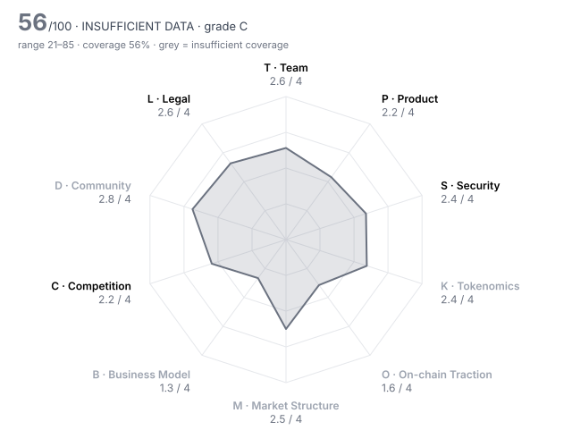

# MegaETH (MEGA) — DD-100 Due-Diligence Report

> **⚪ INSUFFICIENT DATA** · Grade **C** · Score **55.9/100** (range 21–85) · Evidence coverage **56%**  
> Profile `l1_l2` · Evidence as of 2026-04-30 · 100 dimensions · 20 sources

The range is the honest number: it shows where the score could land once unscored dimensions are filled and low-confidence judgments are firmed up.

## Why this verdict

- evidence coverage 56% below the 70% needed for a verdict

## Red-flag gates

| Gate | Severity | Status | What it means |
|---|---|---|---|
| RF02 Sanctions / illicit-finance exposure | critical | ❔ unchecked | Listing would create direct regulatory liability for the venue. |
| RF03 Core contracts not source-verified | critical | ❔ unchecked | Nobody outside the team can see what users are interacting with. |
| RF06 Upgradeable contracts with no meaningful timelock | major | ❔ unchecked | Logic can change under users with no time to exit. |
| RF07 Extreme holder concentration | major | ❔ unchecked | A handful of wallets can set the price; order books will not absorb their exit. |
| RF08 Unlock cliff within 90 days | major | ❔ unchecked | More than a quarter of circulating supply unlocks shortly after a listing window. |
| RF13 Undisclosed market-maker terms | major | ❔ unchecked | Token loans and call options are where post-listing dumps are engineered. |
| RF16 Volume implausible versus depth | minor | ❔ unchecked | Daily volume more than 100x the ±2% depth is a common wash-trading signature. |

8 of 16 gates verified clear (1 not applicable to this profile).

## Pillar scores

| Pillar | Weight | Score /4 | | Coverage | Scored |
|---|---:|---:|---|---:|---:|
| T · Team & Governance | 12 | 2.56 | `██████░░░░` | 67% | 7/10 |
| P · Product & Technology | 14 | 2.16 | `█████░░░░░` | 100% | 10/10 |
| S · Security & Smart Contracts | 12 | 2.35 | `██████░░░░` | 68% | 6/10 |
| K · Tokenomics & Supply | 14 | 2.38 | `██████░░░░` | 38% ⚠️ | 4/10 |
| O · On-chain Traction | 12 | 1.57 | `████░░░░░░` | 47% ⚠️ | 4/9 |
| M · Market Structure & Liquidity | 8 | 2.50 | `██████░░░░` | 12% ⚠️ | 2/10 |
| B · Business Model & Fundamentals | 6 | 1.33 | `███░░░░░░░` | 35% ⚠️ | 3/9 |
| C · Competition & Moat | 10 | 2.18 | `█████░░░░░` | 61% | 6/10 |
| D · Community & Distribution | 6 | 2.75 | `███████░░░` | 31% ⚠️ | 4/10 |
| L · Legal, Compliance & Jurisdiction | 6 | 2.64 | `███████░░░` | 69% | 5/8 |

⚠️ = coverage below the pillar minimum; treat that pillar's score as indicative.

## Claims vs. observation

| Claim | Claimed | Observed | Gap | Sources |
|---|---:|---:|---:|---|
| MiCA white paper: Sonar sale received about $450M in bids, roughly 9x oversubscribed | 450,000,000 | 1,390,000,000 | 68% | MEGA-06 vs MEGA-16 |

## Strengths

- **T06 Team vesting length** (4/4) — team_vesting_months = 48  (bands 4:≥48, 3:≥36, 2:≥24, 1:≥12)
- **K06 Investor cost-basis overhang** (4/4) — price_to_last_round_multiple = 2  (bands 4:≤3, 3:≤10, 2:≤30, 1:≤100)
- **L06 Privacy & obfuscation features** (4/4) — Standard transparent EVM rollup; no privacy or mixing features in the protocol.
- **T05 Controversies & misconduct history** (3/4) — No enforcement action or misconduct allegation found; the one public failure (Nov-2025 pre-deposit multisig error) was operational, admitted as 'sloppy', with a full refund announced. Registries and court records not searched, so not 4.
- **S06 Mint / freeze / blacklist powers** (3/4) — White paper states fixed 10B supply with no minting function and no pause, but also describes emergency multisig admin functions; not verified on-chain.
- **S08 Incident history & response** (3/4) — No exploit found; the Nov-2025 pre-deposit incident (>$400M deposited, no reported loss) was disclosed within two days with a full refund announced, the refund contract going through audit first.

## Risks

- **O06 Organic vs sybil activity** (1/4) — The TGE KPI (100k tx per app over 30 days) is easy to farm and was met by self-incubated apps; USDM rose ~5x in the countdown week. No address-clustering data to show an organic base.
- **T07 Governance design & decentralisation path** (1/4) — Governance is not live; MegaLabs runs the single sequencer and can adjust parameters through multisig; decentralisation is a KPI with no date, and unmet KPI tokens may later go to an undefined vote.
- **P05 Dependency risk** (1/4) — Single MegaLabs sequencer with no described failover; the economic model rests on Ethena's USDM (BUIDL-backed) yield; a third-party bridge provider outage disrupted the Nov-2025 pre-deposit.
- **B02 Revenue quality** (1/4) — The planned revenue engine is USDM reserve yield from tokenised T-bills via Ethena — one rate-sensitive source; no fee or revenue figures were published before listing.
- **B10 Sustainability without emissions** (1/4) — Planned economics lean on USDM yield; 53.3% of supply is reserved to reward KPI growth, and TVL was ~$66M in February — the business has not yet run without incentives.
- **K09 Supply verifiability** (1/4) — Only the team schedule is in the white paper; Echo/Fluffle terms come from third parties; VC (14.7%) and foundation schedules and all vesting-contract addresses were unpublished, and 53.3% releases on discretionary KPIs.

## Open questions for the project team

Everything below is unscored. Each one is a question to put to the team or a data request, not a negative finding.

**Needs a private channel (call, data room, counsel)** (3)

- T02 Identity verification level: Are the key people identified to the reviewer (KYC) and, ideally, publicly? — _requires private channel_
- M05 Market-maker arrangements: Are MM agreements (loans, call options, KPIs) disclosed to the reviewer and reasonable? — _requires private channel_
- L07 Legal opinion: Has the project provided a token legal opinion from reputable counsel? — _requires private channel_

**Needs evidence** (42)

- T01 Founder track record: Have the core founders built and operated comparable products, with verifiable outcomes? — _missing: a dated source on the founders' prior ventures and their outcomes; dated sources name only Namik Muduroglu as a founding contributor and give a 23-person team_
- T08 Treasury transparency: Are treasury addresses, holdings and spending disclosed and reconcilable on-chain? — _missing: published treasury/foundation addresses and any treasury report; none found in dated sources. Foundation's 7.5% reserve and VC 14.7% custody not disclosed_
- S03 Source verification: Is the source code of every core contract verified on the block explorer? — _metric 'contracts_verified' not in evidence pack; contracts_verified not established: the MEGA token (MegaETH 0x28B7E77f82B25B95953825F1E3eA0E36c1c29861) and KPI-staking contracts could not be checked on the MegaETH explorer from this review, and no dated source states their verification status. RF03 stays unchecked. Ask: verified source links for MEGA, staking and buyback contracts._
- S04 Upgrade timelock: How long must users wait between an upgrade being queued and executed? (non-upgradeable = 9999) — _metric 'upgrade_timelock_hours' not in evidence pack; upgrade_timelock_hours not set: the white paper says multisig changes are 'subject to time delays' but gives no figure; no dated third-party source gives the L1 proxy admin or delay. A live L2BEAT page was consulted but excluded because it cannot be pinned to 30 Apr._
- S07 Bug bounty: What is the maximum bug bounty payout on an established platform? — _metric 'bug_bounty_max_usd' not in evidence pack; No bug bounty amount found; mega-evm SECURITY.md gives a private disclosure channel only._
- S09 Oracle & manipulation resistance: Can prices or state be manipulated to drain funds (flash loans, thin oracles)? — _missing: oracle design of the main apps (RedStone Bolt is named in MEGA-16) and USDM/Aave-style collateral parameters; chain itself uses no price oracle_
- K02 Circulating ratio: What share of total supply is circulating today? — _metric 'circulating_supply_pct' not in evidence pack; circulating_supply and market_cap_usd not set: no source dated on or before 30 Apr states the TGE circulating amount. Dated sources give only 'under 10%' (MEGA-07); the documented TGE unlocks (Sonar 500M + Echo 20% of 500M + Fluffle 50% of 250M = 725M, 7.25%) are a lower bound that omits any foundation/liquidity release. Ask: exact TGE circulating supply and its breakdown._
- K03 Holder concentration: Share of supply held by the top 10 wallets, excluding exchanges, burn and protocol contracts — _metric 'top10_holder_pct_ex_contracts' not in evidence pack_
- K04 12-month unlock pressure: Tokens unlocking in the next 12 months as a percentage of current circulating supply — _metric 'unlock_12m_pct_of_circ' not in evidence pack; unlock_12m / unlock_90d not computable without circulating supply and the VC (14.7%) and foundation (7.5%) schedules, which were not published in dated sources. Known: Fluffle remainder (125M) vests over 6 months; Echo and team have 1-year cliffs; the 53.3% KPI pool releases on discretionary KPI events, one of which (TGE) was already triggered. Ask for the full unlock calendar._
- K07 FDV / market cap: How much future dilution is priced in? — _metric 'fdv_to_mcap' not in evidence pack_
- K08 Annual inflation: Net annual emission rate after burns — _metric 'annual_inflation_pct' not in evidence pack_
- K10 Airdrop & incentive design: Do incentive programmes reward real users and resist sybil farming? — _missing: post-claim retention of Sonar/Echo/Fluffle recipients and the Terminal campaign design; cannot be observed before listing_
- O01 Daily active addresses (30d avg): How many unique addresses interact with the protocol daily? — _metric 'daa_30d_avg' not in evidence pack; Daily active addresses, retention and fee payers: no dated indexer data; live dashboards were not used to avoid post-listing data._
- O02 Activity trend (90d): Percentage change in daily active addresses over 90 days — _metric 'daa_90d_change_pct' not in evidence pack_
- O03 30-day user retention: Share of a new-user cohort still active after 30 days — _metric 'retention_30d_pct' not in evidence pack_
- O07 Fee-paying users (30d): Unique addresses that paid fees in the last 30 days — _metric 'fee_paying_users_30d' not in evidence pack_
- O10 Net capital flows (90d): Net inflow of external capital (stablecoins/majors) into the protocol over 90 days, USD — _metric 'net_inflow_90d_usd' not in evidence pack_
- M01 Order-book depth (±2%): Aggregate USD depth within 2% of mid across major venues — _metric 'depth_2pct_usd' not in evidence pack; Depth, spread, 24h volume and venue share at listing were not captured; spot trading began 11:00 UTC on 30 Apr._
- M02 Venue concentration: Share of volume on the single largest venue — _metric 'top_venue_volume_share_pct' not in evidence pack_
- M03 Wash-trading indicators: Do volume, depth and trade-size patterns suggest fabricated volume? — _missing: listing-day volume, order-book depth and trade-size data across venues_
- M04 Bid-ask spread: Volume-weighted average spread in basis points — _metric 'spread_bps' not in evidence pack_
- M07 Derivatives structure: Do perp open interest and funding indicate healthy two-way markets or crowded positioning? — _missing: pre-market perp OI and funding on Hyperliquid and Binance; Binance converts its pre-market MEGAUSDT to a standard perp with up to 50x leverage at listing (MEGA-10)_
- M08 Realised volatility (30d): Annualised 30-day realised volatility — _metric 'realized_vol_30d_pct' not in evidence pack_
- M09 DEX liquidity ownership: Is on-chain liquidity protocol-owned/locked or mercenary and removable overnight? — _missing: on-chain MEGA liquidity pools and LP ownership at TGE_
- B01 Annualised protocol revenue: Revenue retained by the protocol/treasury (not total fees), annualised from the last 90 days, USD — _metric 'annualized_revenue_usd' not in evidence pack; No protocol fee or revenue figures published before listing; revenue model (USDM reserve yield) is not yet measurable. B04 (FDV/fees) therefore unscored._
- B04 Valuation vs fees (FDV / annualised fees): Price paid per dollar of fees generated — _metric 'fdv_to_annual_fees' not in evidence pack_
- B05 Incentive spend vs revenue: USD value of token incentives divided by protocol revenue (90d) — _metric 'incentives_to_revenue' not in evidence pack_
- B06 Treasury runway: Months of runway at current burn, counting non-native assets at full value and native token at 50% — _metric 'runway_months' not in evidence pack_
- B07 Treasury diversification: Share of treasury held in assets other than the native token — _metric 'treasury_non_native_pct' not in evidence pack_
- B08 Revenue growth (90d): Quarter-on-quarter change in protocol revenue — _metric 'revenue_qoq_growth_pct' not in evidence pack_
- C02 Category market share: Share of the relevant category metric (TVL, volume, fees) held by this project — _metric 'category_share_pct' not in evidence pack_
- C03 Share trajectory: Is market share rising or falling over the last two quarters? — _missing: two quarters of share data; mainnet is under 3 months old_
- C07 Relative valuation: Is the valuation reasonable against peers on comparable metrics? — _missing: dated peer FDV/TVL/fee comparables for Arbitrum, Optimism, Base-adjacent tokens and Monad at 30 Apr 2026_
- C08 Platform & incumbent threat: Could an L1, wallet, CEX or major protocol absorb this as a native feature? — _missing: dated evidence on incumbents' latency roadmaps (e.g. Base, Ethereum L1 block-time work)_
- D01 Organic audience: Size and quality of the audience across X, Telegram, Discord and regional channels — _missing: social analytics (engagement rate, bot share) for X/Discord_
- D02 Engagement authenticity: What share of engagement appears bot-driven or paid? — _missing: engagement-authenticity analysis_
- D03 Token holder count: Number of addresses holding a non-dust balance — _metric 'holders_count' not in evidence pack; Holder count at TGE not available from a dated source._
- D04 Geographic & user diversity: Is the user base spread across regions, or concentrated where the venue cannot serve it? — _missing: geographic split of users and sale participants; white paper names only EEA host states_
- D05 Paid-promotion dependence: How much attention comes from paid KOLs, undisclosed promotions or points campaigns? — _missing: disclosed KOL/paid campaigns and the Terminal mainnet campaign design_
- D07 Governance participation: Average share of circulating supply voting on recent proposals — _metric 'governance_participation_pct' not in evidence pack; No token-holder governance is live (MiCA white paper G.3); participation is not measurable. Scored under T07._
- L03 Sanctions & AML exposure: Has screening found exposure to sanctioned addresses, mixers or illicit flows above tolerance? — _metric 'sanctions_exposure' not in evidence pack; sanctions_exposure needs the venue's own Chainalysis/TRM screening of foundation, MegaLabs, deployer and top-holder addresses; none are published._
- L10 Restricted-jurisdiction controls: Does the project geofence and enforce restrictions consistent with its legal analysis? — _missing: restricted-jurisdiction list for the sale and KPI staking (white paper mentions restrictions only generally)_

## Appendix A — all 100 dimensions

### T · Team & Governance

| ID | Dimension | Method | W | Score | Conf. | Evidence | Basis |
|---|---|---|---:|---:|---|---|---|
| T01 | Founder track record | agent | 3 | – |  |  | missing: a dated source on the founders' prior ventures and their outcomes; dated sources name only Namik Muduroglu as a founding contributor and give a 23-person team |
| T02 | Identity verification level | human | 3 | ⏳ |  |  | requires private channel |
| T03 | Team depth & key-person risk | agent | 2 | **2** | medium | MEGA-06, MEGA-18 | 23 team members per the white paper; 12 named contributors committed to the public client repos in the 90 days to 30 Apr, so engineering has some redundancy; no disclosed succession or security/ops leadership. |
| T04 | Technical leadership | agent | 2 | **3** | high | MEGA-17, MEGA-18, MEGA-16 | In-house team built MegaEVM, the SALT state trie and a stateless validator, open-sourced and externally tested by BlockSec; 10ms mini-block design documented. No public consensus/sequencer spec. |
| T05 | Controversies & misconduct history | agent | 3 | **3** | medium | MEGA-06, MEGA-11, MEGA-12 | No enforcement action or misconduct allegation found; the one public failure (Nov-2025 pre-deposit multisig error) was operational, admitted as 'sloppy', with a full refund announced. Registries and court records not searched, so not 4. |
| T06 | Team vesting length | rule | 2 | **4** | low | MEGA-06 | team_vesting_months = 48  (bands 4:≥48, 3:≥36, 2:≥24, 1:≥12) |
| T07 | Governance design & decentralisation path | agent | 2 | **1** | medium | MEGA-06, MEGA-04, MEGA-05 | Governance is not live; MegaLabs runs the single sequencer and can adjust parameters through multisig; decentralisation is a KPI with no date, and unmet KPI tokens may later go to an undefined vote. |
| T08 | Treasury transparency | agent | 2 | – |  |  | missing: published treasury/foundation addresses and any treasury report; none found in dated sources. Foundation's 7.5% reserve and VC 14.7% custody not disclosed |
| T09 | Backer quality & cap table | agent | 2 | **3** | high | MEGA-06, MEGA-02, MEGA-16 | Seed led by Dragonfly with Vitalik Buterin and Joseph Lubin; later backers include Anagram, Kraken Ventures, Maven11, Robot Ventures. GSR and Wintermute are both investors and market makers, which the MM-terms review (M05) must check. |
| T10 | Disclosure honesty | rule | 3 | **2** | high | HARNESS | contradiction_count = 1  (bands 4:≤0, 3:≤0.5, 2:≤1, 1:≤2) |

### P · Product & Technology

| ID | Dimension | Method | W | Score | Conf. | Evidence | Basis |
|---|---|---|---:|---:|---|---|---|
| P01 | Problem clarity & real demand | agent | 3 | **2** | medium | MEGA-02, MEGA-07, MEGA-01 | Real-time EVM execution is a real need for trading and gaming apps, but demand at TGE was shaped by the token KPIs: the 10 qualifying apps were self-incubated and USDM jumped from ~$62.9M to >$300M in the countdown week. |
| P02 | Product maturity | agent | 3 | **2** | high | MEGA-13, MEGA-14, MEGA-15 | Public mainnet since 9 Feb 2026 — under 3 months of production at listing; sequencer decentralisation, staking and proximity markets are still roadmap. |
| P03 | Technical originality | agent | 2 | **3** | high | MEGA-17, MEGA-19, MEGA-16 | Execution layer is original (MegaEVM with a dual gas model, SALT in-memory trie, stateless validation, 10ms mini-blocks); settlement and bridging reuse OP Stack contracts. |
| P04 | Architecture soundness | agent | 2 | **2** | medium | MEGA-17, MEGA-06, MEGA-16 | One high-spec sequencer (100+ cores, TB-scale RAM) run by MegaLabs; BlockSec found DoS paths at the 10B gas limit, mitigated by a 200M compute-gas cap rather than fixed. Liveness limits are acknowledged in the white paper. |
| P05 | Dependency risk | agent | 2 | **1** | medium | MEGA-06, MEGA-11, MEGA-16, MEGA-01 | Single MegaLabs sequencer with no described failover; the economic model rests on Ethena's USDM (BUIDL-backed) yield; a third-party bridge provider outage disrupted the Nov-2025 pre-deposit. |
| P06 | Development activity (90d commits) | rule | 2 | **3** | high | MEGA-18 | github_commits_90d = 155  (bands 4:≥300, 3:≥150, 2:≥60, 1:≥15) |
| P07 | Contributor breadth (90d) | rule | 1 | **3** | high | MEGA-18 | github_active_contributors_90d = 12  (bands 4:≥25, 3:≥12, 2:≥6, 1:≥3) |
| P08 | Roadmap delivery record | agent | 2 | **2** | medium | MEGA-04, MEGA-13, MEGA-11, MEGA-06 | Mainnet shipped on the announced 9 Feb date, but the USDm pre-deposit campaign was aborted and refunded, and the white paper gives conflicting dates for testnet and TGE. |
| P09 | Open source & reproducibility | agent | 1 | **2** | high | MEGA-18, MEGA-17 | MegaEVM, SALT and the stateless validator are public (Apache/MIT) with 155 commits in the 90 days to 30 Apr; the sequencer node and token/staking contracts were not found as public repos. |
| P10 | Documentation quality | agent | 1 | **2** | medium | MEGA-19, MEGA-06 | Developer docs list contract addresses and bridge usage; no published threat model, sequencer spec or admin-key documentation. |

### S · Security & Smart Contracts

| ID | Dimension | Method | W | Score | Conf. | Evidence | Basis |
|---|---|---|---:|---:|---|---|---|
| S01 | Audit coverage | rule | 3 | **2** | high | MEGA-17 | audits_reputable_count = 1  (bands 4:≥3, 3:≥2, 2:≥1, 1:≥0.5) |
| S02 | Audit remediation | agent | 3 | **2** | high | MEGA-17 | BlockSec's 4 High MegaEVM findings: 1 Fixed, 3 Confirmed and mitigated by a compute-gas cap rather than code fixes; SALT Medium fixed. Spearbit/Sherlock remediation is claimed but unpublished. |
| S03 | Source verification | rule | 2 | – |  |  | metric 'contracts_verified' not in evidence pack; contracts_verified not established: the MEGA token (MegaETH 0x28B7E77f82B25B95953825F1E3eA0E36c1c29861) and KPI-staking contracts could not be checked on the MegaETH explorer from this review, and no dated source states their verification status. RF03 stays unchecked. Ask: verified source links for MEGA, staking and buyback contracts. |
| S04 | Upgrade timelock | rule | 3 | – |  |  | metric 'upgrade_timelock_hours' not in evidence pack; upgrade_timelock_hours not set: the white paper says multisig changes are 'subject to time delays' but gives no figure; no dated third-party source gives the L1 proxy admin or delay. A live L2BEAT page was consulted but excluded because it cannot be pinned to 30 Apr. |
| S05 | Admin key custody | agent | 3 | **2** | medium | MEGA-11, MEGA-06 | Admin powers sit in MegaLabs multisigs with undisclosed signers and thresholds; the one observed (pre-deposit) was a 4-signer team Safe whose cap-raise was mis-set to 4-of-4 and executed early by an outsider. |
| S06 | Mint / freeze / blacklist powers | agent | 3 | **3** | low | MEGA-06 | White paper states fixed 10B supply with no minting function and no pause, but also describes emergency multisig admin functions; not verified on-chain. |
| S07 | Bug bounty | rule | 1 | – |  |  | metric 'bug_bounty_max_usd' not in evidence pack; No bug bounty amount found; mega-evm SECURITY.md gives a private disclosure channel only. |
| S08 | Incident history & response | agent | 3 | **3** | medium | MEGA-11, MEGA-12, MEGA-20 | No exploit found; the Nov-2025 pre-deposit incident (>$400M deposited, no reported loss) was disclosed within two days with a full refund announced, the refund contract going through audit first. |
| S09 | Oracle & manipulation resistance | agent | 2 | – |  |  | missing: oracle design of the main apps (RedStone Bolt is named in MEGA-16) and USDM/Aave-style collateral parameters; chain itself uses no price oracle |
| S10 | Bridge & cross-chain exposure | agent | 2 | **2** | low | MEGA-19, MEGA-11 | Assets enter via the canonical OP Stack bridge (proxy contracts) and Ethena-issued USDM; upgrade admin and delay of the bridge were not established from dated sources. |

### K · Tokenomics & Supply

| ID | Dimension | Method | W | Score | Conf. | Evidence | Basis |
|---|---|---|---:|---:|---|---|---|
| K01 | Token utility & value accrual | agent | 3 | **2** | medium | MEGA-06, MEGA-05, MEGA-01 | At listing MEGA's live use is locking for KPI rewards; gas, sequencer staking and proximity markets are planned; the USDM-funded buyback is announced, not shown on-chain, and MEGA confers no revenue rights. |
| K02 | Circulating ratio | rule | 2 | – |  |  | metric 'circulating_supply_pct' not in evidence pack; circulating_supply and market_cap_usd not set: no source dated on or before 30 Apr states the TGE circulating amount. Dated sources give only 'under 10%' (MEGA-07); the documented TGE unlocks (Sonar 500M + Echo 20% of 500M + Fluffle 50% of 250M = 725M, 7.25%) are a lower bound that omits any foundation/liquidity release. Ask: exact TGE circulating supply and its breakdown. |
| K03 | Holder concentration | rule | 3 | – |  |  | metric 'top10_holder_pct_ex_contracts' not in evidence pack |
| K04 | 12-month unlock pressure | rule | 3 | – |  |  | metric 'unlock_12m_pct_of_circ' not in evidence pack; unlock_12m / unlock_90d not computable without circulating supply and the VC (14.7%) and foundation (7.5%) schedules, which were not published in dated sources. Known: Fluffle remainder (125M) vests over 6 months; Echo and team have 1-year cliffs; the 53.3% KPI pool releases on discretionary KPI events, one of which (TGE) was already triggered. Ask for the full unlock calendar. |
| K05 | Insider allocation | rule | 2 | **2** | low | MEGA-06 | insider_allocation_pct = 36.7  (bands 4:≤25, 3:≤35, 2:≤45, 1:≤55) |
| K06 | Investor cost-basis overhang | rule | 2 | **4** | medium | MEGA-08 | price_to_last_round_multiple = 2  (bands 4:≤3, 3:≤10, 2:≤30, 1:≤100) |
| K07 | FDV / market cap | rule | 2 | – |  |  | metric 'fdv_to_mcap' not in evidence pack |
| K08 | Annual inflation | rule | 2 | – |  |  | metric 'annual_inflation_pct' not in evidence pack |
| K09 | Supply verifiability | agent | 1 | **1** | medium | MEGA-06, MEGA-07, MEGA-04 | Only the team schedule is in the white paper; Echo/Fluffle terms come from third parties; VC (14.7%) and foundation schedules and all vesting-contract addresses were unpublished, and 53.3% releases on discretionary KPIs. |
| K10 | Airdrop & incentive design | agent | 1 | – |  |  | missing: post-claim retention of Sonar/Echo/Fluffle recipients and the Terminal campaign design; cannot be observed before listing |

### O · On-chain Traction

| ID | Dimension | Method | W | Score | Conf. | Evidence | Basis |
|---|---|---|---:|---:|---|---|---|
| O01 | Daily active addresses (30d avg) | rule | 2 | – |  |  | metric 'daa_30d_avg' not in evidence pack; Daily active addresses, retention and fee payers: no dated indexer data; live dashboards were not used to avoid post-listing data. |
| O02 | Activity trend (90d) | rule | 2 | – |  |  | metric 'daa_90d_change_pct' not in evidence pack |
| O03 | 30-day user retention | rule | 2 | – |  |  | metric 'retention_30d_pct' not in evidence pack |
| O04 | TVL / AUM | rule | 2 | **2** | medium | MEGA-15 | tvl_usd = 66,480,000  (bands 4:≥1e+09, 3:≥2e+08, 2:≥5e+07, 1:≥1e+07) |
| O05 | Incentive-driven TVL share | rule | 2 | n/a |  |  | not applicable to profile 'l1_l2' |
| O06 | Organic vs sybil activity | agent | 3 | **1** | low | MEGA-02, MEGA-01, MEGA-07 | The TGE KPI (100k tx per app over 30 days) is easy to farm and was met by self-incubated apps; USDM rose ~5x in the countdown week. No address-clustering data to show an organic base. |
| O07 | Fee-paying users (30d) | rule | 1 | – |  |  | metric 'fee_paying_users_30d' not in evidence pack |
| O08 | Integrations | rule | 1 | **2** | medium | MEGA-03 | live_integrations_count = 10  (bands 4:≥50, 3:≥20, 2:≥8, 1:≥3) |
| O09 | Builder ecosystem | agent | 1 | **2** | medium | MEGA-16, MEGA-02, MEGA-07 | Mega Mafia incubated ~30 apps whose first 13 teams raised >$40M, but builders are mostly programme-funded and one incubated app moved to a rival chain. |
| O10 | Net capital flows (90d) | rule | 1 | – |  |  | metric 'net_inflow_90d_usd' not in evidence pack |

### M · Market Structure & Liquidity

| ID | Dimension | Method | W | Score | Conf. | Evidence | Basis |
|---|---|---|---:|---:|---|---|---|
| M01 | Order-book depth (±2%) | rule | 3 | – |  |  | metric 'depth_2pct_usd' not in evidence pack; Depth, spread, 24h volume and venue share at listing were not captured; spot trading began 11:00 UTC on 30 Apr. |
| M02 | Venue concentration | rule | 2 | – |  |  | metric 'top_venue_volume_share_pct' not in evidence pack |
| M03 | Wash-trading indicators | agent | 3 | – |  |  | missing: listing-day volume, order-book depth and trade-size data across venues |
| M04 | Bid-ask spread | rule | 2 | – |  |  | metric 'spread_bps' not in evidence pack |
| M05 | Market-maker arrangements | human | 2 | ⏳ |  |  | requires private channel |
| M06 | Existing venue quality | agent | 1 | **3** | medium | MEGA-09, MEGA-01, MEGA-07 | Lists simultaneously on Binance, Coinbase (deposits opened pre-TGE), KuCoin, Bitget and ~9 others; tier-1 diligence, but no spot trading history before this listing. |
| M07 | Derivatives structure | agent | 1 | – |  |  | missing: pre-market perp OI and funding on Hyperliquid and Binance; Binance converts its pre-market MEGAUSDT to a standard perp with up to 50x leverage at listing (MEGA-10) |
| M08 | Realised volatility (30d) | rule | 1 | – |  |  | metric 'realized_vol_30d_pct' not in evidence pack |
| M09 | DEX liquidity ownership | agent | 1 | – |  |  | missing: on-chain MEGA liquidity pools and LP ownership at TGE |
| M10 | Narrative & timing fit | agent | 1 | **2** | medium | MEGA-03, MEGA-16, MEGA-07 | MegaETH ran the largest community token sale ($1.39B committed vs Monad's $269M), but pre-market valuation fell from >$6B (Oct) to $1.5–2B, and >84% of 2025 launches trade below TGE price. |

### B · Business Model & Fundamentals

| ID | Dimension | Method | W | Score | Conf. | Evidence | Basis |
|---|---|---|---:|---:|---|---|---|
| B01 | Annualised protocol revenue | rule | 3 | – |  |  | metric 'annualized_revenue_usd' not in evidence pack; No protocol fee or revenue figures published before listing; revenue model (USDM reserve yield) is not yet measurable. B04 (FDV/fees) therefore unscored. |
| B02 | Revenue quality | agent | 2 | **1** | low | MEGA-01, MEGA-16, MEGA-06 | The planned revenue engine is USDM reserve yield from tokenised T-bills via Ethena — one rate-sensitive source; no fee or revenue figures were published before listing. |
| B03 | Holder value capture | agent | 2 | **2** | medium | MEGA-01, MEGA-13, MEGA-02 | Foundation has said USDM revenue will be used to accumulate MEGA; no buyback address or executed purchases were shown before listing. |
| B04 | Valuation vs fees (FDV / annualised fees) | rule | 2 | – |  |  | metric 'fdv_to_annual_fees' not in evidence pack |
| B05 | Incentive spend vs revenue | rule | 2 | – |  |  | metric 'incentives_to_revenue' not in evidence pack |
| B06 | Treasury runway | rule | 2 | – |  |  | metric 'runway_months' not in evidence pack |
| B07 | Treasury diversification | rule | 1 | – |  |  | metric 'treasury_non_native_pct' not in evidence pack |
| B08 | Revenue growth (90d) | rule | 1 | – |  |  | metric 'revenue_qoq_growth_pct' not in evidence pack |
| B09 | Counterparty concentration | agent | 1 | n/a |  |  | not applicable to profile 'l1_l2' |
| B10 | Sustainability without emissions | agent | 2 | **1** | low | MEGA-01, MEGA-04, MEGA-15 | Planned economics lean on USDM yield; 53.3% of supply is reserved to reward KPI growth, and TVL was ~$66M in February — the business has not yet run without incentives. |

### C · Competition & Moat

| ID | Dimension | Method | W | Score | Conf. | Evidence | Basis |
|---|---|---|---:|---:|---|---|---|
| C01 | Segment size & growth | agent | 2 | **2** | low | MEGA-16 | General-purpose EVM execution is large but ~95% of TVL sits in 5 chains and 15 new L2s launched in 2025; real-time execution is a growing niche. |
| C02 | Category market share | rule | 2 | – |  |  | metric 'category_share_pct' not in evidence pack |
| C03 | Share trajectory | agent | 2 | – |  |  | missing: two quarters of share data; mainnet is under 3 months old |
| C04 | Moat | agent | 3 | **2** | medium | MEGA-16, MEGA-01, MEGA-02 | Moat is early: latency lead plus the Ethena/USDM partnership and an incubated app set; no retention test against a competitor campaign yet. |
| C05 | Forkability | agent | 2 | **2** | medium | MEGA-18, MEGA-16 | Execution client is open source and forkable; sequencer hardware/know-how and USDM liquidity are the sticky parts. |
| C06 | Differentiation vs top-3 peers | agent | 2 | **3** | low | MEGA-16, MEGA-14 | Versus Arbitrum/Base: 10ms blocks; versus Solana/Hyperliquid: full EVM equivalence on Ethereum. Monad and other fast EVMs compete on the same axis. |
| C07 | Relative valuation | agent | 2 | – |  |  | missing: dated peer FDV/TVL/fee comparables for Arbitrum, Optimism, Base-adjacent tokens and Monad at 30 Apr 2026 |
| C08 | Platform & incumbent threat | agent | 1 | – |  |  | missing: dated evidence on incumbents' latency roadmaps (e.g. Base, Ethereum L1 block-time work) |
| C09 | Partnership substance | agent | 1 | **2** | medium | MEGA-01, MEGA-02, MEGA-03 | Ethena-co-developed USDM is live (> $300M) and 10 apps are live; investor ties (Kraken Ventures, GSR, Wintermute) are investments, not integrations. |
| C10 | Exchange-level strategic fit | agent | 1 | **2** | medium | MEGA-16, MEGA-05 | Adds another Ethereum L2 token to a venue that already lists several; the differentiator is the real-time niche and a large KYC'd retail sale base. |

### D · Community & Distribution

| ID | Dimension | Method | W | Score | Conf. | Evidence | Basis |
|---|---|---|---:|---:|---|---|---|
| D01 | Organic audience | agent | 1 | – |  |  | missing: social analytics (engagement rate, bot share) for X/Discord |
| D02 | Engagement authenticity | agent | 2 | – |  |  | missing: engagement-authenticity analysis |
| D03 | Token holder count | rule | 2 | – |  |  | metric 'holders_count' not in evidence pack; Holder count at TGE not available from a dated source. |
| D04 | Geographic & user diversity | agent | 1 | – |  |  | missing: geographic split of users and sale participants; white paper names only EEA host states |
| D05 | Paid-promotion dependence | agent | 2 | – |  |  | missing: disclosed KOL/paid campaigns and the Terminal mainnet campaign design |
| D06 | Developer community | agent | 1 | **3** | medium | MEGA-16, MEGA-02 | Mega Mafia accelerator: 28–30 projects in two cohorts, first 13 teams raised >$40M, 10 shipped to mainnet. |
| D07 | Governance participation | rule | 1 | – |  |  | metric 'governance_participation_pct' not in evidence pack; No token-holder governance is live (MiCA white paper G.3); participation is not measurable. Scored under T07. |
| D08 | Communication transparency | agent | 1 | **3** | medium | MEGA-11, MEGA-12, MEGA-06 | Pre-deposit failure explained within two days with a full refund announced; but the regulatory white paper has unreconciled dates and a sale-demand figure ($450M bids) far below the $1.39B publicised. |
| D09 | Sentiment & controversy | agent | 1 | **2** | medium | MEGA-03, MEGA-07 | Strong backing, but informed criticism: KPIs met by self-incubated apps, thin float, and pre-market valuation down from >$6B (Oct) to $1.5–2B. |
| D10 | Ecosystem credibility | agent | 1 | **3** | medium | MEGA-01, MEGA-06, MEGA-17 | Ethena co-developed USDM; Dragonfly-led with Buterin as angel; BlockSec and Zellic engaged. Endorsement is strong, integrations still few. |

### L · Legal, Compliance & Jurisdiction

| ID | Dimension | Method | W | Score | Conf. | Evidence | Basis |
|---|---|---|---:|---:|---|---|---|
| L01 | Legal entity & jurisdiction | agent | 2 | **2** | medium | MEGA-06, MEGA-05 | Issuer is a BVI subsidiary of a Cayman foundation; MegaLabs (Cayman) develops; BVI law and courts govern. No named natural-person directors. |
| L02 | Securities-law risk | agent | 3 | **2** | medium | MEGA-06, MEGA-01, MEGA-04 | No revenue rights and a MiCA white paper are mitigants; foundation buybacks from USDM revenue, KPI staking rewards and team-run sequencer point the other way. |
| L03 | Sanctions & AML exposure | rule | 3 | – |  |  | metric 'sanctions_exposure' not in evidence pack; sanctions_exposure needs the venue's own Chainalysis/TRM screening of foundation, MegaLabs, deployer and top-holder addresses; none are published. |
| L04 | Licensing for regulated activity | agent | 2 | **3** | low | MEGA-06, MEGA-05 | MegaETH does not itself issue the stablecoin (Ethena does) or custody user funds beyond the rollup; the sale ran with KYC and a MiCA-licensed custodian for EU buyers. |
| L05 | Litigation & enforcement | agent | 3 | **3** | medium | MEGA-06, MEGA-11, MEGA-01 | No litigation or regulator action found in dated press or the white paper; court and regulator databases were not searched directly. |
| L06 | Privacy & obfuscation features | agent | 1 | **4** | medium | MEGA-06, MEGA-17 | Standard transparent EVM rollup; no privacy or mixing features in the protocol. |
| L07 | Legal opinion | human | 1 | ⏳ |  |  | requires private channel |
| L08 | RWA custody & bankruptcy remoteness | agent | 3 | n/a |  |  | not applicable to profile 'l1_l2' |
| L09 | RWA attestation frequency | agent | 2 | n/a |  |  | not applicable to profile 'l1_l2' |
| L10 | Restricted-jurisdiction controls | agent | 1 | – |  |  | missing: restricted-jurisdiction list for the sale and KPI staking (white paper mentions restrictions only generally) |

## Appendix B — sources

| ID | Tier | Type | Title |
|---|---|---|---|
| MEGA-01 | 2 · independent | news | [The Block: MegaETH token goes live as major exchanges open MEGA trading (30 Apr 2026, 11:25 UTC)](https://www.theblock.co/post/399563/megaeth-token-goes-live-as-major-exchanges-open-mega-trading) |
| MEGA-02 | 2 · independent | news | [The Block: MegaETH hits first KPI with 10 apps live, starts seven-day MEGA token countdown](https://www.theblock.co/post/398651/megaeth-first-kpi-10-apps-live-seven-day-tge-countdown) |
| MEGA-03 | 2 · independent | news | [Unchained: MegaETH clears first KPI milestone, sets MEGA TGE for April 30](https://unchainedcrypto.com/megaeth-clears-first-kpi-milestone-sets-mega-token-generation-event-for-april-30/) |
| MEGA-04 | 2 · independent | news | [The Block: MegaETH outlines four KPIs determining release schedule for 53% of MEGA supply](https://www.theblock.co/post/387721/megaeth-kpis-determining-release-schedule-53-mega-token-supply) |
| MEGA-05 | 2 · independent | news | [The Block: MegaETH's MiCA whitepaper reveals tokenomics with 9.5% team allocation](https://www.theblock.co/post/375871/megaeths-mica-whitepaper-tokenomics-team-allocation-sequencer-features) |
| MEGA-06 | 3 · self-reported | doc | [MegaETH — MiCA Crypto-Asset White Paper, MEGA Token (notified Jan 2026, published Feb 2026)](https://static.megaeth.com/MiCA%20Crypto-Asset%20White%20Paper%20-%20MEGA%20Token.pdf) |
| MEGA-07 | 2 · independent | research | [BlockEden blog: MegaETH's MEGA TGE — when KPIs, not calendars, unlock 5.33B tokens](https://blockeden.xyz/blog/2026/04/30/megaeth-mega-tge-kpi-vesting-coinbase-prelisting-mega-mafia/) |
| MEGA-08 | 2 · independent | news | [ForkLog: Layer 2 project MegaETH launches MEGA token (30 Apr 2026, 12:18 UTC)](https://forklog.com/en/layer-2-project-megaeth-launches-mega-token/) |
| MEGA-09 | 2 · independent | news | [The Defiant: MegaETH token debuts at $2 billion valuation (30 Apr 2026, 19:04 UTC)](https://thedefiant.io/news/blockchains/megaeth-token-debuts-at-usd2-billion-valuation) |
| MEGA-10 | 2 · independent | news | [OneKey blog relaying Binance's 30 Apr 2026 MEGA announcements (spot, futures, margin, Earn)](https://onekey.so/blog/ecosystem/binance-earn-one-click-buy-convert-margin-and-futures-are-adding-megaeth-mega-20260430222132/) |
| MEGA-16 | 2 · independent | research | [Kanon Research: Pre-TGE token valuation — MEGA (Part 1)](https://kanonresearch.substack.com/p/pre-tge-token-valuation-mega-1) |
| MEGA-11 | 2 · independent | news | [The Block: MegaETH to return all funds from pre-deposit bridge, citing 'sloppy' execution](https://www.theblock.co/post/380735/megaeth-refund-pre-deposit-funds) |
| MEGA-12 | 2 · independent | news | [The Defiant: MegaETH to refund USDm pre-deposits after multisig chaos](https://thedefiant.io/news/defi/megaeth-refunds-usdm-predeposit-bridge-campaign) |
| MEGA-13 | 2 · independent | news | [ForkLog: MegaETH team launches public mainnet](https://forklog.com/en/megaeth-team-launches-public-mainnet/) |
| MEGA-14 | 2 · independent | news | [Datawallet Daily #734: MegaETH launches mainnet with extreme throughput](https://datawallet.beehiiv.com/p/megaeth-launches-mainnet-with-extreme-throughput) |
| MEGA-15 | 2 · independent | news | [The Defiant: MegaETH TVL rises 65% in a week, but TGE conditions remain unmet](https://thedefiant.io/news/blockchains/megaeth-tvl-rises-65-percent-week-after-mainnet-but-still-no-tge) |
| MEGA-17 | 1 · primary | audit | [BlockSec — Security testing report for MegaETH: MegaEVM, Stateless Validator & SALT v1.0 (signed 16 Dec 2025)](https://github.com/megaeth-labs/mega-evm/blob/main/audits/2025-12-15-blocksec-megaeth.pdf) |
| MEGA-18 | 1 · primary | onchain | [GitHub commit history, megaeth-labs/mega-evm, stateless-validator, salt — own query, window 30 Jan–30 Apr 2026](https://github.com/megaeth-labs) |
| MEGA-19 | 3 · self-reported | doc | [MegaETH developer docs — Overview and Contracts & Tokens pages](https://docs.megaeth.com/developer-docs/overview-1/contracts) |
| MEGA-20 | 2 · independent | news | [LBank Q&A: audits securing MegaETH and stablecoin issues](https://www.lbank.com/questions/ark7701773239168-audits-secure-megaeth-stablecoin-issues) |
| HARNESS | computed | harness | Metrics derived by the harness from other evidence |

---
_Generated by DD-100. Scores are decision support for a listing committee, not investment advice. Every judgment above cites its evidence; anything uncited was not scored._