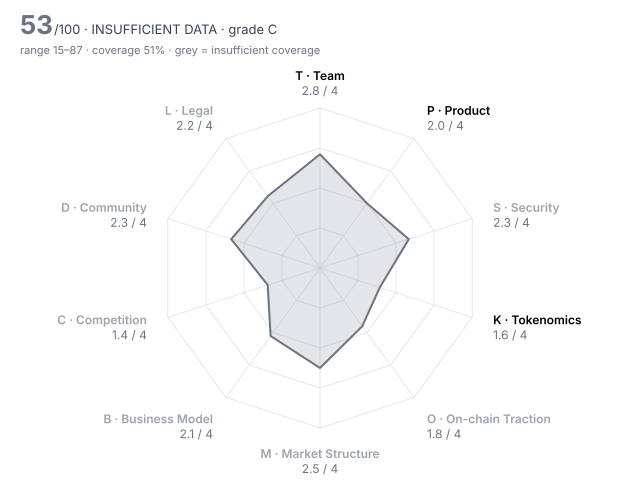

# Momentum (MMT) — DD-100 Due-Diligence Report

> **⚪ INSUFFICIENT DATA** · Grade **C** · Score **52.6/100** (range 15–87) · Evidence coverage **51%**  
> Profile `defi` · Evidence as of 2025-11-04 · 100 dimensions · 23 sources

The range is the honest number: it shows where the score could land once unscored dimensions are filled and low-confidence judgments are firmed up.

## Why this verdict

- evidence coverage 51% below the 70% needed for a verdict

## Red-flag gates

| Gate | Severity | Status | What it means |
|---|---|---|---|
| RF01 Unrestricted mint controlled by a single key | critical | ❔ unchecked | Supply can be inflated at will; every other number in the report is conditional on one person's restraint. |
| RF02 Sanctions / illicit-finance exposure | critical | ❔ unchecked | Listing would create direct regulatory liability for the venue. |
| RF03 Core contracts not source-verified | critical | ❔ unchecked | Nobody outside the team can see what users are interacting with. |
| RF06 Upgradeable contracts with no meaningful timelock | major | ❔ unchecked | Logic can change under users with no time to exit. |
| RF07 Extreme holder concentration | major | ❔ unchecked | A handful of wallets can set the price; order books will not absorb their exit. |
| RF12 Anonymous team with centralised admin powers | major | ❔ unchecked | Unaccountable people holding privileged keys. |
| RF13 Undisclosed market-maker terms | major | ❔ unchecked | Token loans and call options are where post-listing dumps are engineered. |
| RF15 Mercenary TVL | minor | ❔ unchecked | Most deposits are paid to be there and will leave when incentives stop. |
| RF16 Volume implausible versus depth | minor | ❔ unchecked | Daily volume more than 100x the ±2% depth is a common wash-trading signature. |

7 of 16 gates verified clear.

## Pillar scores

| Pillar | Weight | Score /4 | | Coverage | Scored |
|---|---:|---:|---|---:|---:|
| T · Team & Governance | 12 | 2.84 | `███████░░░` | 79% | 8/10 |
| P · Product & Technology | 10 | 2.00 | `█████░░░░░` | 79% | 7/10 |
| S · Security & Smart Contracts | 14 | 2.33 | `██████░░░░` | 36% ⚠️ | 3/10 |
| K · Tokenomics & Supply | 14 | 1.57 | `████░░░░░░` | 67% | 7/10 |
| O · On-chain Traction | 10 | 1.80 | `████░░░░░░` | 29% ⚠️ | 2/10 |
| M · Market Structure & Liquidity | 8 | 2.50 | `██████░░░░` | 12% ⚠️ | 2/10 |
| B · Business Model & Fundamentals | 10 | 2.10 | `█████░░░░░` | 56% ⚠️ | 5/10 |
| C · Competition & Moat | 8 | 1.38 | `███░░░░░░░` | 44% ⚠️ | 4/10 |
| D · Community & Distribution | 5 | 2.33 | `██████░░░░` | 23% ⚠️ | 2/10 |
| L · Legal, Compliance & Jurisdiction | 9 | 2.22 | `██████░░░░` | 56% ⚠️ | 4/8 |

⚠️ = coverage below the pillar minimum; treat that pillar's score as indicative.

## Claims vs. observation

No contradictions found across 5 checked project claim(s).

## Strengths

- **T10 Disclosure honesty** (4/4) — contradiction_count = 0  (bands 4:≤0, 3:≤0.5, 2:≤1, 1:≤2)
- **T06 Team vesting length** (4/4) — team_vesting_months = 48  (bands 4:≥48, 3:≥36, 2:≥24, 1:≥12)
- **L06 Privacy & obfuscation features** (4/4) — Public Sui DEX, multisig and liquid staking products; no privacy or obfuscation features.
- **T01 Founder track record** (3/4) — CEO Wendy Fu (ex-Meta Novi/Libra engineer) shipped MSafe, a Move multisig live on Aptos since Oct 2022 and Sui since May 2023, then a DEX that DefiLlama shows at $290M TVL seven months after launch.
- **T05 Controversies & misconduct history** (3/4) — No allegations or enforcement found in press or in the Coinone listing filing; court records, regulator databases and wallet history were not searched.
- **S01 Audit coverage** (3/4) — audits_reputable_count = 2  (bands 4:≥3, 3:≥2, 2:≥1, 1:≥0.5)

## Risks

- **S06 Mint / freeze / blacklist powers** (1/4) — Binance states supply is not capped and inflation starts ~6 months after TGE, while the Coinone filing calls 1B a cap; a mint path therefore exists with no disclosed holder, bound or rate.
- **O06 Organic vs sybil activity** (1/4) — 1.42M self-reported LPs against ~$600M peak TVL (~$420 each) with every LP earning points looks farming-shaped; about $290M stayed after the campaign. No funding-cluster analysis was possible.
- **C04 Moat** (1/4) — Liquidity followed incentives: more than half of peak TVL left within six days of the HODL campaign ending, so no retention moat has been shown.
- **L02 Securities-law risk** (1/4) — Team-controlled protocol with a promised 100% fee flow to locked-token holders; docs disclaim income rights, but no legal analysis is public.
- **T07 Governance design & decentralisation path** (1/4) — veMMT governance only starts with the ve(3,3) switch 3–6 months after TGE; at listing the team controls parameters, with no timelock, quorum or dated decentralisation plan published.
- **K02 Circulating ratio** (1/4) — circulating_supply_pct = 20.4  (bands 4:≥60, 3:≥40, 2:≥25, 1:≥15)

## Open questions for the project team

Everything below is unscored. Each one is a question to put to the team or a data request, not a negative finding.

**Needs a private channel (call, data room, counsel)** (3)

- T02 Identity verification level: Are the key people identified to the reviewer (KYC) and, ideally, publicly? — _requires private channel_
- M05 Market-maker arrangements: Are MM agreements (loans, call options, KPIs) disclosed to the reviewer and reasonable? — _requires private channel_
- L07 Legal opinion: Has the project provided a token legal opinion from reputable counsel? — _requires private channel_

**Needs evidence** (51)

- T08 Treasury transparency: Are treasury addresses, holdings and spending disclosed and reconcilable on-chain? — _missing: treasury / foundation wallet addresses and holdings; the Coinone filing (MMT-04) lists none and the docs treasury pages could not be read_
- P06 Development activity (90d commits): How much code is being shipped in public repositories? — _metric 'github_commits_90d' not in evidence pack; No public GitHub org for contracts was found; development activity not measurable._
- P07 Contributor breadth (90d): How many distinct developers are actively contributing? — _metric 'github_active_contributors_90d' not in evidence pack_
- P09 Open source & reproducibility: Can a third party build and verify what is deployed? — _missing: public source for the MMT token and CLMM Move packages, and confirmation that published bytecode matches it_
- S02 Audit remediation: Were critical and high findings fixed and re-verified, and does deployed code match audited code? — _missing: Asymptotic and MoveBit reports for the DEX (scope, dates, open findings, commit vs deployed package); only firm names are known (MMT-04)_
- S03 Source verification: Is the source code of every core contract verified on the block explorer? — _metric 'contracts_verified' not in evidence pack; contracts_verified not established. Contract 0x35169bc9...::mmt::MMT is known (MMT-01) but source publication / verification of the token and CLMM packages could not be checked._
- S04 Upgrade timelock: How long must users wait between an upgrade being queued and executed? (non-upgradeable = 9999) — _metric 'upgrade_timelock_hours' not in evidence pack; upgrade_timelock_hours unknown: who holds the Sui UpgradeCap for the CLMM packages, and any delay, is undisclosed in what could be read._
- S05 Admin key custody: Who holds admin keys, and with what multisig threshold and signer independence? — _missing: holders of the CLMM AdminCap/UpgradeCap and MMT TreasuryCap, and multisig threshold/signers (presumably an MSafe account, unconfirmed)_
- S07 Bug bounty: What is the maximum bug bounty payout on an established platform? — _metric 'bug_bounty_max_usd' not in evidence pack; Docs list a Bug Bounty page (MMT-23) but it could not be fetched; max payout unknown._
- S09 Oracle & manipulation resistance: Can prices or state be manipulated to drain funds (flash loans, thin oracles)? — _missing: whether any Momentum vault or integrator reads Momentum pool prices as an oracle, and thin-pool manipulation analysis_
- S10 Bridge & cross-chain exposure: How much value depends on bridges or wrapped representations? — _missing: share of TVL in bridged assets (BTC wrappers, Wormhole assets) vs native Sui assets_
- K03 Holder concentration: Share of supply held by the top 10 wallets, excluding exchanges, burn and protocol contracts — _metric 'top10_holder_pct_ex_contracts' not in evidence pack; No holder distribution published pre-listing; Coinone filing lists none (MMT-04). Needs entity-labelled top-20 on Sui after airdrop distribution._
- K06 Investor cost-basis overhang: Current price as a multiple of the last private round price (higher = more profit to take) — _metric 'price_to_last_round_multiple' not in evidence pack; Not set. Last private round was a $100M valuation (MMT-08); public sales were at $0.10 (Binance Prime Sale, MMT-16) and $0.25/$0.35 (Buidlpad, MMT-07). No listing-time traded price is used, so no multiple. At the $0.35 sale price it would be 3.5x._
- K08 Annual inflation: Net annual emission rate after burns — _metric 'annual_inflation_pct' not in evidence pack; annual_inflation_pct not set: emission rate for the ve(3,3) phase is not published. Coinone's filing calls 1B the issuance cap (MMT-04) while Binance says supply is not capped (MMT-03) — ask the team to reconcile._
- O01 Daily active addresses (30d avg): How many unique addresses interact with the protocol daily? — _metric 'daa_30d_avg' not in evidence pack; No daily-active-address, retention or fee-payer data from an independent indexer; the project's 1.68M swap users / 1.42M LPs (MMT-13) is a self-reported cumulative figure._
- O02 Activity trend (90d): Percentage change in daily active addresses over 90 days — _metric 'daa_90d_change_pct' not in evidence pack_
- O03 30-day user retention: Share of a new-user cohort still active after 30 days — _metric 'retention_30d_pct' not in evidence pack_
- O05 Incentive-driven TVL share: Share of TVL attributable to active token incentives (mercenary capital) — _metric 'incentivised_tvl_share_pct' not in evidence pack; incentivised_tvl_share_pct not set. All LP activity was eligible for 'bricks' points pre-TGE (MMT-11), and TVL fell from $633M (25 Oct) to $290M (31 Oct) after the HODL campaign (MMT-06), but no measurement of the share of current TVL that is incentivised was possible._
- O07 Fee-paying users (30d): Unique addresses that paid fees in the last 30 days — _metric 'fee_paying_users_30d' not in evidence pack_
- O08 Integrations: Number of live third-party integrations (wallets, protocols, aggregators) — _metric 'live_integrations_count' not in evidence pack_
- O09 Builder ecosystem: Are independent teams building on or around the protocol? — _missing: evidence of third-party teams building on Momentum pools or SDK (15 named 'collaborations' in MMT-12 are announcements, not observed integrations)_
- O10 Net capital flows (90d): Net inflow of external capital (stablecoins/majors) into the protocol over 90 days, USD — _metric 'net_inflow_90d_usd' not in evidence pack_
- M01 Order-book depth (±2%): Aggregate USD depth within 2% of mid across major venues — _metric 'depth_2pct_usd' not in evidence pack; No order book existed before 12:00 UTC on 4 Nov 2025; depth, spread, volume, venue share and volatility are not measurable as of the review date._
- M02 Venue concentration: Share of volume on the single largest venue — _metric 'top_venue_volume_share_pct' not in evidence pack_
- M03 Wash-trading indicators: Do volume, depth and trade-size patterns suggest fabricated volume? — _missing: no trading history before 12:00 UTC 4 Nov 2025; re-assess after 7 days of order-book data_
- M04 Bid-ask spread: Volume-weighted average spread in basis points — _metric 'spread_bps' not in evidence pack_
- M07 Derivatives structure: Do perp open interest and funding indicate healthy two-way markets or crowded positioning? — _missing: perp listings, open interest and funding at launch_
- M08 Realised volatility (30d): Annualised 30-day realised volatility — _metric 'realized_vol_30d_pct' not in evidence pack_
- M09 DEX liquidity ownership: Is on-chain liquidity protocol-owned/locked or mercenary and removable overnight? — _missing: MMT pool ownership on Momentum/Sui DEXs after TGE_
- B04 Valuation vs fees (FDV / annualised fees): Price paid per dollar of fees generated — _metric 'fdv_to_annual_fees' not in evidence pack; Not set because no listing-time FDV is used. For reference: at the $350M Buidlpad FDV, FDV / annualised fees = 10.6x; at a $3.5B FDV (a figure floated in pre-listing press, MMT-19) it would be ~106x._
- B05 Incentive spend vs revenue: USD value of token incentives divided by protocol revenue (90d) — _metric 'incentives_to_revenue' not in evidence pack_
- B06 Treasury runway: Months of runway at current burn, counting non-native assets at full value and native token at 50% — _metric 'runway_months' not in evidence pack; Treasury holdings and burn not published._
- B07 Treasury diversification: Share of treasury held in assets other than the native token — _metric 'treasury_non_native_pct' not in evidence pack_
- B09 Counterparty concentration: Does a single client, partner or whale drive most of the usage or revenue? — _missing: volume and TVL concentration by wallet or partner (e.g. HODL-campaign whales)_
- C01 Segment size & growth: How large and fast-growing is the addressable on-chain segment? — _missing: Sui DEX segment size and growth from an independent aggregator_
- C02 Category market share: Share of the relevant category metric (TVL, volume, fees) held by this project — _metric 'category_share_pct' not in evidence pack; Sui DEX category share not established (DefiLlama chain pages could not be fetched); the '#3 DEX globally' line is a one-day self-reported claim (MMT-07)._
- C03 Share trajectory: Is market share rising or falling over the last two quarters? — _missing: Momentum's Sui DEX volume/TVL share over two quarters_
- C07 Relative valuation: Is the valuation reasonable against peers on comparable metrics? — _missing: listing-time FDV and peer valuations (Cetus, Bluefin, Aerodrome FDV/fees)_
- C08 Platform & incumbent threat: Could an L1, wallet, CEX or major protocol absorb this as a native feature? — _missing: evidence on whether Sui-native (DeepBook) or wallet swap features target the same flow_
- C10 Exchange-level strategic fit: Does listing/supporting this add something the venue's users lack (new sector, new users, ecosystem synergy)? — _missing: Binance's existing Sui DeFi coverage and user overlap_
- D01 Organic audience: Size and quality of the audience across X, Telegram, Discord and regional channels — _missing: X/Discord/Telegram audience and engagement data_
- D02 Engagement authenticity: What share of engagement appears bot-driven or paid? — _missing: bot-likelihood analysis of social engagement_
- D03 Token holder count: Number of addresses holding a non-dust balance — _metric 'holders_count' not in evidence pack; Holder count not measurable pre-TGE._
- D04 Geographic & user diversity: Is the user base spread across regions, or concentrated where the venue cannot serve it? — _missing: user geography_
- D06 Developer community: Grants, hackathons and external contributors beyond the core team — _missing: grants, hackathons, external contributors_
- D07 Governance participation: Average share of circulating supply voting on recent proposals — _metric 'governance_participation_pct' not in evidence pack_
- D08 Communication transparency: Does the team communicate bad news promptly and plainly? — _missing: record of incident or delay communications_
- D09 Sentiment & controversy: What is the prevailing tone among informed market participants? — _missing: sentiment among informed participants pre-listing_
- L03 Sanctions & AML exposure: Has screening found exposure to sanctioned addresses, mixers or illicit flows above tolerance? — _metric 'sanctions_exposure' not in evidence pack; sanctions_exposure unknown: no wallet screening was possible. Needs the venue's own screening of deployer, treasury and top-holder addresses._
- L04 Licensing for regulated activity: If the project performs regulated activity (custody, exchange, payments, issuance), is it licensed? — _missing: Terms of Service and MiCA whitepaper contents (not fetchable); licensing position for Momentum X KYC/RWA plans_
- L10 Restricted-jurisdiction controls: Does the project geofence and enforce restrictions consistent with its legal analysis? — _missing: front-end geofencing and airdrop/points eligibility restrictions_

## Appendix A — all 100 dimensions

### T · Team & Governance

| ID | Dimension | Method | W | Score | Conf. | Evidence | Basis |
|---|---|---|---:|---:|---|---|---|
| T01 | Founder track record | agent | 3 | **3** | medium | MMT-09, MMT-22, MMT-10, MMT-06 | CEO Wendy Fu (ex-Meta Novi/Libra engineer) shipped MSafe, a Move multisig live on Aptos since Oct 2022 and Sui since May 2023, then a DEX that DefiLlama shows at $290M TVL seven months after launch. |
| T02 | Identity verification level | human | 3 | ⏳ |  |  | requires private channel |
| T03 | Team depth & key-person risk | agent | 2 | **2** | medium | MMT-09, MMT-10, MMT-04 | Three named executives (CEO Wendy Fu, CTO Jacky Wang, CSO Vinson Leow); the listing filing names only the CEO; no wider team or succession information found. |
| T04 | Technical leadership | agent | 2 | **2** | medium | MMT-09, MMT-22, MMT-10 | In-house technical founders with Libra and Harmony backgrounds who built MSafe; no public research, specs or open contract repositories found. |
| T05 | Controversies & misconduct history | agent | 3 | **3** | low | MMT-04, MMT-09 | No allegations or enforcement found in press or in the Coinone listing filing; court records, regulator databases and wallet history were not searched. |
| T06 | Team vesting length | rule | 2 | **4** | medium | MMT-05 | team_vesting_months = 48  (bands 4:≥48, 3:≥36, 2:≥24, 1:≥12) |
| T07 | Governance design & decentralisation path | agent | 2 | **1** | medium | MMT-13, MMT-01, MMT-05 | veMMT governance only starts with the ve(3,3) switch 3–6 months after TGE; at listing the team controls parameters, with no timelock, quorum or dated decentralisation plan published. |
| T08 | Treasury transparency | agent | 2 | – |  |  | missing: treasury / foundation wallet addresses and holdings; the Coinone filing (MMT-04) lists none and the docs treasury pages could not be read |
| T09 | Backer quality & cap table | agent | 2 | **3** | medium | MMT-09, MMT-18, MMT-08 | Backed by Jump Crypto, Coinbase Ventures, Circle Ventures and Sui Foundation since 2023; the $100M strategic round was led by OKX Ventures alongside Gate, MEXC and KuCoin venture arms — exchange-affiliated investors whose terms are undisclosed. |
| T10 | Disclosure honesty | rule | 3 | **4** | high | HARNESS | contradiction_count = 0  (bands 4:≤0, 3:≤0.5, 2:≤1, 1:≤2) |

### P · Product & Technology

| ID | Dimension | Method | W | Score | Conf. | Evidence | Basis |
|---|---|---|---:|---:|---|---|---|
| P01 | Problem clarity & real demand | agent | 3 | **2** | medium | MMT-06, MMT-11, MMT-12 | Real swap demand ($8.3M fees Aug–Oct 2025), but since launch trading and LPing earned pre-TGE 'bricks' and veMMT competition rewards, so demand has been incentive-driven. |
| P02 | Product maturity | agent | 3 | **2** | medium | MMT-12, MMT-06, MMT-13 | CLMM DEX live since 31 Mar 2025 (~7 months); the ve(3,3) emissions model the token is built around, the perp DEX and the TGL launchpad are still roadmap items. |
| P03 | Technical originality | agent | 2 | **2** | medium | MMT-05, MMT-12 | Uniswap v3-style concentrated liquidity plus an Aerodrome-inspired ve(3,3) design, implemented in Move on Sui — known designs adapted, not novel research. |
| P04 | Architecture soundness | agent | 2 | **2** | low | MMT-20, MMT-04 | CLMM is a proven design, but the same class of Sui CLMM math lost Cetus >$220M in May 2025; Momentum reports no incidents, and no stress-test or formal-verification results were found. |
| P05 | Dependency risk | agent | 2 | **2** | low | MMT-12, MMT-21 | Depends on Sui alone for execution; pools rely on issuer and bridged assets (AUSD, FDUSD, USDY, BTC wrappers) and planned Wormhole flows. No external price oracle is needed for swaps. |
| P06 | Development activity (90d commits) | rule | 2 | – |  |  | metric 'github_commits_90d' not in evidence pack; No public GitHub org for contracts was found; development activity not measurable. |
| P07 | Contributor breadth (90d) | rule | 1 | – |  |  | metric 'github_active_contributors_90d' not in evidence pack |
| P08 | Roadmap delivery record | agent | 2 | **2** | medium | MMT-12, MMT-13 | DEX shipped on the announced date, but ve(3,3) — promised at launch in Mar 2025 with 100% emissions to LPs — is deferred to 3–6 months after TGE. |
| P09 | Open source & reproducibility | agent | 1 | – |  |  | missing: public source for the MMT token and CLMM Move packages, and confirmation that published bytecode matches it |
| P10 | Documentation quality | agent | 1 | **2** | low | MMT-23, MMT-13 | Docs include a CLMM SDK, contract interface, deployments and admin pages; no threat model or formal spec found. Index read from the live site, so some pages may post-date listing. |

### S · Security & Smart Contracts

| ID | Dimension | Method | W | Score | Conf. | Evidence | Basis |
|---|---|---|---:|---:|---|---|---|
| S01 | Audit coverage | rule | 3 | **3** | medium | MMT-04 | audits_reputable_count = 2  (bands 4:≥3, 3:≥2, 2:≥1, 1:≥0.5) |
| S02 | Audit remediation | agent | 3 | – |  |  | missing: Asymptotic and MoveBit reports for the DEX (scope, dates, open findings, commit vs deployed package); only firm names are known (MMT-04) |
| S03 | Source verification | rule | 2 | – |  |  | metric 'contracts_verified' not in evidence pack; contracts_verified not established. Contract 0x35169bc9...::mmt::MMT is known (MMT-01) but source publication / verification of the token and CLMM packages could not be checked. |
| S04 | Upgrade timelock | rule | 3 | – |  |  | metric 'upgrade_timelock_hours' not in evidence pack; upgrade_timelock_hours unknown: who holds the Sui UpgradeCap for the CLMM packages, and any delay, is undisclosed in what could be read. |
| S05 | Admin key custody | agent | 3 | – |  |  | missing: holders of the CLMM AdminCap/UpgradeCap and MMT TreasuryCap, and multisig threshold/signers (presumably an MSafe account, unconfirmed) |
| S06 | Mint / freeze / blacklist powers | agent | 3 | **1** | medium | MMT-03, MMT-01, MMT-04 | Binance states supply is not capped and inflation starts ~6 months after TGE, while the Coinone filing calls 1B a cap; a mint path therefore exists with no disclosed holder, bound or rate. |
| S07 | Bug bounty | rule | 1 | – |  |  | metric 'bug_bounty_max_usd' not in evidence pack; Docs list a Bug Bounty page (MMT-23) but it could not be fetched; max payout unknown. |
| S08 | Incident history & response | agent | 3 | **3** | medium | MMT-04, MMT-20 | No security incidents in the past 3 years per the listing filing, and none found in press across MSafe (since 2022) and the DEX; history of the DEX itself is only seven months. |
| S09 | Oracle & manipulation resistance | agent | 2 | – |  |  | missing: whether any Momentum vault or integrator reads Momentum pool prices as an oracle, and thin-pool manipulation analysis |
| S10 | Bridge & cross-chain exposure | agent | 2 | – |  |  | missing: share of TVL in bridged assets (BTC wrappers, Wormhole assets) vs native Sui assets |

### K · Tokenomics & Supply

| ID | Dimension | Method | W | Score | Conf. | Evidence | Basis |
|---|---|---|---:|---:|---|---|---|
| K01 | Token utility & value accrual | agent | 3 | **2** | medium | MMT-02, MMT-06, MMT-13 | veMMT is to receive 100% of fees and bribes, but only after the ve(3,3) switch; at listing protocol revenue goes to the treasury and MMT's utility is governance and access. |
| K02 | Circulating ratio | rule | 2 | **1** | high | HARNESS | circulating_supply_pct = 20.4  (bands 4:≥60, 3:≥40, 2:≥25, 1:≥15) |
| K03 | Holder concentration | rule | 3 | – |  |  | metric 'top10_holder_pct_ex_contracts' not in evidence pack; No holder distribution published pre-listing; Coinone filing lists none (MMT-04). Needs entity-labelled top-20 on Sui after airdrop distribution. |
| K04 | 12-month unlock pressure | rule | 3 | **2** | low | MMT-13 | unlock_12m_pct_of_circ = 39  (bands 4:≤10, 3:≤25, 2:≤50, 1:≤100) |
| K05 | Insider allocation | rule | 2 | **2** | medium | MMT-03 | insider_allocation_pct = 42.78  (bands 4:≤25, 3:≤35, 2:≤45, 1:≤55) |
| K06 | Investor cost-basis overhang | rule | 2 | – |  |  | metric 'price_to_last_round_multiple' not in evidence pack; Not set. Last private round was a $100M valuation (MMT-08); public sales were at $0.10 (Binance Prime Sale, MMT-16) and $0.25/$0.35 (Buidlpad, MMT-07). No listing-time traded price is used, so no multiple. At the $0.35 sale price it would be 3.5x. |
| K07 | FDV / market cap | rule | 2 | **1** | medium | MMT-01 | fdv_to_mcap = 4.9  (bands 4:≤1.5, 3:≤2.5, 2:≤4, 1:≤7) |
| K08 | Annual inflation | rule | 2 | – |  |  | metric 'annual_inflation_pct' not in evidence pack; annual_inflation_pct not set: emission rate for the ve(3,3) phase is not published. Coinone's filing calls 1B the issuance cap (MMT-04) while Binance says supply is not capped (MMT-03) — ask the team to reconcile. |
| K09 | Supply verifiability | agent | 1 | **1** | medium | MMT-13, MMT-04, MMT-03, MMT-05 | Percentages are published, but no vesting-contract addresses; the community-growth vesting schedule (42.72%) is unspecified; filings disagree on whether 1B is a cap. |
| K10 | Airdrop & incentive design | agent | 1 | **1** | medium | MMT-06, MMT-07, MMT-11, MMT-19 | Points ('bricks') and a $222M Buidlpad HODL campaign drove liquidity; DefiLlama TVL fell from $633M on 25 Oct to $290M on 31 Oct as the campaign ended. No sybil filtering was disclosed. |

### O · On-chain Traction

| ID | Dimension | Method | W | Score | Conf. | Evidence | Basis |
|---|---|---|---:|---:|---|---|---|
| O01 | Daily active addresses (30d avg) | rule | 2 | – |  |  | metric 'daa_30d_avg' not in evidence pack; No daily-active-address, retention or fee-payer data from an independent indexer; the project's 1.68M swap users / 1.42M LPs (MMT-13) is a self-reported cumulative figure. |
| O02 | Activity trend (90d) | rule | 2 | – |  |  | metric 'daa_90d_change_pct' not in evidence pack |
| O03 | 30-day user retention | rule | 2 | – |  |  | metric 'retention_30d_pct' not in evidence pack |
| O04 | TVL / AUM | rule | 2 | **3** | medium | MMT-06 | tvl_usd = 289,590,000  (bands 4:≥1e+09, 3:≥2e+08, 2:≥5e+07, 1:≥1e+07) |
| O05 | Incentive-driven TVL share | rule | 2 | – |  |  | metric 'incentivised_tvl_share_pct' not in evidence pack; incentivised_tvl_share_pct not set. All LP activity was eligible for 'bricks' points pre-TGE (MMT-11), and TVL fell from $633M (25 Oct) to $290M (31 Oct) after the HODL campaign (MMT-06), but no measurement of the share of current TVL that is incentivised was possible. |
| O06 | Organic vs sybil activity | agent | 3 | **1** | low | MMT-13, MMT-06, MMT-11 | 1.42M self-reported LPs against ~$600M peak TVL (~$420 each) with every LP earning points looks farming-shaped; about $290M stayed after the campaign. No funding-cluster analysis was possible. |
| O07 | Fee-paying users (30d) | rule | 1 | – |  |  | metric 'fee_paying_users_30d' not in evidence pack |
| O08 | Integrations | rule | 1 | – |  |  | metric 'live_integrations_count' not in evidence pack |
| O09 | Builder ecosystem | agent | 1 | – |  |  | missing: evidence of third-party teams building on Momentum pools or SDK (15 named 'collaborations' in MMT-12 are announcements, not observed integrations) |
| O10 | Net capital flows (90d) | rule | 1 | – |  |  | metric 'net_inflow_90d_usd' not in evidence pack |

### M · Market Structure & Liquidity

| ID | Dimension | Method | W | Score | Conf. | Evidence | Basis |
|---|---|---|---:|---:|---|---|---|
| M01 | Order-book depth (±2%) | rule | 3 | – |  |  | metric 'depth_2pct_usd' not in evidence pack; No order book existed before 12:00 UTC on 4 Nov 2025; depth, spread, volume, venue share and volatility are not measurable as of the review date. |
| M02 | Venue concentration | rule | 2 | – |  |  | metric 'top_venue_volume_share_pct' not in evidence pack |
| M03 | Wash-trading indicators | agent | 3 | – |  |  | missing: no trading history before 12:00 UTC 4 Nov 2025; re-assess after 7 days of order-book data |
| M04 | Bid-ask spread | rule | 2 | – |  |  | metric 'spread_bps' not in evidence pack |
| M05 | Market-maker arrangements | human | 2 | ⏳ |  |  | requires private channel |
| M06 | Existing venue quality | agent | 1 | **3** | medium | MMT-24, MMT-04, MMT-01 | No prior trading venue; Binance, KuCoin and Coinone (a Korean venue that published its own disclosure) all list it the same day, so other tier-1 diligence happened in parallel, not before. |
| M07 | Derivatives structure | agent | 1 | – |  |  | missing: perp listings, open interest and funding at launch |
| M08 | Realised volatility (30d) | rule | 1 | – |  |  | metric 'realized_vol_30d_pct' not in evidence pack |
| M09 | DEX liquidity ownership | agent | 1 | – |  |  | missing: MMT pool ownership on Momentum/Sui DEXs after TGE |
| M10 | Narrative & timing fit | agent | 1 | **2** | low | MMT-21, MMT-07 | A fast-growing Sui DEX ($100M daily volume in July); the '#3 DEX globally' claim is one self-reported day, and the Sui incumbent Cetus remains, so leadership is unproven. |

### B · Business Model & Fundamentals

| ID | Dimension | Method | W | Score | Conf. | Evidence | Basis |
|---|---|---|---:|---:|---|---|---|
| B01 | Annualised protocol revenue | rule | 3 | **2** | medium | MMT-06 | annualized_revenue_usd = 6,594,000  (bands 4:≥5e+07, 3:≥1e+07, 2:≥2e+06, 1:≥250,000) |
| B02 | Revenue quality | agent | 2 | **2** | medium | MMT-06, MMT-11 | Revenue is the protocol share (~20%) of real swap fees, but it rose with points campaigns: October's $748k came in the HODL-campaign month, against $402k in September. |
| B03 | Holder value capture | agent | 2 | **2** | medium | MMT-06, MMT-02, MMT-13 | 100% fees-to-veMMT is designed and announced, not live; current revenue goes to the Momentum treasury. |
| B04 | Valuation vs fees (FDV / annualised fees) | rule | 2 | – |  |  | metric 'fdv_to_annual_fees' not in evidence pack; Not set because no listing-time FDV is used. For reference: at the $350M Buidlpad FDV, FDV / annualised fees = 10.6x; at a $3.5B FDV (a figure floated in pre-listing press, MMT-19) it would be ~106x. |
| B05 | Incentive spend vs revenue | rule | 2 | – |  |  | metric 'incentives_to_revenue' not in evidence pack |
| B06 | Treasury runway | rule | 2 | – |  |  | metric 'runway_months' not in evidence pack; Treasury holdings and burn not published. |
| B07 | Treasury diversification | rule | 1 | – |  |  | metric 'treasury_non_native_pct' not in evidence pack |
| B08 | Revenue growth (90d) | rule | 1 | **3** | medium | MMT-06 | revenue_qoq_growth_pct = 32.5  (bands 4:≥50, 3:≥15, 2:≥0, 1:≥-25) |
| B09 | Counterparty concentration | agent | 1 | – |  |  | missing: volume and TVL concentration by wallet or partner (e.g. HODL-campaign whales) |
| B10 | Sustainability without emissions | agent | 2 | **2** | low | MMT-06, MMT-11 | $6.6M annualised treasury revenue on fees that existed alongside points; TVL halved when one campaign ended, and the ve(3,3) switch will add token emissions rather than remove them. |

### C · Competition & Moat

| ID | Dimension | Method | W | Score | Conf. | Evidence | Basis |
|---|---|---|---:|---:|---|---|---|
| C01 | Segment size & growth | agent | 2 | – |  |  | missing: Sui DEX segment size and growth from an independent aggregator |
| C02 | Category market share | rule | 2 | – |  |  | metric 'category_share_pct' not in evidence pack; Sui DEX category share not established (DefiLlama chain pages could not be fetched); the '#3 DEX globally' line is a one-day self-reported claim (MMT-07). |
| C03 | Share trajectory | agent | 2 | – |  |  | missing: Momentum's Sui DEX volume/TVL share over two quarters |
| C04 | Moat | agent | 3 | **1** | medium | MMT-06, MMT-07, MMT-19 | Liquidity followed incentives: more than half of peak TVL left within six days of the HODL campaign ending, so no retention moat has been shown. |
| C05 | Forkability | agent | 2 | **1** | low | MMT-05, MMT-12, MMT-06 | Standard CLMM + ve(3,3) design is replicable, and its liquidity left when one incentive ended, so a better-funded incentive programme could pull it. |
| C06 | Differentiation vs top-3 peers | agent | 2 | **2** | low | MMT-05, MMT-13 | Differs from other Sui DEXs by bundling MSafe treasury, xSUI and a launchpad with ve(3,3) — each copyable, and ve(3,3) not live yet. |
| C07 | Relative valuation | agent | 2 | – |  |  | missing: listing-time FDV and peer valuations (Cetus, Bluefin, Aerodrome FDV/fees) |
| C08 | Platform & incumbent threat | agent | 1 | – |  |  | missing: evidence on whether Sui-native (DeepBook) or wallet swap features target the same flow |
| C09 | Partnership substance | agent | 1 | **2** | low | MMT-12, MMT-04 | An OKX Wallet xBTC liquidity campaign is live per the listing filing; the 15 partner names in the launch release are announcements without observed flows. |
| C10 | Exchange-level strategic fit | agent | 1 | – |  |  | missing: Binance's existing Sui DeFi coverage and user overlap |

### D · Community & Distribution

| ID | Dimension | Method | W | Score | Conf. | Evidence | Basis |
|---|---|---|---:|---:|---|---|---|
| D01 | Organic audience | agent | 1 | – |  |  | missing: X/Discord/Telegram audience and engagement data |
| D02 | Engagement authenticity | agent | 2 | – |  |  | missing: bot-likelihood analysis of social engagement |
| D03 | Token holder count | rule | 2 | – |  |  | metric 'holders_count' not in evidence pack; Holder count not measurable pre-TGE. |
| D04 | Geographic & user diversity | agent | 1 | – |  |  | missing: user geography |
| D05 | Paid-promotion dependence | agent | 2 | **2** | medium | MMT-07, MMT-08, MMT-11 | Disclosed sponsored releases, a UGC campaign tied to the Buidlpad sale, and points programmes drive much of the visible attention. |
| D06 | Developer community | agent | 1 | – |  |  | missing: grants, hackathons, external contributors |
| D07 | Governance participation | rule | 1 | – |  |  | metric 'governance_participation_pct' not in evidence pack |
| D08 | Communication transparency | agent | 1 | – |  |  | missing: record of incident or delay communications |
| D09 | Sentiment & controversy | agent | 1 | – |  |  | missing: sentiment among informed participants pre-listing |
| D10 | Ecosystem credibility | agent | 1 | **3** | medium | MMT-18, MMT-09, MMT-24 | Sui Foundation, Circle Ventures, Coinbase Ventures and Jump invested; KuCoin and Coinone list it the same day; no integrations by major external protocols verified. |

### L · Legal, Compliance & Jurisdiction

| ID | Dimension | Method | W | Score | Conf. | Evidence | Basis |
|---|---|---|---:|---:|---|---|---|
| L01 | Legal entity & jurisdiction | agent | 2 | **2** | medium | MMT-04, MMT-08 | Issuer RIZE Labs Inc is a Panama corporation; the team issues releases from San Francisco; no registry extract or address was found. |
| L02 | Securities-law risk | agent | 3 | **1** | low | MMT-02, MMT-13, MMT-14 | Team-controlled protocol with a promised 100% fee flow to locked-token holders; docs disclaim income rights, but no legal analysis is public. |
| L03 | Sanctions & AML exposure | rule | 3 | – |  |  | metric 'sanctions_exposure' not in evidence pack; sanctions_exposure unknown: no wallet screening was possible. Needs the venue's own screening of deployer, treasury and top-holder addresses. |
| L04 | Licensing for regulated activity | agent | 2 | – |  |  | missing: Terms of Service and MiCA whitepaper contents (not fetchable); licensing position for Momentum X KYC/RWA plans |
| L05 | Litigation & enforcement | agent | 3 | **3** | low | MMT-04, MMT-09 | No litigation or regulator action found in press or the listing filing; court and regulator databases were not searched. |
| L06 | Privacy & obfuscation features | agent | 1 | **4** | medium | MMT-05, MMT-13 | Public Sui DEX, multisig and liquid staking products; no privacy or obfuscation features. |
| L07 | Legal opinion | human | 1 | ⏳ |  |  | requires private channel |
| L08 | RWA custody & bankruptcy remoteness | agent | 3 | n/a |  |  | not applicable to profile 'defi' |
| L09 | RWA attestation frequency | agent | 2 | n/a |  |  | not applicable to profile 'defi' |
| L10 | Restricted-jurisdiction controls | agent | 1 | – |  |  | missing: front-end geofencing and airdrop/points eligibility restrictions |

## Appendix B — sources

| ID | Tier | Type | Title |
|---|---|---|---|
| MMT-01 | 2 · independent | news | [Blockmedia — Binance names Momentum (MMT) 56th HODLer Airdrops project (published 2025-11-03 17:26 KST)](https://www.blockmedia.co.kr/archives/1000007) |
| MMT-02 | 2 · independent | news | [NFT Plazas — Momentum (MMT) to Binance HODLer Airdrops (published 2025-11-04 03:48 UTC)](https://nftplazas.com/momentum-mmt-to-binance/) |
| MMT-03 | 2 · independent | news | [CoinCodex — Binance announces Momentum (MMT) airdrop for BNB holders (embeds Binance post of 2025-11-03; article date not shown)](https://coincodex.com/article/75980/binance-announces-momentum-mmt-airdrop-for-bnb-holders) |
| MMT-04 | 2 · independent | doc | [Coinone Research — MMT digital asset manual (exchange listing disclosure dated 2025-11-04)](https://research.coinone.co.kr/primer/MMT_digital_asset_manual_B62AECCC1734FE52.pdf) |
| MMT-05 | 2 · independent | doc | [Coinone Research — MMT digital asset info (dated 2025-11-04)](https://research.coinone.co.kr/primer/MMT_digital_asset_info_AD6841919B99B147.pdf) |
| MMT-13 | 3 · self-reported | doc | [Momentum docs — Whitepaper (live page; metrics snapshot dated 25 Oct 2025)](https://docs.mmt.finance/overview/momentum-whitepaper.md) |
| MMT-14 | 3 · self-reported | doc | [Momentum docs — MMT Token (live page)](https://docs.mmt.finance/overview/mmt-token.md) |
| MMT-15 | 2 · independent | api | [CryptoRank — Momentum Finance token sale page (sale-time values only)](https://cryptorank.io/ico/momentum-finance) |
| MMT-16 | 2 · independent | news | [CoinCarp — MMT Binance Wallet Pre-TGE Prime Sale (event 2025-10-31)](https://www.coincarp.com/events/mmt-finance-new-listing-on-binance-wallet/) |
| MMT-07 | 3 · self-reported | news | [Decrypt / Chainwire (sponsored) — $MMT Community Offering goes live on Buidlpad (2025-10-10)](https://decrypt.co/343773/momentum-ignites-the-next-wave-of-defi-on-sui-mmt-community-offering-goes-live-on-buidlpad?amp=1) |
| MMT-19 | 2 · independent | news | [HokaNews — Momentum (MMT) token ignites hype ahead of Binance (byline 2025-10-30; low-quality outlet)](https://www.hokanews.com/2025/10/momentum-mmt-token-ignites-hype-binance.html) |
| MMT-06 | 2 · independent | api | [DefiLlama — Momentum protocol page (TVL, fees, revenue, methodology); only data dated on or before 2025-11-04 used](https://defillama.com/protocol/momentum) |
| MMT-10 | 3 · self-reported | research | [DeWhales Capital (an investor) — Momentum Explained (2025-05-02)](https://dewhales.substack.com/p/momentum-explained-a-defi-protocol) |
| MMT-11 | 2 · independent | news | [TechFlow (via Decrypt) — Momentum DEX one month after launch (2025-04-30)](https://techflowpost.com/en-US/article/25368) |
| MMT-12 | 3 · self-reported | news | [GlobeNewswire (issuer release) — Momentum launches new DEX on Sui with major trading competition (2025-03-31)](https://www.globenewswire.com/news-release/2025/03/31/3052527/0/en/momentum-launches-new-dex-on-sui-with-major-trading-competition.html) |
| MMT-20 | 2 · independent | news | [Blockworks — Sui shares details on $220M Cetus exploit (late May 2025)](https://blockworks.co/news/sui-cetus-exploit-dex-security) |
| MMT-21 | 2 · independent | news | [The Defiant — Sui DEX Momentum teases expansion plans after hitting $100M daily volume (2025-07-28)](https://thedefiant.io/news/defi/sui-dex-momentum-teases-expansion-plans-after-hitting-usd100-million-in-daily-volume) |
| MMT-23 | 3 · self-reported | doc | [Momentum docs — llms.txt index (live)](https://docs.mmt.finance/llms.txt) |
| MMT-24 | 2 · independent | news | [KuCoin — Momentum (MMT) gets listed on KuCoin World Premiere (2025-11-03)](https://www.kucoin.com/announcement/fr-momentum-mmt-gets-listed-on-kucoin-world-premiere) |
| MMT-08 | 3 · self-reported | news | [Decrypt / Chainwire (sponsored) — Momentum raises strategic round led by OKX Ventures, Coinbase Ventures, Protagonist and DNA Fund (2025-06-05)](https://decrypt.co/323849/momentum-raises-strategic-round-led-by-okx-ventures-coinbase-ventures-protagonist-and-dna-fund) |
| MMT-09 | 2 · independent | news | [The Block — Aptos-based multisig wallet MSafe raises $5 million led by Jump Crypto (2023-01-05)](https://www.theblock.co/post/199359/aptos-based-multisig-wallet-msafe-raises-5-million-led-by-jump-capital) |
| MMT-18 | 2 · independent | api | [Crypto-Fundraising.info — Momentum (MSafe) funding rounds (rounds dated up to Oct 2025 only)](https://crypto-fundraising.info/projects/msafe/) |
| MMT-22 | 2 · independent | news | [IQ.wiki — Wendy Fu (live wiki page; only pre-Nov-2025 career facts used)](https://iq.wiki/wiki/wendy-fu) |
| HARNESS | computed | harness | Metrics derived by the harness from other evidence |

---
_Generated by DD-100. Scores are decision support for a listing committee, not investment advice. Every judgment above cites its evidence; anything uncited was not scored._