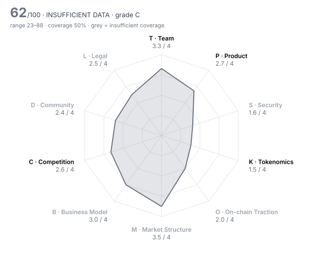

# Zama (ZAMA) — DD-100 Due-Diligence Report

> **⚪ INSUFFICIENT DATA** · Grade **C** · Score **61.8/100** (range 23–88) · Evidence coverage **50%**  
> Profile `infra` · Evidence as of 2026-02-02 · 100 dimensions · 26 sources

The range is the honest number: it shows where the score could land once unscored dimensions are filled and low-confidence judgments are firmed up.

## Why this verdict

- evidence coverage 50% below the 70% needed for a verdict

## Red-flag gates

| Gate | Severity | Status | What it means |
|---|---|---|---|
| RF02 Sanctions / illicit-finance exposure | critical | ❔ unchecked | Listing would create direct regulatory liability for the venue. |
| RF03 Core contracts not source-verified | critical | ❔ unchecked | Nobody outside the team can see what users are interacting with. |
| RF05 Active enforcement action against the project or founders | critical | ❔ unchecked | Outcome could force delisting or freeze assets after listing. |
| RF06 Upgradeable contracts with no meaningful timelock | major | ❔ unchecked | Logic can change under users with no time to exit. |
| RF07 Extreme holder concentration | major | ❔ unchecked | A handful of wallets can set the price; order books will not absorb their exit. |
| RF09 No independent audit | major | ❔ unchecked | Code holding user funds has never been reviewed by a third party. |
| RF13 Undisclosed market-maker terms | major | ❔ unchecked | Token loans and call options are where post-listing dumps are engineered. |
| RF16 Volume implausible versus depth | minor | ❔ unchecked | Daily volume more than 100x the ±2% depth is a common wash-trading signature. |

7 of 16 gates verified clear (1 not applicable to this profile).

## Pillar scores

| Pillar | Weight | Score /4 | | Coverage | Scored |
|---|---:|---:|---|---:|---:|
| T · Team & Governance | 12 | 3.31 | `████████░░` | 67% | 7/10 |
| P · Product & Technology | 14 | 2.74 | `███████░░░` | 100% | 10/10 |
| S · Security & Smart Contracts | 14 | 1.62 | `████░░░░░░` | 32% ⚠️ | 3/10 |
| K · Tokenomics & Supply | 14 | 1.53 | `████░░░░░░` | 79% | 7/9 |
| O · On-chain Traction | 8 | 2.00 | `█████░░░░░` | 8% ⚠️ | 1/8 |
| M · Market Structure & Liquidity | 8 | 3.50 | `█████████░` | 12% ⚠️ | 2/10 |
| B · Business Model & Fundamentals | 10 | 3.00 | `████████░░` | 11% ⚠️ | 1/10 |
| C · Competition & Moat | 10 | 2.64 | `███████░░░` | 61% | 6/10 |
| D · Community & Distribution | 4 | 2.40 | `██████░░░░` | 38% ⚠️ | 4/10 |
| L · Legal, Compliance & Jurisdiction | 6 | 2.50 | `██████░░░░` | 38% ⚠️ | 3/8 |

⚠️ = coverage below the pillar minimum; treat that pillar's score as indicative.

## Claims vs. observation

No contradictions found across 1 checked project claim(s).

## Strengths

- **T10 Disclosure honesty** (4/4) — contradiction_count = 0  (bands 4:≤0, 3:≤0.5, 2:≤1, 1:≤2)
- **T04 Technical leadership** (4/4) — CTO is a recognised cryptographer; the in-house team maintains the TFHE-rs library and the fhEVM stack with published specs and a patent portfolio.
- **T06 Team vesting length** (4/4) — team_vesting_months = 48  (bands 4:≥48, 3:≥36, 2:≥24, 1:≥12)
- **T09 Backer quality & cap table** (4/4) — Series A led by Multicoin and Protocol Labs, Series B by Blockchange and Pantera at a >$1B valuation; 29 institutional backers reported.
- **P03 Technical originality** (4/4) — Original FHE stack (TFHE-rs, coprocessors, threshold-MPC KMS) developed in-house and patented, not a fork.
- **P06 Development activity (90d commits)** (4/4) — github_commits_90d = 667  (bands 4:≥300, 3:≥150, 2:≥60, 1:≥15)

## Risks

- **K08 Annual inflation** (0/4) — annual_inflation_pct = 24.4  (bands 4:≤2, 3:≤5, 2:≤10, 1:≤20)
- **S06 Mint / freeze / blacklist powers** (1/4) — mint() has no cap and is gated only by a role the DAO admin grants; emissions of 5% of supply a year are by design. There is no transfer freeze or blacklist.
- **T07 Governance design & decentralisation path** (1/4) — At listing an Aragon DAO acting through a 3/5 multisig with unnamed signers holds the token and bridge admin roles; operator-majority governance is announced, and token holders have no vote. No dated decentralisation milestones were found.
- **K02 Circulating ratio** (1/4) — circulating_supply_pct = 20.5  (bands 4:≥60, 3:≥40, 2:≥25, 1:≥15)
- **K05 Insider allocation** (1/4) — insider_allocation_pct = 50  (bands 4:≤25, 3:≤35, 2:≤45, 1:≤55)
- **K07 FDV / market cap** (1/4) — fdv_to_mcap = 4.89  (bands 4:≤1.5, 3:≤2.5, 2:≤4, 1:≤7)

## Open questions for the project team

Everything below is unscored. Each one is a question to put to the team or a data request, not a negative finding.

**Needs a private channel (call, data room, counsel)** (3)

- T02 Identity verification level: Are the key people identified to the reviewer (KYC) and, ideally, publicly? — _requires private channel_
- M05 Market-maker arrangements: Are MM agreements (loans, call options, KPIs) disclosed to the reviewer and reasonable? — _requires private channel_
- L07 Legal opinion: Has the project provided a token legal opinion from reputable counsel? — _requires private channel_

**Needs evidence** (48)

- T05 Controversies & misconduct history: Are there credible allegations, enforcement actions or past rugs connected to the team? — _missing: court-record, regulator (AMF/SEC/FCA) and sanctions-list searches for Zama SAS, Rand Hindi and Pascal Paillier; none could be run in this review_
- T08 Treasury transparency: Are treasury addresses, holdings and spending disclosed and reconcilable on-chain? — _missing: treasury and growth wallet addresses, and any treasury report reconciling the ~$55M of sale proceeds and the 30% Treasury/Growth allocation_
- S01 Audit coverage: How many reputable independent audits cover the deployed code? — _metric 'audits_reputable_count' not in evidence pack; audits_reputable_count NOT set. No pre-listing public audit report for the token, staking, governance, host or gateway contracts, or the KMS, was found in the sources read. OpenZeppelin audit write-ups for Zama confidential contracts exist but were published 18 Mar 2026 (after listing) and are excluded. Ask Zama for audit reports covering the deployed mainnet code; RF09 would fire if there are none._
- S02 Audit remediation: Were critical and high findings fixed and re-verified, and does deployed code match audited code? — _missing: any pre-listing audit report (scope, commit, findings) for the deployed token, staking, governance, host/gateway contracts and KMS_
- S03 Source verification: Is the source code of every core contract verified on the block explorer? — _metric 'contracts_verified' not in evidence pack; contracts_verified NOT set. The token source was public on GitHub until 23 Jan 2026 (ZAMA-18, ZAMA-26), but Etherscan verification of 0xa12c…f4f3 and the BSC/Solana deployments could not be checked from this environment. Check the explorers before listing; RF03 stays unchecked._
- S04 Upgrade timelock: How long must users wait between an upgrade being queued and executed? (non-upgradeable = 9999) — _metric 'upgrade_timelock_hours' not in evidence pack; upgrade_timelock_hours NOT set. Host and gateway contracts are UUPS-upgradeable by an owner with no delay in code (ZAMA-24), and governance acts through a 3/5 Aragon multisig with no stated delay (ZAMA-20). The mainnet owner of the host contracts was not read on-chain. If it is the DAO multisig without a timelock, the value is 0 and RF06 fires._
- S07 Bug bounty: What is the maximum bug bounty payout on an established platform? — _metric 'bug_bounty_max_usd' not in evidence pack; bug_bounty_max_usd NOT set. fhevm SECURITY.md asks for disclosure via GitHub advisories with no reward stated; the 'Zama Bounty Program' linked from the KMS README rewards contributions, not vulnerabilities. No paid security bounty found._
- S08 Incident history & response: Has the protocol been exploited, and how was it handled? — _missing: incident-database search; with ~5 weeks of mainnet, the absence of reported incidents is not yet evidence_
- S09 Oracle & manipulation resistance: Can prices or state be manipulated to drain funds (flash loans, thin oracles)? — _missing: how the USD-to-ZAMA fee oracle is sourced and guarded_
- K03 Holder concentration: Share of supply held by the top 10 wallets, excluding exchanges, burn and protocol contracts — _metric 'top10_holder_pct_ex_contracts' not in evidence pack; Holder concentration at TGE not observable before claims opened on 2 Feb. Genesis supply was minted to the Aragon DAO (ZAMA-19); auction buyers hold 8%; 80% sits with Zama treasury/growth, team and investors under cliffs._
- K09 Supply verifiability: Can circulating supply and vesting be verified on-chain rather than taken from a spreadsheet? — _missing: vesting-contract addresses for the Team, VC, Angel, Treasury and Growth allocations; genesis supply was minted to the DAO (ZAMA-19), so whether vesting is enforced on-chain is unknown_
- O01 Daily active addresses (30d avg): How many unique addresses interact with the protocol daily? — _metric 'daa_30d_avg' not in evidence pack; No independent on-chain activity data for the ~5-week-old mainnet (daily active addresses, fee payers, retention, confidential-token TVL) was found pre-listing. The $121.3M 'total value shielded' was auction collateral, not protocol usage._
- O02 Activity trend (90d): Percentage change in daily active addresses over 90 days — _metric 'daa_90d_change_pct' not in evidence pack_
- O03 30-day user retention: Share of a new-user cohort still active after 30 days — _metric 'retention_30d_pct' not in evidence pack_
- O06 Organic vs sybil activity: How much of the activity is bots, farmers or self-dealing? — _missing: any independent on-chain activity data for the mainnet (funding-source clustering, activity outside the auction window)_
- O07 Fee-paying users (30d): Unique addresses that paid fees in the last 30 days — _metric 'fee_paying_users_30d' not in evidence pack_
- O08 Integrations: Number of live third-party integrations (wallets, protocols, aggregators) — _metric 'live_integrations_count' not in evidence pack_
- O10 Net capital flows (90d): Net inflow of external capital (stablecoins/majors) into the protocol over 90 days, USD — _metric 'net_inflow_90d_usd' not in evidence pack_
- M01 Order-book depth (±2%): Aggregate USD depth within 2% of mid across major venues — _metric 'depth_2pct_usd' not in evidence pack; No order book existed before 13:00 UTC on 2 Feb. Depth, spread, 24h volume, venue share and realised volatility at listing are left out on purpose (later values would leak outcomes). Only pre-listing price signals: auction clearing $0.05 (26 Jan) and a pre-market contract ~ $0.043 (29 Jan, ZAMA-12)._
- M02 Venue concentration: Share of volume on the single largest venue — _metric 'top_venue_volume_share_pct' not in evidence pack_
- M03 Wash-trading indicators: Do volume, depth and trade-size patterns suggest fabricated volume? — _missing: no trading history existed before listing_
- M04 Bid-ask spread: Volume-weighted average spread in basis points — _metric 'spread_bps' not in evidence pack_
- M07 Derivatives structure: Do perp open interest and funding indicate healthy two-way markets or crowded positioning? — _missing: pre-market perp open interest and funding; only a pre-market price (~$0.043) is known_
- M08 Realised volatility (30d): Annualised 30-day realised volatility — _metric 'realized_vol_30d_pct' not in evidence pack_
- M09 DEX liquidity ownership: Is on-chain liquidity protocol-owned/locked or mercenary and removable overnight? — _missing: ownership of the 2% liquidity allocation and of the Solana/DEX pools at launch_
- B01 Annualised protocol revenue: Revenue retained by the protocol/treasury (not total fees), annualised from the last 90 days, USD — _metric 'annualized_revenue_usd' not in evidence pack; No fee or revenue data. Fees are burned, so protocol revenue is the burn; volume one month after mainnet is unknown._
- B02 Revenue quality: Is revenue organic and recurring, or one-off, wash or self-generated? — _missing: fee volume by payer since mainnet_
- B04 Valuation vs fees (FDV / annualised fees): Price paid per dollar of fees generated — _metric 'fdv_to_annual_fees' not in evidence pack_
- B05 Incentive spend vs revenue: USD value of token incentives divided by protocol revenue (90d) — _metric 'incentives_to_revenue' not in evidence pack_
- B06 Treasury runway: Months of runway at current burn, counting non-native assets at full value and native token at 50% — _metric 'runway_months' not in evidence pack; Zama SAS raised $130M+ in equity and ~$44M (auction) + ~$11M (pre-TGE sale) + community sale; burn rate and treasury composition are not public._
- B07 Treasury diversification: Share of treasury held in assets other than the native token — _metric 'treasury_non_native_pct' not in evidence pack_
- B08 Revenue growth (90d): Quarter-on-quarter change in protocol revenue — _metric 'revenue_qoq_growth_pct' not in evidence pack_
- B09 Counterparty concentration: Does a single client, partner or whale drive most of the usage or revenue? — _missing: distribution of fee-paying applications_
- B10 Sustainability without emissions: If incentives stopped tomorrow, would the business stand? — _missing: any revenue figure; the operator budget is currently paid by 5% emissions_
- C01 Segment size & growth: How large and fast-growing is the addressable on-chain segment? — _no assessment provided_
- C02 Category market share: Share of the relevant category metric (TVL, volume, fees) held by this project — _metric 'category_share_pct' not in evidence pack; No category-share data for FHE / confidential-compute protocols._
- C03 Share trajectory: Is market share rising or falling over the last two quarters? — _no assessment provided_
- C08 Platform & incumbent threat: Could an L1, wallet, CEX or major protocol absorb this as a native feature? — _no assessment provided_
- D01 Organic audience: Size and quality of the audience across X, Telegram, Discord and regional channels — _missing: social engagement analytics_
- D02 Engagement authenticity: What share of engagement appears bot-driven or paid? — _missing: bot-likelihood analysis_
- D03 Token holder count: Number of addresses holding a non-dust balance — _metric 'holders_count' not in evidence pack; Holder count not observable before claims opened. 11,103 unique auction bidders (ZAMA-02) is the closest pre-listing proxy._
- D04 Geographic & user diversity: Is the user base spread across regions, or concentrated where the venue cannot serve it? — _missing: bidder/user geography from the auction_
- D07 Governance participation: Average share of circulating supply voting on recent proposals — _metric 'governance_participation_pct' not in evidence pack; No token-holder voting at listing; governance is an Aragon DAO run by a 3/5 setup multisig, moving to operator votes (ZAMA-06, ZAMA-20)._
- D09 Sentiment & controversy: What is the prevailing tone among informed market participants? — _missing: survey of informed sentiment (e.g. criticism of the 50% insider allocation or the auction design)_
- L03 Sanctions & AML exposure: Has screening found exposure to sanctioned addresses, mixers or illicit flows above tolerance? — _metric 'sanctions_exposure' not in evidence pack; sanctions_exposure NOT set. No wallet screening available. Needs the venue's Chainalysis/TRM screening of the deployer, Aragon DAO/treasury, the 3/5 setup multisig signers and the auction-proceeds wallets._
- L04 Licensing for regulated activity: If the project performs regulated activity (custody, exchange, payments, issuance), is it licensed? — _missing: whether a MiCA crypto-asset white paper was filed for the EU public offer; KuCoin's sale excluded France and the Netherlands (ZAMA-16)_
- L05 Litigation & enforcement: Any pending lawsuits, regulator actions or subpoenas? — _missing: court and regulator record search; active_enforcement_action NOT set. Regulator and court-record searches (AMF, SEC, FCA, etc.) for Zama SAS, Rand Hindi and Pascal Paillier could not be run in this review (search budget exhausted, regulator pages not reachable). No enforcement was mentioned in any pre-listing source read, but that is not a search. RF05 stays unchecked._
- L10 Restricted-jurisdiction controls: Does the project geofence and enforce restrictions consistent with its legal analysis? — _missing: Zama's own auction-app geofencing; only KuCoin's and Binance's venue restrictions are known_

## Appendix A — all 100 dimensions

### T · Team & Governance

| ID | Dimension | Method | W | Score | Conf. | Evidence | Basis |
|---|---|---|---:|---:|---|---|---|
| T01 | Founder track record | agent | 3 | **3** | medium | ZAMA-04, ZAMA-15 | CEO Rand Hindi founded Snips, which was acquired; CTO Pascal Paillier co-invented the Paillier scheme. Zama itself has shipped FHE libraries since 2020, but no crypto product at scale yet. |
| T02 | Identity verification level | human | 3 | ⏳ |  |  | requires private channel |
| T03 | Team depth & key-person risk | agent | 2 | **3** | medium | ZAMA-08, ZAMA-22 | Team of >100 with ~40 PhDs (project figure via press); 48 distinct non-bot committers across fhevm, tfhe-rs and kms in the 90 days to listing. |
| T04 | Technical leadership | agent | 2 | **4** | high | ZAMA-04, ZAMA-22, ZAMA-25 | CTO is a recognised cryptographer; the in-house team maintains the TFHE-rs library and the fhEVM stack with published specs and a patent portfolio. |
| T05 | Controversies & misconduct history | agent | 3 | – |  |  | missing: court-record, regulator (AMF/SEC/FCA) and sanctions-list searches for Zama SAS, Rand Hindi and Pascal Paillier; none could be run in this review |
| T06 | Team vesting length | rule | 2 | **4** | medium | ZAMA-04 | team_vesting_months = 48  (bands 4:≥48, 3:≥36, 2:≥24, 1:≥12) |
| T07 | Governance design & decentralisation path | agent | 2 | **1** | medium | ZAMA-20, ZAMA-21, ZAMA-06, ZAMA-19 | At listing an Aragon DAO acting through a 3/5 multisig with unnamed signers holds the token and bridge admin roles; operator-majority governance is announced, and token holders have no vote. No dated decentralisation milestones were found. |
| T08 | Treasury transparency | agent | 2 | – |  |  | missing: treasury and growth wallet addresses, and any treasury report reconciling the ~$55M of sale proceeds and the 30% Treasury/Growth allocation |
| T09 | Backer quality & cap table | agent | 2 | **4** | medium | ZAMA-04, ZAMA-01, ZAMA-08 | Series A led by Multicoin and Protocol Labs, Series B by Blockchange and Pantera at a >$1B valuation; 29 institutional backers reported. |
| T10 | Disclosure honesty | rule | 3 | **4** | high | HARNESS | contradiction_count = 0  (bands 4:≤0, 3:≤0.5, 2:≤1, 1:≤2) |

### P · Product & Technology

| ID | Dimension | Method | W | Score | Conf. | Evidence | Basis |
|---|---|---|---:|---:|---|---|---|
| P01 | Problem clarity & real demand | agent | 3 | **2** | medium | ZAMA-02, ZAMA-17, ZAMA-14 | On-chain confidentiality is a real gap, but at listing the usage evidence was a confidential USDT transfer, one payroll pilot (Bron) and a token auction. That shows demand for the token, not for paid protocol usage. |
| P02 | Product maturity | agent | 3 | **2** | high | ZAMA-14, ZAMA-03, ZAMA-17 | Ethereum mainnet went live in late Dec 2025, about 5 weeks before listing, and staking on 19 Jan 2026; other EVM chains and Solana were still on the roadmap. |
| P03 | Technical originality | agent | 2 | **4** | high | ZAMA-25, ZAMA-22, ZAMA-23 | Original FHE stack (TFHE-rs, coprocessors, threshold-MPC KMS) developed in-house and patented, not a fork. |
| P04 | Architecture soundness | agent | 2 | **2** | medium | ZAMA-23, ZAMA-15 | Documented trust model: 13-node KMS tolerating up to 1/3 malicious nodes, majority-honest coprocessors. Throughput is ~20 TPS per chain and slashing is still 'eventual'; there is no production stress history yet. |
| P05 | Dependency risk | agent | 2 | **2** | medium | ZAMA-23, ZAMA-14, ZAMA-19 | Every KMS node runs by default in AWS Nitro Enclaves on AWS infrastructure; the Gateway is an Arbitrum rollup; token bridging relies on LayerZero. |
| P06 | Development activity (90d commits) | rule | 2 | **4** | high | ZAMA-22 | github_commits_90d = 667  (bands 4:≥300, 3:≥150, 2:≥60, 1:≥15) |
| P07 | Contributor breadth (90d) | rule | 1 | **4** | high | ZAMA-22 | github_active_contributors_90d = 48  (bands 4:≥25, 3:≥12, 2:≥6, 1:≥3) |
| P08 | Roadmap delivery record | agent | 2 | **3** | medium | ZAMA-15, ZAMA-14, ZAMA-17 | The Q4 2025 Ethereum mainnet target was met (late Dec 2025) and staking and the auction shipped in January; multi-chain items were not yet due. |
| P09 | Open source & reproducibility | agent | 1 | **3** | high | ZAMA-22, ZAMA-25, ZAMA-26 | fhevm, tfhe-rs and kms are public. The token, staking and governance contracts were pulled from the public repo on 23 Jan 2026, and commercial use needs a patent licence. |
| P10 | Documentation quality | agent | 1 | **3** | medium | ZAMA-23, ZAMA-15 | Architecture docs state trust assumptions for the KMS, coprocessors and Gateway, with integration guides; no formal threat model or consensus spec was found. |

### S · Security & Smart Contracts

| ID | Dimension | Method | W | Score | Conf. | Evidence | Basis |
|---|---|---|---:|---:|---|---|---|
| S01 | Audit coverage | rule | 3 | – |  |  | metric 'audits_reputable_count' not in evidence pack; audits_reputable_count NOT set. No pre-listing public audit report for the token, staking, governance, host or gateway contracts, or the KMS, was found in the sources read. OpenZeppelin audit write-ups for Zama confidential contracts exist but were published 18 Mar 2026 (after listing) and are excluded. Ask Zama for audit reports covering the deployed mainnet code; RF09 would fire if there are none. |
| S02 | Audit remediation | agent | 3 | – |  |  | missing: any pre-listing audit report (scope, commit, findings) for the deployed token, staking, governance, host/gateway contracts and KMS |
| S03 | Source verification | rule | 2 | – |  |  | metric 'contracts_verified' not in evidence pack; contracts_verified NOT set. The token source was public on GitHub until 23 Jan 2026 (ZAMA-18, ZAMA-26), but Etherscan verification of 0xa12c…f4f3 and the BSC/Solana deployments could not be checked from this environment. Check the explorers before listing; RF03 stays unchecked. |
| S04 | Upgrade timelock | rule | 3 | – |  |  | metric 'upgrade_timelock_hours' not in evidence pack; upgrade_timelock_hours NOT set. Host and gateway contracts are UUPS-upgradeable by an owner with no delay in code (ZAMA-24), and governance acts through a 3/5 Aragon multisig with no stated delay (ZAMA-20). The mainnet owner of the host contracts was not read on-chain. If it is the DAO multisig without a timelock, the value is 0 and RF06 fires. |
| S05 | Admin key custody | agent | 3 | **2** | medium | ZAMA-19, ZAMA-20, ZAMA-21 | Admin powers sit with an Aragon DAO operated by a 3/5 multisig whose signers are not disclosed; membership was still being changed during the setup phase (20 and 30 Jan). |
| S06 | Mint / freeze / blacklist powers | agent | 3 | **1** | high | ZAMA-18, ZAMA-06 | mint() has no cap and is gated only by a role the DAO admin grants; emissions of 5% of supply a year are by design. There is no transfer freeze or blacklist. |
| S07 | Bug bounty | rule | 1 | – |  |  | metric 'bug_bounty_max_usd' not in evidence pack; bug_bounty_max_usd NOT set. fhevm SECURITY.md asks for disclosure via GitHub advisories with no reward stated; the 'Zama Bounty Program' linked from the KMS README rewards contributions, not vulnerabilities. No paid security bounty found. |
| S08 | Incident history & response | agent | 3 | – |  |  | missing: incident-database search; with ~5 weeks of mainnet, the absence of reported incidents is not yet evidence |
| S09 | Oracle & manipulation resistance | agent | 2 | – |  |  | missing: how the USD-to-ZAMA fee oracle is sourced and guarded |
| S10 | Bridge & cross-chain exposure | agent | 2 | **2** | medium | ZAMA-19, ZAMA-07, ZAMA-09 | ZAMA lives on Ethereum, BSC, the Gateway rollup and Solana. Non-Ethereum supply is bridged via LayerZero OFT (lock on Ethereum, mint elsewhere), with the adapter owned by the DAO. |

### K · Tokenomics & Supply

| ID | Dimension | Method | W | Score | Conf. | Evidence | Basis |
|---|---|---|---:|---:|---|---|---|
| K01 | Token utility & value accrual | agent | 3 | **3** | medium | ZAMA-05, ZAMA-07, ZAMA-06 | Protocol fees are paid in ZAMA and burned, and operators must stake ZAMA. The burn mechanism is live, but fee volume at listing is unknown and probably small next to 5% emissions. |
| K02 | Circulating ratio | rule | 2 | **1** | high | HARNESS | circulating_supply_pct = 20.5  (bands 4:≥60, 3:≥40, 2:≥25, 1:≥15) |
| K03 | Holder concentration | rule | 3 | – |  |  | metric 'top10_holder_pct_ex_contracts' not in evidence pack; Holder concentration at TGE not observable before claims opened on 2 Feb. Genesis supply was minted to the Aragon DAO (ZAMA-19); auction buyers hold 8%; 80% sits with Zama treasury/growth, team and investors under cliffs. |
| K04 | 12-month unlock pressure | rule | 3 | **2** | medium | ZAMA-04 | unlock_12m_pct_of_circ = 36.7  (bands 4:≤10, 3:≤25, 2:≤50, 1:≤100) |
| K05 | Insider allocation | rule | 2 | **1** | medium | ZAMA-04 | insider_allocation_pct = 50  (bands 4:≤25, 3:≤35, 2:≤45, 1:≤55) |
| K06 | Investor cost-basis overhang | rule | 2 | n/a |  | ZAMA-04 | n/a for this project: Investors bought equity (Series A $73M, Series B $57M at >$1B post-money), not a priced token round; no per-token cost basis is public. For scale: the $550M auction FDV is ~0.55× the last equity valuation; No priced token round is public; investors bought equity (ZAMA-04). Auction FDV $550M vs >$1B last equity valuation. |
| K07 | FDV / market cap | rule | 2 | **1** | high | HARNESS | fdv_to_mcap = 4.89  (bands 4:≤1.5, 3:≤2.5, 2:≤4, 1:≤7) |
| K08 | Annual inflation | rule | 2 | **0** | low | ZAMA-06 | annual_inflation_pct = 24.4  (bands 4:≤2, 3:≤5, 2:≤10, 1:≤20) |
| K09 | Supply verifiability | agent | 1 | – |  |  | missing: vesting-contract addresses for the Team, VC, Angel, Treasury and Growth allocations; genesis supply was minted to the DAO (ZAMA-19), so whether vesting is enforced on-chain is unknown |
| K10 | Airdrop & incentive design | agent | 1 | **2** | medium | ZAMA-02, ZAMA-01, ZAMA-09 | Distribution was a paid sealed-bid auction (11,103 bidders, fully unlocked) plus a 6% TGE-campaign bucket including 55M ZAMA for Binance campaigns; no retention evidence exists yet. |

### O · On-chain Traction

| ID | Dimension | Method | W | Score | Conf. | Evidence | Basis |
|---|---|---|---:|---:|---|---|---|
| O01 | Daily active addresses (30d avg) | rule | 2 | – |  |  | metric 'daa_30d_avg' not in evidence pack; No independent on-chain activity data for the ~5-week-old mainnet (daily active addresses, fee payers, retention, confidential-token TVL) was found pre-listing. The $121.3M 'total value shielded' was auction collateral, not protocol usage. |
| O02 | Activity trend (90d) | rule | 2 | – |  |  | metric 'daa_90d_change_pct' not in evidence pack |
| O03 | 30-day user retention | rule | 2 | – |  |  | metric 'retention_30d_pct' not in evidence pack |
| O04 | TVL / AUM | rule | 2 | n/a |  |  | not applicable to profile 'infra' |
| O05 | Incentive-driven TVL share | rule | 2 | n/a |  |  | not applicable to profile 'infra' |
| O06 | Organic vs sybil activity | agent | 3 | – |  |  | missing: any independent on-chain activity data for the mainnet (funding-source clustering, activity outside the auction window) |
| O07 | Fee-paying users (30d) | rule | 1 | – |  |  | metric 'fee_paying_users_30d' not in evidence pack |
| O08 | Integrations | rule | 1 | – |  |  | metric 'live_integrations_count' not in evidence pack |
| O09 | Builder ecosystem | agent | 1 | **2** | medium | ZAMA-17, ZAMA-23, ZAMA-15 | Early third-party work exists: OpenZeppelin's ERC-7984 confidential-token library, Bron's payroll pilot and the Zaiffer joint venture. Most builders are Zama itself or partners it funds. |
| O10 | Net capital flows (90d) | rule | 1 | – |  |  | metric 'net_inflow_90d_usd' not in evidence pack |

### M · Market Structure & Liquidity

| ID | Dimension | Method | W | Score | Conf. | Evidence | Basis |
|---|---|---|---:|---:|---|---|---|
| M01 | Order-book depth (±2%) | rule | 3 | – |  |  | metric 'depth_2pct_usd' not in evidence pack; No order book existed before 13:00 UTC on 2 Feb. Depth, spread, 24h volume, venue share and realised volatility at listing are left out on purpose (later values would leak outcomes). Only pre-listing price signals: auction clearing $0.05 (26 Jan) and a pre-market contract ~ $0.043 (29 Jan, ZAMA-12). |
| M02 | Venue concentration | rule | 2 | – |  |  | metric 'top_venue_volume_share_pct' not in evidence pack |
| M03 | Wash-trading indicators | agent | 3 | – |  |  | missing: no trading history existed before listing |
| M04 | Bid-ask spread | rule | 2 | – |  |  | metric 'spread_bps' not in evidence pack |
| M05 | Market-maker arrangements | human | 2 | ⏳ |  |  | requires private channel |
| M06 | Existing venue quality | agent | 1 | **4** | high | ZAMA-09, ZAMA-10, ZAMA-11 | Trading opened the same day on Binance, Coinbase, OKX, Bybit, Kraken, KuCoin and others, each with its own listing process. |
| M07 | Derivatives structure | agent | 1 | – |  |  | missing: pre-market perp open interest and funding; only a pre-market price (~$0.043) is known |
| M08 | Realised volatility (30d) | rule | 1 | – |  |  | metric 'realized_vol_30d_pct' not in evidence pack |
| M09 | DEX liquidity ownership | agent | 1 | – |  |  | missing: ownership of the 2% liquidity allocation and of the Solana/DEX pools at launch |
| M10 | Narrative & timing fit | agent | 1 | **3** | medium | ZAMA-15, ZAMA-04 | Confidential computation is a well-funded narrative, and Zama is its best-funded FHE player (>$1B valuation); sector demand for privacy tokens was not measured. |

### B · Business Model & Fundamentals

| ID | Dimension | Method | W | Score | Conf. | Evidence | Basis |
|---|---|---|---:|---:|---|---|---|
| B01 | Annualised protocol revenue | rule | 3 | – |  |  | metric 'annualized_revenue_usd' not in evidence pack; No fee or revenue data. Fees are burned, so protocol revenue is the burn; volume one month after mainnet is unknown. |
| B02 | Revenue quality | agent | 2 | – |  |  | missing: fee volume by payer since mainnet |
| B03 | Holder value capture | agent | 2 | **3** | medium | ZAMA-05, ZAMA-07, ZAMA-26 | The fee-burn mechanism is announced as live, and a ProtocolFeesBurner contract existed in the repo; burned amounts were not observed on-chain. |
| B04 | Valuation vs fees (FDV / annualised fees) | rule | 2 | – |  |  | metric 'fdv_to_annual_fees' not in evidence pack |
| B05 | Incentive spend vs revenue | rule | 2 | – |  |  | metric 'incentives_to_revenue' not in evidence pack |
| B06 | Treasury runway | rule | 2 | – |  |  | metric 'runway_months' not in evidence pack; Zama SAS raised $130M+ in equity and ~$44M (auction) + ~$11M (pre-TGE sale) + community sale; burn rate and treasury composition are not public. |
| B07 | Treasury diversification | rule | 1 | – |  |  | metric 'treasury_non_native_pct' not in evidence pack |
| B08 | Revenue growth (90d) | rule | 1 | – |  |  | metric 'revenue_qoq_growth_pct' not in evidence pack |
| B09 | Counterparty concentration | agent | 1 | – |  |  | missing: distribution of fee-paying applications |
| B10 | Sustainability without emissions | agent | 2 | – |  |  | missing: any revenue figure; the operator budget is currently paid by 5% emissions |

### C · Competition & Moat

| ID | Dimension | Method | W | Score | Conf. | Evidence | Basis |
|---|---|---|---:|---:|---|---|---|
| C01 | Segment size & growth | agent | 2 | – |  |  | no assessment provided |
| C02 | Category market share | rule | 2 | – |  |  | metric 'category_share_pct' not in evidence pack; No category-share data for FHE / confidential-compute protocols. |
| C03 | Share trajectory | agent | 2 | – |  |  | no assessment provided |
| C04 | Moat | agent | 3 | **2** | medium | ZAMA-25, ZAMA-04, ZAMA-23 | The moat is technical and legal (patents, an FHE research team, the ERC-7984 standard with OpenZeppelin); it has not yet been tested by users choosing between rivals. |
| C05 | Forkability | agent | 2 | **4** | medium | ZAMA-25 | Code is source-available, but commercial use requires Zama's patent licence, which makes a commercial fork legally impractical. |
| C06 | Differentiation vs top-3 peers | agent | 2 | **3** | medium | ZAMA-15, ZAMA-23 | FHE adds composable encrypted state to existing chains without a new L1, unlike TEE chains (Secret, Oasis) or ZK L2s (Aztec); performance is the trade-off (~20 TPS). |
| C07 | Relative valuation | agent | 2 | **2** | low | ZAMA-04 | $550M auction FDV is ~4.4× the closest listed FHE peer (Mind Network, ~$125M), with no usage metrics to justify the premium beyond funding and team. |
| C08 | Platform & incumbent threat | agent | 1 | – |  |  | no assessment provided |
| C09 | Partnership substance | agent | 1 | **2** | medium | ZAMA-17, ZAMA-04, ZAMA-23 | Bron payroll and the OpenZeppelin library are observable; other named partners (Conduit, the Zaiffer JV) are infrastructure or affiliates, and no on-chain flow volumes were found. |
| C10 | Exchange-level strategic fit | agent | 1 | **3** | low | ZAMA-09, ZAMA-04 | Adds FHE confidential-compute infrastructure, which major venues barely cover; an FHE peer (Mind Network) already exists in the market. |

### D · Community & Distribution

| ID | Dimension | Method | W | Score | Conf. | Evidence | Basis |
|---|---|---|---:|---:|---|---|---|
| D01 | Organic audience | agent | 1 | – |  |  | missing: social engagement analytics |
| D02 | Engagement authenticity | agent | 2 | – |  |  | missing: bot-likelihood analysis |
| D03 | Token holder count | rule | 2 | – |  |  | metric 'holders_count' not in evidence pack; Holder count not observable before claims opened. 11,103 unique auction bidders (ZAMA-02) is the closest pre-listing proxy. |
| D04 | Geographic & user diversity | agent | 1 | – |  |  | missing: bidder/user geography from the auction |
| D05 | Paid-promotion dependence | agent | 2 | **2** | medium | ZAMA-17, ZAMA-02 | Disclosed paid Creator and Developer programs ($374k) and OG NFT bonuses ran alongside a 218%-oversubscribed auction. |
| D06 | Developer community | agent | 1 | **2** | medium | ZAMA-15, ZAMA-17, ZAMA-22 | Developer programs and a claimed >5,000 library users, but contributors to the core repos are almost entirely Zama staff (CLA required for PRs). |
| D07 | Governance participation | rule | 1 | – |  |  | metric 'governance_participation_pct' not in evidence pack; No token-holder voting at listing; governance is an Aragon DAO run by a 3/5 setup multisig, moving to operator votes (ZAMA-06, ZAMA-20). |
| D08 | Communication transparency | agent | 1 | **3** | low | ZAMA-02, ZAMA-17, ZAMA-21 | Detailed auction results, including refund ratio, came out within two days, and governance proposals are posted publicly; there is no incident history yet to test disclosure. |
| D09 | Sentiment & controversy | agent | 1 | – |  |  | missing: survey of informed sentiment (e.g. criticism of the 50% insider allocation or the auction design) |
| D10 | Ecosystem credibility | agent | 1 | **3** | medium | ZAMA-04, ZAMA-10, ZAMA-23 | OpenZeppelin co-builds the confidential-token standard, top-tier funds back it, and Binance and Coinbase listed it on day one. |

### L · Legal, Compliance & Jurisdiction

| ID | Dimension | Method | W | Score | Conf. | Evidence | Basis |
|---|---|---|---:|---:|---|---|---|
| L01 | Legal entity & jurisdiction | agent | 2 | **3** | medium | ZAMA-03, ZAMA-04 | Paris-based operating company with >$130M in equity funding and a large staff; the token-issuing entity and the DAO's legal wrapper were not identified. |
| L02 | Securities-law risk | agent | 3 | **2** | medium | ZAMA-01, ZAMA-02, ZAMA-04, ZAMA-20 | Utility (fee payment, staking) is live, but the issuer sold tokens publicly for ~$55M with 50% insider allocation, and parameters are controlled by a 3/5 multisig. |
| L03 | Sanctions & AML exposure | rule | 3 | – |  |  | metric 'sanctions_exposure' not in evidence pack; sanctions_exposure NOT set. No wallet screening available. Needs the venue's Chainalysis/TRM screening of the deployer, Aragon DAO/treasury, the 3/5 setup multisig signers and the auction-proceeds wallets. |
| L04 | Licensing for regulated activity | agent | 2 | – |  |  | missing: whether a MiCA crypto-asset white paper was filed for the EU public offer; KuCoin's sale excluded France and the Netherlands (ZAMA-16) |
| L05 | Litigation & enforcement | agent | 3 | – |  |  | missing: court and regulator record search; active_enforcement_action NOT set. Regulator and court-record searches (AMF, SEC, FCA, etc.) for Zama SAS, Rand Hindi and Pascal Paillier could not be run in this review (search budget exhausted, regulator pages not reachable). No enforcement was mentioned in any pre-listing source read, but that is not a search. RF05 stays unchecked. |
| L06 | Privacy & obfuscation features | agent | 1 | **3** | medium | ZAMA-23, ZAMA-17 | Confidentiality is opt-in per token (wrapped ERC-7984), and the ACL supports selective disclosure to auditors; balances in confidential tokens are hidden by default. |
| L07 | Legal opinion | human | 1 | ⏳ |  |  | requires private channel |
| L08 | RWA custody & bankruptcy remoteness | agent | 3 | n/a |  |  | not applicable to profile 'infra' |
| L09 | RWA attestation frequency | agent | 2 | n/a |  |  | not applicable to profile 'infra' |
| L10 | Restricted-jurisdiction controls | agent | 1 | – |  |  | missing: Zama's own auction-app geofencing; only KuCoin's and Binance's venue restrictions are known |

## Appendix B — sources

| ID | Tier | Type | Title |
|---|---|---|---|
| ZAMA-01 | 2 · independent | news | [The Block — Zama token sale via CoinList and its own auction app (13 Jan 2026)](https://www.theblock.co/post/385409/zama-token-sale-coinlist-own-auction-app) |
| ZAMA-02 | 3 · self-reported | doc | [Zama blog — The Zama Public Auction: $118M committed for the first encrypted ICO on Ethereum (26 Jan 2026)](https://www.zama.org/post/118m-committed-for-the-first-encrypted-ico-on-ethereum) |
| ZAMA-03 | 3 · self-reported | news | [Decrypt (Chainwire press release) — Zama's public auction attracts $118M (27 Jan 2026)](https://decrypt.co/356036/zamas-public-auction-attracts-118m-for-ethereums-first-encrypted-ico?amp=1) |
| ZAMA-04 | 2 · independent | research | [Bitget research — In-depth analysis and market cap of Zama (ZAMA) (30 Jan 2026)](https://www.bitget.com/amp/news/detail/12560605175620) |
| ZAMA-05 | 3 · self-reported | doc | [Zama blog — Announcing the Zama Public Auction (1 Dec 2025)](https://www.zama.org/post/announcing-the-zama-public-auction) |
| ZAMA-06 | 3 · self-reported | doc | [Zama blog — Stake $ZAMA (2 Feb 2026)](https://www.zama.org/post/stake-zama-token) |
| ZAMA-07 | 3 · self-reported | doc | [Zama blog — $ZAMA token launch (2 Feb 2026)](https://www.zama.org/post/zama-token-launch) |
| ZAMA-08 | 2 · independent | news | [NFT Evening — Binance lists Zama (ZAMA) for spot trading with Seed Tag (2 Feb 2026)](https://nftevening.com/binance-list-zama/) |
| ZAMA-09 | 2 · independent | news | [AiCoin — relay of Binance listing notice for Zama (ZAMA) (2 Feb 2026)](https://www.aicoin.com/en/news-flash/2736702) |
| ZAMA-10 | 2 · independent | news | [TechFlow newsletter — Coinbase Markets to launch ZAMA-USD spot trading (2 Feb 2026)](https://www.techflowpost.com/en-US/newsletter/113188) |
| ZAMA-11 | 2 · independent | news | [CoinGabbar — Zama listing date 2 Feb: Binance and other exchanges (2 Feb 2026)](https://www.coingabbar.com/en/crypto-currency-news/zama-listing-date-feb2-zama-protocol-price-binance-airdrop) |
| ZAMA-12 | 2 · independent | news | [MEXC News — Binance Alpha pre-TGE sale for ZAMA (29 Jan 2026)](https://www.mexc.com/news/591560) |
| ZAMA-13 | 2 · independent | news | [MEXC News — Zama pre-TGE campaign on Binance Wallet (c. 29 Jan 2026)](https://www.mexc.com/news/591782) |
| ZAMA-16 | 2 · independent | news | [KuCoin — Introducing Zama (ZAMA) on KuCoin Spotlight (19 Jan 2026)](https://www.kucoin.com/announcement/es-introducing-zama-zama-on-kucoin-spotlight-bid-in-the-auction) |
| ZAMA-14 | 2 · independent | news | [MEXC News — Zama launches mainnet with first confidential USDT transfer on Ethereum (31 Dec 2025)](https://www.mexc.com/news/380573) |
| ZAMA-17 | 3 · self-reported | doc | [Plushcap — summaries of Zama blog posts, January 2026](https://www.plushcap.com/companies/zama/blog/summaries/2026/01) |
| ZAMA-18 | 1 · primary | code | [GitHub zama-ai/fhevm — protocol-contracts/token/contracts/ZamaERC20.sol at c6cdefd^ (22 Jan 2026)](https://github.com/zama-ai/fhevm/blob/c6cdefd%5E/protocol-contracts/token/contracts/ZamaERC20.sol) |
| ZAMA-19 | 1 · primary | code | [GitHub zama-ai/fhevm — protocol-contracts/token/ADD_BNB_OFT.md and deployment CLI at c6cdefd^ (Jan 2026)](https://github.com/zama-ai/fhevm/blob/c6cdefd%5E/protocol-contracts/token/ADD_BNB_OFT.md) |
| ZAMA-20 | 3 · self-reported | governance | [Zama community forum — SETUP-18 Update operator governance addresses (proposal created 20 Jan 2026)](https://community.zama.org/t/setup-18-update-operator-governance-addresses/4589) |
| ZAMA-21 | 3 · self-reported | governance | [Zama community forum — SETUP-24 Update governance address (proposal created 30 Jan 2026)](https://community.zama.org/t/setup-24-update-governance-address/4595) |
| ZAMA-22 | 1 · primary | github | [GitHub — my git-log count over zama-ai/fhevm, zama-ai/tfhe-rs, zama-ai/kms, 4 Nov 2025 – 2 Feb 2026](https://github.com/zama-ai) |
| ZAMA-23 | 3 · self-reported | doc | [GitHub zama-ai/fhevm — docs/protocol/architecture (kms.md, coprocessor.md, gateway.md) at 62b9d5e (2 Feb 2026)](https://github.com/zama-ai/fhevm/tree/62b9d5e89eb3e7fd04b9ce42b6da3630ccfe75c5/docs/protocol/architecture) |
| ZAMA-24 | 1 · primary | code | [GitHub zama-ai/fhevm — host-contracts/contracts/ACL.sol at 62b9d5e (2 Feb 2026)](https://github.com/zama-ai/fhevm/blob/62b9d5e89eb3e7fd04b9ce42b6da3630ccfe75c5/host-contracts/contracts/ACL.sol) |
| ZAMA-25 | 1 · primary | legal | [GitHub zama-ai/fhevm — LICENSE and README licence section at 62b9d5e](https://github.com/zama-ai/fhevm/blob/62b9d5e89eb3e7fd04b9ce42b6da3630ccfe75c5/LICENSE) |
| ZAMA-26 | 1 · primary | github | [GitHub zama-ai/fhevm — commit c6cdefd 'chore(common): remove protocol contracts (#1816)' (23 Jan 2026)](https://github.com/zama-ai/fhevm/commit/c6cdefd) |
| ZAMA-15 | 2 · independent | research | [MEXC Blog — Zama's public token auction approaches: from 'privacy coins' to confidential computation (3 Dec 2025)](https://blog.mexc.com/news/zamas-public-token-auction-approaches-the-shift-from-privacy-coins-to-confidential-computation-infrastructure/) |
| HARNESS | computed | harness | Metrics derived by the harness from other evidence |

---
_Generated by DD-100. Scores are decision support for a listing committee, not investment advice. Every judgment above cites its evidence; anything uncited was not scored._