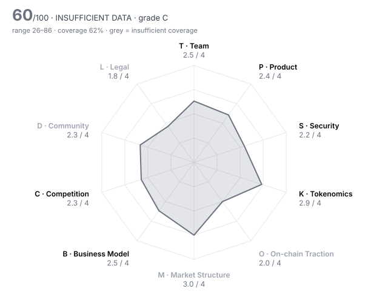

# Derive (DRV) — DD-100 Due-Diligence Report

> **⚪ INSUFFICIENT DATA** · Grade **C** · Score **60.3/100** (range 26–86) · Evidence coverage **62%**  
> Profile `defi` · Evidence as of 2026-05-28 · 100 dimensions · 26 sources

The range is the honest number: it shows where the score could land once unscored dimensions are filled and low-confidence judgments are firmed up.

## Why this verdict

- evidence coverage 62% below the 70% needed for a verdict

## Red-flag gates

| Gate | Severity | Status | What it means |
|---|---|---|---|
| RF02 Sanctions / illicit-finance exposure | critical | ❔ unchecked | Listing would create direct regulatory liability for the venue. |
| RF05 Active enforcement action against the project or founders | critical | ❔ unchecked | Outcome could force delisting or freeze assets after listing. |
| RF06 Upgradeable contracts with no meaningful timelock | major | ❔ unchecked | Logic can change under users with no time to exit. |
| RF07 Extreme holder concentration | major | ❔ unchecked | A handful of wallets can set the price; order books will not absorb their exit. |
| RF13 Undisclosed market-maker terms | major | ❔ unchecked | Token loans and call options are where post-listing dumps are engineered. |
| RF15 Mercenary TVL | minor | ❔ unchecked | Most deposits are paid to be there and will leave when incentives stop. |
| RF16 Volume implausible versus depth | minor | ❔ unchecked | Daily volume more than 100x the ±2% depth is a common wash-trading signature. |

9 of 16 gates verified clear.

## Pillar scores

| Pillar | Weight | Score /4 | | Coverage | Scored |
|---|---:|---:|---|---:|---:|
| T · Team & Governance | 12 | 2.53 | `██████░░░░` | 71% | 7/10 |
| P · Product & Technology | 10 | 2.42 | `██████░░░░` | 100% | 10/10 |
| S · Security & Smart Contracts | 14 | 2.18 | `█████░░░░░` | 88% | 9/10 |
| K · Tokenomics & Supply | 14 | 2.94 | `███████░░░` | 76% | 8/10 |
| O · On-chain Traction | 10 | 2.00 | `█████░░░░░` | 12% ⚠️ | 1/10 |
| M · Market Structure & Liquidity | 8 | 3.00 | `████████░░` | 24% ⚠️ | 2/10 |
| B · Business Model & Fundamentals | 10 | 2.46 | `██████░░░░` | 72% | 7/10 |
| C · Competition & Moat | 8 | 2.29 | `██████░░░░` | 78% | 8/10 |
| D · Community & Distribution | 5 | 2.33 | `██████░░░░` | 23% ⚠️ | 3/10 |
| L · Legal, Compliance & Jurisdiction | 9 | 1.83 | `█████░░░░░` | 38% ⚠️ | 3/8 |

⚠️ = coverage below the pillar minimum; treat that pillar's score as indicative.

## Claims vs. observation

| Claim | Claimed | Observed | Gap | Sources |
|---|---:|---:|---:|---|
| Help centre: total supply is fixed at 1,000,000,000 DRV and 'no new tokens will be minted' | 1,000,000,000 | 1,500,000,000 | 33% | DRV-11 vs DRV-05 |

## Strengths

- **P02 Product maturity** (4/4) — Options protocol live since 2021; the V2 exchange was audited from 2023 to Mar 2025 and was in production well over 12 months before listing.
- **T06 Team vesting length** (4/4) — team_vesting_months = 48  (bands 4:≥48, 3:≥36, 2:≥24, 1:≥12)
- **S03 Source verification** (4/4) — contracts_verified = true
- **K02 Circulating ratio** (4/4) — circulating_supply_pct = 66.7  (bands 4:≥60, 3:≥40, 2:≥25, 1:≥15)
- **K07 FDV / market cap** (4/4) — fdv_to_mcap = 1.5  (bands 4:≤1.5, 3:≤2.5, 2:≤4, 1:≤7)
- **K08 Annual inflation** (4/4) — annual_inflation_pct = 0  (bands 4:≤2, 3:≤5, 2:≤10, 1:≤20)

## Risks

- **P06 Development activity (90d commits)** (0/4) — github_commits_90d = 12  (bands 4:≥300, 3:≥150, 2:≥60, 1:≥15)
- **P07 Contributor breadth (90d)** (0/4) — github_active_contributors_90d = 2  (bands 4:≥25, 3:≥12, 2:≥6, 1:≥3)
- **S06 Mint / freeze / blacklist powers** (1/4) — Despite a 'fixed supply, no new tokens' policy, supply was raised 50% by deploying a new OFT on HyperEVM and linking it through LayerZero; nothing technical stops the Foundation from repeating this after an off-chain vote.
- **L02 Securities-law risk** (1/4) — Token value is tied to revenue-funded buybacks while the Foundation controls supply and treasury and issued 500M tokens to fund growth.
- **P05 Dependency risk** (1/4) — Prices come from the team's own signed feeds (2 required signers in the mainnet config), the chain runs on a semi-permissioned OP Stack sequencer, collateral arrives over bridges from four chains, and DRV supply spans chains via LayerZero.
- **K09 Supply verifiability** (1/4) — The 500M mint vests by Foundation policy inside its own Safe, not in public vesting contracts; no supply table was provided, and data providers count the whole 500M as non-circulating.

## Open questions for the project team

Everything below is unscored. Each one is a question to put to the team or a data request, not a negative finding.

**Needs a private channel (call, data room, counsel)** (3)

- T02 Identity verification level: Are the key people identified to the reviewer (KYC) and, ideally, publicly? — _requires private channel_
- M05 Market-maker arrangements: Are MM agreements (loans, call options, KPIs) disclosed to the reviewer and reasonable? — _requires private channel_
- L07 Legal opinion: Has the project provided a token legal opinion from reputable counsel? — _requires private channel_

**Needs evidence** (37)

- T03 Team depth & key-person risk: Would the project survive the departure of any single person? — _missing: team size and roles. Public repos show only 2 committers in the 90 days to listing (DRV-23) and the team was reshaped after the failed Synthetix merger (DRV-07); headcount not disclosed._
- T08 Treasury transparency: Are treasury addresses, holdings and spending disclosed and reconcilable on-chain? — _missing: Foundation/DAO treasury addresses, holdings and spending reports; the proposer could not give a 2025–2029 supply table for the strategic allocation (DRV-08)._
- S04 Upgrade timelock: How long must users wait between an upgrade being queued and executed? (non-upgradeable = 9999) — _metric 'upgrade_timelock_hours' not in evidence pack; upgrade_timelock_hours not established. PMRM_2 is upgradeable and 84 functions are onlyOwner (DRV-23); no timelock contract is in the repo, and the owner address and delay of the deployed contracts could not be read (explorers unreachable). Ask: who owns the core contracts, and what delay applies to upgrades?_
- K03 Holder concentration: Share of supply held by the top 10 wallets, excluding exchanges, burn and protocol contracts — _metric 'top10_holder_pct_ex_contracts' not in evidence pack; Top-holder concentration not established (no explorer access). Foundation/BVI Safes holding the 500M strategic mint must be labelled and excluded._
- K06 Investor cost-basis overhang: Current price as a multiple of the last private round price (higher = more profit to take) — _metric 'price_to_last_round_multiple' not in evidence pack; No priced round in the public record: early rounds ($3.3M seed 2021, $3M 2022) and Variant's Feb 2026 Foundation transaction (DRV-16) have undisclosed prices._
- O01 Daily active addresses (30d avg): How many unique addresses interact with the protocol daily? — _metric 'daa_30d_avg' not in evidence pack; Daily active addresses, fee-paying users and retention not available from dated pre-listing sources._
- O02 Activity trend (90d): Percentage change in daily active addresses over 90 days — _metric 'daa_90d_change_pct' not in evidence pack_
- O03 30-day user retention: Share of a new-user cohort still active after 30 days — _metric 'retention_30d_pct' not in evidence pack_
- O05 Incentive-driven TVL share: Share of TVL attributable to active token incentives (mercenary capital) — _metric 'incentivised_tvl_share_pct' not in evidence pack; Share of TVL in incentivised pools not established; weekly stDRV reward pools exist (DRV-10) but their size at May 2026 is undated._
- O06 Organic vs sybil activity: How much of the activity is bots, farmers or self-dealing? — _missing: active-trader counts, funding-source clustering and activity outside reward windows; DefiLlama gives fees and TVL only._
- O07 Fee-paying users (30d): Unique addresses that paid fees in the last 30 days — _metric 'fee_paying_users_30d' not in evidence pack_
- O08 Integrations: Number of live third-party integrations (wallets, protocols, aggregators) — _metric 'live_integrations_count' not in evidence pack_
- O09 Builder ecosystem: Are independent teams building on or around the protocol? — _missing: independent evidence of third-party builders; the '20+ teams building' figure is self-reported (DRV-16)._
- O10 Net capital flows (90d): Net inflow of external capital (stablecoins/majors) into the protocol over 90 days, USD — _metric 'net_inflow_90d_usd' not in evidence pack_
- M01 Order-book depth (±2%): Aggregate USD depth within 2% of mid across major venues — _metric 'depth_2pct_usd' not in evidence pack; No pre-listing order-book depth or spread snapshot found; volume_to_depth_ratio cannot be derived._
- M02 Venue concentration: Share of volume on the single largest venue — _metric 'top_venue_volume_share_pct' not in evidence pack; Venue split of DRV volume before listing not found._
- M04 Bid-ask spread: Volume-weighted average spread in basis points — _metric 'spread_bps' not in evidence pack_
- M06 Existing venue quality: Where does the token already trade, and what does that say about prior diligence? — _missing: list of CEX venues and pairs trading DRV before 27 May 2026; only Derive's own spot market and Aerodrome incentives are documented (DRV-12, DRV-13)._
- M07 Derivatives structure: Do perp open interest and funding indicate healthy two-way markets or crowded positioning? — _missing: DRV perp OI and funding history before listing._
- M08 Realised volatility (30d): Annualised 30-day realised volatility — _metric 'realized_vol_30d_pct' not in evidence pack_
- M09 DEX liquidity ownership: Is on-chain liquidity protocol-owned/locked or mercenary and removable overnight? — _missing: DEX pool ownership (Aerodrome/Uniswap LP holders, any protocol-owned liquidity)._
- B05 Incentive spend vs revenue: USD value of token incentives divided by protocol revenue (90d) — _metric 'incentives_to_revenue' not in evidence pack; Incentive spend vs revenue not established: reward-pool sizes on the docs page are undated, and emissions were halved in Jul 2025 (DRV-19)._
- B06 Treasury runway: Months of runway at current burn, counting non-native assets at full value and native token at 50% — _metric 'runway_months' not in evidence pack; Foundation/DAO treasury balance and burn rate are not published; runway unknown._
- B07 Treasury diversification: Share of treasury held in assets other than the native token — _metric 'treasury_non_native_pct' not in evidence pack; Treasury composition not published for dates before listing._
- C02 Category market share: Share of the relevant category metric (TVL, volume, fees) held by this project — _metric 'category_share_pct' not in evidence pack; Category share not set: Derive claims a majority of on-chain options OI (DRV-16, self-reported), while independent data puts it at 0.8% of all BTC options OI (DRV-15, Coin Metrics). Neither is a clean category share._
- C07 Relative valuation: Is the valuation reasonable against peers on comparable metrics? — _missing: FDV/fees of named peers (on-chain options and perp venues) at May 2026._
- D01 Organic audience: Size and quality of the audience across X, Telegram, Discord and regional channels — _missing: social analytics (audience size, engagement quality)._
- D02 Engagement authenticity: What share of engagement appears bot-driven or paid? — _missing: bot/paid-engagement analysis._
- D03 Token holder count: Number of addresses holding a non-dust balance — _metric 'holders_count' not in evidence pack; Holder count needs an indexer query across Ethereum, Base, Derive Chain and HyperEVM deployments._
- D04 Geographic & user diversity: Is the user base spread across regions, or concentrated where the venue cannot serve it? — _missing: user geography._
- D05 Paid-promotion dependence: How much attention comes from paid KOLs, undisclosed promotions or points campaigns? — _missing: disclosed KOL or paid campaigns around the listing._
- D06 Developer community: Grants, hackathons and external contributors beyond the core team — _missing: grants and external developer activity._
- D07 Governance participation: Average share of circulating supply voting on recent proposals — _metric 'governance_participation_pct' not in evidence pack; Snapshot tally of the strategic-mint vote (23 Sep – 3 Oct 2025) not retrieved (DRV-09)._
- L03 Sanctions & AML exposure: Has screening found exposure to sanctioned addresses, mixers or illicit flows above tolerance? — _metric 'sanctions_exposure' not in evidence pack; sanctions_exposure needs the venue's own Chainalysis/TRM screening of Foundation, BVI-subsidiary Safe, deployer and top-holder addresses._
- L04 Licensing for regulated activity: If the project performs regulated activity (custody, exchange, payments, issuance), is it licensed? — _missing: licensing position for offering options and perps, and restricted jurisdictions in the terms of use._
- L05 Litigation & enforcement: Any pending lawsuits, regulator actions or subpoenas? — _missing: court and regulator records search (SEC, CFTC, FCA, MAS, SFC); none was done for this review.; active_enforcement_action not established: the web-search budget ran out before regulator and court records (SEC, CFTC, FCA, MAS, SFC) were searched. None of the 25 dated sources mentions an enforcement action, but that is not a search. RF05 stays unchecked until an analyst runs it._
- L10 Restricted-jurisdiction controls: Does the project geofence and enforce restrictions consistent with its legal analysis? — _missing: geofencing of front end, airdrops and API._

## Appendix A — all 100 dimensions

### T · Team & Governance

| ID | Dimension | Method | W | Score | Conf. | Evidence | Basis |
|---|---|---|---:|---:|---|---|---|
| T01 | Founder track record | agent | 3 | **3** | medium | DRV-19, DRV-18, DRV-14 | Founders come from equity options and market making and have run Lyra/Derive since 2021 through two product generations; Derive now earns ~$4.1M annualised revenue, a modest scale. |
| T02 | Identity verification level | human | 3 | ⏳ |  |  | requires private channel |
| T03 | Team depth & key-person risk | agent | 2 | – |  |  | missing: team size and roles. Public repos show only 2 committers in the 90 days to listing (DRV-23) and the team was reshaped after the failed Synthetix merger (DRV-07); headcount not disclosed. |
| T04 | Technical leadership | agent | 2 | **3** | medium | DRV-23, DRV-21 | In-house design of a portfolio-margin risk engine with public design docs (PMRM, SRM) and repeated Sigma Prime engagements; little public research beyond that. |
| T05 | Controversies & misconduct history | agent | 3 | **2** | medium | DRV-07, DRV-25, DRV-17 | No misconduct found in reviewed press, but the team reversed its 'no new tokens' pledge with a 50% mint that critics called a betrayal; regulator and court records were not searched. |
| T06 | Team vesting length | rule | 2 | **4** | low | DRV-08 | team_vesting_months = 48  (bands 4:≥48, 3:≥36, 2:≥24, 1:≥12) |
| T07 | Governance design & decentralisation path | agent | 2 | **2** | medium | DRV-08, DRV-09, DRV-10 | stDRV holders vote on Snapshot (off-chain); execution sits with Foundation and BVI multisigs (3-of-5) whose board can be replaced by token-holder resolution under Cayman law; the 50% mint was proposed by a co-founder and executed by the Foundation. |
| T08 | Treasury transparency | agent | 2 | – |  |  | missing: Foundation/DAO treasury addresses, holdings and spending reports; the proposer could not give a 2025–2029 supply table for the strategic allocation (DRV-08). |
| T09 | Backer quality & cap table | agent | 2 | **2** | medium | DRV-14, DRV-16, DRV-07 | Small early rounds ($3.3M seed 2021, $3M strategic 2022) with backers not identified here; Variant bought in Feb 2026 on undisclosed terms; the team cut ties with investors who backed the Synthetix deal. |
| T10 | Disclosure honesty | rule | 3 | **2** | high | HARNESS | contradiction_count = 1  (bands 4:≤0, 3:≤0.5, 2:≤1, 1:≤2) |

### P · Product & Technology

| ID | Dimension | Method | W | Score | Conf. | Evidence | Basis |
|---|---|---|---:|---:|---|---|---|
| P01 | Problem clarity & real demand | agent | 3 | **3** | medium | DRV-14, DRV-15 | Self-custodial options and perps with paying users: revenue doubled to $1.03M in Feb–Apr 2026 and OI passed $1B in March 2026, though the OI figure is self-reported. |
| P02 | Product maturity | agent | 3 | **4** | high | DRV-21, DRV-18, DRV-20 | Options protocol live since 2021; the V2 exchange was audited from 2023 to Mar 2025 and was in production well over 12 months before listing. |
| P03 | Technical originality | agent | 2 | **3** | medium | DRV-23, DRV-21 | Original sub-account and portfolio-margin risk engine with its own matching contracts, not a fork; no published academic-style research. |
| P04 | Architecture soundness | agent | 2 | **3** | medium | DRV-19, DRV-20, DRV-21 | Off-chain matching with on-chain settlement on an OP Stack appchain is a proven pattern; it relies on a semi-permissioned rollup, and audits found 5 critical issues in the liquidation logic, 4 fixed and 1 acknowledged. |
| P05 | Dependency risk | agent | 2 | **1** | medium | DRV-23, DRV-20, DRV-08 | Prices come from the team's own signed feeds (2 required signers in the mainnet config), the chain runs on a semi-permissioned OP Stack sequencer, collateral arrives over bridges from four chains, and DRV supply spans chains via LayerZero. |
| P06 | Development activity (90d commits) | rule | 2 | **0** | high | DRV-23 | github_commits_90d = 12  (bands 4:≥300, 3:≥150, 2:≥60, 1:≥15) |
| P07 | Contributor breadth (90d) | rule | 1 | **0** | high | DRV-23 | github_active_contributors_90d = 2  (bands 4:≥25, 3:≥12, 2:≥6, 1:≥3) |
| P08 | Roadmap delivery record | agent | 2 | **3** | medium | DRV-26, DRV-12, DRV-24, DRV-21 | Shipped V2, vaults, atomic matching and HYPE markets; the DRV token was promised for Q3/Q4 2024 and launched 15 Jan 2025. |
| P09 | Open source & reproducibility | agent | 1 | **2** | high | DRV-23 | Settlement and risk contracts are open source with a deployment map; the off-chain matching engine is closed and no reproducible-build check exists. |
| P10 | Documentation quality | agent | 1 | **3** | medium | DRV-23, DRV-10 | Repo design docs explain managers, sub-accounts and assets, and user docs cover token and staking; no public threat model was found. |

### S · Security & Smart Contracts

| ID | Dimension | Method | W | Score | Conf. | Evidence | Basis |
|---|---|---|---:|---:|---|---|---|
| S01 | Audit coverage | rule | 3 | **2** | high | DRV-21 | audits_reputable_count = 1  (bands 4:≥3, 3:≥2, 2:≥1, 1:≥0.5) |
| S02 | Audit remediation | agent | 3 | **2** | high | DRV-21 | All 4 criticals and 2 highs in the Sep 2024 review were resolved, but round-2 critical DRV2-01 (liquidation-bid blocking) was acknowledged and not fixed; no bytecode match to audited commits was published. |
| S03 | Source verification | rule | 2 | **4** | high | DRV-23 | contracts_verified = true |
| S04 | Upgrade timelock | rule | 3 | – |  |  | metric 'upgrade_timelock_hours' not in evidence pack; upgrade_timelock_hours not established. PMRM_2 is upgradeable and 84 functions are onlyOwner (DRV-23); no timelock contract is in the repo, and the owner address and delay of the deployed contracts could not be read (explorers unreachable). Ask: who owns the core contracts, and what delay applies to upgrades? |
| S05 | Admin key custody | agent | 3 | **2** | low | DRV-08, DRV-23 | Contracts are owner-controlled (84 onlyOwner functions, upgradeable PMRM_2) and Foundation multisigs are 3-of-5, but signer identities and the owner address of the deployed contracts were not established. |
| S06 | Mint / freeze / blacklist powers | agent | 3 | **1** | medium | DRV-08, DRV-07, DRV-11 | Despite a 'fixed supply, no new tokens' policy, supply was raised 50% by deploying a new OFT on HyperEVM and linking it through LayerZero; nothing technical stops the Foundation from repeating this after an off-chain vote. |
| S07 | Bug bounty | rule | 1 | **2** | medium | DRV-22 | bug_bounty_max_usd = 50,000  (bands 4:≥1e+06, 3:≥250,000, 2:≥50,000, 1:≥10,000) |
| S08 | Incident history & response | agent | 3 | **3** | medium | DRV-20, DRV-16 | No exploit found from 2021 to May 2026, and independent press describes a clean track record; absence of incidents is not proof of security. |
| S09 | Oracle & manipulation resistance | agent | 2 | **2** | medium | DRV-23, DRV-21 | Feeds require 2 whitelisted signatures and a heartbeat but are run by the team, with no independent fallback found; the audit noted that oracles using perp prices can be manipulated. |
| S10 | Bridge & cross-chain exposure | agent | 2 | **2** | medium | DRV-20, DRV-08, DRV-24 | All collateral is bridged into Derive Chain from Ethereum, Optimism, Arbitrum or Base, HYPE collateral goes through a HyperEVM bridge vault, and DRV supply is cross-chain via LayerZero OFT. |

### K · Tokenomics & Supply

| ID | Dimension | Method | W | Score | Conf. | Evidence | Basis |
|---|---|---|---:|---:|---|---|---|
| K01 | Token utility & value accrual | agent | 3 | **3** | medium | DRV-14, DRV-03, DRV-10 | 35% of revenue funds weekly DRV buybacks, visible as $303k holders revenue in Feb–Apr 2026; staking gives governance only, and bought-back tokens' final use (burn vs treasury) is not stated. |
| K02 | Circulating ratio | rule | 2 | **4** | high | HARNESS | circulating_supply_pct = 66.7  (bands 4:≥60, 3:≥40, 2:≥25, 1:≥15) |
| K03 | Holder concentration | rule | 3 | – |  |  | metric 'top10_holder_pct_ex_contracts' not in evidence pack; Top-holder concentration not established (no explorer access). Foundation/BVI Safes holding the 500M strategic mint must be labelled and excluded. |
| K04 | 12-month unlock pressure | rule | 3 | **2** | low | DRV-08 | unlock_12m_pct_of_circ = 32.8  (bands 4:≤10, 3:≤25, 2:≤50, 1:≤100) |
| K05 | Insider allocation | rule | 2 | **3** | low | DRV-08 | insider_allocation_pct = 33.3  (bands 4:≤25, 3:≤35, 2:≤45, 1:≤55) |
| K06 | Investor cost-basis overhang | rule | 2 | – |  |  | metric 'price_to_last_round_multiple' not in evidence pack; No priced round in the public record: early rounds ($3.3M seed 2021, $3M 2022) and Variant's Feb 2026 Foundation transaction (DRV-16) have undisclosed prices. |
| K07 | FDV / market cap | rule | 2 | **4** | high | HARNESS | fdv_to_mcap = 1.5  (bands 4:≤1.5, 3:≤2.5, 2:≤4, 1:≤7) |
| K08 | Annual inflation | rule | 2 | **4** | low | DRV-10 | annual_inflation_pct = 0  (bands 4:≤2, 3:≤5, 2:≤10, 1:≤20) |
| K09 | Supply verifiability | agent | 1 | **1** | medium | DRV-08, DRV-05 | The 500M mint vests by Foundation policy inside its own Safe, not in public vesting contracts; no supply table was provided, and data providers count the whole 500M as non-circulating. |
| K10 | Airdrop & incentive design | agent | 1 | **1** | medium | DRV-12, DRV-05 | 67M DRV airdropped from points with no vesting at the 15 Jan 2025 launch; price fell from the launch-day ATH of $0.228 to $0.0124 by Apr 2025, and no retention data is published. |

### O · On-chain Traction

| ID | Dimension | Method | W | Score | Conf. | Evidence | Basis |
|---|---|---|---:|---:|---|---|---|
| O01 | Daily active addresses (30d avg) | rule | 2 | – |  |  | metric 'daa_30d_avg' not in evidence pack; Daily active addresses, fee-paying users and retention not available from dated pre-listing sources. |
| O02 | Activity trend (90d) | rule | 2 | – |  |  | metric 'daa_90d_change_pct' not in evidence pack |
| O03 | 30-day user retention | rule | 2 | – |  |  | metric 'retention_30d_pct' not in evidence pack |
| O04 | TVL / AUM | rule | 2 | **2** | medium | DRV-14 | tvl_usd = 121,790,000  (bands 4:≥1e+09, 3:≥2e+08, 2:≥5e+07, 1:≥1e+07) |
| O05 | Incentive-driven TVL share | rule | 2 | – |  |  | metric 'incentivised_tvl_share_pct' not in evidence pack; Share of TVL in incentivised pools not established; weekly stDRV reward pools exist (DRV-10) but their size at May 2026 is undated. |
| O06 | Organic vs sybil activity | agent | 3 | – |  |  | missing: active-trader counts, funding-source clustering and activity outside reward windows; DefiLlama gives fees and TVL only. |
| O07 | Fee-paying users (30d) | rule | 1 | – |  |  | metric 'fee_paying_users_30d' not in evidence pack |
| O08 | Integrations | rule | 1 | – |  |  | metric 'live_integrations_count' not in evidence pack |
| O09 | Builder ecosystem | agent | 1 | – |  |  | missing: independent evidence of third-party builders; the '20+ teams building' figure is self-reported (DRV-16). |
| O10 | Net capital flows (90d) | rule | 1 | – |  |  | metric 'net_inflow_90d_usd' not in evidence pack |

### M · Market Structure & Liquidity

| ID | Dimension | Method | W | Score | Conf. | Evidence | Basis |
|---|---|---|---:|---:|---|---|---|
| M01 | Order-book depth (±2%) | rule | 3 | – |  |  | metric 'depth_2pct_usd' not in evidence pack; No pre-listing order-book depth or spread snapshot found; volume_to_depth_ratio cannot be derived. |
| M02 | Venue concentration | rule | 2 | – |  |  | metric 'top_venue_volume_share_pct' not in evidence pack; Venue split of DRV volume before listing not found. |
| M03 | Wash-trading indicators | agent | 3 | **3** | low | DRV-04, DRV-05, DRV-06 | Reported 24h volume was $0.67–1.4M on a ~$83–117M cap (about 1% turnover), not the profile of fabricated volume; order-book depth was not observed. |
| M04 | Bid-ask spread | rule | 2 | – |  |  | metric 'spread_bps' not in evidence pack |
| M05 | Market-maker arrangements | human | 2 | ⏳ |  |  | requires private channel |
| M06 | Existing venue quality | agent | 1 | – |  |  | missing: list of CEX venues and pairs trading DRV before 27 May 2026; only Derive's own spot market and Aerodrome incentives are documented (DRV-12, DRV-13). |
| M07 | Derivatives structure | agent | 1 | – |  |  | missing: DRV perp OI and funding history before listing. |
| M08 | Realised volatility (30d) | rule | 1 | – |  |  | metric 'realized_vol_30d_pct' not in evidence pack |
| M09 | DEX liquidity ownership | agent | 1 | – |  |  | missing: DEX pool ownership (Aerodrome/Uniswap LP holders, any protocol-owned liquidity). |
| M10 | Narrative & timing fit | agent | 1 | **3** | medium | DRV-15, DRV-20, DRV-19 | On-chain derivatives are in favour and Derive leads on-chain options, but on-chain options remain a niche next to Deribit (Derive ~8% of Deribit daily volume, 0.8% of BTC options OI). |

### B · Business Model & Fundamentals

| ID | Dimension | Method | W | Score | Conf. | Evidence | Basis |
|---|---|---|---:|---:|---|---|---|
| B01 | Annualised protocol revenue | rule | 3 | **2** | medium | DRV-14 | annualized_revenue_usd = 4,107,324  (bands 4:≥5e+07, 3:≥1e+07, 2:≥2e+06, 1:≥250,000) |
| B02 | Revenue quality | agent | 2 | **2** | medium | DRV-14, DRV-15 | Revenue is organic trading fees but small and volatile ($133k–$479k a month over Nov 2025–Apr 2026), with growth driven by a few large options flows. |
| B03 | Holder value capture | agent | 2 | **3** | medium | DRV-14, DRV-03, DRV-10 | Buybacks are live and tracked by DefiLlama ($303k of $1.03M revenue in Feb–Apr 2026, ~30%); the rest stays with the protocol. |
| B04 | Valuation vs fees (FDV / annualised fees) | rule | 2 | **3** | high | HARNESS | fdv_to_annual_fees = 20.7  (bands 4:≤20, 3:≤50, 2:≤150, 1:≤500) |
| B05 | Incentive spend vs revenue | rule | 2 | – |  |  | metric 'incentives_to_revenue' not in evidence pack; Incentive spend vs revenue not established: reward-pool sizes on the docs page are undated, and emissions were halved in Jul 2025 (DRV-19). |
| B06 | Treasury runway | rule | 2 | – |  |  | metric 'runway_months' not in evidence pack; Foundation/DAO treasury balance and burn rate are not published; runway unknown. |
| B07 | Treasury diversification | rule | 1 | – |  |  | metric 'treasury_non_native_pct' not in evidence pack; Treasury composition not published for dates before listing. |
| B08 | Revenue growth (90d) | rule | 1 | **4** | medium | DRV-14 | revenue_qoq_growth_pct = 103.6  (bands 4:≥50, 3:≥15, 2:≥0, 1:≥-25) |
| B09 | Counterparty concentration | agent | 1 | **2** | low | DRV-15, DRV-16 | Volume leans on a few market makers (FalconX named) and on large block trades such as a single $130M+ structure; no counterparty breakdown was published. |
| B10 | Sustainability without emissions | agent | 2 | **2** | medium | DRV-14, DRV-07, DRV-08 | There is a real fee business (~$4.1M annualised revenue), but the team needed a 500M-token mint to pay contributors and partners, so revenue alone does not fund operations. |

### C · Competition & Moat

| ID | Dimension | Method | W | Score | Conf. | Evidence | Basis |
|---|---|---|---:|---:|---|---|---|
| C01 | Segment size & growth | agent | 2 | **3** | medium | DRV-15, DRV-20 | Crypto options are large (~$63B BTC options OI) and growing, but the on-chain slice Derive serves is still small. |
| C02 | Category market share | rule | 2 | – |  |  | metric 'category_share_pct' not in evidence pack; Category share not set: Derive claims a majority of on-chain options OI (DRV-16, self-reported), while independent data puts it at 0.8% of all BTC options OI (DRV-15, Coin Metrics). Neither is a clean category share. |
| C03 | Share trajectory | agent | 2 | **3** | medium | DRV-14, DRV-15 | Revenue doubled quarter on quarter and options volume set records in Feb–Mar 2026 against Deribit; share among on-chain venues was not measured independently. |
| C04 | Moat | agent | 3 | **2** | medium | DRV-15, DRV-19 | Moat rests on market-maker relationships (FalconX, 10+ makers) and portfolio margin, and has not yet been tested by a well-funded on-chain challenger. |
| C05 | Forkability | agent | 2 | **2** | medium | DRV-23, DRV-15 | Contracts are open source and forkable; the matching engine and market-maker liquidity are harder to copy. |
| C06 | Differentiation vs top-3 peers | agent | 2 | **2** | medium | DRV-20, DRV-19 | Versus Deribit the case is self-custody with portfolio margin; versus on-chain peers the edge is liquidity, which they could match. |
| C07 | Relative valuation | agent | 2 | – |  |  | missing: FDV/fees of named peers (on-chain options and perp venues) at May 2026. |
| C08 | Platform & incumbent threat | agent | 1 | **1** | medium | DRV-07, DRV-20 | The listing venue owns Deribit, the 87%-share options incumbent Derive explicitly targets, and on-chain perp venues are adding options. |
| C09 | Partnership substance | agent | 1 | **2** | low | DRV-15, DRV-24, DRV-07 | FalconX quoting and HYPE markets are live; the 'major partnership' cited to justify the mint was never named. |
| C10 | Exchange-level strategic fit | agent | 1 | **3** | medium | DRV-01, DRV-07, DRV-20 | Gives Coinbase users exposure to on-chain options, a sector Coinbase invested in by buying Deribit; DRV is an ERC-20 on Base, Coinbase's own chain. |

### D · Community & Distribution

| ID | Dimension | Method | W | Score | Conf. | Evidence | Basis |
|---|---|---|---:|---:|---|---|---|
| D01 | Organic audience | agent | 1 | – |  |  | missing: social analytics (audience size, engagement quality). |
| D02 | Engagement authenticity | agent | 2 | – |  |  | missing: bot/paid-engagement analysis. |
| D03 | Token holder count | rule | 2 | – |  |  | metric 'holders_count' not in evidence pack; Holder count needs an indexer query across Ethereum, Base, Derive Chain and HyperEVM deployments. |
| D04 | Geographic & user diversity | agent | 1 | – |  |  | missing: user geography. |
| D05 | Paid-promotion dependence | agent | 2 | – |  |  | missing: disclosed KOL or paid campaigns around the listing. |
| D06 | Developer community | agent | 1 | – |  |  | missing: grants and external developer activity. |
| D07 | Governance participation | rule | 1 | – |  |  | metric 'governance_participation_pct' not in evidence pack; Snapshot tally of the strategic-mint vote (23 Sep – 3 Oct 2025) not retrieved (DRV-09). |
| D08 | Communication transparency | agent | 1 | **2** | medium | DRV-08, DRV-07 | The mint was debated publicly on the forum and the proposer answered questions, but it reversed a written 'no new tokens' policy and no supply table was provided. |
| D09 | Sentiment & controversy | agent | 1 | **2** | medium | DRV-25, DRV-17, DRV-19 | Informed views are mixed: analysts see an undervalued leader, while holders objected to both the Synthetix terms and the 50% dilution. |
| D10 | Ecosystem credibility | agent | 1 | **3** | medium | DRV-16, DRV-15, DRV-21 | Variant bought in, FalconX makes markets and Sigma Prime has audited it repeatedly. |

### L · Legal, Compliance & Jurisdiction

| ID | Dimension | Method | W | Score | Conf. | Evidence | Basis |
|---|---|---|---:|---:|---|---|---|
| L01 | Legal entity & jurisdiction | agent | 2 | **2** | medium | DRV-08 | A Cayman foundation with a BVI subsidiary; operating substance and staff location were not established. |
| L02 | Securities-law risk | agent | 3 | **1** | medium | DRV-10, DRV-08, DRV-07 | Token value is tied to revenue-funded buybacks while the Foundation controls supply and treasury and issued 500M tokens to fund growth. |
| L03 | Sanctions & AML exposure | rule | 3 | – |  |  | metric 'sanctions_exposure' not in evidence pack; sanctions_exposure needs the venue's own Chainalysis/TRM screening of Foundation, BVI-subsidiary Safe, deployer and top-holder addresses. |
| L04 | Licensing for regulated activity | agent | 2 | – |  |  | missing: licensing position for offering options and perps, and restricted jurisdictions in the terms of use. |
| L05 | Litigation & enforcement | agent | 3 | – |  |  | missing: court and regulator records search (SEC, CFTC, FCA, MAS, SFC); none was done for this review.; active_enforcement_action not established: the web-search budget ran out before regulator and court records (SEC, CFTC, FCA, MAS, SFC) were searched. None of the 25 dated sources mentions an enforcement action, but that is not a search. RF05 stays unchecked until an analyst runs it. |
| L06 | Privacy & obfuscation features | agent | 1 | **4** | medium | DRV-23, DRV-20 | A transparent derivatives venue on a public rollup with no privacy or mixing features. |
| L07 | Legal opinion | human | 1 | ⏳ |  |  | requires private channel |
| L08 | RWA custody & bankruptcy remoteness | agent | 3 | n/a |  |  | not applicable to profile 'defi' |
| L09 | RWA attestation frequency | agent | 2 | n/a |  |  | not applicable to profile 'defi' |
| L10 | Restricted-jurisdiction controls | agent | 1 | – |  |  | missing: geofencing of front end, airdrops and API. |

## Appendix B — sources

| ID | Tier | Type | Title |
|---|---|---|---|
| DRV-01 | 2 · independent | news | [OneKey blog — Coinbase adds MetaDAO (META) and Derive (DRV) to its asset listing roadmap (20 May 2026)](https://onekey.so/blog/ecosystem/coinbase-adds-metadao-meta-and-derive-drv-to-its-asset-listing-roadmap-20260520104914/) |
| DRV-02 | 2 · independent | news | [KuCoin News flash — Coinbase to list MetaDAO (META) and Derive (DRV) on May 27 (26 May 2026)](https://www.kucoin.com/news/flash/coinbase-to-list-metadao-meta-and-derive-drv-on-may-27) |
| DRV-03 | 2 · independent | news | [Crypto Briefing via Pluang — Coinbase lists Derive (DRV) for trading (28 May 2026)](https://pluang.com/en/news-feed/coinbase-daftarkan-token-derive-drv-untuk-perdagangan) |
| DRV-04 | 2 · independent | news | [Invezz (syndicated on cryptonews.net) — DRV rises over 6% after Coinbase roadmap listing (20 May 2026, 14:08 UTC)](https://cryptonews.net/news/analytics/32890995/) |
| DRV-05 | 2 · independent | news | [MEXC News — DRV price analysis citing CoinGecko data (22 Mar 2026, data as of 21 Mar)](https://www.mexc.com/it-IT/news/972097) |
| DRV-06 | 2 · independent | news | [MEXC News — DRV jumps 34% (16 Mar 2026)](https://www.mexc.com/news/941401) |
| DRV-07 | 2 · independent | news | [The Block — Derive co-founder proposes 50% DRV token supply increase, diluting holders by 33% (13 Sep 2025)](https://www.theblock.co/post/370527/derive-co-founder-proposes-50-drv-token-supply-increase-diluting-holders-by-33) |
| DRV-08 | 3 · self-reported | governance | [Derive forum — DIP: Strategic Mint for Institutional Expansion (12–15 Sep 2025)](https://forums.derive.xyz/t/dip-strategic-mint-for-institutional-expansion/303) |
| DRV-09 | 2 · independent | governance | [Alea Research governance tracker — Derive Snapshot: [Fixed] DIP: Strategic Mint for Institutional Expansion](https://governance.alearesearch.io/item/d226af71-5b31-4539-a4a8-32e543d656f3) |
| DRV-10 | 3 · self-reported | doc | [Derive docs — DRV token page (undated; retrieved after listing, used only for policy statements corroborated pre-listing)](https://docs.derive.xyz/docs/drv) |
| DRV-11 | 3 · self-reported | doc | [Derive help centre — DRV article ('updated over a year ago' at retrieval, i.e. before Oct 2025)](https://help.derive.xyz/en/articles/10381892-drv) |
| DRV-12 | 3 · self-reported | doc | [Derive insights — $DRV Has Arrived: The Post-Launch Guide (21 Jan 2025)](https://insights.derive.xyz/drv/) |
| DRV-13 | 3 · self-reported | doc | [Derive docs — DRV Token Launch (contract addresses)](https://docs.derive.xyz/docs/drv-token-launch) |
| DRV-26 | 3 · self-reported | doc | [Derive insights — LDX/DRV farming programme (19 Apr 2024, modified 17 Sep 2024)](https://insights.derive.xyz/ldx-farming-program/) |
| DRV-21 | 1 · primary | audit | [Sigma Prime — Derive (formerly Lyra) security reviews, sigp/public-audits/reports/derive (5 reports, Sep 2024 – Mar 2025)](https://github.com/sigp/public-audits/tree/master/reports/derive) |
| DRV-22 | 2 · independent | doc | [Immunefi — Derive bug bounty programme](https://immunefi.com/bug-bounty/derive/information/) |
| DRV-23 | 1 · primary | github | [GitHub — derivexyz/v2-core, v2-matching, cockpit, governance (cloned; history read up to 27 May 2026)](https://github.com/derivexyz/v2-core) |
| DRV-24 | 3 · self-reported | doc | [Derive insights — HYPE on Derive (20 Nov 2025)](https://insights.derive.xyz/hype-on-derive/) |
| DRV-14 | 2 · independent | api | [DefiLlama — Derive protocol page: monthly fees, revenue, holders revenue, TVL (only values dated on or before 30 Apr 2026 used)](https://defillama.com/protocol/derive) |
| DRV-15 | 3 · self-reported | research | [Derive insights (reproducing FalconX post) — Exploring Derive's record options surge (13 Mar 2026)](https://insights.derive.xyz/exploring-derives-record-options-surge/) |
| DRV-16 | 3 · self-reported | doc | [Derive insights — Variant invests in Derive (2 Feb 2026)](https://insights.derive.xyz/variant-invests-in-derive-to-build-the-volatility-layer-onchain/) |
| DRV-17 | 2 · independent | news | [The Block — Synthetix and Derive call off $27 million merger proposal (26 May 2025)](https://www.theblock.co/post/355678/synthetix-derive-call-off-merger) |
| DRV-18 | 2 · independent | news | [Cointelegraph — Synthetix cans $27M Derive deal after community concerns (22 May 2025)](https://cointelegraph.com/news/synthetix-cans-27m-derive-deal-after-community-concerns) |
| DRV-19 | 2 · independent | research | [Alea Research — Derive thesis (25 Jun 2025, public teaser)](https://alearesearch.io/reports/theses/derive) |
| DRV-20 | 2 · independent | research | [Bankless — Your options for options (24 Jun 2025)](https://www.bankless.com/read/your-options-for-options) |
| DRV-25 | 2 · independent | news | [Unchained — Derive co-founder proposes 50% increase in DRV token supply (15 Sep 2025)](https://unchainedcrypto.com/derive-co-founder-proposes-50-increase-in-drv-token-supply/) |
| HARNESS | computed | harness | Metrics derived by the harness from other evidence |

---
_Generated by DD-100. Scores are decision support for a listing committee, not investment advice. Every judgment above cites its evidence; anything uncited was not scored._