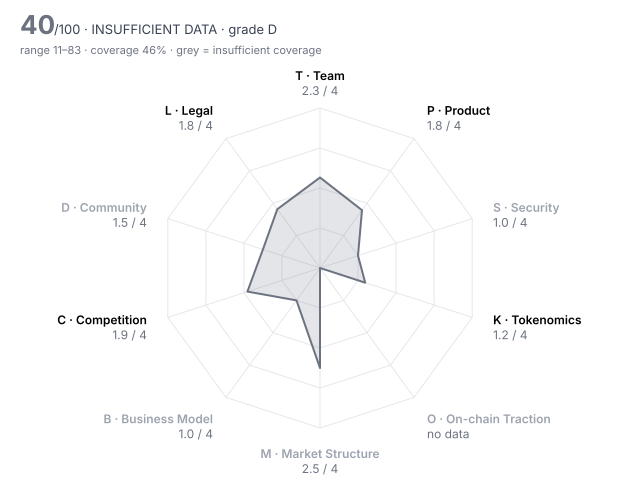

# ETHGas (GWEI) — DD-100 Due-Diligence Report

> **⚪ INSUFFICIENT DATA** · Grade **D** · Score **40.4/100** (range 11–83) · Evidence coverage **46%**  
> Profile `infra` · Evidence as of 2026-02-24 · 100 dimensions · 20 sources

The range is the honest number: it shows where the score could land once unscored dimensions are filled and low-confidence judgments are firmed up.

## Why this verdict

- evidence coverage 46% below the 70% needed for a verdict

## Red-flag gates

| Gate | Severity | Status | What it means |
|---|---|---|---|
| RF09 No independent audit | major | 🚩 fired | Code holding user funds has never been reviewed by a third party. |
| RF11 Security pillar failing | major | 🚩 fired | Average security score below 1.5/4 — structural rather than one-off weakness. |
| RF14 Insider-heavy allocation | minor | 🚩 fired | Team and investors hold more than half of supply. |
| RF01 Unrestricted mint controlled by a single key | critical | ❔ unchecked | Supply can be inflated at will; every other number in the report is conditional on one person's restraint. |
| RF02 Sanctions / illicit-finance exposure | critical | ❔ unchecked | Listing would create direct regulatory liability for the venue. |
| RF03 Core contracts not source-verified | critical | ❔ unchecked | Nobody outside the team can see what users are interacting with. |
| RF06 Upgradeable contracts with no meaningful timelock | major | ❔ unchecked | Logic can change under users with no time to exit. |
| RF07 Extreme holder concentration | major | ❔ unchecked | A handful of wallets can set the price; order books will not absorb their exit. |
| RF12 Anonymous team with centralised admin powers | major | ❔ unchecked | Unaccountable people holding privileged keys. |
| RF13 Undisclosed market-maker terms | major | ❔ unchecked | Token loans and call options are where post-listing dumps are engineered. |
| RF16 Volume implausible versus depth | minor | ❔ unchecked | Daily volume more than 100x the ±2% depth is a common wash-trading signature. |

4 of 16 gates verified clear (1 not applicable to this profile).

## Pillar scores

| Pillar | Weight | Score /4 | | Coverage | Scored |
|---|---:|---:|---|---:|---:|
| T · Team & Governance | 12 | 2.26 | `██████░░░░` | 79% | 8/10 |
| P · Product & Technology | 14 | 1.79 | `████░░░░░░` | 74% | 6/10 |
| S · Security & Smart Contracts | 14 | 1.00 | `██░░░░░░░░` | 12% ⚠️ | 1/10 |
| K · Tokenomics & Supply | 14 | 1.19 | `███░░░░░░░` | 76% | 8/10 |
| O · On-chain Traction | 8 | n/a | `··········` | 0% ⚠️ | 0/8 |
| M · Market Structure & Liquidity | 8 | 2.50 | `██████░░░░` | 12% ⚠️ | 2/10 |
| B · Business Model & Fundamentals | 10 | 1.00 | `██░░░░░░░░` | 11% ⚠️ | 1/10 |
| C · Competition & Moat | 10 | 1.91 | `█████░░░░░` | 61% | 6/10 |
| D · Community & Distribution | 4 | 1.50 | `████░░░░░░` | 31% ⚠️ | 3/10 |
| L · Legal, Compliance & Jurisdiction | 6 | 1.82 | `█████░░░░░` | 69% | 5/8 |

⚠️ = coverage below the pillar minimum; treat that pillar's score as indicative.

## Claims vs. observation

| Claim | Claimed | Observed | Gap | Sources |
|---|---:|---:|---:|---|
| 13 Jan announcement (as reported): investors receive 20% of supply | 20 | 27 | 26% | GWEI-06 vs GWEI-05 |

## Strengths

- **L06 Privacy & obfuscation features** (4/4) — Blockspace marketplace and ERC-20 with no privacy or obfuscation features.
- **T05 Controversies & misconduct history** (3/4) — No misconduct or enforcement found in press coverage 2023–Feb 2026; court records and team wallets were not checked, and why Infinity Exchange was paused is not explained.
- **L05 Litigation & enforcement** (3/4) — No litigation or enforcement in coverage up to listing; court and regulator databases were not searched directly.
- **T06 Team vesting length** (3/4) — team_vesting_months = 36  (bands 4:≥48, 3:≥36, 2:≥24, 1:≥12)
- **T09 Backer quality & cap table** (3/4) — Seed led by Polychain with BlueYard, Stake Capital, Amber, SIG DT and Lafayette; sold as a SAFT with no valuation disclosed and no board seats.
- **P03 Technical originality** (3/4) — Forward market for whole blocks and preconfirmations up to 64 slots ahead plus base-fee futures is an original design; per-transaction preconfirmations already exist elsewhere (mev-commit).

## Risks

- **K05 Insider allocation** (0/4) — insider_allocation_pct = 59  (bands 4:≤25, 3:≤35, 2:≤45, 1:≤55)
- **P01 Problem clarity & real demand** (1/4) — Gas-cost hedging and guaranteed inclusion are real problems, but no buyer-side usage figure is public; the $800M 'commitments' are validator supply, not demand.
- **S01 Audit coverage** (1/4) — audits_reputable_count = 0.5  (bands 4:≥3, 3:≥2, 2:≥1, 1:≥0.5)
- **K01 Token utility & value accrual** (1/4) — GWEI is a governance token (veGWEI); the 5% trading fee accrues to the company, and fee sharing with stakers appears only in exchange marketing, not as a live mechanism.
- **K04 12-month unlock pressure** (1/4) — unlock_12m_pct_of_circ = 73  (bands 4:≤10, 3:≤25, 2:≤50, 1:≤100)
- **L02 Securities-law risk** (1/4) — Token pre-sold to investors via SAFT, governance-only utility, and the team runs the marketplace; 59% of supply sits with insiders and the Foundation.

## Open questions for the project team

Everything below is unscored. Each one is a question to put to the team or a data request, not a negative finding.

**Needs a private channel (call, data room, counsel)** (3)

- T02 Identity verification level: Are the key people identified to the reviewer (KYC) and, ideally, publicly? — _requires private channel_
- M05 Market-maker arrangements: Are MM agreements (loans, call options, KPIs) disclosed to the reviewer and reasonable? — _requires private channel_
- L07 Legal opinion: Has the project provided a token legal opinion from reputable counsel? — _requires private channel_

**Needs evidence** (53)

- T08 Treasury transparency: Are treasury addresses, holdings and spending disclosed and reconcilable on-chain? — _missing: Foundation/treasury addresses or any treasury report; none found in sources dated to 2026-02-24_
- P06 Development activity (90d commits): How much code is being shipped in public repositories? — _metric 'github_commits_90d' not in evidence pack; GitHub activity not collected: the API was restricted in this environment, and 90-day commit counts would have to be reconstructed as of 2026-02-24._
- P07 Contributor breadth (90d): How many distinct developers are actively contributing? — _metric 'github_active_contributors_90d' not in evidence pack_
- P09 Open source & reproducibility: Can a third party build and verify what is deployed? — _missing: public repositories and Etherscan/BscScan source-verification status of the token, collateral and pool contracts (explorers unreachable for this review)_
- P10 Documentation quality: Could an integrator or auditor understand the system from the docs alone? — _missing: ETHGas technical documentation (docs site not retrieved); only forum posts reviewed_
- S02 Audit remediation: Were critical and high findings fixed and re-verified, and does deployed code match audited code? — _missing: the Sigma Prime report(s) — scope, commit, findings and remediation; none published as of 2026-02-24_
- S03 Source verification: Is the source code of every core contract verified on the block explorer? — _metric 'contracts_verified' not in evidence pack; contracts_verified not established for the same reason (explorers unreachable). Must be checked on both chains before sign-off._
- S04 Upgrade timelock: How long must users wait between an upgrade being queued and executed? (non-upgradeable = 9999) — _metric 'upgrade_timelock_hours' not in evidence pack; upgrade_timelock_hours unknown: whether the token, collateral and pool contracts are upgradeable was not read._
- S05 Admin key custody: Who holds admin keys, and with what multisig threshold and signer independence? — _missing: on-chain owner/admin of GWEI (Ethereum and BSC) and of the collateral/pool contracts, multisig threshold and signers_
- S06 Mint / freeze / blacklist powers: Can any party mint, freeze, seize or blacklist, and is that power bounded? — _missing: token contract read — mint, pause and blacklist functions and their holders on both deployments; mint_authority not established. GWEI exists on Ethereum (0x2798b1cC5A993085E8A9D46e80499F1B63f42204, GWEI-08) and BNB Smart Chain (0x30117e4bc17d7b044194b76a38365c53b72f7d49, GWEI-09). Etherscan/BscScan and RPC endpoints were unreachable for this review, so mint, owner, pause and blacklist functions were not read. The 'fixed 10B supply' is only the project's statement. This critical gate stays UNCHECKED._
- S07 Bug bounty: What is the maximum bug bounty payout on an established platform? — _metric 'bug_bounty_max_usd' not in evidence pack; No bug bounty programme found in sources dated to 2026-02-24; not set rather than set to 0._
- S08 Incident history & response: Has the protocol been exploited, and how was it handled? — _missing: incident-database check; no incident found in press, but the product was not broadly deployed so there is no track record to score_
- S09 Oracle & manipulation resistance: Can prices or state be manipulated to drain funds (flash loans, thin oracles)? — _missing: settlement reference for cash-settled base-fee futures and delivery-verification mechanism for preconfirmations_
- S10 Bridge & cross-chain exposure: How much value depends on bridges or wrapped representations? — _missing: how GWEI on BNB Smart Chain (GWEI-09) is issued or bridged from the Ethereum ERC-20, and what share of supply sits there_
- K03 Holder concentration: Share of supply held by the top 10 wallets, excluding exchanges, burn and protocol contracts — _metric 'top10_holder_pct_ex_contracts' not in evidence pack; Top-holder concentration at listing needs a point-in-time holder snapshot with Foundation, vesting, exchange and bridge addresses labelled; not obtainable from current explorers without leaking post-listing state._
- K08 Annual inflation: Net annual emission rate after burns — _metric 'annual_inflation_pct' not in evidence pack; Annual inflation not set: supply is announced as fixed, but mint authority is unverified (RF01) and staking-reward funding for veGWEI is undisclosed. Unlock-driven float growth is captured in K04._
- O01 Daily active addresses (30d avg): How many unique addresses interact with the protocol daily? — _metric 'daa_30d_avg' not in evidence pack; No on-chain activity metric for ETHGas buyers/sellers exists in public pre-listing sources; the marketplace runs on an off-chain order book._
- O02 Activity trend (90d): Percentage change in daily active addresses over 90 days — _metric 'daa_90d_change_pct' not in evidence pack_
- O03 30-day user retention: Share of a new-user cohort still active after 30 days — _metric 'retention_30d_pct' not in evidence pack_
- O06 Organic vs sybil activity: How much of the activity is bots, farmers or self-dealing? — _missing: buyer-side activity data (preconfirmation/futures buyers, funding sources) — no indexer or dashboard data found_
- O07 Fee-paying users (30d): Unique addresses that paid fees in the last 30 days — _metric 'fee_paying_users_30d' not in evidence pack_
- O08 Integrations: Number of live third-party integrations (wallets, protocols, aggregators) — _metric 'live_integrations_count' not in evidence pack_
- O09 Builder ecosystem: Are independent teams building on or around the protocol? — _missing: evidence of third-party products built on ETHGas; validator/node-operator testing (GWEI-16) is supply side_
- O10 Net capital flows (90d): Net inflow of external capital (stablecoins/majors) into the protocol over 90 days, USD — _metric 'net_inflow_90d_usd' not in evidence pack_
- M01 Order-book depth (±2%): Aggregate USD depth within 2% of mid across major venues — _metric 'depth_2pct_usd' not in evidence pack; ±2% depth, spread, 24h volume and 30d realised volatility at listing could not be found in any source dated on or before 2026-02-24; only later values exist, so they are omitted._
- M02 Venue concentration: Share of volume on the single largest venue — _metric 'top_venue_volume_share_pct' not in evidence pack_
- M03 Wash-trading indicators: Do volume, depth and trade-size patterns suggest fabricated volume? — _missing: pre-listing 24h volume, ±2% depth and venue split_
- M04 Bid-ask spread: Volume-weighted average spread in basis points — _metric 'spread_bps' not in evidence pack_
- M07 Derivatives structure: Do perp open interest and funding indicate healthy two-way markets or crowded positioning? — _missing: perp OI and funding history; perps at up to 50x opened on Binance eight days after TGE with a 17.5% float (GWEI-11, GWEI-13)_
- M08 Realised volatility (30d): Annualised 30-day realised volatility — _metric 'realized_vol_30d_pct' not in evidence pack_
- M09 DEX liquidity ownership: Is on-chain liquidity protocol-owned/locked or mercenary and removable overnight? — _missing: DEX pools on Ethereum/BSC and LP ownership_
- B01 Annualised protocol revenue: Revenue retained by the protocol/treasury (not total fees), annualised from the last 90 days, USD — _metric 'annualized_revenue_usd' not in evidence pack; No revenue figure published; The Block reports only the 5% fee rate (GWEI-01). FDV/fees cannot be computed._
- B02 Revenue quality: Is revenue organic and recurring, or one-off, wash or self-generated? — _missing: any revenue figure; only the 5% fee rate is disclosed (GWEI-01)_
- B04 Valuation vs fees (FDV / annualised fees): Price paid per dollar of fees generated — _metric 'fdv_to_annual_fees' not in evidence pack_
- B05 Incentive spend vs revenue: USD value of token incentives divided by protocol revenue (90d) — _metric 'incentives_to_revenue' not in evidence pack_
- B06 Treasury runway: Months of runway at current burn, counting non-native assets at full value and native token at 50% — _metric 'runway_months' not in evidence pack; ~$17M raised (pre-seed ~$5M + $12M seed, GWEI-01); burn and treasury holdings undisclosed, so runway and diversification are unknown._
- B07 Treasury diversification: Share of treasury held in assets other than the native token — _metric 'treasury_non_native_pct' not in evidence pack_
- B08 Revenue growth (90d): Quarter-on-quarter change in protocol revenue — _metric 'revenue_qoq_growth_pct' not in evidence pack_
- B09 Counterparty concentration: Does a single client, partner or whale drive most of the usage or revenue? — _missing: distribution of blockspace sellers/buyers; commitment providers are unnamed (GWEI-03)_
- B10 Sustainability without emissions: If incentives stopped tomorrow, would the business stand? — _missing: revenue and cost base; ~$17M raised (GWEI-01) but burn unknown_
- C02 Category market share: Share of the relevant category metric (TVL, volume, fees) held by this project — _metric 'category_share_pct' not in evidence pack; No category-share data for blockspace/preconfirmation venues in dated sources._
- C03 Share trajectory: Is market share rising or falling over the last two quarters? — _missing: market-share data for ETHGas vs mev-commit and other preconf/blockspace venues over two periods_
- C07 Relative valuation: Is the valuation reasonable against peers on comparable metrics? — _missing: peer valuations (FDV vs fees/usage) for preconf and MEV-infrastructure tokens_
- C08 Platform & incumbent threat: Could an L1, wallet, CEX or major protocol absorb this as a native feature? — _missing: dated source on in-protocol alternatives (ePBS, enshrined preconfirmations) and their timeline_
- D01 Organic audience: Size and quality of the audience across X, Telegram, Discord and regional channels — _missing: social analytics (engagement rate, follower quality)_
- D02 Engagement authenticity: What share of engagement appears bot-driven or paid? — _missing: bot-likelihood / engagement-authenticity data_
- D03 Token holder count: Number of addresses holding a non-dust balance — _metric 'holders_count' not in evidence pack; Holder count at listing not available in a pre-listing source._
- D04 Geographic & user diversity: Is the user base spread across regions, or concentrated where the venue cannot serve it? — _missing: user and holder geography_
- D06 Developer community: Grants, hackathons and external contributors beyond the core team — _missing: external developer activity (repos, grants, shipped integrations)_
- D07 Governance participation: Average share of circulating supply voting on recent proposals — _metric 'governance_participation_pct' not in evidence pack; veGWEI governance had no recorded votes before listing._
- D09 Sentiment & controversy: What is the prevailing tone among informed market participants? — _missing: sentiment data from informed participants_
- L03 Sanctions & AML exposure: Has screening found exposure to sanctioned addresses, mixers or illicit flows above tolerance? — _metric 'sanctions_exposure' not in evidence pack; sanctions_exposure needs the venue's own Chainalysis/TRM screening of deployer, Foundation, team and top-holder addresses._
- L10 Restricted-jurisdiction controls: Does the project geofence and enforce restrictions consistent with its legal analysis? — _missing: terms of service, front-end geofencing and airdrop jurisdiction restrictions_

## Appendix A — all 100 dimensions

### T · Team & Governance

| ID | Dimension | Method | W | Score | Conf. | Evidence | Basis |
|---|---|---|---:|---:|---|---|---|
| T01 | Founder track record | agent | 3 | **2** | medium | GWEI-07, GWEI-19, GWEI-01 | Founder led structured derivatives at Morgan Stanley and Barclays; his previous crypto venture, Infinity Exchange ($4.2M seed, 2022), reached no reported scale and is now paused. |
| T02 | Identity verification level | human | 3 | ⏳ |  |  | requires private channel |
| T03 | Team depth & key-person risk | agent | 2 | **2** | medium | GWEI-01, GWEI-03 | 18 contributors, about half in Hong Kong, with staff from Morgan Stanley, Deutsche Bank, HKEx and Lockheed; the founder is the only named person in every source, so key-person risk sits with him. |
| T04 | Technical leadership | agent | 2 | **2** | medium | GWEI-15, GWEI-20, GWEI-03 | In-house team built the Commit-Boost module and order book; public technical output is limited to forum posts and one co-authored ethresear.ch post. |
| T05 | Controversies & misconduct history | agent | 3 | **3** | low | GWEI-01, GWEI-07, GWEI-19 | No misconduct or enforcement found in press coverage 2023–Feb 2026; court records and team wallets were not checked, and why Infinity Exchange was paused is not explained. |
| T06 | Team vesting length | rule | 2 | **3** | medium | GWEI-05 | team_vesting_months = 36  (bands 4:≥48, 3:≥36, 2:≥24, 1:≥12) |
| T07 | Governance design & decentralisation path | agent | 2 | **1** | medium | GWEI-04, GWEI-05, GWEI-15 | veGWEI governance was only announced at TGE; the marketplace is a central limit order book run by ETHGas, and insiders plus the liquid 8% Foundation hold 59% of supply. |
| T08 | Treasury transparency | agent | 2 | – |  |  | missing: Foundation/treasury addresses or any treasury report; none found in sources dated to 2026-02-24 |
| T09 | Backer quality & cap table | agent | 2 | **3** | high | GWEI-01, GWEI-03 | Seed led by Polychain with BlueYard, Stake Capital, Amber, SIG DT and Lafayette; sold as a SAFT with no valuation disclosed and no board seats. |
| T10 | Disclosure honesty | rule | 3 | **2** | high | HARNESS | contradiction_count = 1  (bands 4:≤0, 3:≤0.5, 2:≤1, 1:≤2) |

### P · Product & Technology

| ID | Dimension | Method | W | Score | Conf. | Evidence | Basis |
|---|---|---|---:|---:|---|---|---|
| P01 | Problem clarity & real demand | agent | 3 | **1** | medium | GWEI-01, GWEI-02, GWEI-03 | Gas-cost hedging and guaranteed inclusion are real problems, but no buyer-side usage figure is public; the $800M 'commitments' are validator supply, not demand. |
| P02 | Product maturity | agent | 3 | **2** | medium | GWEI-01, GWEI-02, GWEI-15 | Blockspace futures launched on mainnet in Dec 2025, but the founder said full rollout was due Q1 2026 and execution guarantees were not broadly deployed before Jan/Feb 2026. |
| P03 | Technical originality | agent | 2 | **3** | medium | GWEI-15, GWEI-17 | Forward market for whole blocks and preconfirmations up to 64 slots ahead plus base-fee futures is an original design; per-transaction preconfirmations already exist elsewhere (mev-commit). |
| P04 | Architecture soundness | agent | 2 | **2** | medium | GWEI-02, GWEI-15 | Out-of-protocol design that relies on relays and builders enforcing constraints, with fallback to a conforming block; the founder concedes 'centralizing vectors' and the 99.96% delivery figure is unverified. |
| P05 | Dependency risk | agent | 2 | **2** | medium | GWEI-15, GWEI-16, GWEI-02 | Depends on Commit-Boost, MEV-Boost relays/builders and EigenLayer collateral; the PBS fallback is a partial safeguard. |
| P06 | Development activity (90d commits) | rule | 2 | – |  |  | metric 'github_commits_90d' not in evidence pack; GitHub activity not collected: the API was restricted in this environment, and 90-day commit counts would have to be reconstructed as of 2026-02-24. |
| P07 | Contributor breadth (90d) | rule | 1 | – |  |  | metric 'github_active_contributors_90d' not in evidence pack |
| P08 | Roadmap delivery record | agent | 2 | **1** | medium | GWEI-15, GWEI-16, GWEI-01 | Mainnet was targeted for Q1 2025 and full rollout slipped to Q1 2026; audit reports promised 'shortly' in Feb 2025 were still not public. |
| P09 | Open source & reproducibility | agent | 1 | – |  |  | missing: public repositories and Etherscan/BscScan source-verification status of the token, collateral and pool contracts (explorers unreachable for this review) |
| P10 | Documentation quality | agent | 1 | – |  |  | missing: ETHGas technical documentation (docs site not retrieved); only forum posts reviewed |

### S · Security & Smart Contracts

| ID | Dimension | Method | W | Score | Conf. | Evidence | Basis |
|---|---|---|---:|---:|---|---|---|
| S01 | Audit coverage | rule | 3 | **1** | low | GWEI-16 | audits_reputable_count = 0.5  (bands 4:≥3, 3:≥2, 2:≥1, 1:≥0.5) |
| S02 | Audit remediation | agent | 3 | – |  |  | missing: the Sigma Prime report(s) — scope, commit, findings and remediation; none published as of 2026-02-24 |
| S03 | Source verification | rule | 2 | – |  |  | metric 'contracts_verified' not in evidence pack; contracts_verified not established for the same reason (explorers unreachable). Must be checked on both chains before sign-off. |
| S04 | Upgrade timelock | rule | 3 | – |  |  | metric 'upgrade_timelock_hours' not in evidence pack; upgrade_timelock_hours unknown: whether the token, collateral and pool contracts are upgradeable was not read. |
| S05 | Admin key custody | agent | 3 | – |  |  | missing: on-chain owner/admin of GWEI (Ethereum and BSC) and of the collateral/pool contracts, multisig threshold and signers |
| S06 | Mint / freeze / blacklist powers | agent | 3 | – |  |  | missing: token contract read — mint, pause and blacklist functions and their holders on both deployments; mint_authority not established. GWEI exists on Ethereum (0x2798b1cC5A993085E8A9D46e80499F1B63f42204, GWEI-08) and BNB Smart Chain (0x30117e4bc17d7b044194b76a38365c53b72f7d49, GWEI-09). Etherscan/BscScan and RPC endpoints were unreachable for this review, so mint, owner, pause and blacklist functions were not read. The 'fixed 10B supply' is only the project's statement. This critical gate stays UNCHECKED. |
| S07 | Bug bounty | rule | 1 | – |  |  | metric 'bug_bounty_max_usd' not in evidence pack; No bug bounty programme found in sources dated to 2026-02-24; not set rather than set to 0. |
| S08 | Incident history & response | agent | 3 | – |  |  | missing: incident-database check; no incident found in press, but the product was not broadly deployed so there is no track record to score |
| S09 | Oracle & manipulation resistance | agent | 2 | – |  |  | missing: settlement reference for cash-settled base-fee futures and delivery-verification mechanism for preconfirmations |
| S10 | Bridge & cross-chain exposure | agent | 2 | – |  |  | missing: how GWEI on BNB Smart Chain (GWEI-09) is issued or bridged from the Ethereum ERC-20, and what share of supply sits there |

### K · Tokenomics & Supply

| ID | Dimension | Method | W | Score | Conf. | Evidence | Basis |
|---|---|---|---:|---:|---|---|---|
| K01 | Token utility & value accrual | agent | 3 | **1** | medium | GWEI-04, GWEI-06, GWEI-01, GWEI-14 | GWEI is a governance token (veGWEI); the 5% trading fee accrues to the company, and fee sharing with stakers appears only in exchange marketing, not as a live mechanism. |
| K02 | Circulating ratio | rule | 2 | **1** | high | HARNESS | circulating_supply_pct = 17.5  (bands 4:≥60, 3:≥40, 2:≥25, 1:≥15) |
| K03 | Holder concentration | rule | 3 | – |  |  | metric 'top10_holder_pct_ex_contracts' not in evidence pack; Top-holder concentration at listing needs a point-in-time holder snapshot with Foundation, vesting, exchange and bridge addresses labelled; not obtainable from current explorers without leaking post-listing state. |
| K04 | 12-month unlock pressure | rule | 3 | **1** | medium | GWEI-05 | unlock_12m_pct_of_circ = 73  (bands 4:≤10, 3:≤25, 2:≤50, 1:≤100) |
| K05 | Insider allocation | rule | 2 | **0** | medium | GWEI-05 | insider_allocation_pct = 59  (bands 4:≤25, 3:≤35, 2:≤45, 1:≤55) |
| K06 | Investor cost-basis overhang | rule | 2 | **3** | medium | GWEI-13 | price_to_last_round_multiple = 4.8  (bands 4:≤3, 3:≤10, 2:≤30, 1:≤100) |
| K07 | FDV / market cap | rule | 2 | **1** | high | HARNESS | fdv_to_mcap = 5.66  (bands 4:≤1.5, 3:≤2.5, 2:≤4, 1:≤7) |
| K08 | Annual inflation | rule | 2 | – |  |  | metric 'annual_inflation_pct' not in evidence pack; Annual inflation not set: supply is announced as fixed, but mint authority is unverified (RF01) and staking-reward funding for veGWEI is undisclosed. Unlock-driven float growth is captured in K04. |
| K09 | Supply verifiability | agent | 1 | **1** | medium | GWEI-05, GWEI-06, GWEI-07 | Allocation changed between announcements (investors 20%→27%, team 25%→22%), no vesting-contract addresses are published, and the buckets behind the 17.5% launch float are not disclosed. |
| K10 | Airdrop & incentive design | agent | 1 | **2** | low | GWEI-06, GWEI-05, GWEI-10 | Airdrop weighted by historical gas spend with a 30-day auto-stake, but also first-come Binance Alpha giveaways to points holders; no post-claim retention data. |

### O · On-chain Traction

| ID | Dimension | Method | W | Score | Conf. | Evidence | Basis |
|---|---|---|---:|---:|---|---|---|
| O01 | Daily active addresses (30d avg) | rule | 2 | – |  |  | metric 'daa_30d_avg' not in evidence pack; No on-chain activity metric for ETHGas buyers/sellers exists in public pre-listing sources; the marketplace runs on an off-chain order book. |
| O02 | Activity trend (90d) | rule | 2 | – |  |  | metric 'daa_90d_change_pct' not in evidence pack |
| O03 | 30-day user retention | rule | 2 | – |  |  | metric 'retention_30d_pct' not in evidence pack |
| O04 | TVL / AUM | rule | 2 | n/a |  |  | not applicable to profile 'infra' |
| O05 | Incentive-driven TVL share | rule | 2 | n/a |  |  | not applicable to profile 'infra' |
| O06 | Organic vs sybil activity | agent | 3 | – |  |  | missing: buyer-side activity data (preconfirmation/futures buyers, funding sources) — no indexer or dashboard data found |
| O07 | Fee-paying users (30d) | rule | 1 | – |  |  | metric 'fee_paying_users_30d' not in evidence pack |
| O08 | Integrations | rule | 1 | – |  |  | metric 'live_integrations_count' not in evidence pack |
| O09 | Builder ecosystem | agent | 1 | – |  |  | missing: evidence of third-party products built on ETHGas; validator/node-operator testing (GWEI-16) is supply side |
| O10 | Net capital flows (90d) | rule | 1 | – |  |  | metric 'net_inflow_90d_usd' not in evidence pack |

### M · Market Structure & Liquidity

| ID | Dimension | Method | W | Score | Conf. | Evidence | Basis |
|---|---|---|---:|---:|---|---|---|
| M01 | Order-book depth (±2%) | rule | 3 | – |  |  | metric 'depth_2pct_usd' not in evidence pack; ±2% depth, spread, 24h volume and 30d realised volatility at listing could not be found in any source dated on or before 2026-02-24; only later values exist, so they are omitted. |
| M02 | Venue concentration | rule | 2 | – |  |  | metric 'top_venue_volume_share_pct' not in evidence pack |
| M03 | Wash-trading indicators | agent | 3 | – |  |  | missing: pre-listing 24h volume, ±2% depth and venue split |
| M04 | Bid-ask spread | rule | 2 | – |  |  | metric 'spread_bps' not in evidence pack |
| M05 | Market-maker arrangements | human | 2 | ⏳ |  |  | requires private channel |
| M06 | Existing venue quality | agent | 1 | **2** | high | GWEI-07, GWEI-08, GWEI-09, GWEI-11 | Spot on KuCoin, Bitget, MEXC and Binance Alpha (not Binance spot), plus Binance perpetuals; Coinbase would be the first tier-1 spot venue. |
| M07 | Derivatives structure | agent | 1 | – |  |  | missing: perp OI and funding history; perps at up to 50x opened on Binance eight days after TGE with a 17.5% float (GWEI-11, GWEI-13) |
| M08 | Realised volatility (30d) | rule | 1 | – |  |  | metric 'realized_vol_30d_pct' not in evidence pack |
| M09 | DEX liquidity ownership | agent | 1 | – |  |  | missing: DEX pools on Ethereum/BSC and LP ownership |
| M10 | Narrative & timing fit | agent | 1 | **3** | medium | GWEI-02, GWEI-17, GWEI-13 | Gas futures and real-time preconfirmations are an Ethereum-roadmap-adjacent narrative Buterin has raised; ETHGas is the first blockspace futures market, in a niche that is still small. |

### B · Business Model & Fundamentals

| ID | Dimension | Method | W | Score | Conf. | Evidence | Basis |
|---|---|---|---:|---:|---|---|---|
| B01 | Annualised protocol revenue | rule | 3 | – |  |  | metric 'annualized_revenue_usd' not in evidence pack; No revenue figure published; The Block reports only the 5% fee rate (GWEI-01). FDV/fees cannot be computed. |
| B02 | Revenue quality | agent | 2 | – |  |  | missing: any revenue figure; only the 5% fee rate is disclosed (GWEI-01) |
| B03 | Holder value capture | agent | 2 | **1** | medium | GWEI-01, GWEI-14 | No live buyback, burn or distribution; staker benefit from marketplace fees is described only in exchange marketing. |
| B04 | Valuation vs fees (FDV / annualised fees) | rule | 2 | – |  |  | metric 'fdv_to_annual_fees' not in evidence pack |
| B05 | Incentive spend vs revenue | rule | 2 | – |  |  | metric 'incentives_to_revenue' not in evidence pack |
| B06 | Treasury runway | rule | 2 | – |  |  | metric 'runway_months' not in evidence pack; ~$17M raised (pre-seed ~$5M + $12M seed, GWEI-01); burn and treasury holdings undisclosed, so runway and diversification are unknown. |
| B07 | Treasury diversification | rule | 1 | – |  |  | metric 'treasury_non_native_pct' not in evidence pack |
| B08 | Revenue growth (90d) | rule | 1 | – |  |  | metric 'revenue_qoq_growth_pct' not in evidence pack |
| B09 | Counterparty concentration | agent | 1 | – |  |  | missing: distribution of blockspace sellers/buyers; commitment providers are unnamed (GWEI-03) |
| B10 | Sustainability without emissions | agent | 2 | – |  |  | missing: revenue and cost base; ~$17M raised (GWEI-01) but burn unknown |

### C · Competition & Moat

| ID | Dimension | Method | W | Score | Conf. | Evidence | Basis |
|---|---|---|---:|---:|---|---|---|
| C01 | Segment size & growth | agent | 2 | **1** | medium | GWEI-17, GWEI-02 | Preconfirmation market is nascent: the leading competitor had ~1% of validators opted in and 8,090 preconfs in Aug 2025. |
| C02 | Category market share | rule | 2 | – |  |  | metric 'category_share_pct' not in evidence pack; No category-share data for blockspace/preconfirmation venues in dated sources. |
| C03 | Share trajectory | agent | 2 | – |  |  | missing: market-share data for ETHGas vs mev-commit and other preconf/blockspace venues over two periods |
| C04 | Moat | agent | 3 | **2** | low | GWEI-01, GWEI-03 | First-mover blockspace futures venue with claimed validator commitments; no retention test against a competitor yet. |
| C05 | Forkability | agent | 2 | **2** | low | GWEI-15, GWEI-16 | Module design could be copied; the stickier assets are validator registrations and order-book liquidity. |
| C06 | Differentiation vs top-3 peers | agent | 2 | **2** | medium | GWEI-15, GWEI-17, GWEI-07 | Broader product set (64-slot forward market, whole blocks, base-fee futures) than per-transaction preconf protocols; competitors could add these. |
| C07 | Relative valuation | agent | 2 | – |  |  | missing: peer valuations (FDV vs fees/usage) for preconf and MEV-infrastructure tokens |
| C08 | Platform & incumbent threat | agent | 1 | – |  |  | missing: dated source on in-protocol alternatives (ePBS, enshrined preconfirmations) and their timeline |
| C09 | Partnership substance | agent | 1 | **2** | medium | GWEI-03, GWEI-16, GWEI-17 | A Kiln-EthGas cohort shows up in independent mainnet research and Lido operators tested on testnets, but the $800M commitment providers are unnamed. |
| C10 | Exchange-level strategic fit | agent | 1 | **3** | medium | GWEI-13, GWEI-02 | Adds Ethereum-blockspace exposure that Coinbase's books lack, alongside a same-day Coinbase Futures listing; segment still unproven. |

### D · Community & Distribution

| ID | Dimension | Method | W | Score | Conf. | Evidence | Basis |
|---|---|---|---:|---:|---|---|---|
| D01 | Organic audience | agent | 1 | – |  |  | missing: social analytics (engagement rate, follower quality) |
| D02 | Engagement authenticity | agent | 2 | – |  |  | missing: bot-likelihood / engagement-authenticity data |
| D03 | Token holder count | rule | 2 | – |  |  | metric 'holders_count' not in evidence pack; Holder count at listing not available in a pre-listing source. |
| D04 | Geographic & user diversity | agent | 1 | – |  |  | missing: user and holder geography |
| D05 | Paid-promotion dependence | agent | 2 | **1** | medium | GWEI-10, GWEI-12, GWEI-18 | Attention was bought through sponsored content, a points quest, Binance Alpha giveaways and a buy-volume trading competition worth 'hundreds of thousands of dollars'; organic interest is not evidenced. |
| D06 | Developer community | agent | 1 | – |  |  | missing: external developer activity (repos, grants, shipped integrations) |
| D07 | Governance participation | rule | 1 | – |  |  | metric 'governance_participation_pct' not in evidence pack; veGWEI governance had no recorded votes before listing. |
| D08 | Communication transparency | agent | 1 | **1** | medium | GWEI-06, GWEI-05, GWEI-16, GWEI-01 | Allocation figures changed within eight days without explanation, audit reports promised in Feb 2025 were never published, and the valuation was withheld. |
| D09 | Sentiment & controversy | agent | 1 | – |  |  | missing: sentiment data from informed participants |
| D10 | Ecosystem credibility | agent | 1 | **3** | medium | GWEI-01, GWEI-16, GWEI-17 | Polychain-led, Lido node operators (Stakely, Chorus One, A41) engaged in testing, and a Kiln cohort is live on mainnet. |

### L · Legal, Compliance & Jurisdiction

| ID | Dimension | Method | W | Score | Conf. | Evidence | Basis |
|---|---|---|---:|---:|---|---|---|
| L01 | Legal entity & jurisdiction | agent | 2 | **1** | medium | GWEI-04, GWEI-03 | An 'ETHGas Foundation' issues the token, but no jurisdiction or registration is disclosed; the operating team is in Hong Kong. |
| L02 | Securities-law risk | agent | 3 | **1** | medium | GWEI-01, GWEI-04, GWEI-05 | Token pre-sold to investors via SAFT, governance-only utility, and the team runs the marketplace; 59% of supply sits with insiders and the Foundation. |
| L03 | Sanctions & AML exposure | rule | 3 | – |  |  | metric 'sanctions_exposure' not in evidence pack; sanctions_exposure needs the venue's own Chainalysis/TRM screening of deployer, Foundation, team and top-holder addresses. |
| L04 | Licensing for regulated activity | agent | 2 | **1** | low | GWEI-07, GWEI-01 | Operates a futures market for blockspace (incl. cash-settled base-fee futures) with no licensing position disclosed; whether this is a regulated derivative is untested. |
| L05 | Litigation & enforcement | agent | 3 | **3** | low | GWEI-07, GWEI-13, GWEI-01 | No litigation or enforcement in coverage up to listing; court and regulator databases were not searched directly. |
| L06 | Privacy & obfuscation features | agent | 1 | **4** | medium | GWEI-15, GWEI-01 | Blockspace marketplace and ERC-20 with no privacy or obfuscation features. |
| L07 | Legal opinion | human | 1 | ⏳ |  |  | requires private channel |
| L08 | RWA custody & bankruptcy remoteness | agent | 3 | n/a |  |  | not applicable to profile 'infra' |
| L09 | RWA attestation frequency | agent | 2 | n/a |  |  | not applicable to profile 'infra' |
| L10 | Restricted-jurisdiction controls | agent | 1 | – |  |  | missing: terms of service, front-end geofencing and airdrop jurisdiction restrictions |

## Appendix B — sources

| ID | Tier | Type | Title |
|---|---|---|---|
| GWEI-01 | 2 · independent | news | [The Block — ETHGas raises $12M in token round as it launches Ethereum blockspace futures market with $800M in liquidity commitments (17 Dec 2025)](https://www.theblock.co/post/382960/ethgas-raises-12-million-in-token-round-as-it-launches-ethereum-blockspace-futures-market-with-800-million-in-liquidity-commitments) |
| GWEI-02 | 2 · independent | news | [Cointelegraph — ETHGas raised $12M as it launches Buterin-proposed gas futures (18 Dec 2025)](https://cointelegraph.com/news/ethgas-raised-12m-as-it-launches-buterin-proposed-gas-futures) |
| GWEI-04 | 2 · independent | news | [ForkLog — Ethereum gas to become tradable asset with GWEI token launch (14 Jan 2026)](https://forklog.com/en/ethereum-gas-to-become-tradable-asset-with-gwei-token-launch/amp) |
| GWEI-05 | 2 · independent | news | [ChainCatcher — GWEI airdrop checker live; claims open 21 Jan; tokenomics and vesting (21 Jan 2026)](https://www.chaincatcher.com/en/article/2239077) |
| GWEI-06 | 2 · independent | news | [MEXC News / PANews — ETHGas announces GWEI and Genesis Harvest airdrop (13 Jan 2026)](https://www.mexc.com/news/476147) |
| GWEI-07 | 2 · independent | research | [BlockEden.xyz — ETHGas 'Proof of Pain' airdrop and GWEI blockspace futures (23 Jan 2026)](https://blockeden.xyz/blog/2026/01/23/ethgas-proof-of-pain-airdrop-gwei-blockspace-futures/) |
| GWEI-13 | 2 · independent | news | [Yellow.com — Coinbase opens spot trading for ETHGas (GWEI) (23 Feb 2026, 20:57)](https://yellow.com/uk/news/coinbase-opens-spot-trading-for-ethgas-gwei-as-ethereum-blockspace-protocol-gains-exchange-foothold) |
| GWEI-14 | 2 · independent | news | [KuCoin blog — What is ETHGas (GWEI)? (22 Jan 2026; exchange promotional content)](https://www.kucoin.com/blog/my-what-is-ethgas-gwei-a-comprehensive-guide-to-the-future-of-ethereum-blockspace) |
| GWEI-08 | 2 · independent | announcement | [KuCoin — ETHGas (GWEI) gets listed on KuCoin, World Premiere (20 Jan 2026)](https://www.kucoin.com/announcement/pk-thgas-gwei-gets-listed-on-kucoin-world-premiere) |
| GWEI-09 | 2 · independent | news | [MEXC News / PANews — Binance Alpha lists ETHGas (GWEI) (21 Jan 2026)](https://www.mexc.com/news/524654) |
| GWEI-15 | 3 · self-reported | forum | [Lido forum — Introducing ETHGas and Realtime Proposer Commitments (K. Lepsoe, 4 Dec 2024)](https://research.lido.fi/t/introducing-ethgas-and-realtime-proposer-commitments-to-the-lido-community/9018) |
| GWEI-16 | 3 · self-reported | forum | [Lido forum — [PERCH] Request for Node Operators to run and test ETHGas (5 Feb 2025; replies to 1 Dec 2025 used)](https://research.lido.fi/t/perch-request-for-node-operators-to-run-and-test-ethgas/9484) |
| GWEI-03 | 3 · self-reported | press_release | [EQS / PR Newswire — ETHGas debuts Ethereum's blockspace futures market with $800M of commitments and $12M seed round led by Polychain Capital (19 Dec 2025, Hong Kong)](https://www.gettex.de/en/news-overview/newsdetail/eqs-news-ethgas-debuts-ethereums-blockspace-futures-market-with-800m-of-commitments-and-12m-seed-round-led-by-polychain-capital/) |
| GWEI-10 | 2 · independent | news | [MEXC News / PANews — Binance Alpha GWEI airdrop for Alpha Points holders (21 Jan 2026)](https://www.mexc.com/news/523003) |
| GWEI-11 | 2 · independent | news | [MEXC News — Binance Futures to launch GWEIUSDT perpetual, up to 50x (29 Jan 2026)](https://www.mexc.com/news/583895) |
| GWEI-12 | 2 · independent | news | [KuCoin News — GWEI added to Coinbase listing roadmap; Binance Wallet launches GWEI trading competition (11 Feb 2026)](https://www.kucoin.com/es/news/articles/gwei-added-to-coinbase-listing-roadmap-binance-wallet-launches-trading-competition) |
| GWEI-17 | 2 · independent | research | [Ethereum Research — Measuring validator economics under preconfirmations: early mainnet evidence (murat, 15 Sep 2025)](https://ethresear.ch/t/measuring-validator-economics-under-preconfirmations-early-mainnet-evidence/23066) |
| GWEI-18 | 3 · self-reported | sponsored | [The Defiant (sponsored, written by ETHGas) — ETHGas: building critical infrastructure for Ethereum blockspace (25 Sep 2025)](https://thedefiant.io/news/infrastructure/ethgas-building-critical-infrastructure-for-ethereum-blockspace) |
| GWEI-19 | 2 · independent | news | [The Block — Nomura's Laser Digital invests in DeFi protocol Infinity Exchange (15 Feb 2023)](https://www.theblock.co/post/211852/nomura-laser-digital-invests-infinity-exchange) |
| GWEI-20 | 3 · self-reported | research | [Ethereum Research — An observation on Ethereum's blockspace market (co-authored by Kevin L., ETHGas; 16 Dec 2025)](https://ethresear.ch/t/an-observation-on-ethereum-s-blockspace-market/23669) |
| HARNESS | computed | harness | Metrics derived by the harness from other evidence |

---
_Generated by DD-100. Scores are decision support for a listing committee, not investment advice. Every judgment above cites its evidence; anything uncited was not scored._