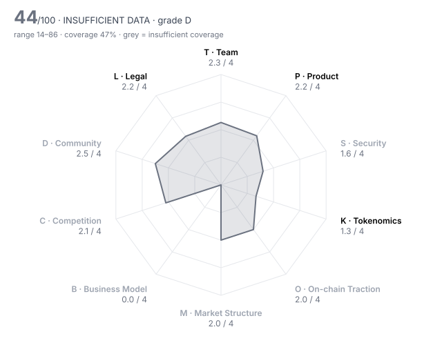

# Kaio (KAIO) — DD-100 Due-Diligence Report

> **⚪ INSUFFICIENT DATA** · Grade **D** · Score **44.3/100** (range 14–86) · Evidence coverage **47%**  
> Profile `rwa` · Evidence as of 2026-05-06 · 100 dimensions · 21 sources

The range is the honest number: it shows where the score could land once unscored dimensions are filled and low-confidence judgments are firmed up.

## Why this verdict

- evidence coverage 47% below the 70% needed for a verdict

## Red-flag gates

| Gate | Severity | Status | What it means |
|---|---|---|---|
| RF01 Unrestricted mint controlled by a single key | critical | ❔ unchecked | Supply can be inflated at will; every other number in the report is conditional on one person's restraint. |
| RF02 Sanctions / illicit-finance exposure | critical | ❔ unchecked | Listing would create direct regulatory liability for the venue. |
| RF03 Core contracts not source-verified | critical | ❔ unchecked | Nobody outside the team can see what users are interacting with. |
| RF04 Unremediated exploit with user losses | critical | ❔ unchecked | Users are owed money; listing would expose new users to the same counterparty. |
| RF06 Upgradeable contracts with no meaningful timelock | major | ❔ unchecked | Logic can change under users with no time to exit. |
| RF07 Extreme holder concentration | major | ❔ unchecked | A handful of wallets can set the price; order books will not absorb their exit. |
| RF09 No independent audit | major | ❔ unchecked | Code holding user funds has never been reviewed by a third party. |
| RF12 Anonymous team with centralised admin powers | major | ❔ unchecked | Unaccountable people holding privileged keys. |
| RF13 Undisclosed market-maker terms | major | ❔ unchecked | Token loans and call options are where post-listing dumps are engineered. |
| RF16 Volume implausible versus depth | minor | ❔ unchecked | Daily volume more than 100x the ±2% depth is a common wash-trading signature. |

5 of 16 gates verified clear (1 not applicable to this profile).

## Pillar scores

| Pillar | Weight | Score /4 | | Coverage | Scored |
|---|---:|---:|---|---:|---:|
| T · Team & Governance | 12 | 2.26 | `██████░░░░` | 79% | 8/10 |
| P · Product & Technology | 8 | 2.20 | `██████░░░░` | 79% | 7/10 |
| S · Security & Smart Contracts | 12 | 1.60 | `████░░░░░░` | 20% ⚠️ | 3/10 |
| K · Tokenomics & Supply | 10 | 1.50 | `████░░░░░░` | 60% | 5/9 |
| O · On-chain Traction | 8 | 2.00 | `█████░░░░░` | 20% ⚠️ | 2/9 |
| M · Market Structure & Liquidity | 8 | 2.00 | `█████░░░░░` | 12% ⚠️ | 2/10 |
| B · Business Model & Fundamentals | 12 | 0.00 | `░░░░░░░░░░` | 11% ⚠️ | 1/10 |
| C · Competition & Moat | 7 | 2.10 | `█████░░░░░` | 56% ⚠️ | 6/10 |
| D · Community & Distribution | 5 | 2.50 | `██████░░░░` | 15% ⚠️ | 2/10 |
| L · Legal, Compliance & Jurisdiction | 18 | 2.18 | `█████░░░░░` | 81% | 8/10 |

⚠️ = coverage below the pillar minimum; treat that pillar's score as indicative.

## Claims vs. observation

| Claim | Claimed | Observed | Gap | Sources |
|---|---:|---:|---:|---|
| Docs FAQ: KAIO has facilitated over $200M in live assets across multiple chains | 200,000,000 | 108,500,000 | 84% | KAIO-17 vs KAIO-08 |

## Strengths

- **K08 Annual inflation** (4/4) — annual_inflation_pct = 0  (bands 4:≤2, 3:≤5, 2:≤10, 1:≤20)
- **L06 Privacy & obfuscation features** (4/4) — No privacy features; fund tokens transfer only between KYC'd, allowlisted investors.
- **T05 Controversies & misconduct history** (3/4) — No VARA notice and no allegations in 2024–26 press coverage; court records, other regulators and wallet history were not checked, so not a 4.
- **P02 Product maturity** (3/4) — Fund tokens have been live since Mar 2024 on several chains; the AppChain, staking, governance and the KASH retail product are not live at TGE.
- **L05 Litigation & enforcement** (3/4) — No regulator action on VARA's list and none in press coverage; FSRA, MAS and court records were not searched directly.
- **T06 Team vesting length** (3/4) — team_vesting_months = 36  (bands 4:≥48, 3:≥36, 2:≥24, 1:≥12)

## Risks

- **K02 Circulating ratio** (0/4) — circulating_supply_pct = 6.8  (bands 4:≥60, 3:≥40, 2:≥25, 1:≥15)
- **B03 Holder value capture** (0/4) — Token holders have no statutory right to fees, and no buyback, burn or distribution is planned.
- **S07 Bug bounty** (0/4) — bug_bounty_max_usd = 0  (bands 4:≥1e+06, 3:≥250,000, 2:≥50,000, 1:≥10,000)
- **K01 Token utility & value accrual** (1/4) — Governance, product access and planned staking; holders have no right to protocol fees and no buyback or burn exists.
- **K04 12-month unlock pressure** (1/4) — unlock_12m_pct_of_circ = 84.6  (bands 4:≤10, 3:≤25, 2:≤50, 1:≤100)
- **T07 Governance design & decentralisation path** (1/4) — The KAIO Foundation was set up in Apr 2026 and token voting is promised but not live at TGE; on the platform a KAIO Admin role sits at the top of all permissions.

## Open questions for the project team

Everything below is unscored. Each one is a question to put to the team or a data request, not a negative finding.

**Needs a private channel (call, data room, counsel)** (3)

- T02 Identity verification level: Are the key people identified to the reviewer (KYC) and, ideally, publicly? — _requires private channel_
- M05 Market-maker arrangements: Are MM agreements (loans, call options, KPIs) disclosed to the reviewer and reasonable? — _requires private channel_
- L07 Legal opinion: Has the project provided a token legal opinion from reputable counsel? — _requires private channel_

**Needs evidence** (51)

- T08 Treasury transparency: Are treasury addresses, holdings and spending disclosed and reconcilable on-chain? — _missing: Foundation/treasury and vesting wallet addresses; the token docs page and Etherscan were not accessible for this review_
- P06 Development activity (90d commits): How much code is being shipped in public repositories? — _metric 'github_commits_90d' not in evidence pack; No public KAIO GitHub organisation was identified, so the collector was not run._
- P07 Contributor breadth (90d): How many distinct developers are actively contributing? — _metric 'github_active_contributors_90d' not in evidence pack_
- P09 Open source & reproducibility: Can a third party build and verify what is deployed? — _missing: public code repository and explorer verification of the KAIO token and gateway contracts_
- S01 Audit coverage: How many reputable independent audits cover the deployed code? — _metric 'audits_reputable_count' not in evidence pack; audits_reputable_count not set. Docs (KAIO-16, undated) name a Nethermind audit of the platform contracts; the report was not read, and no audit of the KAIO ERC-20 was found. Recorded as a claim (KC4)._
- S02 Audit remediation: Were critical and high findings fixed and re-verified, and does deployed code match audited code? — _missing: the Nethermind report itself (date, scope, commit, findings) and whether it covers deployed gateway and KAIO token contracts_
- S03 Source verification: Is the source code of every core contract verified on the block explorer? — _metric 'contracts_verified' not in evidence pack; contracts_verified not established, for the same reason (no explorer access). The gateway and fund-registry contracts are also unverified for this review._
- S04 Upgrade timelock: How long must users wait between an upgrade being queued and executed? (non-upgradeable = 9999) — _metric 'upgrade_timelock_hours' not in evidence pack; upgrade_timelock_hours unknown: upgradeability of the token and gateway contracts is not documented (KAIO-16)._
- S05 Admin key custody: Who holds admin keys, and with what multisig threshold and signer independence? — _missing: who holds KAIO Admin and token/proxy admin rights, multisig threshold and signers_
- S06 Mint / freeze / blacklist powers: Can any party mint, freeze, seize or blacklist, and is that power bounded? — _missing: on-chain read of the KAIO ERC-20 (mint, pause, blacklist, owner). Fund tokens carry allowlist controls by design (KAIO-15).; mint_authority not established. Contract 0x00bac91fd8f5b4a0dc03c8021139b76f6549ee7e (KAIO-06) could not be read: Etherscan, Blockscout and GoPlus were not reachable from this environment. A DexTools scan retrieved on 2026-10-23 reports 'mintable: no, owner renounced'. It was deliberately NOT used, because it postdates the review date. On the day, an analyst would read the verified source on Etherscan._
- S08 Incident history & response: Has the protocol been exploited, and how was it handled? — _missing: incident-database check; no exploit appears in 2024–26 coverage, but absence in press is not proof; unreimbursed_exploit_usd not established. No exploit appears in 2024–26 coverage (KAIO-08, -11, -13, -14), but incident databases (rekt.news, DeFiLlama hacks) could not be reached. Absence in press is not treated as evidence._
- K03 Holder concentration: Share of supply held by the top 10 wallets, excluding exchanges, burn and protocol contracts — _metric 'top10_holder_pct_ex_contracts' not in evidence pack; top10_holder_pct_ex_contracts not set: at TGE, supply sits in Foundation, community and vesting wallets, and airdrop claims open on 8 May. Needs labelled holder data on the day._
- K06 Investor cost-basis overhang: Current price as a multiple of the last private round price (higher = more profit to take) — _metric 'price_to_last_round_multiple' not in evidence pack; price_to_last_round_multiple not set: round prices (early investors 31%, pre-TGE sale 3.5%) and the listing price were not found in sources dated on or before 2026-05-06._
- K07 FDV / market cap: How much future dilution is priced in? — _metric 'fdv_to_mcap' not in evidence pack; market_cap_usd / fdv_usd not set: trading began on listing day (KuCoin 13:00 UTC, Coinbase conditional on liquidity) and no pre-listing price or pre-market quote was found. Later values were deliberately not looked up._
- K09 Supply verifiability: Can circulating supply and vesting be verified on-chain rather than taken from a spreadsheet? — _missing: vesting contract addresses and an on-chain reconciliation of the 681.25M TGE circulating supply_
- O01 Daily active addresses (30d avg): How many unique addresses interact with the protocol daily? — _metric 'daa_30d_avg' not in evidence pack; No independent on-chain activity, holder or fee-payer data for the fund tokens as of the review date; DeFiLlama and rwa.xyz snapshots for that date could not be retrieved._
- O02 Activity trend (90d): Percentage change in daily active addresses over 90 days — _metric 'daa_90d_change_pct' not in evidence pack_
- O03 30-day user retention: Share of a new-user cohort still active after 30 days — _metric 'retention_30d_pct' not in evidence pack_
- O06 Organic vs sybil activity: How much of the activity is bots, farmers or self-dealing? — _missing: on-chain activity data for fund tokens and the airdrop recipient set (claims open 8 May)_
- O07 Fee-paying users (30d): Unique addresses that paid fees in the last 30 days — _metric 'fee_paying_users_30d' not in evidence pack_
- O08 Integrations: Number of live third-party integrations (wallets, protocols, aggregators) — _metric 'live_integrations_count' not in evidence pack_
- O10 Net capital flows (90d): Net inflow of external capital (stablecoins/majors) into the protocol over 90 days, USD — _metric 'net_inflow_90d_usd' not in evidence pack_
- M01 Order-book depth (±2%): Aggregate USD depth within 2% of mid across major venues — _metric 'depth_2pct_usd' not in evidence pack; Order-book depth, spread, volume, venue share and volatility are unavailable before first trade on 2026-05-06._
- M02 Venue concentration: Share of volume on the single largest venue — _metric 'top_venue_volume_share_pct' not in evidence pack_
- M03 Wash-trading indicators: Do volume, depth and trade-size patterns suggest fabricated volume? — _missing: no trading history; TGE and first trading are on the review date_
- M04 Bid-ask spread: Volume-weighted average spread in basis points — _metric 'spread_bps' not in evidence pack_
- M07 Derivatives structure: Do perp open interest and funding indicate healthy two-way markets or crowded positioning? — _missing: no perpetual market or funding history before listing_
- M08 Realised volatility (30d): Annualised 30-day realised volatility — _metric 'realized_vol_30d_pct' not in evidence pack_
- M09 DEX liquidity ownership: Is on-chain liquidity protocol-owned/locked or mercenary and removable overnight? — _missing: DEX pool addresses and LP ownership at launch_
- B01 Annualised protocol revenue: Revenue retained by the protocol/treasury (not total fees), annualised from the last 90 days, USD — _metric 'annualized_revenue_usd' not in evidence pack; Protocol revenue is undisclosed. LUMA charges 15 bps to cover fund expenses (KAIO-15); platform fees are 'planned' (KAIO-05)._
- B02 Revenue quality: Is revenue organic and recurring, or one-off, wash or self-generated? — _missing: protocol revenue; only a 15 bps fund ongoing charge (covering fund expenses) and planned basis-point platform fees are disclosed_
- B04 Valuation vs fees (FDV / annualised fees): Price paid per dollar of fees generated — _metric 'fdv_to_annual_fees' not in evidence pack_
- B05 Incentive spend vs revenue: USD value of token incentives divided by protocol revenue (90d) — _metric 'incentives_to_revenue' not in evidence pack_
- B06 Treasury runway: Months of runway at current burn, counting non-native assets at full value and native token at 50% — _metric 'runway_months' not in evidence pack; Treasury runway unknown: $19M raised (KAIO-08); burn and treasury holdings undisclosed._
- B07 Treasury diversification: Share of treasury held in assets other than the native token — _metric 'treasury_non_native_pct' not in evidence pack_
- B08 Revenue growth (90d): Quarter-on-quarter change in protocol revenue — _metric 'revenue_qoq_growth_pct' not in evidence pack_
- B09 Counterparty concentration: Does a single client, partner or whale drive most of the usage or revenue? — _missing: AUM split by fund as of May 2026 (the site's per-fund TVL widget is not point-in-time)_
- B10 Sustainability without emissions: If incentives stopped tomorrow, would the business stand? — _missing: revenue and burn; the company is funded by $19M of venture capital (KAIO-08)_
- C01 Segment size & growth: How large and fast-growing is the addressable on-chain segment? — _missing: dated size of the tokenised-fund segment from an independent aggregator as of May 2026_
- C02 Category market share: Share of the relevant category metric (TVL, volume, fees) held by this project — _metric 'category_share_pct' not in evidence pack; No dated category-share figure for tokenised funds as of May 2026 was obtainable._
- C03 Share trajectory: Is market share rising or falling over the last two quarters? — _missing: KAIO's share of tokenised-fund AUM over the last two quarters_
- C07 Relative valuation: Is the valuation reasonable against peers on comparable metrics? — _missing: listing price/FDV and peer valuations as of 6 May 2026_
- D01 Organic audience: Size and quality of the audience across X, Telegram, Discord and regional channels — _missing: social analytics for X/Telegram as of May 2026_
- D02 Engagement authenticity: What share of engagement appears bot-driven or paid? — _missing: bot/engagement analysis_
- D03 Token holder count: Number of addresses holding a non-dust balance — _metric 'holders_count' not in evidence pack_
- D04 Geographic & user diversity: Is the user base spread across regions, or concentrated where the venue cannot serve it? — _no assessment provided_
- D05 Paid-promotion dependence: How much attention comes from paid KOLs, undisclosed promotions or points campaigns? — _missing: disclosure of paid campaigns and airdrop eligibility criteria published before TGE_
- D06 Developer community: Grants, hackathons and external contributors beyond the core team — _no assessment provided_
- D07 Governance participation: Average share of circulating supply voting on recent proposals — _metric 'governance_participation_pct' not in evidence pack; No token governance vote exists at TGE (KAIO-05)._
- D09 Sentiment & controversy: What is the prevailing tone among informed market participants? — _missing: informed-participant sentiment before TGE_
- L03 Sanctions & AML exposure: Has screening found exposure to sanctioned addresses, mixers or illicit flows above tolerance? — _metric 'sanctions_exposure' not in evidence pack; sanctions_exposure unknown: needs venue wallet screening of the deployer, Foundation, vesting and top-holder addresses._

## Appendix A — all 100 dimensions

### T · Team & Governance

| ID | Dimension | Method | W | Score | Conf. | Evidence | Basis |
|---|---|---|---:|---:|---|---|---|
| T01 | Founder track record | agent | 3 | **2** | low | KAIO-13, KAIO-09, KAIO-14 | Founded in 2024 by Avtar Sehra as a Laser Digital/WebN venture; the CEO named in April 2026 is Shrey Rastogi. The platform itself has shipped, but the founders' earlier ventures and their outcomes are not documented in the sources. |
| T02 | Identity verification level | human | 3 | ⏳ |  |  | requires private channel |
| T03 | Team depth & key-person risk | agent | 2 | **2** | low | KAIO-09, KAIO-10, KAIO-20, KAIO-13 | Three named executives (CEO Rastogi, COO Dang, CTO Surana since Oct 2025); the founding CEO is no longer named, and headcount is not disclosed. |
| T04 | Technical leadership | agent | 2 | **2** | low | KAIO-20, KAIO-16 | A CTO joined in Oct 2025 and the docs describe a role-based registry design, but no public specs, research or code from the technical team were found. |
| T05 | Controversies & misconduct history | agent | 3 | **3** | medium | KAIO-19, KAIO-08, KAIO-11 | No VARA notice and no allegations in 2024–26 press coverage; court records, other regulators and wallet history were not checked, so not a 4. |
| T06 | Team vesting length | rule | 2 | **3** | medium | KAIO-03 | team_vesting_months = 36  (bands 4:≥48, 3:≥36, 2:≥24, 1:≥12) |
| T07 | Governance design & decentralisation path | agent | 2 | **1** | medium | KAIO-01, KAIO-05, KAIO-16 | The KAIO Foundation was set up in Apr 2026 and token voting is promised but not live at TGE; on the platform a KAIO Admin role sits at the top of all permissions. |
| T08 | Treasury transparency | agent | 2 | – |  |  | missing: Foundation/treasury and vesting wallet addresses; the token docs page and Etherscan were not accessible for this review |
| T09 | Backer quality & cap table | agent | 2 | **3** | high | KAIO-08, KAIO-09, KAIO-14 | Incubated by Laser Digital (Nomura) and WebN (Alan Howard); $19M raised in total; the $8M round in Apr 2026 brought in Tether and Systemic Ventures, with existing investors Further Ventures and Laser Digital (WebN is the incubator, not a round participant). Round terms are undisclosed, and early investors hold 31% of supply. |
| T10 | Disclosure honesty | rule | 3 | **2** | high | HARNESS | contradiction_count = 1  (bands 4:≤0, 3:≤0.5, 2:≤1, 1:≤2) |

### P · Product & Technology

| ID | Dimension | Method | W | Score | Conf. | Evidence | Basis |
|---|---|---|---:|---:|---|---|---|
| P01 | Problem clarity & real demand | agent | 3 | **2** | medium | KAIO-08, KAIO-11, KAIO-17 | Real problem (on-chain access to institutional funds), but two years in, AUM is about $108.5M, against claims of more than $200M issued, so demand looks modest. |
| P02 | Product maturity | agent | 3 | **3** | high | KAIO-14, KAIO-13, KAIO-11 | Fund tokens have been live since Mar 2024 on several chains; the AppChain, staking, governance and the KASH retail product are not live at TGE. |
| P03 | Technical originality | agent | 2 | **2** | medium | KAIO-15, KAIO-16 | Permissioned register on a sidechain plus an allowlisted mainnet gateway: a standard tokenised-fund design with custom role registries, no published research. |
| P04 | Architecture soundness | agent | 2 | **2** | medium | KAIO-15 | Off-chain administrator keeps the authoritative register and can rebuild it; on-chain tokens are receipts minted/locked through a gateway, which works but has manual and liveness limits. |
| P05 | Dependency risk | agent | 2 | **2** | medium | KAIO-15, KAIO-10 | Depends on fund administrators, underlying managers, Circle off-ramp and LayerZero for multi-chain supply; the administrator's off-chain records are the fallback. |
| P06 | Development activity (90d commits) | rule | 2 | – |  |  | metric 'github_commits_90d' not in evidence pack; No public KAIO GitHub organisation was identified, so the collector was not run. |
| P07 | Contributor breadth (90d) | rule | 1 | – |  |  | metric 'github_active_contributors_90d' not in evidence pack |
| P08 | Roadmap delivery record | agent | 2 | **2** | low | KAIO-10, KAIO-17, KAIO-08, KAIO-05 | Chain launches shipped (Solana, Aptos, Sei), but the $500M Telegram Bond Fund (announced Apr 2025) has no visible launch, and KASH is still on a waitlist that opened Feb 2026. |
| P09 | Open source & reproducibility | agent | 1 | – |  |  | missing: public code repository and explorer verification of the KAIO token and gateway contracts |
| P10 | Documentation quality | agent | 1 | **2** | medium | KAIO-16, KAIO-17 | Docs describe registries and access roles but say nothing on upgradeability, admin keys or the KAIO token, and give conflicting asset figures. |

### S · Security & Smart Contracts

| ID | Dimension | Method | W | Score | Conf. | Evidence | Basis |
|---|---|---|---:|---:|---|---|---|
| S01 | Audit coverage | rule | 3 | – |  |  | metric 'audits_reputable_count' not in evidence pack; audits_reputable_count not set. Docs (KAIO-16, undated) name a Nethermind audit of the platform contracts; the report was not read, and no audit of the KAIO ERC-20 was found. Recorded as a claim (KC4). |
| S02 | Audit remediation | agent | 3 | – |  |  | missing: the Nethermind report itself (date, scope, commit, findings) and whether it covers deployed gateway and KAIO token contracts |
| S03 | Source verification | rule | 2 | – |  |  | metric 'contracts_verified' not in evidence pack; contracts_verified not established, for the same reason (no explorer access). The gateway and fund-registry contracts are also unverified for this review. |
| S04 | Upgrade timelock | rule | 3 | – |  |  | metric 'upgrade_timelock_hours' not in evidence pack; upgrade_timelock_hours unknown: upgradeability of the token and gateway contracts is not documented (KAIO-16). |
| S05 | Admin key custody | agent | 3 | – |  |  | missing: who holds KAIO Admin and token/proxy admin rights, multisig threshold and signers |
| S06 | Mint / freeze / blacklist powers | agent | 3 | – |  |  | missing: on-chain read of the KAIO ERC-20 (mint, pause, blacklist, owner). Fund tokens carry allowlist controls by design (KAIO-15).; mint_authority not established. Contract 0x00bac91fd8f5b4a0dc03c8021139b76f6549ee7e (KAIO-06) could not be read: Etherscan, Blockscout and GoPlus were not reachable from this environment. A DexTools scan retrieved on 2026-10-23 reports 'mintable: no, owner renounced'. It was deliberately NOT used, because it postdates the review date. On the day, an analyst would read the verified source on Etherscan. |
| S07 | Bug bounty | rule | 1 | **0** | low | KAIO-16 | bug_bounty_max_usd = 0  (bands 4:≥1e+06, 3:≥250,000, 2:≥50,000, 1:≥10,000) |
| S08 | Incident history & response | agent | 3 | – |  |  | missing: incident-database check; no exploit appears in 2024–26 coverage, but absence in press is not proof; unreimbursed_exploit_usd not established. No exploit appears in 2024–26 coverage (KAIO-08, -11, -13, -14), but incident databases (rekt.news, DeFiLlama hacks) could not be reached. Absence in press is not treated as evidence. |
| S09 | Oracle & manipulation resistance | agent | 2 | **2** | low | KAIO-15, KAIO-18 | Fund token value is set by an independent administrator's daily NAV rather than a market oracle; no on-chain NAV feed or fallback is documented, and KAIO assets are not Horizon collateral. |
| S10 | Bridge & cross-chain exposure | agent | 2 | **2** | medium | KAIO-10, KAIO-15 | Fund tokens move across 10+ chains through a sidechain gateway and LayerZero; the KAIO token itself is a single ERC-20 on Ethereum. |

### K · Tokenomics & Supply

| ID | Dimension | Method | W | Score | Conf. | Evidence | Basis |
|---|---|---|---:|---:|---|---|---|
| K01 | Token utility & value accrual | agent | 3 | **1** | medium | KAIO-05, KAIO-01 | Governance, product access and planned staking; holders have no right to protocol fees and no buyback or burn exists. |
| K02 | Circulating ratio | rule | 2 | **0** | high | HARNESS | circulating_supply_pct = 6.8  (bands 4:≥60, 3:≥40, 2:≥25, 1:≥15) |
| K03 | Holder concentration | rule | 3 | – |  |  | metric 'top10_holder_pct_ex_contracts' not in evidence pack; top10_holder_pct_ex_contracts not set: at TGE, supply sits in Foundation, community and vesting wallets, and airdrop claims open on 8 May. Needs labelled holder data on the day. |
| K04 | 12-month unlock pressure | rule | 3 | **1** | medium | KAIO-03 | unlock_12m_pct_of_circ = 84.6  (bands 4:≤10, 3:≤25, 2:≤50, 1:≤100) |
| K05 | Insider allocation | rule | 2 | **2** | medium | KAIO-05 | insider_allocation_pct = 42  (bands 4:≤25, 3:≤35, 2:≤45, 1:≤55) |
| K06 | Investor cost-basis overhang | rule | 2 | – |  |  | metric 'price_to_last_round_multiple' not in evidence pack; price_to_last_round_multiple not set: round prices (early investors 31%, pre-TGE sale 3.5%) and the listing price were not found in sources dated on or before 2026-05-06. |
| K07 | FDV / market cap | rule | 2 | – |  |  | metric 'fdv_to_mcap' not in evidence pack; market_cap_usd / fdv_usd not set: trading began on listing day (KuCoin 13:00 UTC, Coinbase conditional on liquidity) and no pre-listing price or pre-market quote was found. Later values were deliberately not looked up. |
| K08 | Annual inflation | rule | 2 | **4** | medium | KAIO-03 | annual_inflation_pct = 0  (bands 4:≤2, 3:≤5, 2:≤10, 1:≤20) |
| K09 | Supply verifiability | agent | 1 | – |  |  | missing: vesting contract addresses and an on-chain reconciliation of the 681.25M TGE circulating supply |
| K10 | Airdrop & incentive design | agent | 1 | n/a |  |  | not applicable to profile 'rwa' |

### O · On-chain Traction

| ID | Dimension | Method | W | Score | Conf. | Evidence | Basis |
|---|---|---|---:|---:|---|---|---|
| O01 | Daily active addresses (30d avg) | rule | 2 | – |  |  | metric 'daa_30d_avg' not in evidence pack; No independent on-chain activity, holder or fee-payer data for the fund tokens as of the review date; DeFiLlama and rwa.xyz snapshots for that date could not be retrieved. |
| O02 | Activity trend (90d) | rule | 2 | – |  |  | metric 'daa_90d_change_pct' not in evidence pack |
| O03 | 30-day user retention | rule | 2 | – |  |  | metric 'retention_30d_pct' not in evidence pack |
| O04 | TVL / AUM | rule | 2 | **2** | medium | KAIO-08 | tvl_usd = 108,500,000  (bands 4:≥1e+09, 3:≥2e+08, 2:≥5e+07, 1:≥1e+07) |
| O05 | Incentive-driven TVL share | rule | 2 | n/a |  |  | not applicable to profile 'rwa' |
| O06 | Organic vs sybil activity | agent | 3 | – |  |  | missing: on-chain activity data for fund tokens and the airdrop recipient set (claims open 8 May) |
| O07 | Fee-paying users (30d) | rule | 1 | – |  |  | metric 'fee_paying_users_30d' not in evidence pack |
| O08 | Integrations | rule | 1 | – |  |  | metric 'live_integrations_count' not in evidence pack |
| O09 | Builder ecosystem | agent | 1 | **2** | medium | KAIO-20, KAIO-18, KAIO-21 | Integrations are mostly chain-foundation launches (Sei, Solana, Aptos, MANTRA) and a lending pilot; KAIO is named in Aave Horizon's network but has no collateral listed there. |
| O10 | Net capital flows (90d) | rule | 1 | – |  |  | metric 'net_inflow_90d_usd' not in evidence pack |

### M · Market Structure & Liquidity

| ID | Dimension | Method | W | Score | Conf. | Evidence | Basis |
|---|---|---|---:|---:|---|---|---|
| M01 | Order-book depth (±2%) | rule | 3 | – |  |  | metric 'depth_2pct_usd' not in evidence pack; Order-book depth, spread, volume, venue share and volatility are unavailable before first trade on 2026-05-06. |
| M02 | Venue concentration | rule | 2 | – |  |  | metric 'top_venue_volume_share_pct' not in evidence pack |
| M03 | Wash-trading indicators | agent | 3 | – |  |  | missing: no trading history; TGE and first trading are on the review date |
| M04 | Bid-ask spread | rule | 2 | – |  |  | metric 'spread_bps' not in evidence pack |
| M05 | Market-maker arrangements | human | 2 | ⏳ |  |  | requires private channel |
| M06 | Existing venue quality | agent | 1 | **2** | medium | KAIO-06, KAIO-07, KAIO-02 | No prior market: KuCoin opens KAIO/USDT the same day as TGE and Coinbase's listing; there is no earlier venue whose diligence can be relied on. |
| M07 | Derivatives structure | agent | 1 | – |  |  | missing: no perpetual market or funding history before listing |
| M08 | Realised volatility (30d) | rule | 1 | – |  |  | metric 'realized_vol_30d_pct' not in evidence pack |
| M09 | DEX liquidity ownership | agent | 1 | – |  |  | missing: DEX pool addresses and LP ownership at launch |
| M10 | Narrative & timing fit | agent | 1 | **2** | low | KAIO-11, KAIO-08 | RWA tokenisation has momentum and attracted Tether's investment, but KAIO is a small distributor (~$108.5M AUM), not a sector leader. |

### B · Business Model & Fundamentals

| ID | Dimension | Method | W | Score | Conf. | Evidence | Basis |
|---|---|---|---:|---:|---|---|---|
| B01 | Annualised protocol revenue | rule | 3 | – |  |  | metric 'annualized_revenue_usd' not in evidence pack; Protocol revenue is undisclosed. LUMA charges 15 bps to cover fund expenses (KAIO-15); platform fees are 'planned' (KAIO-05). |
| B02 | Revenue quality | agent | 2 | – |  |  | missing: protocol revenue; only a 15 bps fund ongoing charge (covering fund expenses) and planned basis-point platform fees are disclosed |
| B03 | Holder value capture | agent | 2 | **0** | medium | KAIO-05 | Token holders have no statutory right to fees, and no buyback, burn or distribution is planned. |
| B04 | Valuation vs fees (FDV / annualised fees) | rule | 2 | – |  |  | metric 'fdv_to_annual_fees' not in evidence pack |
| B05 | Incentive spend vs revenue | rule | 2 | – |  |  | metric 'incentives_to_revenue' not in evidence pack |
| B06 | Treasury runway | rule | 2 | – |  |  | metric 'runway_months' not in evidence pack; Treasury runway unknown: $19M raised (KAIO-08); burn and treasury holdings undisclosed. |
| B07 | Treasury diversification | rule | 1 | – |  |  | metric 'treasury_non_native_pct' not in evidence pack |
| B08 | Revenue growth (90d) | rule | 1 | – |  |  | metric 'revenue_qoq_growth_pct' not in evidence pack |
| B09 | Counterparty concentration | agent | 1 | – |  |  | missing: AUM split by fund as of May 2026 (the site's per-fund TVL widget is not point-in-time) |
| B10 | Sustainability without emissions | agent | 2 | – |  |  | missing: revenue and burn; the company is funded by $19M of venture capital (KAIO-08) |

### C · Competition & Moat

| ID | Dimension | Method | W | Score | Conf. | Evidence | Basis |
|---|---|---|---:|---:|---|---|---|
| C01 | Segment size & growth | agent | 2 | – |  |  | missing: dated size of the tokenised-fund segment from an independent aggregator as of May 2026 |
| C02 | Category market share | rule | 2 | – |  |  | metric 'category_share_pct' not in evidence pack; No dated category-share figure for tokenised funds as of May 2026 was obtainable. |
| C03 | Share trajectory | agent | 2 | – |  |  | missing: KAIO's share of tokenised-fund AUM over the last two quarters |
| C04 | Moat | agent | 3 | **2** | medium | KAIO-21, KAIO-12, KAIO-13 | The moat is relationships via Laser Digital/WebN; the products are feeders that BlackRock and Hamilton Lane do not sponsor or run, so managers could go direct. |
| C05 | Forkability | agent | 2 | **3** | medium | KAIO-15, KAIO-12 | A code fork gets no fund structures, administrators or manager access; but these relationships are not exclusive to KAIO. |
| C06 | Differentiation vs top-3 peers | agent | 2 | **2** | low | KAIO-11, KAIO-10 | Multi-manager feeder access across 10+ chains is the stated edge; Securitize already brings sponsor-backed funds to the same chains (Apollo on Sei). |
| C07 | Relative valuation | agent | 2 | – |  |  | missing: listing price/FDV and peer valuations as of 6 May 2026 |
| C08 | Platform & incumbent threat | agent | 1 | **1** | medium | KAIO-11, KAIO-21 | Sponsor-backed tokenisers (Securitize) are active on KAIO's chains, and KAIO's BlackRock exposure is unsponsored, so incumbents can absorb the use case directly. |
| C09 | Partnership substance | agent | 1 | **2** | medium | KAIO-12, KAIO-18, KAIO-10, KAIO-17 | Hamilton Lane confirms a live feeder; Aave Horizon lists no KAIO collateral, and the $500M Telegram Bond Fund and $100M BTC fund are unverified announcements. |
| C10 | Exchange-level strategic fit | agent | 1 | **2** | low | KAIO-07, KAIO-15 | Adds an RWA-platform governance token to Coinbase's catalogue; Coinbase Prime is already a stablecoin custodian for the LUMA fund. Incremental, not a new segment. |

### D · Community & Distribution

| ID | Dimension | Method | W | Score | Conf. | Evidence | Basis |
|---|---|---|---:|---:|---|---|---|
| D01 | Organic audience | agent | 1 | – |  |  | missing: social analytics for X/Telegram as of May 2026 |
| D02 | Engagement authenticity | agent | 2 | – |  |  | missing: bot/engagement analysis |
| D03 | Token holder count | rule | 2 | – |  |  | metric 'holders_count' not in evidence pack |
| D04 | Geographic & user diversity | agent | 1 | – |  |  | no assessment provided |
| D05 | Paid-promotion dependence | agent | 2 | – |  |  | missing: disclosure of paid campaigns and airdrop eligibility criteria published before TGE |
| D06 | Developer community | agent | 1 | – |  |  | no assessment provided |
| D07 | Governance participation | rule | 1 | – |  |  | metric 'governance_participation_pct' not in evidence pack; No token governance vote exists at TGE (KAIO-05). |
| D08 | Communication transparency | agent | 1 | **2** | low | KAIO-17, KAIO-09, KAIO-10 | Regular announcements, but asset figures vary across its own materials ($200M live vs ~$100M AUM) with no reconciliation. |
| D09 | Sentiment & controversy | agent | 1 | – |  |  | missing: informed-participant sentiment before TGE |
| D10 | Ecosystem credibility | agent | 1 | **3** | medium | KAIO-12, KAIO-21, KAIO-08, KAIO-18 | Hamilton Lane and Sei publish joint launches, and Tether invested; Aave names KAIO as a Horizon network partner without live collateral. |

### L · Legal, Compliance & Jurisdiction

| ID | Dimension | Method | W | Score | Conf. | Evidence | Basis |
|---|---|---|---:|---:|---|---|---|
| L01 | Legal entity & jurisdiction | agent | 2 | **2** | medium | KAIO-09, KAIO-15, KAIO-01 | HQ in ADGM, a Singapore VCC fund entity and LibreCo Holdings are identifiable; the issuer of the KAIO token (KAIO Foundation) has no stated jurisdiction. |
| L02 | Securities-law risk | agent | 3 | **2** | low | KAIO-05, KAIO-01, KAIO-16 | Marketed as governance/access with no fee rights; team and investors hold 42% (45.5% with pre-TGE sale buyers), and the platform is centrally administered. |
| L03 | Sanctions & AML exposure | rule | 3 | – |  |  | metric 'sanctions_exposure' not in evidence pack; sanctions_exposure unknown: needs venue wallet screening of the deployer, Foundation, vesting and top-holder addresses. |
| L04 | Licensing for regulated activity | agent | 2 | **2** | medium | KAIO-17, KAIO-15, KAIO-09 | KAIO holds no licences itself and relies on a MAS-regulated manager and third-party administrators; distribution is said to run under CIMA/MAS frameworks, but no ADGM licence is named. |
| L05 | Litigation & enforcement | agent | 3 | **3** | medium | KAIO-19, KAIO-08, KAIO-11 | No regulator action on VARA's list and none in press coverage; FSRA, MAS and court records were not searched directly. |
| L06 | Privacy & obfuscation features | agent | 1 | **4** | medium | KAIO-15, KAIO-13, KAIO-11 | No privacy features; fund tokens transfer only between KYC'd, allowlisted investors. |
| L07 | Legal opinion | human | 1 | ⏳ |  |  | requires private channel |
| L08 | RWA custody & bankruptcy remoteness | agent | 3 | **2** | medium | KAIO-15, KAIO-12, KAIO-21 | For LUMA: a segregated Singapore VCC sub-fund with units at J.P. Morgan SE and an EY audit, but bankruptcy remoteness rests on non-reliance opinions. The other feeders' custody structures are not disclosed. |
| L09 | RWA attestation frequency | agent | 2 | **1** | medium | KAIO-15, KAIO-18 | An independent administrator strikes a daily NAV and EY audits annually, but no published attestation or proof of reserves for the fund tokens was found. |
| L10 | Restricted-jurisdiction controls | agent | 1 | **2** | low | KAIO-15, KAIO-11 | Fund tokens enforce investor and jurisdiction allowlists; no geographic restrictions were found for the KAIO token's distribution or trading. |

## Appendix B — sources

| ID | Tier | Type | Title |
|---|---|---|---|
| KAIO-01 | 2 · independent | news | [Odaily newsflash — KAIO announces native token and KAIO Foundation (29 Apr 2026)](https://www.odaily.news/en/newsflash/478870) |
| KAIO-02 | 2 · independent | news | [Odaily newsflash — KAIO TGE today (6 May 2026)](https://www.odaily.news/en/newsflash/479519) |
| KAIO-03 | 2 · independent | data | [Tokenomics.com — KAIO allocation and vesting schedule](https://app.tokenomics.com/tokenomics/kaio) |
| KAIO-04 | 3 · self-reported | social | [KuCoin News Insight post (user 'mufettis') — KAIO TGE and tokenomics (6 May 2026)](https://www.kucoin.com/news/insight/KAIO/69fb095b9514cf00076fe3eb) |
| KAIO-05 | 2 · independent | news | [ChainCatcher — KAIO token launch and tokenomics (30 Apr 2026)](https://www.chaincatcher.com/en/article/2261616) |
| KAIO-06 | 2 · independent | exchange | [KuCoin announcement — World Premiere: KAIO (KAIO) listed on KuCoin](https://www.kucoin.com/announcement/en-world-premiere-kaio-kaio-listed-on-kucoin?lang=en_US) |
| KAIO-07 | 2 · independent | news | [Crypto News (via Bitcoinsistemi) — Coinbase to list KAIO](https://cryptonews.net/news/market/32819089/) |
| KAIO-08 | 2 · independent | news | [The Block — Tether joins $8 million strategic funding round in RWA firm Kaio](https://www.theblock.co/amp/post/398108/tether-joins-8-million-strategic-funding-round-in-rwa-firm-kaio) |
| KAIO-09 | 3 · self-reported | doc | [KAIO blog — KAIO raises strategic round backed by Tether](https://kaio.xyz/post/kaio-raises-strategic-round-backed-by-tether-to-bring-institutional-funds-onchain) |
| KAIO-10 | 3 · self-reported | doc | [KAIO blog — Libre Capital rebrands to KAIO](https://www.kaio.xyz/post/libre-capital-rebrands-to-kaio) |
| KAIO-11 | 2 · independent | news | [CoinDesk (via Yahoo Finance) — Brevan Howard-backed tokenization firm expands funds to Sei](https://finance.yahoo.com/news/brevan-howard-backed-tokenization-firm-130053983.html) |
| KAIO-13 | 2 · independent | news | [The Block — Libre expands omnichain tokenization with BlackRock, Nomura funds](https://www.theblock.co/post/345029/omnichain-tokenization-libre-institutional-funds-blackrock-nomura-injective) |
| KAIO-14 | 2 · independent | news | [Ledger Insights — Fund tokenization protocol Libre launches](https://www.ledgerinsights.com/fund-tokenization-protocol-libre-launches/) |
| KAIO-15 | 3 · self-reported | doc | [Arbitrum forum — LibreCapital USD Money Market A1 (LUMA) STEP application](https://forum.arbitrum.foundation/t/librecapital-usd-money-market-a1-luma-step-application/23577) |
| KAIO-16 | 3 · self-reported | doc | [KAIO docs — Security: Smart Contracts](https://docs.kaio.xyz/product-operations/security/smart-contracts) |
| KAIO-17 | 3 · self-reported | doc | [KAIO docs — FAQs](https://docs.kaio.xyz/overview/faqs) |
| KAIO-20 | 3 · self-reported | doc | [KAIO blog index](https://www.kaio.xyz/blog) |
| KAIO-12 | 2 · independent | news | [Hamilton Lane press release — KAIO tokenizes Hamilton Lane private credit fund on Sei](https://www.hamiltonlane.com/en-us/news/kaio-tokenizes-private-credit-fund-sei-network) |
| KAIO-18 | 2 · independent | doc | [Aave blog — Aave Horizon launches](https://aave.com/blog/horizon-launch) |
| KAIO-19 | 1 · primary | regulator | [Dubai VARA — Regulatory, enforcement and warning notices](https://www.vara.ae/en/regulations/regulatory-notices/) |
| KAIO-21 | 2 · independent | doc | [Sei blog — BlackRock and Brevan Howard tokenized funds launch on Sei via KAIO](https://blog.sei.io/blackrock-and-brevan-howard-tokenized-funds-launch-on-sei-network-via-kaios-institutional-grade-infrastructure) |
| HARNESS | computed | harness | Metrics derived by the harness from other evidence |

---
_Generated by DD-100. Scores are decision support for a listing committee, not investment advice. Every judgment above cites its evidence; anything uncited was not scored._