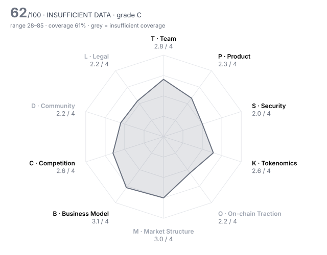

# Lighter (LIT) — DD-100 Due-Diligence Report

> **⚪ INSUFFICIENT DATA** · Grade **C** · Score **62.3/100** (range 28–85) · Evidence coverage **61%**  
> Profile `defi` · Evidence as of 2026-01-15 · 100 dimensions · 31 sources

The range is the honest number: it shows where the score could land once unscored dimensions are filled and low-confidence judgments are firmed up.

## Why this verdict

- evidence coverage 61% below the 70% needed for a verdict

## Red-flag gates

| Gate | Severity | Status | What it means |
|---|---|---|---|
| RF06 Upgradeable contracts with no meaningful timelock | major | 🚩 fired | Logic can change under users with no time to exit. |
| RF01 Unrestricted mint controlled by a single key | critical | ❔ unchecked | Supply can be inflated at will; every other number in the report is conditional on one person's restraint. |
| RF02 Sanctions / illicit-finance exposure | critical | ❔ unchecked | Listing would create direct regulatory liability for the venue. |
| RF05 Active enforcement action against the project or founders | critical | ❔ unchecked | Outcome could force delisting or freeze assets after listing. |
| RF07 Extreme holder concentration | major | ❔ unchecked | A handful of wallets can set the price; order books will not absorb their exit. |
| RF12 Anonymous team with centralised admin powers | major | ❔ unchecked | Unaccountable people holding privileged keys. |
| RF13 Undisclosed market-maker terms | major | ❔ unchecked | Token loans and call options are where post-listing dumps are engineered. |
| RF15 Mercenary TVL | minor | ❔ unchecked | Most deposits are paid to be there and will leave when incentives stop. |
| RF16 Volume implausible versus depth | minor | ❔ unchecked | Daily volume more than 100x the ±2% depth is a common wash-trading signature. |

7 of 16 gates verified clear.

## Pillar scores

| Pillar | Weight | Score /4 | | Coverage | Scored |
|---|---:|---:|---|---:|---:|
| T · Team & Governance | 12 | 2.81 | `███████░░░` | 88% | 9/10 |
| P · Product & Technology | 10 | 2.33 | `██████░░░░` | 79% | 7/10 |
| S · Security & Smart Contracts | 14 | 2.00 | `█████░░░░░` | 76% | 7/10 |
| K · Tokenomics & Supply | 14 | 2.56 | `██████░░░░` | 76% | 8/10 |
| O · On-chain Traction | 10 | 2.20 | `██████░░░░` | 29% ⚠️ | 2/10 |
| M · Market Structure & Liquidity | 8 | 3.00 | `████████░░` | 6% ⚠️ | 1/10 |
| B · Business Model & Fundamentals | 10 | 3.09 | `████████░░` | 61% | 5/10 |
| C · Competition & Moat | 8 | 2.60 | `██████░░░░` | 83% | 8/10 |
| D · Community & Distribution | 5 | 2.20 | `██████░░░░` | 38% ⚠️ | 4/10 |
| L · Legal, Compliance & Jurisdiction | 9 | 2.17 | `█████░░░░░` | 38% ⚠️ | 3/8 |

⚠️ = coverage below the pillar minimum; treat that pillar's score as indicative.

## Claims vs. observation

No contradictions found across 1 checked project claim(s).

## Strengths

- **T10 Disclosure honesty** (4/4) — contradiction_count = 0  (bands 4:≤0, 3:≤0.5, 2:≤1, 1:≤2)
- **K04 12-month unlock pressure** (4/4) — unlock_12m_pct_of_circ = 2.9  (bands 4:≤10, 3:≤25, 2:≤50, 1:≤100)
- **B01 Annualised protocol revenue** (4/4) — annualized_revenue_usd = 132,500,000  (bands 4:≥5e+07, 3:≥1e+07, 2:≥2e+06, 1:≥250,000)
- **T06 Team vesting length** (4/4) — team_vesting_months = 48  (bands 4:≥48, 3:≥36, 2:≥24, 1:≥12)
- **T09 Backer quality & cap table** (4/4) — Nov-2025 round led by Founders Fund and Ribbit with Haun and Robinhood; a16z, Dragonfly, Lightspeed, Coatue and Coinbase also listed as backers. Investor token warrants (24% of supply) make them a 2027+ supply source.
- **S03 Source verification** (4/4) — contracts_verified = true

## Risks

- **S04 Upgrade timelock** (0/4) — upgrade_timelock_hours = 0  (bands 4:≥72, 3:≥48, 2:≥24, 1:≥6)
- **S05 Admin key custody** (1/4) — Network governor and upgrade-master role sit with one EOA; the 21-day upgrade delay can be skipped entirely by a team multisig whose threshold and signers are not disclosed.
- **O06 Organic vs sybil activity** (1/4) — Volume/OI ~27 in beta and ~8 in Nov 2025 (called points farming); volume reportedly fell from $15B to $3B and farmers left after the airdrop. No sybil clustering data published.
- **L02 Securities-law risk** (1/4) — A US company issues the token, controls upgrades via an EOA governor, and markets that all value 'will fully accrue to LIT holders' with buybacks — facts that cut toward a security analysis.
- **T07 Governance design & decentralisation path** (1/4) — A US C-Corp issues LIT and runs the protocol; there is no token-holder vote, the network governor is a single EOA, and decentralisation via staking is described only as 'progressive'.
- **K05 Insider allocation** (1/4) — insider_allocation_pct = 50  (bands 4:≤25, 3:≤35, 2:≤45, 1:≤55)

## Open questions for the project team

Everything below is unscored. Each one is a question to put to the team or a data request, not a negative finding.

**Needs a private channel (call, data room, counsel)** (3)

- T02 Identity verification level: Are the key people identified to the reviewer (KYC) and, ideally, publicly? — _requires private channel; Human-only: KYC of Vladimir Novakovski and core team._
- M05 Market-maker arrangements: Are MM agreements (loans, call options, KPIs) disclosed to the reviewer and reasonable? — _requires private channel; Human-only: market-maker terms. Reports say Jump Crypto got >$24M of LIT for market making (LIT-08); size, loan/option terms and lock-ups must come from the project._
- L07 Legal opinion: Has the project provided a token legal opinion from reputable counsel? — _requires private channel; Human-only: legal opinion on LIT — critical here because a US C-Corp issues the token and says all value accrues to holders (LIT-01)._

**Needs evidence** (41)

- P06 Development activity (90d commits): How much code is being shipped in public repositories? — _metric 'github_commits_90d' not in evidence pack; GitHub activity not measured (GitHub org listing blocked from this environment); lighter-prover repo published 26 Dec 2025 (LIT-26)._
- P07 Contributor breadth (90d): How many distinct developers are actively contributing? — _metric 'github_active_contributors_90d' not in evidence pack_
- P10 Documentation quality: Could an integrator or auditor understand the system from the docs alone? — _missing: dated review of docs.lighter.xyz (technical specs, API, risk docs) as of Jan 2026_
- S06 Mint / freeze / blacklist powers: Can any party mint, freeze, seize or blacklist, and is that power bounded? — _missing: LIT token contract roles (owner/minter, mint function) and any L2-side mint/freeze powers; Etherscan not reachable; mint_authority (gate RF01) NOT established. LIT ERC-20 is 0x232ce3bd40fcd6f80f3d55a522d03f25df784ee2 (LIT-27), total supply 1B, but its source/roles could not be read: Etherscan and RPC endpoints were not reachable from this review environment. Needs: read owner/minter roles and any mint function on the token contract and on the L2 asset config._
- S07 Bug bounty: What is the maximum bug bounty payout on an established platform? — _metric 'bug_bounty_max_usd' not in evidence pack; Bug bounty programme not found in dated sources._
- S09 Oracle & manipulation resistance: Can prices or state be manipulated to drain funds (flash loans, thin oracles)? — _missing: dated description of the index/mark-price oracle, its fallbacks and whether signatures are verified on-chain_
- K03 Holder concentration: Share of supply held by the top 10 wallets, excluding exchanges, burn and protocol contracts — _metric 'top10_holder_pct_ex_contracts' not in evidence pack; Top-holder concentration not established: holder lists as of 15 Jan were not available without using post-listing explorer data. Needs labelled top-20 on Ethereum and on Lighter L2, incl. the LP-linked 5-wallet cluster (~10M LIT, LIT-09) and the market maker's allocation (LIT-08)._
- K08 Annual inflation: Net annual emission rate after burns — _metric 'annual_inflation_pct' not in evidence pack; annual_inflation_pct not set: the ~25% ecosystem reserve (250M LIT, equal to all circulating supply) has no published emission schedule._
- O01 Daily active addresses (30d avg): How many unique addresses interact with the protocol daily? — _metric 'daa_30d_avg' not in evidence pack; Daily active addresses, retention and fee-paying users not found in dated sources._
- O02 Activity trend (90d): Percentage change in daily active addresses over 90 days — _metric 'daa_90d_change_pct' not in evidence pack_
- O03 30-day user retention: Share of a new-user cohort still active after 30 days — _metric 'retention_30d_pct' not in evidence pack_
- O05 Incentive-driven TVL share: Share of TVL attributable to active token incentives (mercenary capital) — _metric 'incentivised_tvl_share_pct' not in evidence pack; Share of TVL earning points not published; LLP deposits earned points through the airdrop seasons (LIT-09)._
- O07 Fee-paying users (30d): Unique addresses that paid fees in the last 30 days — _metric 'fee_paying_users_30d' not in evidence pack_
- O08 Integrations: Number of live third-party integrations (wallets, protocols, aggregators) — _metric 'live_integrations_count' not in evidence pack_
- O09 Builder ecosystem: Are independent teams building on or around the protocol? — _missing: count of third-party builders/integrations (SDK users, front-ends, vault operators) as of Jan 2026_
- O10 Net capital flows (90d): Net inflow of external capital (stablecoins/majors) into the protocol over 90 days, USD — _metric 'net_inflow_90d_usd' not in evidence pack_
- M01 Order-book depth (±2%): Aggregate USD depth within 2% of mid across major venues — _metric 'depth_2pct_usd' not in evidence pack; LIT order-book depth, spread and 24h token volume as of 15 Jan were not found in any dated source; live pages were not used. Pre-listing, LIT traded mainly on Lighter's own spot book and as pre-market/IOU products elsewhere (LIT-16)._
- M02 Venue concentration: Share of volume on the single largest venue — _metric 'top_venue_volume_share_pct' not in evidence pack; Venue split as of 15 Jan not found._
- M03 Wash-trading indicators: Do volume, depth and trade-size patterns suggest fabricated volume? — _missing: dated LIT spot volume, depth and trade-size data across venues at listing_
- M04 Bid-ask spread: Volume-weighted average spread in basis points — _metric 'spread_bps' not in evidence pack_
- M06 Existing venue quality: Where does the token already trade, and what does that say about prior diligence? — _missing: dated list of LIT spot venues before 15 Jan; LIT was not withdrawable on 2 Jan, so off-platform listings may have been IOUs_
- M07 Derivatives structure: Do perp open interest and funding indicate healthy two-way markets or crowded positioning? — _missing: LIT perp OI and funding history; only pre-market prices and a 54% short skew among top accounts are known_
- M08 Realised volatility (30d): Annualised 30-day realised volatility — _metric 'realized_vol_30d_pct' not in evidence pack_
- M09 DEX liquidity ownership: Is on-chain liquidity protocol-owned/locked or mercenary and removable overnight? — _missing: who supplies liquidity on Lighter's LIT spot book and the size of the market-maker allocation_
- B05 Incentive spend vs revenue: USD value of token incentives divided by protocol revenue (90d) — _metric 'incentives_to_revenue' not in evidence pack; incentives_to_revenue not set: the $675M airdrop (LIT-10) paid for ~12 months of points seasons against ~$105–200M annualised revenue, but the season windows and revenue for the same period could not be matched._
- B06 Treasury runway: Months of runway at current burn, counting non-native assets at full value and native token at 50% — _metric 'runway_months' not in evidence pack; Company treasury/runway not public; $68M raised Nov 2025 (LIT-14)._
- B07 Treasury diversification: Share of treasury held in assets other than the native token — _metric 'treasury_non_native_pct' not in evidence pack_
- B08 Revenue growth (90d): Quarter-on-quarter change in protocol revenue — _metric 'revenue_qoq_growth_pct' not in evidence pack_
- B09 Counterparty concentration: Does a single client, partner or whale drive most of the usage or revenue? — _missing: revenue split by account; premium/API fee payers are likely concentrated but no data published_
- C07 Relative valuation: Is the valuation reasonable against peers on comparable metrics? — _missing: peer FDV and fees on the same date (Hyperliquid, Aster) to compare with LIT's ~15.6× FDV/fees_
- C09 Partnership substance: Are announced partnerships live integrations with measurable usage, or press releases? — _missing: live partner integrations with observable flows; announced relationships are investors, not integrations_
- D01 Organic audience: Size and quality of the audience across X, Telegram, Discord and regional channels — _missing: dated social audience and engagement data_
- D02 Engagement authenticity: What share of engagement appears bot-driven or paid? — _missing: bot-likelihood / engagement-quality analysis_
- D03 Token holder count: Number of addresses holding a non-dust balance — _metric 'holders_count' not in evidence pack_
- D04 Geographic & user diversity: Is the user base spread across regions, or concentrated where the venue cannot serve it? — _missing: user geography and whether US persons can trade perps_
- D06 Developer community: Grants, hackathons and external contributors beyond the core team — _missing: grants, hackathons and external contributors_
- D07 Governance participation: Average share of circulating supply voting on recent proposals — _metric 'governance_participation_pct' not in evidence pack_
- L03 Sanctions & AML exposure: Has screening found exposure to sanctioned addresses, mixers or illicit flows above tolerance? — _metric 'sanctions_exposure' not in evidence pack; sanctions_exposure NOT established. No public wallet screening. Needs the venue's own Chainalysis/TRM screening of treasury Account #0, team, deployer, the market-maker and LLP-linked wallets named in LIT-08/LIT-09._
- L04 Licensing for regulated activity: If the project performs regulated activity (custody, exchange, payments, issuance), is it licensed? — _missing: whether US persons are blocked from perps and any CFTC/other registration for a US-issuer-operated derivatives venue_
- L05 Litigation & enforcement: Any pending lawsuits, regulator actions or subpoenas? — _missing: search of SEC/CFTC/state regulator and court records; press coverage to 14 Jan reports none; active_enforcement_action NOT established. Press coverage from 30 Dec 2025 to 14 Jan 2026 (LIT-01, LIT-06, LIT-07, LIT-08, LIT-09) reports no regulatory action, but SEC/CFTC/state regulator and court databases were not searched (web search budget exhausted). Lighter's US C-Corp issues the token and operates a perp venue, so this check matters more than usual._
- L10 Restricted-jurisdiction controls: Does the project geofence and enforce restrictions consistent with its legal analysis? — _missing: geofencing terms and enforcement across front end, API and airdrop_

## Appendix A — all 100 dimensions

### T · Team & Governance

| ID | Dimension | Method | W | Score | Conf. | Evidence | Basis |
|---|---|---|---:|---:|---|---|---|
| T01 | Founder track record | agent | 3 | **3** | medium | LIT-16, LIT-15, LIT-06 | Founder's career (Citadel, Head of ML at Quora, VP Eng at Addepar, prior AI start-up) is documented, and Lighter led perp-DEX monthly volume within ~3 months of public mainnet; the founder's earlier company outcome is not documented. |
| T02 | Identity verification level | human | 3 | ⏳ |  |  | requires private channel; Human-only: KYC of Vladimir Novakovski and core team. |
| T03 | Team depth & key-person risk | agent | 2 | **2** | low | LIT-16 | A ~28-engineer team is reported only in a write-up the team reviewed; public communication centres on the CEO and no ops/security leads or succession are documented. |
| T04 | Technical leadership | agent | 2 | **3** | high | LIT-20, LIT-21, LIT-26 | In-house team designed custom ZK circuits for verifiable matching, reviewed by zkSecurity since 2024, and published the prover code in Dec 2025; no specs or research papers of its own. |
| T05 | Controversies & misconduct history | agent | 3 | **2** | medium | LIT-08, LIT-09 | Open allegations at TGE: an LLP-linked 5-wallet cluster received ~10M LIT and sold ~2.76M, and a market maker reportedly got >$24M of LIT; the CEO said the wallets were a third-party LP with no undisclosed ties. No enforcement found in coverage. |
| T06 | Team vesting length | rule | 2 | **4** | medium | LIT-02 | team_vesting_months = 48  (bands 4:≥48, 3:≥36, 2:≥24, 1:≥12) |
| T07 | Governance design & decentralisation path | agent | 2 | **1** | high | LIT-01, LIT-24 | A US C-Corp issues LIT and runs the protocol; there is no token-holder vote, the network governor is a single EOA, and decentralisation via staking is described only as 'progressive'. |
| T08 | Treasury transparency | agent | 2 | **2** | medium | LIT-06, LIT-01 | Treasury Account #0 is public on the explorer (180,588 LIT on 5 Jan), but no buyback amounts, reports, or custody details for the 250M-LIT ecosystem reserve are published. |
| T09 | Backer quality & cap table | agent | 2 | **4** | medium | LIT-14, LIT-16 | Nov-2025 round led by Founders Fund and Ribbit with Haun and Robinhood; a16z, Dragonfly, Lightspeed, Coatue and Coinbase also listed as backers. Investor token warrants (24% of supply) make them a 2027+ supply source. |
| T10 | Disclosure honesty | rule | 3 | **4** | high | HARNESS | contradiction_count = 0  (bands 4:≤0, 3:≤0.5, 2:≤1, 1:≤2) |

### P · Product & Technology

| ID | Dimension | Method | W | Score | Conf. | Evidence | Basis |
|---|---|---|---:|---:|---|---|---|
| P01 | Problem clarity & real demand | agent | 3 | **3** | medium | LIT-16, LIT-17, LIT-18 | Premium (low-latency) accounts pay real fees, ~$105–200M annualised; but retail volume is free and was largely farmed for points, so demand outside incentives is unproven. |
| P02 | Product maturity | agent | 3 | **2** | high | LIT-12, LIT-06, LIT-25 | Public mainnet since early Oct 2025 (~3.5 months at listing) after a 2025 private beta; spot trading and staking added Dec 2025–Jan 2026. |
| P03 | Technical originality | agent | 2 | **3** | high | LIT-20, LIT-21, LIT-22 | Original design: an app-specific Ethereum ZK-rollup whose custom Plonky2 circuits prove order matching and liquidations, not a fork; no peer-reviewed research. |
| P04 | Architecture soundness | agent | 2 | **2** | high | LIT-12, LIT-11 | Sequencer database failed for ~4.5h in the 10 Oct 2025 crash (known weak point, upgrade postponed), and the prover lagged the sequencer on 30 Dec, delaying withdrawals. |
| P05 | Dependency risk | agent | 2 | **2** | medium | LIT-24, LIT-11, LIT-23 | Single operator runs sequencer and prover; Ethereum is the settlement/DA layer with a 14-day desert-mode fallback; fast exits route via Arbitrum. Oracle sources were not documented in dated sources. |
| P06 | Development activity (90d commits) | rule | 2 | – |  |  | metric 'github_commits_90d' not in evidence pack; GitHub activity not measured (GitHub org listing blocked from this environment); lighter-prover repo published 26 Dec 2025 (LIT-26). |
| P07 | Contributor breadth (90d) | rule | 1 | – |  |  | metric 'github_active_contributors_90d' not in evidence pack |
| P08 | Roadmap delivery record | agent | 2 | **2** | medium | LIT-24, LIT-26, LIT-25 | Circuit open-sourcing promised in '1–2 weeks' on 8 Oct 2025 arrived 26 Dec; desert-mode circuits still not public on 5 Jan 2026. Spot, token and staking did ship. |
| P09 | Open source & reproducibility | agent | 1 | **2** | high | LIT-24, LIT-25, LIT-26 | L1 contracts are verified and perp/spot circuits are public, but desert circuits are closed and L2BEAT had not reproduced the deployed verifiers; the matching engine is off-chain and closed. |
| P10 | Documentation quality | agent | 1 | – |  |  | missing: dated review of docs.lighter.xyz (technical specs, API, risk docs) as of Jan 2026 |

### S · Security & Smart Contracts

| ID | Dimension | Method | W | Score | Conf. | Evidence | Basis |
|---|---|---|---:|---:|---|---|---|
| S01 | Audit coverage | rule | 3 | **2** | high | LIT-21 | audits_reputable_count = 1  (bands 4:≥3, 3:≥2, 2:≥1, 1:≥0.5) |
| S02 | Audit remediation | agent | 3 | **2** | high | LIT-21, LIT-22, LIT-23, LIT-25 | All six high findings across three 2025 zkSecurity circuit audits were fixed (one low left open), but no audit of the L1 contracts or token was found and the deployed verifiers were not independently matched to source. |
| S03 | Source verification | rule | 2 | **4** | medium | LIT-24 | contracts_verified = true |
| S04 | Upgrade timelock | rule | 3 | **0** | medium | LIT-24 | upgrade_timelock_hours = 0  (bands 4:≥72, 3:≥48, 2:≥24, 1:≥6) |
| S05 | Admin key custody | agent | 3 | **1** | medium | LIT-24, LIT-25 | Network governor and upgrade-master role sit with one EOA; the 21-day upgrade delay can be skipped entirely by a team multisig whose threshold and signers are not disclosed. |
| S06 | Mint / freeze / blacklist powers | agent | 3 | – |  |  | missing: LIT token contract roles (owner/minter, mint function) and any L2-side mint/freeze powers; Etherscan not reachable; mint_authority (gate RF01) NOT established. LIT ERC-20 is 0x232ce3bd40fcd6f80f3d55a522d03f25df784ee2 (LIT-27), total supply 1B, but its source/roles could not be read: Etherscan and RPC endpoints were not reachable from this review environment. Needs: read owner/minter roles and any mint function on the token contract and on the L2 asset config. |
| S07 | Bug bounty | rule | 1 | – |  |  | metric 'bug_bounty_max_usd' not in evidence pack; Bug bounty programme not found in dated sources. |
| S08 | Incident history & response | agent | 3 | **3** | medium | LIT-12, LIT-13, LIT-11, LIT-29 | No exploit; the Oct 2025 outage (LLP also lost money) got a public loss breakdown and stablecoin+points compensation within days. Dec 2025 withdrawal delays were acknowledged only on Discord. |
| S09 | Oracle & manipulation resistance | agent | 2 | – |  |  | missing: dated description of the index/mark-price oracle, its fallbacks and whether signatures are verified on-chain |
| S10 | Bridge & cross-chain exposure | agent | 2 | **3** | medium | LIT-24, LIT-23, LIT-09 | Funds sit in a validity-proved Ethereum rollup with an audited desert-mode exit, not a multisig bridge; ~$52M of exits went via Arbitrum, and the instant-upgrade path (S05) can override the exit. |

### K · Tokenomics & Supply

| ID | Dimension | Method | W | Score | Conf. | Evidence | Basis |
|---|---|---|---:|---:|---|---|---|
| K01 | Token utility & value accrual | agent | 3 | **3** | medium | LIT-01, LIT-06, LIT-07 | Team says all product value accrues to LIT; treasury LIT balance rose (implied buybacks) and LIT staking became mandatory for LLP access on 14 Jan. Buyback size and rules are discretionary and unpublished. |
| K02 | Circulating ratio | rule | 2 | **2** | high | HARNESS | circulating_supply_pct = 25  (bands 4:≥60, 3:≥40, 2:≥25, 1:≥15) |
| K03 | Holder concentration | rule | 3 | – |  |  | metric 'top10_holder_pct_ex_contracts' not in evidence pack; Top-holder concentration not established: holder lists as of 15 Jan were not available without using post-listing explorer data. Needs labelled top-20 on Ethereum and on Lighter L2, incl. the LP-linked 5-wallet cluster (~10M LIT, LIT-09) and the market maker's allocation (LIT-08). |
| K04 | 12-month unlock pressure | rule | 3 | **4** | medium | LIT-02 | unlock_12m_pct_of_circ = 2.9  (bands 4:≤10, 3:≤25, 2:≤50, 1:≤100) |
| K05 | Insider allocation | rule | 2 | **1** | medium | LIT-01 | insider_allocation_pct = 50  (bands 4:≤25, 3:≤35, 2:≤45, 1:≤55) |
| K06 | Investor cost-basis overhang | rule | 2 | **4** | medium | LIT-14 | price_to_last_round_multiple = 1.4  (bands 4:≤3, 3:≤10, 2:≤30, 1:≤100) |
| K07 | FDV / market cap | rule | 2 | **2** | high | HARNESS | fdv_to_mcap = 4  (bands 4:≤1.5, 3:≤2.5, 2:≤4, 1:≤7) |
| K08 | Annual inflation | rule | 2 | – |  |  | metric 'annual_inflation_pct' not in evidence pack; annual_inflation_pct not set: the ~25% ecosystem reserve (250M LIT, equal to all circulating supply) has no published emission schedule. |
| K09 | Supply verifiability | agent | 1 | **1** | medium | LIT-01, LIT-16, LIT-06 | Total supply is on-chain, but no vesting-contract addresses for the 50% team/investor share or the ecosystem reserve were published, and LIT was not yet withdrawable from Lighter on 2 Jan. |
| K10 | Airdrop & incentive design | agent | 1 | **1** | medium | LIT-18, LIT-19, LIT-09, LIT-10, LIT-28 | Points rewarded volume that analysts tie to farming (volume/OI ~27 in beta); ~$250M left in 24h after the drop and farmers were moving on by 12 Jan; ~75% of addresses still held on day 1 (unnamed analysts). |

### O · On-chain Traction

| ID | Dimension | Method | W | Score | Conf. | Evidence | Basis |
|---|---|---|---:|---:|---|---|---|
| O01 | Daily active addresses (30d avg) | rule | 2 | – |  |  | metric 'daa_30d_avg' not in evidence pack; Daily active addresses, retention and fee-paying users not found in dated sources. |
| O02 | Activity trend (90d) | rule | 2 | – |  |  | metric 'daa_90d_change_pct' not in evidence pack |
| O03 | 30-day user retention | rule | 2 | – |  |  | metric 'retention_30d_pct' not in evidence pack |
| O04 | TVL / AUM | rule | 2 | **4** | medium | LIT-08 | tvl_usd = 1,300,000,000  (bands 4:≥1e+09, 3:≥2e+08, 2:≥5e+07, 1:≥1e+07) |
| O05 | Incentive-driven TVL share | rule | 2 | – |  |  | metric 'incentivised_tvl_share_pct' not in evidence pack; Share of TVL earning points not published; LLP deposits earned points through the airdrop seasons (LIT-09). |
| O06 | Organic vs sybil activity | agent | 3 | **1** | medium | LIT-19, LIT-29, LIT-18, LIT-09, LIT-28 | Volume/OI ~27 in beta and ~8 in Nov 2025 (called points farming); volume reportedly fell from $15B to $3B and farmers left after the airdrop. No sybil clustering data published. |
| O07 | Fee-paying users (30d) | rule | 1 | – |  |  | metric 'fee_paying_users_30d' not in evidence pack |
| O08 | Integrations | rule | 1 | – |  |  | metric 'live_integrations_count' not in evidence pack |
| O09 | Builder ecosystem | agent | 1 | – |  |  | missing: count of third-party builders/integrations (SDK users, front-ends, vault operators) as of Jan 2026 |
| O10 | Net capital flows (90d) | rule | 1 | – |  |  | metric 'net_inflow_90d_usd' not in evidence pack |

### M · Market Structure & Liquidity

| ID | Dimension | Method | W | Score | Conf. | Evidence | Basis |
|---|---|---|---:|---:|---|---|---|
| M01 | Order-book depth (±2%) | rule | 3 | – |  |  | metric 'depth_2pct_usd' not in evidence pack; LIT order-book depth, spread and 24h token volume as of 15 Jan were not found in any dated source; live pages were not used. Pre-listing, LIT traded mainly on Lighter's own spot book and as pre-market/IOU products elsewhere (LIT-16). |
| M02 | Venue concentration | rule | 2 | – |  |  | metric 'top_venue_volume_share_pct' not in evidence pack; Venue split as of 15 Jan not found. |
| M03 | Wash-trading indicators | agent | 3 | – |  |  | missing: dated LIT spot volume, depth and trade-size data across venues at listing |
| M04 | Bid-ask spread | rule | 2 | – |  |  | metric 'spread_bps' not in evidence pack |
| M05 | Market-maker arrangements | human | 2 | ⏳ |  |  | requires private channel; Human-only: market-maker terms. Reports say Jump Crypto got >$24M of LIT for market making (LIT-08); size, loan/option terms and lock-ups must come from the project. |
| M06 | Existing venue quality | agent | 1 | – |  |  | missing: dated list of LIT spot venues before 15 Jan; LIT was not withdrawable on 2 Jan, so off-platform listings may have been IOUs |
| M07 | Derivatives structure | agent | 1 | – |  |  | missing: LIT perp OI and funding history; only pre-market prices and a 54% short skew among top accounts are known |
| M08 | Realised volatility (30d) | rule | 1 | – |  |  | metric 'realized_vol_30d_pct' not in evidence pack |
| M09 | DEX liquidity ownership | agent | 1 | – |  |  | missing: who supplies liquidity on Lighter's LIT spot book and the size of the market-maker allocation |
| M10 | Narrative & timing fit | agent | 1 | **3** | medium | LIT-14, LIT-06, LIT-18, LIT-28 | On-chain perps hit a record $1.2T in Oct 2025 and Lighter led monthly volume in Nov–Dec; but LIT fell ~30% in the week to 12 Jan as farmers moved to newer perp DEXs. |

### B · Business Model & Fundamentals

| ID | Dimension | Method | W | Score | Conf. | Evidence | Basis |
|---|---|---|---:|---:|---|---|---|
| B01 | Annualised protocol revenue | rule | 3 | **4** | medium | LIT-16 | annualized_revenue_usd = 132,500,000  (bands 4:≥5e+07, 3:≥1e+07, 2:≥2e+06, 1:≥250,000) |
| B02 | Revenue quality | agent | 2 | **2** | medium | LIT-16, LIT-18 | Revenue comes from premium accounts (market makers/HFT) paying for latency, not retail; organic, but concentrated in a professional segment and tied to volume cycles. |
| B03 | Holder value capture | agent | 2 | **3** | medium | LIT-06, LIT-31, LIT-30, LIT-01 | Treasury Account #0 visibly bought ~180k LIT with USDC around 5–6 Jan, but the buyback was not formally confirmed, and the share of revenue used and the schedule are undisclosed. |
| B04 | Valuation vs fees (FDV / annualised fees) | rule | 2 | **4** | high | HARNESS | fdv_to_annual_fees = 15.6  (bands 4:≤20, 3:≤50, 2:≤150, 1:≤500) |
| B05 | Incentive spend vs revenue | rule | 2 | – |  |  | metric 'incentives_to_revenue' not in evidence pack; incentives_to_revenue not set: the $675M airdrop (LIT-10) paid for ~12 months of points seasons against ~$105–200M annualised revenue, but the season windows and revenue for the same period could not be matched. |
| B06 | Treasury runway | rule | 2 | – |  |  | metric 'runway_months' not in evidence pack; Company treasury/runway not public; $68M raised Nov 2025 (LIT-14). |
| B07 | Treasury diversification | rule | 1 | – |  |  | metric 'treasury_non_native_pct' not in evidence pack |
| B08 | Revenue growth (90d) | rule | 1 | – |  |  | metric 'revenue_qoq_growth_pct' not in evidence pack |
| B09 | Counterparty concentration | agent | 1 | – |  |  | missing: revenue split by account; premium/API fee payers are likely concentrated but no data published |
| B10 | Sustainability without emissions | agent | 2 | **2** | medium | LIT-16, LIT-09, LIT-18 | Professional fee revenue (~$105–200M annualised) would remain, but much retail volume was points-driven and reportedly fell ~5× from the November peak around the airdrop. |

### C · Competition & Moat

| ID | Dimension | Method | W | Score | Conf. | Evidence | Basis |
|---|---|---|---:|---:|---|---|---|
| C01 | Segment size & growth | agent | 2 | **4** | medium | LIT-14, LIT-18 | Perps are most of crypto trading volume; on-chain perps hit a record $1.2T in Oct 2025 and rose to >56% of DEX volume. |
| C02 | Category market share | rule | 2 | **3** | medium | LIT-18 | category_share_pct = 20  (bands 4:≥30, 3:≥15, 2:≥5, 1:≥1) |
| C03 | Share trajectory | agent | 2 | **2** | medium | LIT-29, LIT-18, LIT-10, LIT-28 | Volume share went from launch to 27.7% (Nov) and ~20% (end-2025), but OI share was only 12.5%, the gain was paid for with a $675M points airdrop, and farmers were leaving by mid-January. |
| C04 | Moat | agent | 3 | **2** | medium | LIT-18, LIT-16 | Zero retail fees and ZK-verified matching are the moat; OI (~$1.4B vs Hyperliquid ~$8B) shows positions and liquidity did not follow volume, and retention after incentives is untested. |
| C05 | Forkability | agent | 2 | **2** | medium | LIT-26, LIT-18 | Circuits are now open source and zero fees are easy to copy; liquidity and the LLP are the sticky parts. |
| C06 | Differentiation vs top-3 peers | agent | 2 | **3** | medium | LIT-16, LIT-24, LIT-23 | Versus Hyperliquid and Aster: free retail trading plus Ethereum settlement with ZK-proved execution and a proof-based escape hatch; the fee edge is copyable, the verifiability less so. |
| C07 | Relative valuation | agent | 2 | – |  |  | missing: peer FDV and fees on the same date (Hyperliquid, Aster) to compare with LIT's ~15.6× FDV/fees |
| C08 | Platform & incumbent threat | agent | 1 | **2** | low | LIT-14, LIT-16 | CEX perps dwarf DEX perps and Robinhood/Coinbase (both reported backers) could offer similar products; no competing native feature announced against Lighter specifically. |
| C09 | Partnership substance | agent | 1 | – |  |  | missing: live partner integrations with observable flows; announced relationships are investors, not integrations |
| C10 | Exchange-level strategic fit | agent | 1 | **3** | low | LIT-05, LIT-01, LIT-16 | Adds a US-issued, Ethereum-settled perp-DEX token to Coinbase's Ethereum/Base focus; Coinbase is reported as a backer, a conflict the listing committee should record. |

### D · Community & Distribution

| ID | Dimension | Method | W | Score | Conf. | Evidence | Basis |
|---|---|---|---:|---:|---|---|---|
| D01 | Organic audience | agent | 1 | – |  |  | missing: dated social audience and engagement data |
| D02 | Engagement authenticity | agent | 2 | – |  |  | missing: bot-likelihood / engagement-quality analysis |
| D03 | Token holder count | rule | 2 | – |  |  | metric 'holders_count' not in evidence pack |
| D04 | Geographic & user diversity | agent | 1 | – |  |  | missing: user geography and whether US persons can trade perps |
| D05 | Paid-promotion dependence | agent | 2 | **2** | low | LIT-18, LIT-16 | Attention was driven by a disclosed points programme; team says it does not pay for listings; no undisclosed KOL payments found. |
| D06 | Developer community | agent | 1 | – |  |  | missing: grants, hackathons and external contributors |
| D07 | Governance participation | rule | 1 | – |  |  | metric 'governance_participation_pct' not in evidence pack |
| D08 | Communication transparency | agent | 1 | **2** | medium | LIT-12, LIT-11, LIT-06, LIT-08 | Detailed loss data and compensation after the Oct outage; but Discord-only response to Dec withdrawal delays, unconfirmed buybacks, and limited upfront disclosure of the market-maker allocation. |
| D09 | Sentiment & controversy | agent | 1 | **2** | medium | LIT-08, LIT-09, LIT-28, LIT-16 | Bullish theses coexist with specific unresolved criticism: insider/LP airdrop allocation, market-maker deal, farmer exodus and a ~30% weekly price drop. |
| D10 | Ecosystem credibility | agent | 1 | **3** | medium | LIT-14, LIT-20, LIT-24 | Top-tier investors and Robinhood backed it, zkSecurity audits it and L2BEAT tracks it; few independent protocol integrations documented. |

### L · Legal, Compliance & Jurisdiction

| ID | Dimension | Method | W | Score | Conf. | Evidence | Basis |
|---|---|---|---:|---:|---|---|---|
| L01 | Legal entity & jurisdiction | agent | 2 | **3** | medium | LIT-01, LIT-02 | Token issued by Lighter's US C-Corp, which operates the protocol; entity name and registry record not checked. |
| L02 | Securities-law risk | agent | 3 | **1** | medium | LIT-01, LIT-06, LIT-24 | A US company issues the token, controls upgrades via an EOA governor, and markets that all value 'will fully accrue to LIT holders' with buybacks — facts that cut toward a security analysis. |
| L03 | Sanctions & AML exposure | rule | 3 | – |  |  | metric 'sanctions_exposure' not in evidence pack; sanctions_exposure NOT established. No public wallet screening. Needs the venue's own Chainalysis/TRM screening of treasury Account #0, team, deployer, the market-maker and LLP-linked wallets named in LIT-08/LIT-09. |
| L04 | Licensing for regulated activity | agent | 2 | – |  |  | missing: whether US persons are blocked from perps and any CFTC/other registration for a US-issuer-operated derivatives venue |
| L05 | Litigation & enforcement | agent | 3 | – |  |  | missing: search of SEC/CFTC/state regulator and court records; press coverage to 14 Jan reports none; active_enforcement_action NOT established. Press coverage from 30 Dec 2025 to 14 Jan 2026 (LIT-01, LIT-06, LIT-07, LIT-08, LIT-09) reports no regulatory action, but SEC/CFTC/state regulator and court databases were not searched (web search budget exhausted). Lighter's US C-Corp issues the token and operates a perp venue, so this check matters more than usual. |
| L06 | Privacy & obfuscation features | agent | 1 | **4** | medium | LIT-24, LIT-23 | No privacy features: ZK proofs are used for validity, state diffs are posted to Ethereum and accounts map to L1 addresses. |
| L07 | Legal opinion | human | 1 | ⏳ |  |  | requires private channel; Human-only: legal opinion on LIT — critical here because a US C-Corp issues the token and says all value accrues to holders (LIT-01). |
| L08 | RWA custody & bankruptcy remoteness | agent | 3 | n/a |  |  | not applicable to profile 'defi' |
| L09 | RWA attestation frequency | agent | 2 | n/a |  |  | not applicable to profile 'defi' |
| L10 | Restricted-jurisdiction controls | agent | 1 | – |  |  | missing: geofencing terms and enforcement across front end, API and airdrop |

## Appendix B — sources

| ID | Tier | Type | Title |
|---|---|---|---|
| LIT-01 | 2 · independent | news | [The Block — Lighter launches native token LIT, allocates half to ecosystem growth (published 30 Dec 2025)](https://www.theblock.co/post/383940/lighter-native-token-lit) |
| LIT-02 | 2 · independent | tokenomics | [Whale Alert — Lighter launches LIT token: 25% airdropped, 50% team/investors with 1-year lock and 3-year vesting (30 Dec 2025)](https://whale-alert.io/stories/c2736d8500c1/Lighter-launches-LIT-token-as-native-asset-for-its-zk-rollup-DEX-25-of-supply-airdropped-50-reserved-for-team-investors-with-1year-lock-and-3year-vesting) |
| LIT-03 | 2 · independent | news | [Foresight News (via MEXC) — With Lighter TGE imminent, market expects FDV above $2B? (30 Dec 2025)](https://www.mexc.com/news/371545) |
| LIT-04 | 2 · independent | news | [CoinDesk (via MEXC) — Traders split over whether Lighter's LIT clears $3B FDV after launch (30 Dec 2025)](https://www.mexc.com/news/374140) |
| LIT-05 | 2 · independent | news | [MEXC News — Coinbase lists Lighter token as LIT nears $3 on launch day (30 Dec 2025)](https://www.mexc.com/news/377021) |
| LIT-06 | 2 · independent | news | [The Block — Lighter's LIT token rises 14% as protocol indicates active buyback (5 Jan 2026)](https://www.theblock.co/post/384399/lighter-lit-buyback) |
| LIT-07 | 2 · independent | news | [The Block — Lighter introduces mandatory LIT staking for liquidity pool access (14 Jan 2026, 21:52 EST)](https://www.theblock.co/post/385696/lighter-lit-staking) |
| LIT-14 | 2 · independent | news | [The Block — Lighter raises $68 million at a $1.5 billion valuation (11 Nov 2025)](https://www.theblock.co/post/378358/lighter-raises-68-million-1-5-billion-valuation-vc-bets-flood-perp-dex-infrastructure-report) |
| LIT-16 | 2 · independent | research | [0xJermo (Substack) — The thesis: Lighter (2 Jan 2026; author holds LIT, team gave feedback)](https://0xjermo.substack.com/p/the-thesis-lighter) |
| LIT-17 | 2 · independent | research | [OneKey blog — Lighter's TGE is imminent: what valuation counts as reasonable? (22 Dec 2025)](https://onekey.so/blog/ecosystem/lighters-tge-is-imminent-what-valuation-counts-as-reasonable) |
| LIT-27 | 2 · independent | onchain | [Bitquery DEXrabbit — LIT (Lighter) token on Ethereum](https://dexrabbit.bitquery.io/eth/token/0x232ce3bd40fcd6f80f3d55a522d03f25df784ee2) |
| LIT-12 | 2 · independent | news | [Crypto Times — Lighter Ethereum L2 goes offline for 5 hours amid volatile trading (13 Oct 2025)](https://www.cryptotimes.io/2025/10/13/lighter-ethereum-l2-goes-offline-for-5-hours-amid-volatile-trading/) |
| LIT-13 | 2 · independent | news | [The Defiant — Lighter distributes points to users affected by platform outage (17 Oct 2025)](https://thedefiant.io/news/defi/lighter-distributes-points-to-users-affected-by-platform-outage) |
| LIT-11 | 2 · independent | news | [CoinAlertNews — Lighter users face withdrawal disruptions on Arbitrum amid team silence (31 Dec 2025)](https://coinalertnews.com/news/2025/12/31/0d34a889) |
| LIT-20 | 1 · primary | audit | [zkSecurity — Lighter ZK circuits review (blog, 24 Apr 2024)](https://blog.zksecurity.xyz/posts/lighter-xyz/) |
| LIT-21 | 1 · primary | audit | [zkSecurity — Audit of Lighter's block circuits (Plonky2), engagement from 4 Aug 2025](https://reports.zksecurity.xyz/reports/zklighter-block.md) |
| LIT-22 | 1 · primary | audit | [zkSecurity — Lighter audit #3 (circuits, 8 Sep 2025)](https://reports.zksecurity.xyz/reports/lighter-3) |
| LIT-23 | 1 · primary | audit | [zkSecurity — Audit of Lighter's exit hatch (desert exit circuit), 5 Nov 2025](https://reports.zksecurity.xyz/reports/zklighter-desertexit.md) |
| LIT-24 | 2 · independent | onchain | [L2BEAT config diff PR 9796 — Lighter contracts discovery (note dated 8 Oct 2025)](https://config-diff.l2beat.com/pr-9796) |
| LIT-25 | 2 · independent | onchain | [L2BEAT config diff PR 10541 — Lighter ZK catalog (note dated 5 Jan 2026)](https://config-diff.l2beat.com/pr-10541) |
| LIT-26 | 2 · independent | news | [Blockonomi — Lighter open-sources zero-knowledge proof circuits following security audits (26 Dec 2025)](https://blockonomi.com/lighter-open-sources-zero-knowledge-proof-circuits-following-security-audits/) |
| LIT-19 | 2 · independent | research | [K33 Research — Lighter: revolutionary perp DEX or points pump? (22 Apr 2025)](https://k33.com/research/articles/lighter-revolutionary-perp-dex-or-points-pump) |
| LIT-08 | 2 · independent | news | [Coin360 — Lighter LIT token launch: airdrop and market-maker controversy (2 Jan 2026)](https://coin360.com/news/lighter-lit-token-launch-airdrop-market-maker-controversy) |
| LIT-09 | 2 · independent | news | [CoinGape — Lighter team under fire after alleged $7.18M LIT dump post-airdrop (1 Jan 2026)](https://coingape.com/lighter-team-under-fire-after-alleged-7-18m-lit-token-dump-post-airdrop/) |
| LIT-10 | 2 · independent | news | [CoinAcademy — $250M withdrawn from Lighter less than 24h after LIT airdrop (31 Dec 2025)](https://coinacademy.fr/actu/250-millions-retires-lighter-24-heures-airdrop-lit/) |
| LIT-15 | 2 · independent | news | [The Defiant — Lighter becomes top perp DEX by volume, reveals $68M raise (12 Nov 2025)](https://thedefiant.io/news/defi/lighter-becomes-top-perp-dex-by-volume-reveals-usd68-million-raise) |
| LIT-18 | 2 · independent | research | [KuCoin Ventures weekly report — Lighter's sector disruption (6 Jan 2026)](https://www.kucoin.com/blog/en-kucoin-ventures-weekly-report-asset-recovery-strategic-gaming-amid-geopolitical-shocks-from-lighter-s-sector-disruption-to-broccoli-s-liquidity-hunt) |
| LIT-28 | 2 · independent | news | [The Defiant — Lighter token struggles as farmers transition to alternative exchanges (12 Jan 2026)](https://thedefiant.io/news/defi/lighter-token-struggles-as-farmers-transition-to-alternative-exchanges) |
| LIT-29 | 2 · independent | research | [TechFlow — perp DEX comparison incl. Lighter volume/OI and LLP performance (18 Nov 2025)](https://techflowpost.com/en-US/article/29149) |
| LIT-30 | 2 · independent | news | [Bitrue blog (sponsored) — LIT price analysis: why is it going up? (7 Jan 2026)](https://www.bitrue.com/blog/lit-price-analysis-why-is-it-going-up) |
| LIT-31 | 2 · independent | news | [Capwolf — Lighter LIT token surges 16% on buyback launch (6 Jan 2026)](https://capwolf.com/lighter-lit-token-surges-16-on-buyback-launch/) |
| HARNESS | computed | harness | Metrics derived by the harness from other evidence |

---
_Generated by DD-100. Scores are decision support for a listing committee, not investment advice. Every judgment above cites its evidence; anything uncited was not scored._